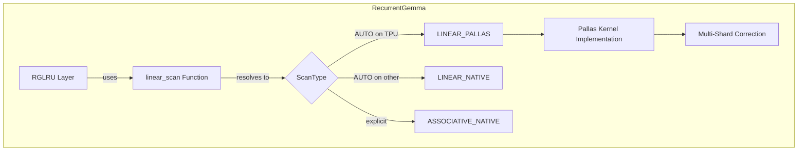
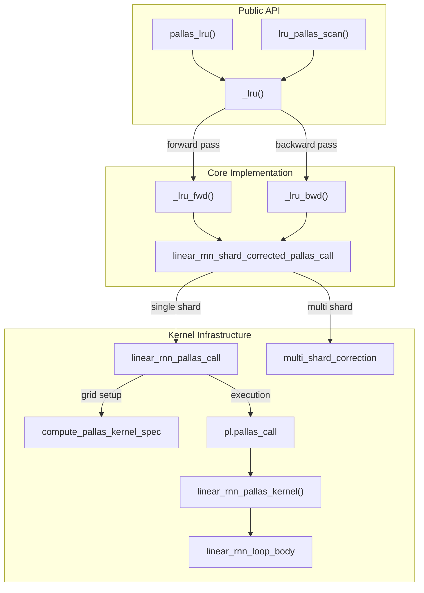
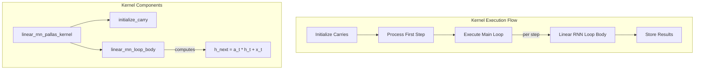
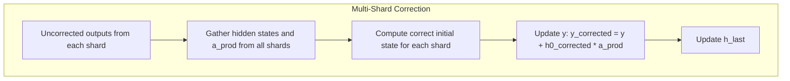
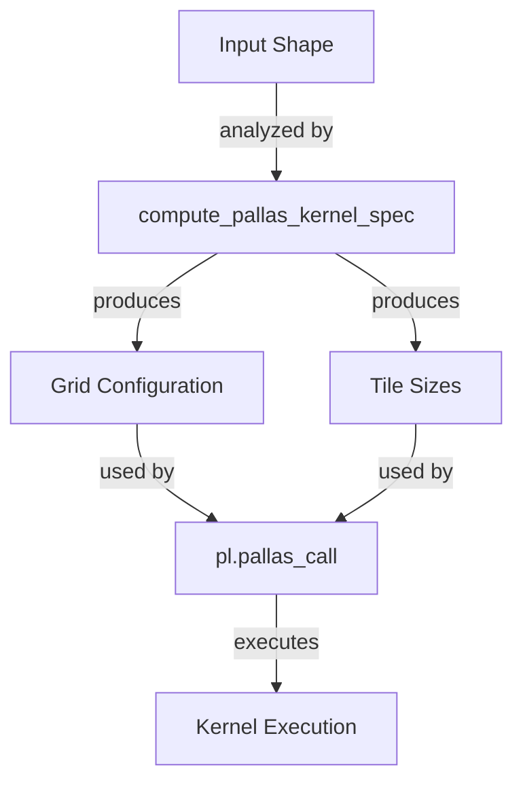
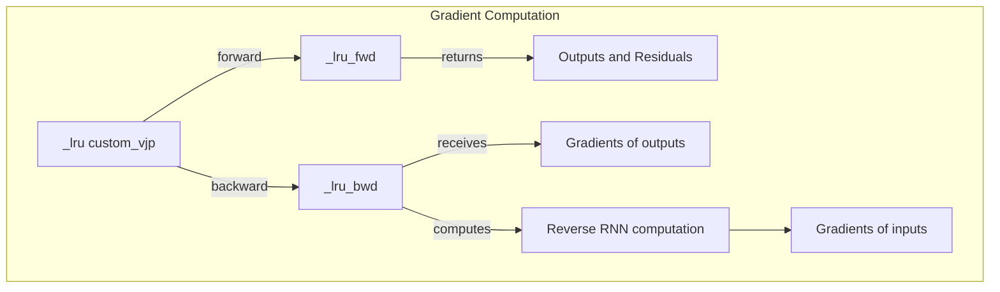

<!-- source: DeepWiki mcp.deepwiki.com · repo google-deepmind/recurrentgemma · page 3.4 Pallas Optimization · fetched 2026-10-26 -->

# Pallas Optimization

Relevant source files

The following files were used as context for generating this wiki page:

- [recurrentgemma/jax/pallas.py](recurrentgemma/jax/pallas.py)

This document describes the specialized TPU optimization using JAX's Pallas framework implemented in RecurrentGemma. Pallas optimization is a critical component for achieving efficient computation in the recurrent components of the model, particularly for the Linear Recurrent Unit (LRU) operations. For information about the recurrent mechanisms themselves, see [Recurrent Components](#3.1).

## 1. Overview and Purpose

Pallas is a low-level programming model for accelerators in JAX that allows for fine-grained control over memory and computation. In RecurrentGemma, Pallas is used to implement highly optimized kernels for linear scan operations, which are essential for efficient processing of long sequences in recurrent components.

The primary purpose of the Pallas optimization is to:

1. Accelerate linear recurrence computation on TPUs
2. Efficiently handle multi-device computation through sharding
3. Support complex number operations required for state-space models
4. Provide efficient gradient computation

Sources: [recurrentgemma/jax/pallas.py:15-16](), [recurrentgemma/jax/pallas.py:844-983]()

## 2. Architecture and Components

The Pallas optimization module consists of several key components that work together to implement efficient linear recurrence:

Sources: [recurrentgemma/jax/pallas.py:844-983](), [recurrentgemma/jax/pallas.py:738-842]()

### 2.1 Component Descriptions

| Component | Description |
|-----------|-------------|
| `pallas_lru` / `lru_pallas_scan` | Public entry points to perform LRU scan using Pallas |
| `_lru` | Core function with custom VJP implementation for gradient computation |
| `linear_rnn_shard_corrected_pallas_call` | Handles execution with shard correction if needed |
| `linear_rnn_pallas_call` | Prepares and executes the Pallas kernel |
| `linear_rnn_pallas_kernel` | The actual Pallas kernel implementation |
| `multi_shard_correction` | Corrects results when computation is sharded across devices |
| `compute_pallas_kernel_spec` | Determines optimal grid configuration for the kernel |

Sources: [recurrentgemma/jax/pallas.py:846-983](), [recurrentgemma/jax/pallas.py:623-736](), [recurrentgemma/jax/pallas.py:348-390]()

## 3. Linear RNN Pallas Kernel

The core of the optimization is the Pallas kernel implementation for linear recurrent neural networks:

Sources: [recurrentgemma/jax/pallas.py:521-590](), [recurrentgemma/jax/pallas.py:487-519]()

The linear RNN kernel performs the following key operations:

1. Initializes carry variables (hidden state and accumulated products)
2. Processes each step of the sequence either forward or backward
3. For each step, computes the recurrence operation: `h_next = a_t * h_t + x_t`
4. Accumulates products of the `a` coefficient when needed for multi-shard correction

The kernel is designed to be highly efficient on TPUs through careful memory access patterns and parallelization.

## 4. Multi-Shard Correction

When running on multiple devices, the sequence is partitioned across devices (shards), requiring a correction mechanism to ensure correct results. The `multi_shard_correction` function implements this.

Sources: [recurrentgemma/jax/pallas.py:71-193]()

The correction process:

1. Gathers the last hidden states and accumulated products from all shards
2. Computes corrected initial states for each shard
3. Updates the output using the formula: `y_corrected = y + h0_corrected * a_prod`
4. Ensures the last hidden state is properly computed

This allows the recurrent computation to be efficiently distributed across multiple TPU devices while maintaining mathematical correctness.

## 5. Kernel Configuration and Optimization

The Pallas kernel's efficiency depends on proper configuration of block sizes and grid layout to match TPU hardware characteristics:

Sources: [recurrentgemma/jax/pallas.py:348-390](), [recurrentgemma/jax/pallas.py:623-680]()

Key optimization aspects:

1. **Adaptive Block Sizing**: The `compute_tile_size` function determines optimal block sizes based on input dimensions and hardware constraints
2. **Hardware-Specific Tuning**: Different configurations for TPUs vs GPUs
3. **Dimension Padding**: Inputs are padded to ensure dimensions are divisible by specific values for optimal performance
4. **Multi-Device Optimization**: Special handling for cases when computation is sharded across multiple devices

## 6. Custom Vector-Jacobian Products (VJPs)

The implementation includes custom VJPs to efficiently compute gradients for the recurrent operation:

Sources: [recurrentgemma/jax/pallas.py:738-842]()

The custom VJP implementation:

1. Forward pass captures intermediate values needed for the backward pass
2. Backward pass implements an efficient algorithm for computing gradients
3. Handles multi-shard correction specifically for gradients
4. Ensures proper handling of complex numbers when computing gradients

## 7. Usage and Configuration

The main entry points for using the Pallas optimization are `pallas_lru` and `lru_pallas_scan` functions, which provide the following configuration options:

| Parameter | Description |
|-----------|-------------|
| `max_seq_block_size` | Maximum sequence block size for Pallas tiling (default: 256) |
| `min_seq_block_size` | Minimum sequence block size for Pallas tiling (default: 16) |
| `pad_seq_to_min_block_size` | Whether to pad sequence to be divisible by min_seq_block_size |
| `pad_last_dim_to_128` | Whether to pad last dimension to be divisible by 128 |
| `seq_axis` | Name of the sequence axis for sharded computation |
| `seq_axis_index_groups` | Index groups for the sequence axis in sharded computation |

Sources: [recurrentgemma/jax/pallas.py:846-983]()

The optimization automatically handles:
- Detection of complex number types and conversion if needed
- Padding sequences to optimal block sizes
- Reversing sequence computation if requested
- Multi-device sharding correction

## Summary

The Pallas optimization in RecurrentGemma provides significant performance improvements for the linear recurrent operations central to the model's architecture. By leveraging JAX's Pallas framework, it implements highly efficient kernels specifically optimized for TPU hardware, with careful handling of multi-device computation, complex numbers, and gradient propagation.

Sources: [recurrentgemma/jax/pallas.py:15-983]()

---

