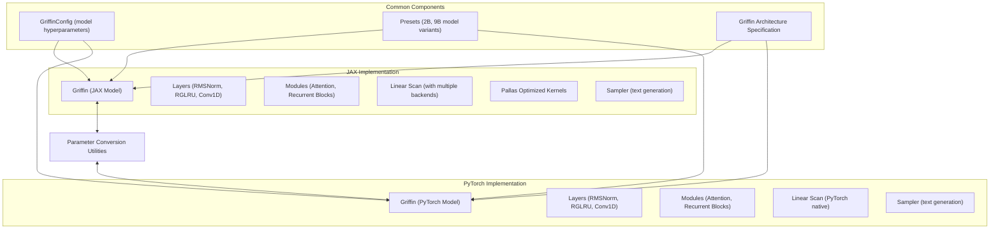
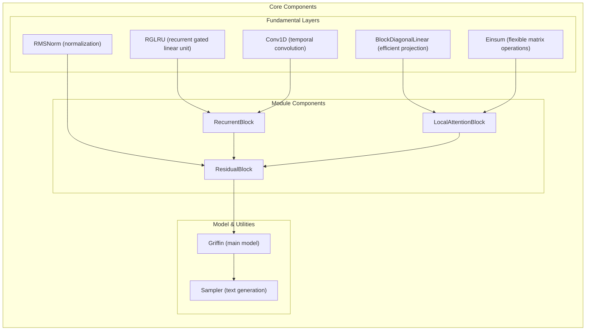

<!-- source: DeepWiki mcp.deepwiki.com · repo google-deepmind/recurrentgemma · page 4 Implementations · fetched 2026-10-26 -->

# Implementations

<details>
<summary>Relevant source files</summary>

The following files were used as context for generating this wiki page:

- [recurrentgemma/jax/__init__.py](recurrentgemma/jax/__init__.py)
- [recurrentgemma/torch/layers_test.py](recurrentgemma/torch/layers_test.py)

</details>


This page provides an overview of the dual implementations of RecurrentGemma: JAX and PyTorch. It describes the high-level architecture of each implementation, their key components, and how they relate to each other. For detailed information about specific implementations, see [JAX Implementation](#4.1), [PyTorch Implementation](#4.2), and [Framework Conversion](#4.3).

## Implementation Strategy

RecurrentGemma is implemented in two major deep learning frameworks:

1. **JAX/Flax Implementation**: The primary, high-performance implementation optimized for TPUs through Pallas kernels.
2. **PyTorch Implementation**: A secondary implementation focused on accessibility and compatibility with the PyTorch ecosystem.

Both implementations share the same model architecture (Griffin) and conceptual components, but differ in their internal implementation details and optimizations.

Sources: [recurrentgemma/jax/__init__.py:15-71]()

## Framework Comparison

The following table summarizes the key differences between the JAX and PyTorch implementations:

| Feature | JAX Implementation | PyTorch Implementation |
|---------|-------------------|------------------------|
| **Primary Focus** | High performance on TPUs | Accessibility and ecosystem compatibility |
| **Optimization** | Pallas kernels for linear scan operations | Native PyTorch operations |
| **Scan Types** | Multiple (LINEAR_PALLAS, LINEAR_NATIVE, ASSOCIATIVE_NATIVE) | Single implementation |
| **Model Coverage** | Complete Griffin architecture | Complete Griffin architecture |
| **Precision Support** | float32, bfloat16 | float32, bfloat16 |
| **Parameter Conversion** | ✓ (export to PyTorch) | ✓ (import from JAX) |

Sources: [recurrentgemma/torch/layers_test.py:15-72]()

## Architecture Overview

Both implementations follow the same fundamental architecture, maintaining feature parity while leveraging framework-specific optimizations.



Sources: [recurrentgemma/jax/__init__.py:15-71](), [recurrentgemma/torch/layers_test.py:15-72]()

## Core Components

Both implementations share the same key components with framework-specific implementations:



Sources: [recurrentgemma/jax/__init__.py:26-65](), [recurrentgemma/torch/layers_test.py:28-238]()

## JAX Implementation

The JAX implementation is the primary, reference implementation of RecurrentGemma, optimized for performance on TPUs.

### Key Features

- **Pallas-optimized kernels**: Custom TPU kernels for maximum performance on linear scan operations
- **Multiple scan implementations**: Support for different scan types (LINEAR_PALLAS, LINEAR_NATIVE, ASSOCIATIVE_NATIVE)
- **Automatic scan type selection**: Depending on hardware capabilities and model configuration
- **Advanced sharding support**: For distributed training and inference
- **Parameter typing**: Supports configuration of parameter precision

The JAX implementation exports the following key components, as defined in [recurrentgemma/jax/__init__.py:46-65]():

```
ScanType
TemporalBlockType
ShardingSpec
linear_scan
BlockDiagonalLinear
RGLRU
Conv1D
RecurrentBlockCache
RecurrentBlock
AttentionBlockCache
LocalAttentionBlock
ResidualBlockCache
ResidualBlock
Preset
GriffinConfig
Griffin
Sampler
load_parameters
```

Sources: [recurrentgemma/jax/__init__.py:15-71]()

## PyTorch Implementation

The PyTorch implementation provides feature parity with the JAX implementation, with a focus on accessibility and integration with the PyTorch ecosystem.

### Key Features

- **Numerically equivalent**: Produces the same outputs as the JAX implementation (within numerical tolerance)
- **Native PyTorch tensors**: Uses PyTorch's native tensor operations
- **Simplified recurrence**: Implemented without the multiple scan backends of the JAX version
- **PyTorch-style API**: Follows PyTorch conventions for module interfaces
- **Direct parameter loading**: Can load parameters from the JAX implementation

### Implementation Equivalence

The PyTorch implementation maintains numerical equivalence with the JAX implementation, as confirmed by comprehensive tests that compare outputs between the two frameworks. These tests, such as those in [recurrentgemma/torch/layers_test.py](), ensure that both implementations produce similar results within acceptable numerical tolerance.

For example, the numerical comparisons include:
- RMSNorm layer [torch/layers_test.py:28-59]()
- BlockDiagonalLinear layer [torch/layers_test.py:62-93]()
- RGLRU layer [torch/layers_test.py:96-133]()
- Conv1D layer [torch/layers_test.py:136-172]()
- Einsum operations [torch/layers_test.py:175-238]()

Sources: [recurrentgemma/torch/layers_test.py:15-240]()

## Framework Interoperability

RecurrentGemma supports conversion of model parameters between JAX and PyTorch implementations, allowing users to train models in one framework and deploy in another. The conversion utilities handle the mapping of parameter names and tensor transformations between the different frameworks' conventions.

For details on how to convert models between frameworks, see the [Framework Conversion](#4.3) page.

## Conclusion

RecurrentGemma provides two complete implementations of the Griffin architecture, each targeting different use cases:

1. The **JAX implementation** serves as the reference implementation with high-performance optimizations for TPUs.
2. The **PyTorch implementation** offers wider accessibility and ecosystem compatibility.

Both implementations are numerically equivalent and maintain full feature parity, allowing users to choose the framework that best suits their needs while accessing the same model capabilities.

---

