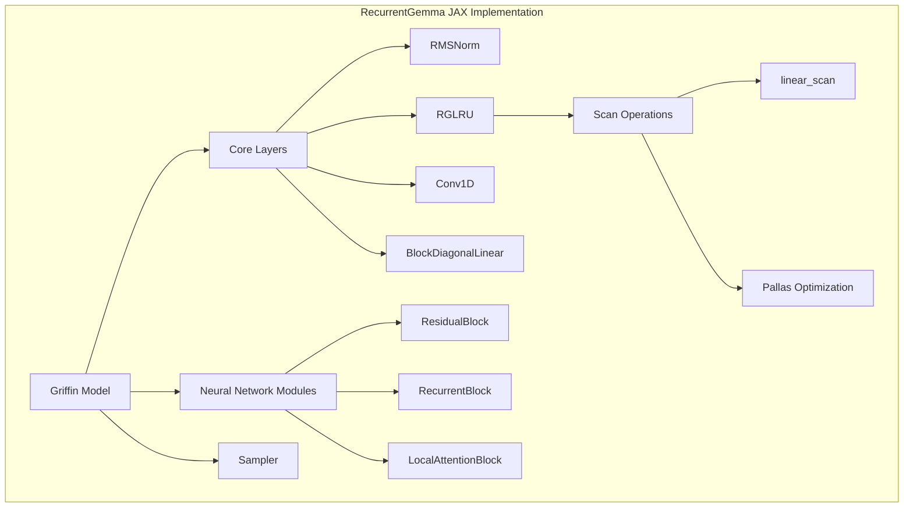
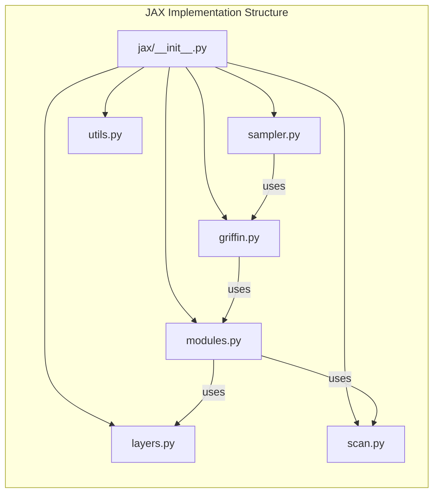
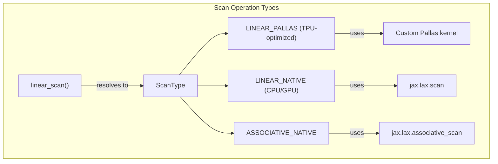
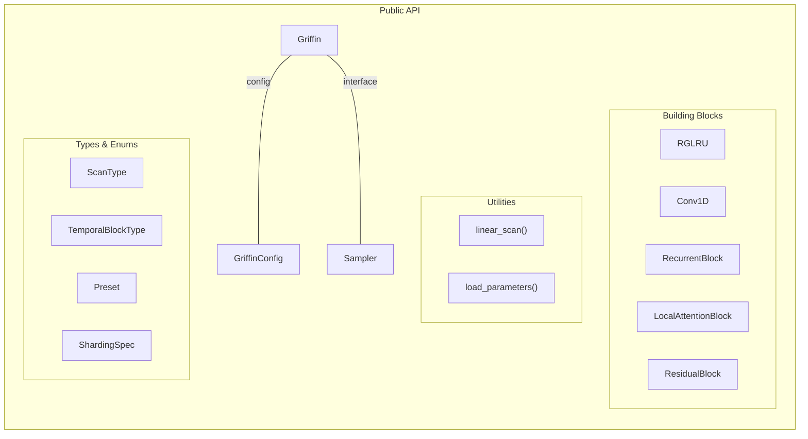

<!-- source: DeepWiki mcp.deepwiki.com · repo google-deepmind/recurrentgemma · page 4.1 JAX Implementation · fetched 2026-10-26 -->

# JAX Implementation

<details>
<summary>Relevant source files</summary>

The following files were used as context for generating this wiki page:

- [examples/simple_run_jax.py](examples/simple_run_jax.py)
- [recurrentgemma/jax/__init__.py](recurrentgemma/jax/__init__.py)

</details>


This page details the primary JAX/Flax implementation of RecurrentGemma, which serves as the reference implementation for the model. For information about the PyTorch implementation, see [PyTorch Implementation](#4.2). For details on converting between the JAX and PyTorch implementations, see [Framework Conversion](#4.3).

## Overview

The JAX implementation of RecurrentGemma provides a high-performance, TPU-optimized version of the Griffin model architecture. It leverages JAX's functional programming paradigm, XLA compilation, and Flax's neural network library to deliver efficient training and inference capabilities.



Sources: [recurrentgemma/jax/__init__.py:15-65]()

## Implementation Structure

The JAX implementation is organized into several key modules that provide the building blocks for the Griffin model architecture.



Sources: [recurrentgemma/jax/__init__.py:17-23]()

## Core Components

### Griffin Model

The `Griffin` class implements the complete RecurrentGemma model. It integrates all the components necessary for text processing and generation, including token embedding, a stack of residual blocks with different temporal block types, and a final normalization layer.

Key features:
- Token embedding with optional position embedding
- Configurable stack of residual blocks
- Support for both attention and recurrent mechanisms
- Efficient caching system for autoregressive generation

### Layers

The JAX implementation includes several specialized neural network layers:

| Layer | Description |
|-------|-------------|
| `RGLRU` | Recurrent Gated Linear Recurrent Unit - the core recurrent mechanism |
| `Conv1D` | One-dimensional convolution layer |
| `BlockDiagonalLinear` | Efficient block-diagonal linear transformation |
| `RMSNorm` | Root Mean Square Layer Normalization |

### Modules

Modules combine multiple layers into functional blocks:

- `RecurrentBlock`: Implements the recurrent processing architecture
- `LocalAttentionBlock`: Implements windowed local attention
- `ResidualBlock`: Wraps either a recurrent or attention block with residual connections and normalization

### Scan Operations

The `linear_scan` function is a critical component that implements the linear recurrence operations used in the RGLRU. It supports multiple scan implementations:



Sources: [recurrentgemma/jax/__init__.py:30-31]()

### Pallas Optimization

The JAX implementation leverages Pallas for TPU-optimized kernels, particularly for efficient linear recurrence operations. These optimizations are crucial for achieving high performance when processing long sequences.

## Public API

The JAX implementation exposes a comprehensive API that allows users to access and utilize all the components of RecurrentGemma.

### Key Classes and Functions



Sources: [recurrentgemma/jax/__init__.py:26-65]()

## Example Usage

The JAX implementation can be used for both model inference and training. Below is an example of how to perform text generation using the JAX implementation.

### Model Initialization

To initialize the Griffin model, you need to create a configuration and then instantiate the model:

```python
# Import the JAX implementation
from recurrentgemma import jax as recurrentgemma

# Create configuration for RecurrentGemma 2B
config = recurrentgemma.GriffinConfig.from_preset(
    vocab_size=256_000,
    preset=recurrentgemma.Preset.RECURRENT_GEMMA_2B_V1,
)

# Initialize the model
model = recurrentgemma.Griffin(config)
```

Sources: [examples/simple_run_jax.py:56-62]()

### Forward Pass (Prefill)

To process a prompt or input sequence, you perform a forward pass which initializes the cache:

```python
# Initialize parameters
rng = jax.random.PRNGKey(seed)
params = model.init(rng, tokens, segment_pos=positions)

# JIT-compile the apply function for better performance
apply_func = jax.jit(model.apply)

# Forward pass (prefill)
logits, cache = apply_func(params, tokens, segment_pos=positions)
```

Sources: [examples/simple_run_jax.py:77-80]()

### Autoregressive Generation

After the initial forward pass, you can generate text token by token in an autoregressive manner:

```python
# Initial position for the new tokens
pos = positions[:, -1:] + 1

# Sample tokens autoregressively
for i in range(num_tokens_to_generate):
    # Sample next token using the logits
    next_token = jax.random.categorical(rng, logits[:, -1])
    
    # Forward pass with cached state
    logits, cache = apply_func(
        params,
        next_token[:, None],
        segment_pos=pos + i,
        cache=cache,
    )
```

Sources: [examples/simple_run_jax.py:84-96]()

## Performance Considerations

The JAX implementation is optimized for TPU performance through several mechanisms:

1. **Pallas-optimized kernels**: Custom implementations of linear recurrence operations that leverage TPU hardware capabilities.

2. **JIT compilation**: All core operations are designed to be JIT-compilable with JAX's `jit` for optimal execution.

3. **Efficient caching**: The implementation includes carefully designed cache data structures for both attention and recurrent blocks to minimize memory usage during autoregressive generation.

4. **Scan operation variants**: Multiple implementation options for linear scans allow for optimal performance across different hardware platforms.

Sources: [recurrentgemma/jax/__init__.py:30-31](), [examples/simple_run_jax.py:79-96]()

## Integration with the Ecosystem

The JAX implementation integrates smoothly with the broader JAX/Flax ecosystem, including:

- **Orbax** for checkpointing and parameter storage
- **Optax** for optimization algorithms (during training)
- **JAX's parallelism primitives** for multi-device training and inference

Sources: [examples/simple_run_jax.py:112-113]()

---

