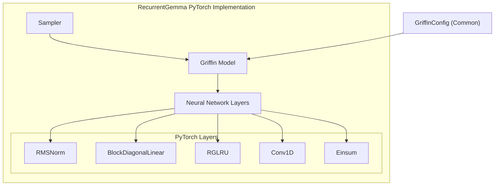
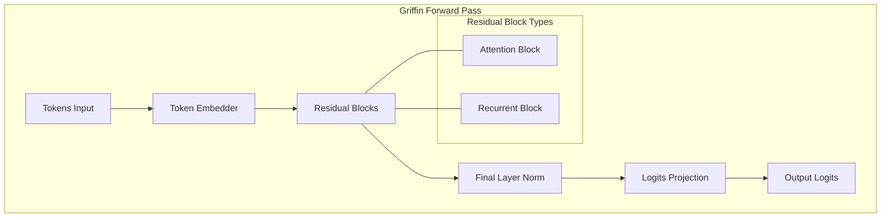
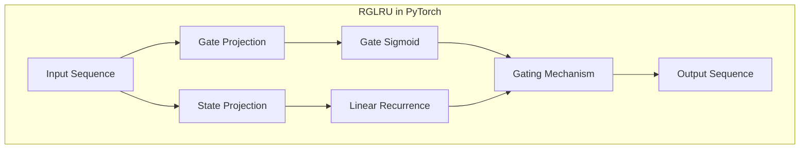
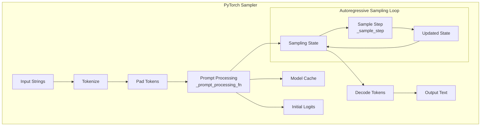
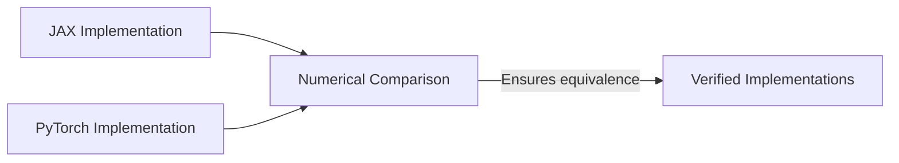

<!-- source: DeepWiki mcp.deepwiki.com · repo google-deepmind/recurrentgemma · page 4.2 PyTorch Implementation · fetched 2026-10-26 -->

# PyTorch Implementation

<details>
<summary>Relevant source files</summary>

The following files were used as context for generating this wiki page:

- [examples/simple_run_pytorch.py](examples/simple_run_pytorch.py)
- [recurrentgemma/torch/layers_test.py](recurrentgemma/torch/layers_test.py)
- [recurrentgemma/torch/sampler.py](recurrentgemma/torch/sampler.py)
- [recurrentgemma/torch/sampler_test.py](recurrentgemma/torch/sampler_test.py)

</details>


This page documents the PyTorch implementation of RecurrentGemma, which serves as a secondary implementation alongside the primary JAX implementation. For details on the JAX implementation, see [JAX Implementation](#4.1).

The PyTorch implementation provides a framework-specific alternative that maintains functional equivalence with the JAX version while leveraging PyTorch's programming model and ecosystem. This implementation is particularly useful for users who prefer PyTorch or need to integrate RecurrentGemma into existing PyTorch-based applications.

## Architecture Overview

The PyTorch implementation mirrors the core architecture of the JAX implementation but is adapted to utilize PyTorch's module hierarchy and execution model. It implements the Griffin model architecture with its recurrent and attention-based blocks, providing equivalent functionality while following PyTorch conventions.



Sources: [recurrentgemma/torch/layers_test.py:19-60](), [recurrentgemma/torch/sampler.py:16-70]()

## Key Components

### Griffin Model

The `Griffin` class is the main model implementation in PyTorch, which follows the same neural network architecture as its JAX counterpart. The model accepts token inputs and segment positions, and can optionally use a cache for efficient autoregressive generation.

Key operations include:
- Token embedding
- Processing through stacked residual blocks (which contain either attention or recurrent blocks)
- Final layer normalization
- Output projection to vocabulary logits



Sources: [examples/simple_run_pytorch.py:60-74]()

### Neural Network Layers

The PyTorch implementation includes the following core layers, which mirror their JAX counterparts:

1. **RMSNorm**: Root Mean Square Normalization layer for stabilizing activations.
2. **BlockDiagonalLinear**: Specialized linear projection layer with block-diagonal structure.
3. **RGLRU**: Recurrent Gated Linear Recurrent Unit, a key innovation in RecurrentGemma that enables efficient processing of long sequences.
4. **Conv1D**: One-dimensional convolution layer for temporal processing.
5. **Einsum**: Flexible layer for Einstein summation operations.

Each layer is implemented to be numerically equivalent to its JAX counterpart, as verified by the test suite.

Sources: [recurrentgemma/torch/layers_test.py:28-238]()

### RGLRU Implementation

The RGLRU (Recurrent Gated Linear Recurrent Unit) is a critical component that enables efficient sequence processing. The PyTorch implementation maintains functional equivalence with the JAX version:



Sources: [recurrentgemma/torch/layers_test.py:96-133]()

## Text Generation with Sampler

The PyTorch implementation includes a `Sampler` class that handles text generation. It supports both the prefill stage (processing the entire prompt at once) and autoregressive generation (token-by-token).



### Sampling Process

The sampling process consists of two main phases:

1. **Prompt Processing**: The input prompt is tokenized, padded, and processed by the model to initialize the cache and generate the first set of logits.

2. **Autoregressive Generation**: Tokens are generated one by one using the model's predictions and the cached state.

Key methods involved:
- `__call__`: Main entry point for sampling
- `_prompt_processing_fn`: Handles the prefill phase
- `_sample_fn`: Manages the autoregressive loop
- `_sample_step`: Generates a single token

Sources: [recurrentgemma/torch/sampler.py:200-336](), [recurrentgemma/torch/sampler.py:363-434]()

### SamplingState

The sampler maintains internal state through the `SamplingState` dataclass, which includes:

| Field | Type | Description |
|-------|------|-------------|
| tokens_buffer | Tensor | Buffer for accumulating output tokens |
| step | Tensor | Current decoding step |
| total_steps | Tensor | Total number of sampling steps |
| positions | Tensor | Position of the latest token in sequence |
| cache | Cache | Model state for conditioning |
| done | Tensor | Whether decoding is complete |
| logits_buffer | Tensor | Buffer for accumulating output logits (optional) |

Sources: [recurrentgemma/torch/sampler.py:33-53]()

## Usage Example

The following is a basic flow for using the PyTorch implementation:

1. **Model Initialization**:
   ```python
   from recurrentgemma import torch as recurrentgemma
   
   # Use preset configuration
   config = recurrentgemma.GriffinConfig.from_preset(
       vocab_size=256_000,
       preset=recurrentgemma.Preset.RECURRENT_GEMMA_2B_V1,
   )
   
   # Create model
   model = recurrentgemma.Griffin(config)
   ```

2. **Text Generation**:
   ```python
   # Initialize sampler with model and vocabulary
   sampler = recurrentgemma.Sampler(model=model, vocab=vocab)
   
   # Generate text
   output = sampler(
       input_strings=["Your prompt here"],
       total_generation_steps=128,
       echo=True,
       return_logits=False,
   )
   
   # Access generated text
   generated_text = output.text[0]
   ```

For a complete example, see the simple run script at [examples/simple_run_pytorch.py]().

Sources: [examples/simple_run_pytorch.py:33-106](), [recurrentgemma/torch/sampler.py:363-434]()

## Implementation Equivalence

The PyTorch implementation maintains numerical equivalence with the JAX implementation. This is enforced through the test suite, which verifies that each layer produces similar outputs when given the same inputs.



The test suite includes numerical comparison tests for:
- RMSNorm
- BlockDiagonalLinear
- RGLRU
- Conv1D
- Einsum

Different tolerance thresholds are used for different data types (e.g., higher tolerance for bfloat16).

Sources: [recurrentgemma/torch/layers_test.py:43-59](), [recurrentgemma/torch/layers_test.py:77-93](), [recurrentgemma/torch/layers_test.py:114-133]()

## Limitations and Differences

While the PyTorch implementation aims to be functionally equivalent to the JAX implementation, there are some differences:

1. The JAX implementation includes optimized Pallas kernels for TPU acceleration, which are not available in the PyTorch version.

2. The scan operation in JAX (used for linear recurrences) has different implementations (LINEAR_PALLAS, LINEAR_NATIVE, ASSOCIATIVE_NATIVE), while the PyTorch implementation uses a more straightforward approach.

3. The PyTorch implementation may have slightly different numerical characteristics due to framework differences, especially when using reduced precision formats like bfloat16.

For applications requiring the highest performance on TPUs, the JAX implementation is recommended. For integration with PyTorch ecosystems or where PyTorch-specific features are needed, the PyTorch implementation provides a compatible alternative.

Sources: [recurrentgemma/torch/layers_test.py:127-132](), [recurrentgemma/torch/sampler_test.py:217-223]()

---

