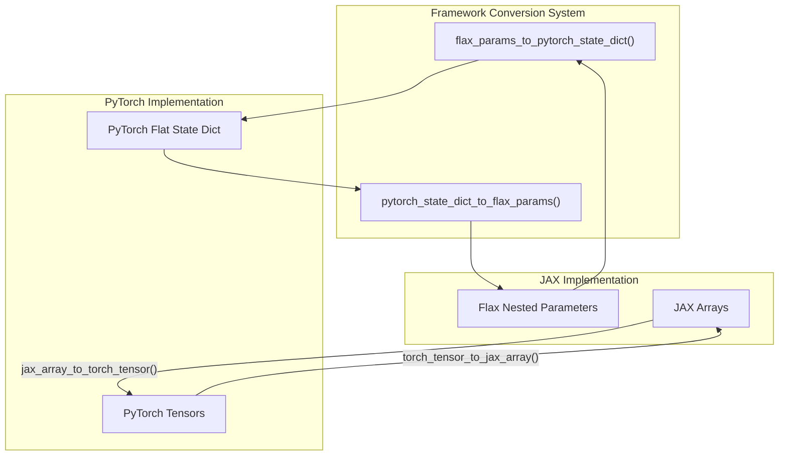
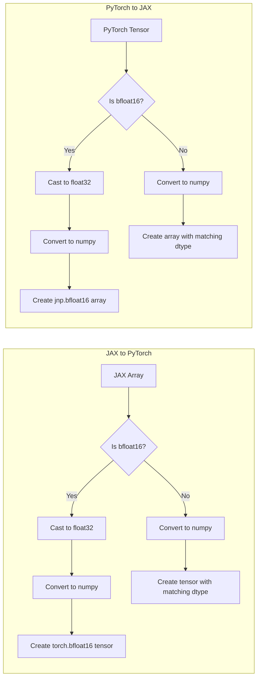
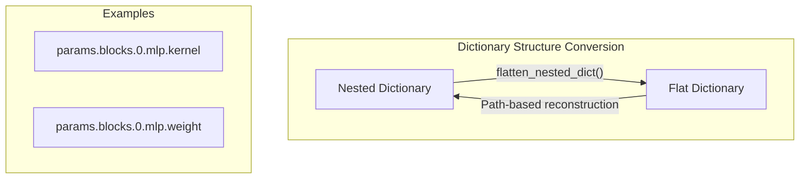
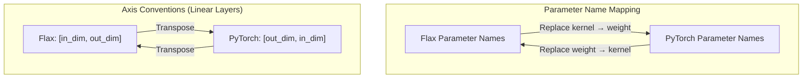
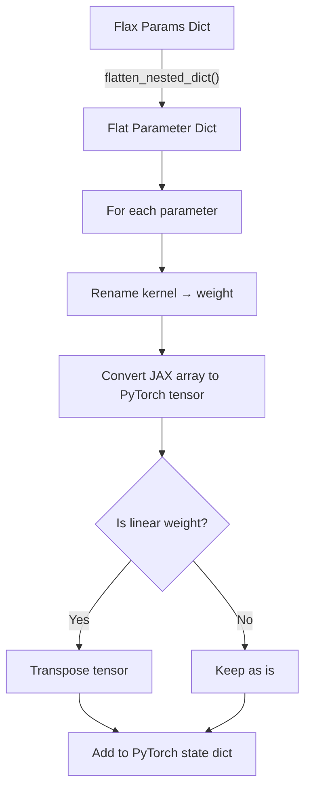
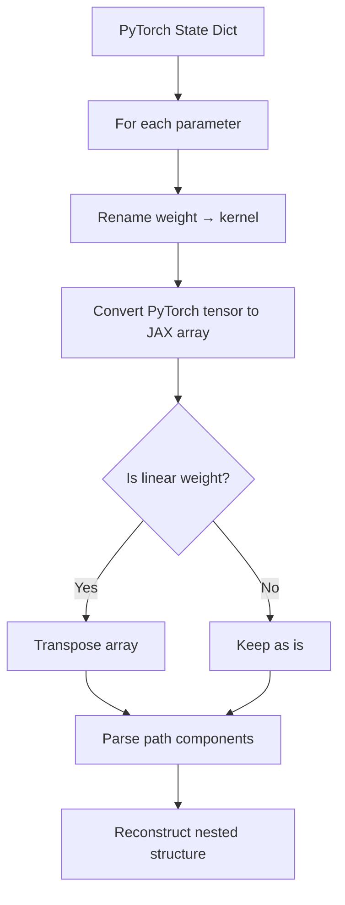

<!-- source: DeepWiki mcp.deepwiki.com · repo google-deepmind/recurrentgemma · page 4.3 Framework Conversion · fetched 2026-10-26 -->

# Framework Conversion

<details>
<summary>Relevant source files</summary>

The following files were used as context for generating this wiki page:

- [recurrentgemma/conversion.py](recurrentgemma/conversion.py)
- [recurrentgemma/conversion_test.py](recurrentgemma/conversion_test.py)

</details>


This document describes the framework conversion system in RecurrentGemma, which enables parameter conversion between the JAX/Flax and PyTorch implementations. For information about the specific implementations themselves, see [JAX Implementation](#4.1) and [PyTorch Implementation](#4.2).

## 1. Overview

RecurrentGemma provides implementations in both JAX/Flax and PyTorch frameworks. To ensure model compatibility and enable users to work in their preferred framework while sharing the same model weights, RecurrentGemma includes a conversion system that handles the translation of parameters between these frameworks.



Sources: [recurrentgemma/conversion.py:15-127]()

## 2. Conversion Components

The conversion system consists of several key components that handle different aspects of the parameter translation process.

### 2.1 Array and Tensor Conversion

At the core of the conversion system are functions that translate between JAX arrays and PyTorch tensors:

- `jax_array_to_torch_tensor`: Converts JAX arrays to PyTorch tensors
- `torch_tensor_to_jax_array`: Converts PyTorch tensors to JAX arrays

These functions handle data type compatibility, with special consideration for bfloat16, which requires additional handling.



Sources: [recurrentgemma/conversion.py:26-46]()

### 2.2 Dictionary Structure Handling

The parameter organization differs between frameworks:
- Flax uses a nested dictionary structure
- PyTorch uses a flat state dictionary

To bridge this gap, the conversion system includes:

- `flatten_nested_dict`: Recursively flattens Flax's nested dictionaries
- Path-based reconstruction for nested dictionaries when converting back to Flax



Sources: [recurrentgemma/conversion.py:49-62](), [recurrentgemma/conversion.py:104-126]()

## 3. Parameter Naming and Axis Conventions

The conversion system addresses differences in parameter naming conventions and tensor layouts between frameworks:

1. **Name Mapping**:
   - JAX/Flax uses `kernel` for weight matrices
   - PyTorch uses `weight` for the same parameters

2. **Axis Conventions**:
   - For linear layers, JAX and PyTorch use different axis orderings
   - Weight matrices are transposed during conversion (except for Conv1D layers)



Sources: [recurrentgemma/conversion.py:72-81](), [recurrentgemma/conversion.py:93-101]()

## 4. Full Conversion Process

### 4.1 JAX to PyTorch Conversion

The `flax_params_to_pytorch_state_dict` function performs the following steps:

1. Flatten the nested Flax parameter dictionary
2. For each parameter:
   - Convert parameter names (replace "kernel" with "weight")
   - Convert JAX arrays to PyTorch tensors
   - Transpose weight matrices for linear layers



Sources: [recurrentgemma/conversion.py:65-83]()

### 4.2 PyTorch to JAX Conversion

The `pytorch_state_dict_to_flax_params` function performs these steps:

1. For each parameter in the PyTorch state dictionary:
   - Convert parameter names (replace "weight" with "kernel")
   - Convert PyTorch tensors to JAX arrays
   - Transpose weight matrices for linear layers
   - Reconstruct the nested Flax structure using the parameter path



Sources: [recurrentgemma/conversion.py:86-127]()

## 5. Usage Example

The conversion system can be used to:
1. Initialize a model in one framework
2. Convert the parameters to the other framework
3. Run the same model with identical parameters in either framework

```python
# Initialize a JAX/Flax model
jax_model = griffin_jax.Griffin(config)
jax_params = jax_model.init(rng, tokens, segment_pos=segment_pos)

# Convert to PyTorch
torch_params = conversion.flax_params_to_pytorch_state_dict(jax_params)

# Load parameters into PyTorch model
torch_model = griffin_torch.Griffin(config)
torch_model.load_state_dict(torch_params)

# Convert back to JAX if needed
jax_params_restored = conversion.pytorch_state_dict_to_flax_params(torch_params)
```

The conversion is lossless, as verified by the conversion test, which ensures parameters can be converted back and forth without changes.

Sources: [recurrentgemma/conversion_test.py:41-81]()

## 6. Framework-Specific Considerations

### 6.1 Data Type Handling

Special attention is given to bfloat16 data type, which is handled differently in JAX and PyTorch:

- When converting bfloat16 JAX arrays to PyTorch, they are temporarily cast to float32 for numpy conversion
- Similarly, bfloat16 PyTorch tensors are temporarily cast to float32 when converting to JAX

### 6.2 Parameter Structure Assumptions

The conversion system makes assumptions about the Griffin model parameter structure:

- Top-level keys in Flax are expected to be `params`
- Second-level keys are expected to be `blocks`, `embedder`, or `final_norm`
- This structure is enforced in the conversion process

```
Flax Parameter Structure:
params
├── blocks
│   ├── 0
│   │   ├── temporal_block
│   │   ├── mlp
│   │   ├── temp_norm
│   │   └── chan_norm
│   ├── 1
│   └── ...
├── embedder
└── final_norm
```

Sources: [recurrentgemma/conversion.py:104-109]()

## 7. Limitations

- The conversion system is specifically designed for the Griffin model architecture
- Custom or modified model architectures may require adjustments to the conversion process
- The system assumes standard parameter naming conventions in both frameworks

---

