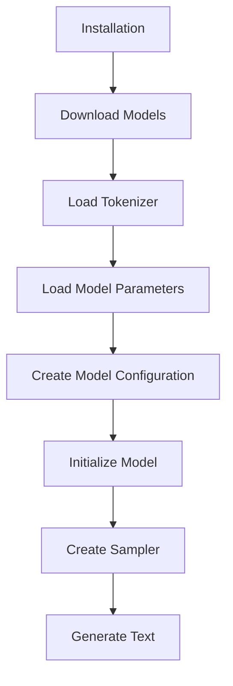
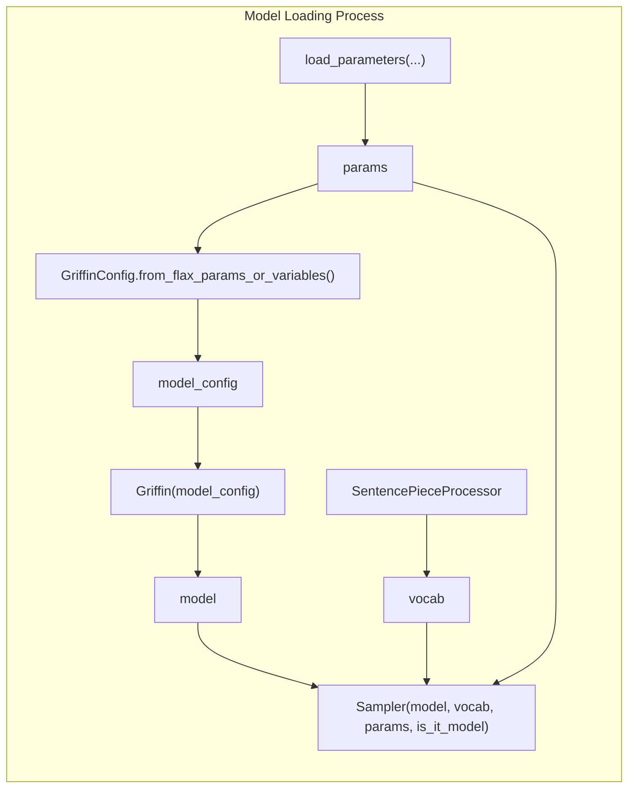
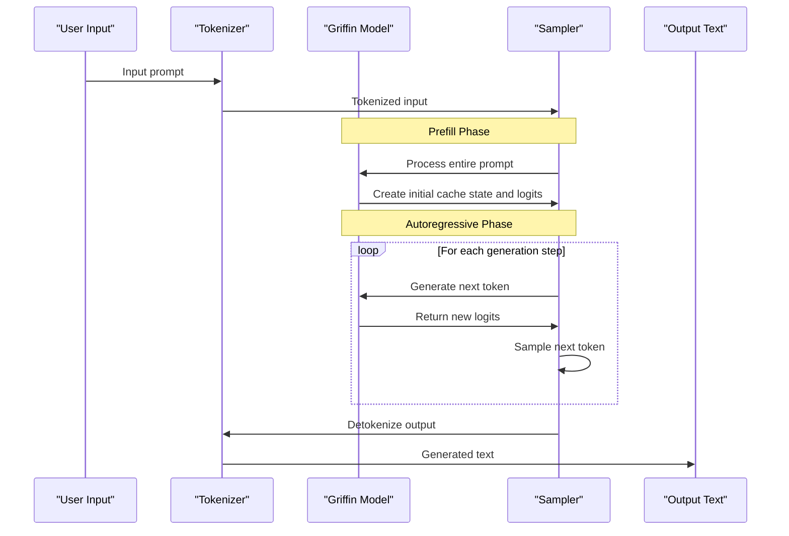

<!-- source: DeepWiki mcp.deepwiki.com · repo google-deepmind/recurrentgemma · page 5 Usage Guide · fetched 2026-10-26 -->

# Usage Guide

<details>
<summary>Relevant source files</summary>

The following files were used as context for generating this wiki page:

- [README.md](README.md)
- [colabs/sampling_tutorial_jax.ipynb](colabs/sampling_tutorial_jax.ipynb)
- [examples/sampling_jax.py](examples/sampling_jax.py)

</details>


## Purpose and Scope

This guide provides instructions for using RecurrentGemma, a family of open-weights Language Models based on the Griffin architecture. It covers the general usage patterns, including loading models and basic operations. For detailed instructions on specific use cases, please refer to:

- [Text Generation (Sampling)](#5.1) for comprehensive guidance on generating text
- [Fine-tuning](#5.2) for instructions on adapting RecurrentGemma to custom tasks
- [Evaluation](#5.3) for methods to benchmark model performance

## Model Overview

RecurrentGemma features multiple model variants in both JAX and PyTorch implementations, with different parameters and training objectives:

| Model Variant | Parameters | Training | Best For |
|---------------|------------|----------|----------|
| 2b            | 2 billion  | Base     | Next-token prediction |
| 2b-it         | 2 billion  | Instruction-tuned | Chat and QA |
| 9b            | 9 billion  | Base     | Next-token prediction |
| 9b-it         | 9 billion  | Instruction-tuned | Chat and QA |

The JAX implementation is highly optimized, especially for TPUs, while the PyTorch implementation is provided primarily for reference.

Sources: [README.md:1-5](), [colabs/sampling_tutorial_jax.ipynb:98-102]()

## Installation and Setup

### Installation Options

RecurrentGemma can be installed using either Poetry or pip:

```bash
# Using Poetry (recommended)
poetry install -E full  # Installs all dependencies
poetry shell            # Activates virtual environment

# Using pip
python -m venv recurrentgemma-demo
. recurrentgemma-demo/bin/activate
pip install .[full]
```

For specific framework implementations:
- JAX only: `poetry install -E jax` or `pip install .[jax]`
- PyTorch only: `poetry install -E torch` or `pip install .[torch]`
- Test dependencies: `poetry install -E test` or `pip install .[test]`

### Model Downloads

Model checkpoints are available through Kaggle at http://kaggle.com/models/google/recurrentgemma. You'll need to:

1. Create a Kaggle account
2. Accept the model license terms
3. Download either the Flax (JAX) or PyTorch model variants

The downloaded archive contains both model weights and the tokenizer.

Sources: [README.md:14-57]()

## Basic Usage Workflow

The typical workflow for using RecurrentGemma follows these steps:



Sources: [examples/sampling_jax.py:15-32](), [colabs/sampling_tutorial_jax.ipynb:38-250]()

## Loading and Initializing Models

### JAX Implementation



The JAX implementation uses the following components:

1. Load parameters from checkpoint:
```python
params = recurrentgemma.load_parameters(ckpt_path, "single_device")
```

2. Load the tokenizer:
```python
vocab = spm.SentencePieceProcessor()
vocab.Load(str(vocab_path))
```

3. Create model configuration:
```python
model_config = recurrentgemma.GriffinConfig.from_flax_params_or_variables(
    params, preset=recurrentgemma.Preset.RECURRENT_GEMMA_2B_V1)
```

4. Initialize the model:
```python
model = recurrentgemma.Griffin(model_config)
```

5. Create a sampler:
```python
sampler = recurrentgemma.Sampler(
    model=model, vocab=vocab, params=params, is_it_model="it" in VARIANT)
```

Note that the `is_it_model` parameter should be set to `True` for instruction-tuned models (those with `-it` in their name).

Sources: [colabs/sampling_tutorial_jax.ipynb:115-220](), [examples/sampling_jax.py:67-78]()

### PyTorch Implementation

The PyTorch implementation follows a similar pattern but uses PyTorch-specific components. For detailed PyTorch usage, refer to the PyTorch sampling tutorial notebook provided in the repository.

Sources: [README.md:78-83]()

## Text Generation

Once the model is loaded and the sampler is created, generating text is straightforward:

```python
input_batch = ["What are the planets of the solar system?"]

# Generate up to 300 tokens
out_data = sampler(input_strings=input_batch, total_generation_steps=300)

# Print results
for input_string, out_string in zip(input_batch, out_data.text):
    print(f"Prompt:\n{input_string}\nOutput:\n{out_string}")
```

The `sampler` function takes the following key parameters:
- `input_strings`: A list of input prompts (batch)
- `total_generation_steps`: Maximum number of tokens to generate

For instruction-tuned models (2b-it, 9b-it), questions and instructions work best. For base models (2b, 9b), the model is trained for next-token prediction and may not respond to instructions as expected.

Sources: [colabs/sampling_tutorial_jax.ipynb:239-249](), [examples/sampling_jax.py:59-85]()

## Generation Pipeline



The text generation process consists of two main phases:
1. **Prefill Phase**: The entire prompt is processed at once to create an initial cache state
2. **Autoregressive Phase**: Tokens are generated one by one

The sampler uses just-in-time compilation, so keeping the batch size consistent between calls is recommended for optimal performance.

Sources: [colabs/sampling_tutorial_jax.ipynb:229-233]()

## Hardware Considerations

RecurrentGemma can run on CPU, GPU, or TPU with the following capabilities:

| Hardware            | T4  | P100 | V100 | A100 | TPUv2 | TPUv3+ |
|---------------------|:---:|:----:|:----:|:----:|:-----:|:------:|
| Sampling in JAX     | ✓   | ✓    | ✓    | ✓    | ✓     | ✓      |
| Sampling in PyTorch | ✓   | ✓    | ✓    | ✓    | ✓     | ✓      |
| Finetuning in JAX   | ✓   | ✓    | ✓    | ✓    | ✗     | ✓      |

The JAX implementation is highly optimized for TPUs, with a low-level [Pallas](https://jax.readthedocs.io/en/latest/pallas/index.html) kernel to efficiently perform the linear scan in recurrent layers.

Sources: [README.md:94-106]()

## Common Usage Patterns

### Command-line Text Generation

The repository includes a sampling example script that can be run from the command line:

```bash
python examples/sampling_jax.py \
  --path_checkpoint=/path/to/archive/contents/2b/ \
  --path_tokenizer=/path/to/archive/contents/tokenizer.model \
  --string_to_sample="What is machine learning?" \
  --total_sampling_steps=256
```

Sources: [README.md:68-75](), [examples/sampling_jax.py:15-32]()

### Interactive Exploration

For interactive exploration, you can use the provided Colab notebooks:
- `colabs/sampling_tutorial_jax.ipynb` - Text generation with JAX
- `colabs/sampling_tutorial_pytorch.ipynb` - Text generation with PyTorch
- `colabs/fine_tuning_tutorial_jax.ipynb` - Fine-tuning example with JAX

These notebooks provide an environment with necessary hardware acceleration and demonstrate the full workflow from loading models to generating text.

Sources: [README.md:77-90]()

## Conclusion

RecurrentGemma offers different usage pathways depending on your needs and preferences. The JAX implementation provides higher performance, especially on TPUs, while the PyTorch implementation offers greater flexibility and accessibility for certain use cases.

For more detailed guidance on specific aspects of using RecurrentGemma, refer to the dedicated wiki pages on [Text Generation](#5.1), [Fine-tuning](#5.2), and [Evaluation](#5.3).

---

