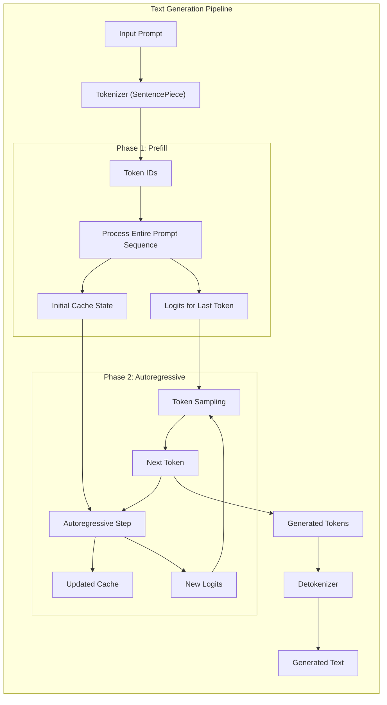

<!-- source: DeepWiki mcp.deepwiki.com · repo google-deepmind/recurrentgemma · page 5.1 Text Generation (Sampling) · fetched 2026-10-26 -->

# Text Generation (Sampling)

<details>
<summary>Relevant source files</summary>

The following files were used as context for generating this wiki page:

- [colabs/sampling_tutorial_jax.ipynb](colabs/sampling_tutorial_jax.ipynb)
- [colabs/sampling_tutorial_pytorch.ipynb](colabs/sampling_tutorial_pytorch.ipynb)
- [examples/sampling_jax.py](examples/sampling_jax.py)
- [examples/sampling_pytorch.py](examples/sampling_pytorch.py)

</details>


This page describes the text generation (sampling) capabilities of RecurrentGemma, explaining how to generate text using both the JAX and PyTorch implementations. It covers loading models, setting up samplers, and running the text generation process.

## Text Generation Overview

RecurrentGemma's text generation process follows a two-phase approach common in modern language models, but with optimizations specific to its recurrent architecture.



The text generation process:

1. **Prefill Phase**: Process the entire input prompt at once, generating:
   - The initial cache state (storing recurrent states and attention key-values)
   - Logits for the last token of the input

2. **Autoregressive Phase**: For each generation step:
   - Sample the next token from the logits
   - Process only this new token while using the cached state
   - Update the cache and generate new logits
   - Repeat until completion or reaching the maximum generation steps

Sources: [colabs/sampling_tutorial_jax.ipynb:229-249](), [colabs/sampling_tutorial_pytorch.ipynb:229-249]()

## Sampler Component

The `Sampler` class is the central component for text generation in RecurrentGemma, handling the entire process from tokenization to output generation.

```mermaid
classDiagram
    class "Sampler" {
        -model: Griffin
        -vocab: SentencePieceProcessor
        -params: Parameters (JAX)
        -is_it_model: bool
        +__call__(input_strings, total_generation_steps): SamplerOutput
    }
    
    class "SamplerOutput" {
        +text: List[str]
        +tokens: List[List[int]]
    }
    
    "Sampler" --> "Griffin" : uses
    "Sampler" --> "SentencePieceProcessor" : uses for tokenization
    "Sampler" ..> "SamplerOutput" : produces
```

Key features of the Sampler:
- Handles tokenization and detokenization
- Manages the prefill and autoregressive phases
- Implements the token sampling logic
- Returns both the generated text and token IDs

Sources: [examples/sampling_jax.py:78-86](), [examples/sampling_pytorch.py:82-89]()

## Sampling with JAX

### Setup and Initialization

```python
# Load parameters
params = recurrentgemma.load_parameters(checkpoint_path, "single_device")

# Load tokenizer
vocab = spm.SentencePieceProcessor()
vocab.Load(tokenizer_path)

# Create model configuration and initialize model
model_config = recurrentgemma.GriffinConfig.from_flax_params_or_variables(
    params, preset=recurrentgemma.Preset.RECURRENT_GEMMA_2B_V1)
model = recurrentgemma.Griffin(model_config)

# Create sampler
sampler = recurrentgemma.Sampler(model=model, vocab=vocab, params=params, is_it_model=is_it_model)
```

### Generating Text

```python
# Define input prompts
input_batch = ["What are the planets of the solar system?"]

# Generate text with specified number of steps
output = sampler(input_strings=input_batch, total_generation_steps=300)

# Access generated text
for input_string, output_string in zip(input_batch, output.text):
    print(f"Input: {input_string}")
    print(f"Output: {output_string}")
```

Sources: [colabs/sampling_tutorial_jax.ipynb:113-249](), [examples/sampling_jax.py:59-85]()

## Sampling with PyTorch

### Setup and Initialization

```python
# Load parameters
device = "cuda" if torch.cuda.is_available() else "cpu"
params = torch.load(checkpoint_path)
params = {k: v.to(device=device) for k, v in params.items()}

# Load tokenizer
vocab = spm.SentencePieceProcessor()
vocab.Load(tokenizer_path)

# Create model configuration and initialize model
model_config = recurrentgemma.GriffinConfig.from_torch_params(
    params, preset=recurrentgemma.Preset.RECURRENT_GEMMA_2B_V1)
model = recurrentgemma.Griffin(model_config, device=device, dtype=torch.bfloat16)
model.load_state_dict(params)

# Create sampler
sampler = recurrentgemma.Sampler(model=model, vocab=vocab, is_it_model=is_it_model)
```

### Generating Text

```python
# Define input prompts
input_batch = ["What are the planets of the solar system?"]

# Generate text with specified number of steps
output = sampler(input_strings=input_batch, total_generation_steps=300)

# Access generated text
for input_string, output_string in zip(input_batch, output.text):
    print(f"Input: {input_string}")
    print(f"Output: {output_string}")
```

Sources: [colabs/sampling_tutorial_pytorch.ipynb:113-257](), [examples/sampling_pytorch.py:60-89]()

## Sampler Implementation Details

The Sampler implementation combines several key components to efficiently generate text:

```mermaid
flowchart TD
    subgraph "Sampler Internal Flow"
        Call["sampler(input_strings, total_generation_steps)"] --> Tokenize["Tokenize inputs"]
        Tokenize --> PrepareInputs["Prepare model inputs"]
        PrepareInputs --> Prefill["Run prefill phase"]
        Prefill --> InitLoop["Initialize generation loop"]
        
        InitLoop --> AutoregLoop["For each generation step"]
        AutoregLoop --> SampleToken["Sample next token"]
        SampleToken --> UpdateState["Update cache state"]
        UpdateState --> CheckEOS["Check for EOS token"]
        CheckEOS -->|"Not EOS and\nsteps remaining"| AutoregLoop
        CheckEOS -->|"EOS or max steps\nreached"| Detokenize["Detokenize outputs"]
        
        Detokenize --> CreateOutput["Create SamplerOutput"]
    end
```



Key implementation details:
- **Model Presets**: Supports different model variants (2B, 9B)
- **Instruction Tuning Detection**: The `is_it_model` parameter indicates if the model is instruction-tuned, affecting prompt formatting
- **Efficient Caching**: Maintains and updates cache state for efficient autoregressive generation
- **JIT Compilation**: Takes advantage of JAX's just-in-time compilation for performance

Sources: [examples/sampling_jax.py:59-86](), [examples/sampling_pytorch.py:60-90]()

## Model Variants and Checkpoints

RecurrentGemma offers several model variants with different capabilities:

| Variant | Size | Instruction Tuned | Best For |
|---------|------|-------------------|----------|
| 2b      | 2B   | No                | Next token prediction |
| 2b-it   | 2B   | Yes               | Chat and Q&A |
| 9b      | 9B   | No                | Next token prediction |
| 9b-it   | 9B   | Yes               | Chat and Q&A |

When using a model for text generation, it's important to select the appropriate variant:
- For chat applications or question answering, the instruction-tuned models (with `-it` suffix) perform better
- For pure text completion tasks, the base models may be suitable

Sources: [colabs/sampling_tutorial_jax.ipynb:102-103](), [colabs/sampling_tutorial_pytorch.ipynb:102-103]()

## Performance Considerations

For optimal performance when using the Sampler:

1. **Consistent Batch Size**: Keep the batch size consistent to avoid recompilation in JIT-compiled code
2. **Device Placement**: 
   - JAX: Parameters are automatically placed on the appropriate device
   - PyTorch: Explicitly move parameters to the target device (CPU/CUDA)
3. **Precision**: The models use `bfloat16` precision for efficiency
4. **Generation Length**: Setting an appropriate `total_generation_steps` value balances output quality and computational cost

Sources: [colabs/sampling_tutorial_jax.ipynb:237-238](), [colabs/sampling_tutorial_pytorch.ipynb:237-238]()

## Practical Example

Here's a complete example of loading a model and generating text:

```python
# For JAX implementation:
import pathlib
import sentencepiece as spm
from recurrentgemma import jax as recurrentgemma

# Download or locate checkpoint and tokenizer
weights_dir = pathlib.Path("/path/to/weights")
ckpt_path = weights_dir / "2b-it"
vocab_path = weights_dir / "tokenizer.model"

# Load parameters and tokenizer
params = recurrentgemma.load_parameters(ckpt_path, "single_device")
vocab = spm.SentencePieceProcessor()
vocab.Load(str(vocab_path))

# Initialize model
model_config = recurrentgemma.GriffinConfig.from_flax_params_or_variables(
    params, preset=recurrentgemma.Preset.RECURRENT_GEMMA_2B_V1)
model = recurrentgemma.Griffin(model_config)

# Create sampler and generate text
sampler = recurrentgemma.Sampler(model=model, vocab=vocab, params=params, is_it_model=True)
input_text = "What are the planets of the solar system?"
output = sampler(input_strings=[input_text], total_generation_steps=300)
print(output.text[0])
```

Sources: [colabs/sampling_tutorial_jax.ipynb:129-249]()

---

