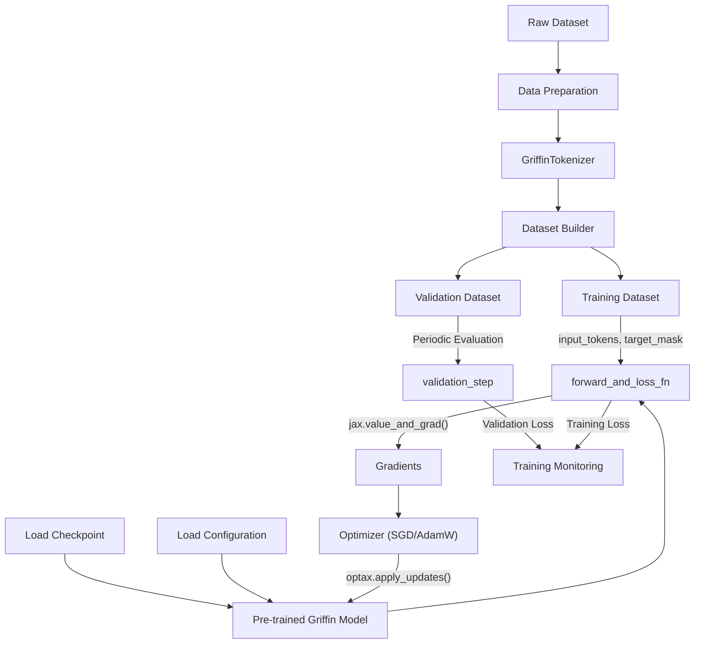
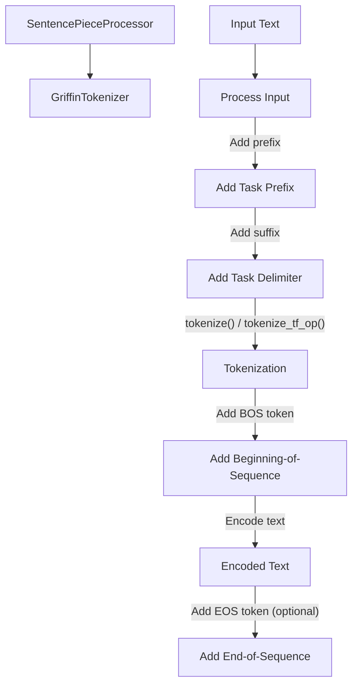
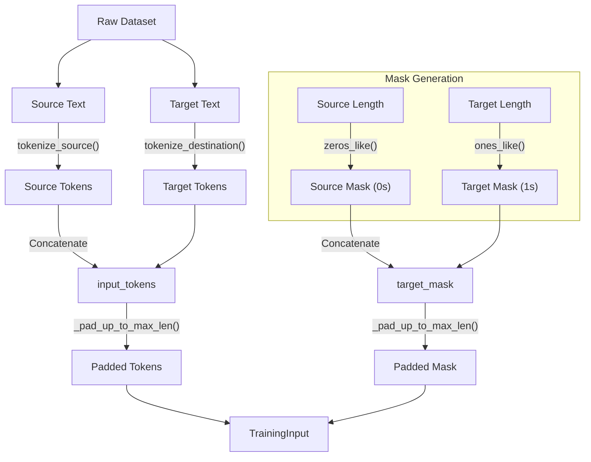
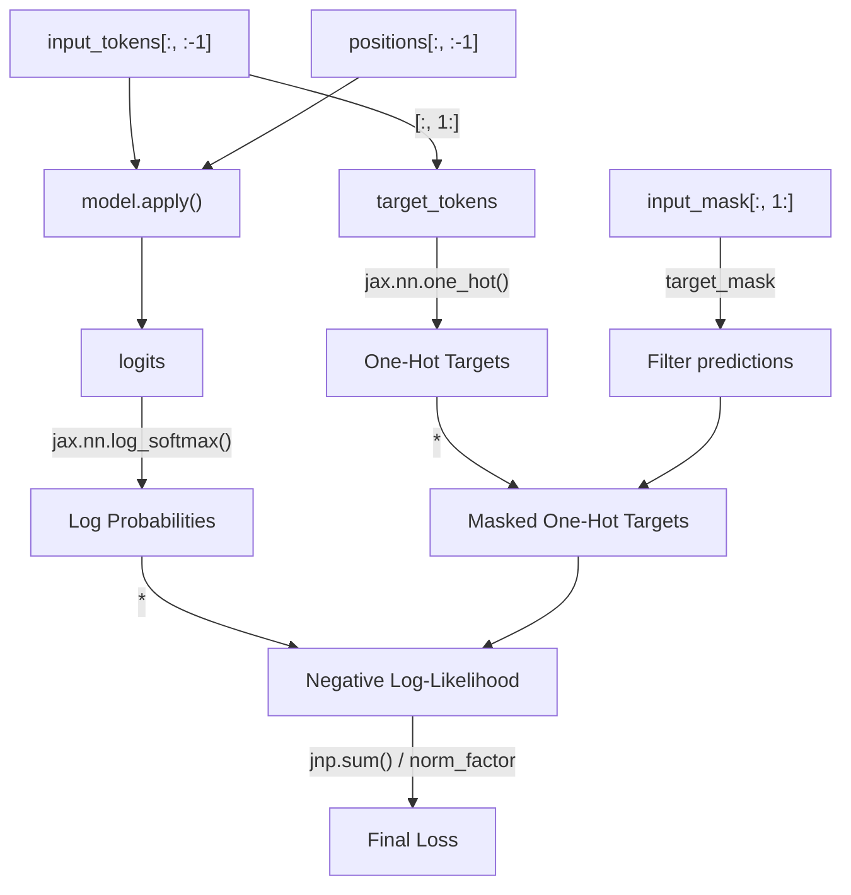
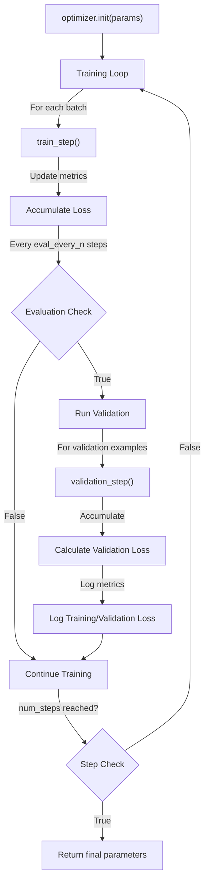

<!-- source: DeepWiki mcp.deepwiki.com · repo google-deepmind/recurrentgemma · page 5.2 Fine-tuning · fetched 2026-10-26 -->

# Fine-tuning

<details>
<summary>Relevant source files</summary>

The following files were used as context for generating this wiki page:

- [colabs/fine_tuning_tutorial_jax.ipynb](colabs/fine_tuning_tutorial_jax.ipynb)

</details>


This document provides detailed instructions for fine-tuning RecurrentGemma models on custom datasets using JAX. Fine-tuning enables you to adapt pre-trained RecurrentGemma models to specific tasks such as translation, summarization, or domain-specific text generation. For information about using already trained models for text generation, see [Text Generation (Sampling)](#5.1). For methods to evaluate model performance, see [Evaluation](#5.3).

## Fine-tuning Workflow

Fine-tuning RecurrentGemma involves several key components working together to adapt a pre-trained model to new tasks.



Sources: [colabs/fine_tuning_tutorial_jax.ipynb:627-673](), [colabs/fine_tuning_tutorial_jax.ipynb:694-747](), [colabs/fine_tuning_tutorial_jax.ipynb:801-856]()

## Data Preparation

### Tokenization

RecurrentGemma uses a SentencePiece tokenizer that must be appropriately wrapped for fine-tuning tasks. The tutorial implements a `GriffinTokenizer` class that adds functionality specific to fine-tuning:



Sources: [colabs/fine_tuning_tutorial_jax.ipynb:246-300]()

### Dataset Structure

Fine-tuning requires a proper dataset structure. The key data structure is the `TrainingInput` dataclass which contains:

1. `input_tokens`: The tokenized sequence fed to the model
2. `target_mask`: A boolean mask indicating which tokens should contribute to the loss calculation

For tasks like translation, the input tokens consist of both the source text (with a task-specific prefix) and the target translation, while the target mask is set to `0` for source tokens and `1` for target tokens.



Sources: [colabs/fine_tuning_tutorial_jax.ipynb:366-490]()

## Model Configuration and Loading

Loading a pre-trained model for fine-tuning involves these steps:

1. Download a checkpoint from a model repository
2. Load the model parameters
3. Create a Griffin configuration from those parameters
4. Instantiate the Griffin model

```python
# Load parameters
params = recurrentgemma.load_parameters(ckpt_path, "single_device")
config = recurrentgemma.GriffinConfig.from_flax_params_or_variables(
    params,
    preset=recurrentgemma.Preset.RECURRENT_GEMMA_2B_V1,
)
model = recurrentgemma.Griffin(config)
```

Sources: [colabs/fine_tuning_tutorial_jax.ipynb:542-550]()

## Forward Pass and Loss Calculation

The forward pass and loss calculation function is the core of fine-tuning:



The key aspects of this process include:
- Token shifting: Using `[:-1]` for input and `[1:]` for targets creates the next-token prediction task
- Target masking: Using the `target_mask` ensures the model only learns from specific tokens (e.g., only the translation portion)
- Cross-entropy loss: Calculating the negative log-likelihood between predictions and targets

Sources: [colabs/fine_tuning_tutorial_jax.ipynb:628-673]()

## Training and Validation Steps

The training and validation steps are implemented as JIT-compiled functions for efficiency:

### Training Step
- Takes the model, parameters, optimizer, optimizer state, and training example
- Computes positions for the input tokens
- Performs forward pass and computes gradients in a single operation
- Updates parameters using the optimizer
- Returns the loss, updated parameters, and updated optimizer state

### Validation Step
- Similar to the training step but only computes the loss without gradients or parameter updates
- Used for monitoring model performance on validation data

Sources: [colabs/fine_tuning_tutorial_jax.ipynb:694-747](), [colabs/fine_tuning_tutorial_jax.ipynb:767-780]()

## Optimizer Selection

RecurrentGemma supports different optimizers for fine-tuning, each with different trade-offs:

| Optimizer | Memory Usage | Convergence Speed | Best For |
|-----------|--------------|-------------------|----------|
| SGD       | Low          | Slower            | Memory-constrained devices (T4 GPU) |
| AdamW     | High         | Faster            | Higher memory devices, better results |

A custom weight decay mask is implemented to exclude certain parameters from regularization:

```python
def griffin_weight_decay_mask(params_like: optax.Params) -> Any:
  # Don't apply weight decay to RGLRU, embeddings, and any biases
  def enable_weight_decay(path: list[Any], _: Any) -> bool:
    path = [dict_key.key for dict_key in path]
    if 'rg_lru' in path or 'embedder' in path:
      return False
    if path[-1] in ('b', 'scale'):
      return False
    return True
  
  return jax.tree_util.tree_map_with_path(enable_weight_decay, params_like)
```

Sources: [colabs/fine_tuning_tutorial_jax.ipynb:876-905]()

## Training Loop

The training loop coordinates the entire fine-tuning process:



Sources: [colabs/fine_tuning_tutorial_jax.ipynb:801-856]()

## Example: Translation Task

The fine-tuning tutorial demonstrates adapting the 2B Griffin model for English to French translation using the MTNT dataset.

### Task-Specific Prompt Formatting

For translation, the input is formatted with a specific prefix and suffix:
```
Translate this into French:
[English text]
```

The expected output is the French translation. The target mask ensures the model only learns to predict the French translation tokens, not the English prompt.

### Recommended Hyperparameters

| Parameter | SGD Value | AdamW Value |
|-----------|-----------|-------------|
| Learning Rate | 1e-3 | 1e-4 |
| Batch Size | 1-8 | 1-8 |
| Sequence Length | 32-128 | 32-128 |
| Training Steps | ~300 | ~100 |
| Weight Decay | N/A | 0.1 |

Sources: [colabs/fine_tuning_tutorial_jax.ipynb:890-905](), [colabs/fine_tuning_tutorial_jax.ipynb:924-944]()

## Performance and Memory Considerations

- For memory-constrained environments:
  - Use SGD instead of AdamW
  - Reduce batch size and sequence length
  - Consider gradient accumulation (not implemented in the tutorial)

- For optimal performance:
  - Use AdamW with appropriate weight decay masking
  - Increase batch size if memory allows
  - Monitor validation loss to prevent overfitting

Sources: [colabs/fine_tuning_tutorial_jax.ipynb:876-905]()

## Complete Fine-tuning Pipeline

The complete fine-tuning pipeline can be summarized as:

1. **Setup**:
   - Load the tokenizer and pre-trained model
   - Configure the optimizer
   - Create dataset builders for training and validation

2. **Data Processing**:
   - Format examples with appropriate task-specific prefixes/suffixes
   - Tokenize inputs and targets
   - Create target masks to focus learning on specific tokens
   - Batch and pad sequences

3. **Training Loop**:
   - Perform training steps with forward pass, loss calculation, and parameter updates
   - Periodically evaluate on validation data
   - Monitor training and validation loss
   - Return the fine-tuned parameters

4. **Evaluation**:
   - Test the fine-tuned model on new examples
   - Compare performance to the pre-fine-tuned model

Sources: [colabs/fine_tuning_tutorial_jax.ipynb:801-856](), [colabs/fine_tuning_tutorial_jax.ipynb:992-998]()

---

