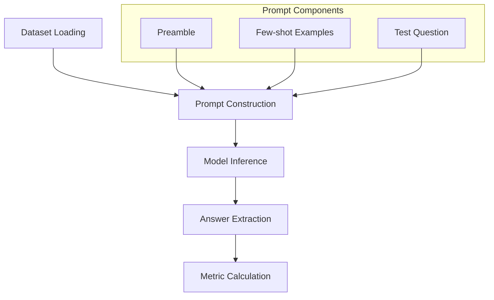
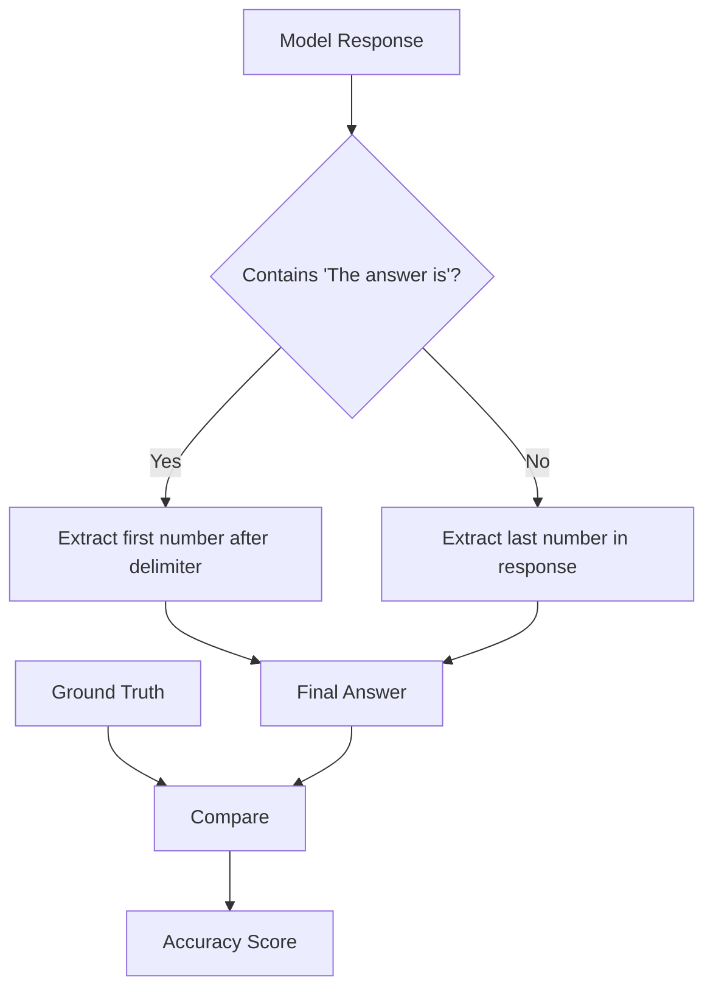
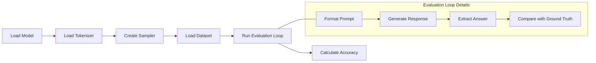

<!-- source: DeepWiki mcp.deepwiki.com · repo google-deepmind/recurrentgemma · page 5.3 Evaluation · fetched 2026-10-26 -->

# Evaluation

<details>
<summary>Relevant source files</summary>

The following files were used as context for generating this wiki page:

- [colabs/gsm8k_eval.ipynb](colabs/gsm8k_eval.ipynb)

</details>


This document provides a comprehensive guide to evaluating RecurrentGemma models on standard benchmarks. It covers methods to assess model performance, available benchmarks, and practical instructions for running evaluations. For information about fine-tuning RecurrentGemma models, see [Fine-tuning](#5.2).

## Evaluation Benchmarks

RecurrentGemma can be evaluated on various benchmarks to assess its capabilities. This section outlines the supported benchmarks and why they're useful for evaluating model performance.

### GSM8K (Grade School Math)

The [GSM8K dataset](https://arxiv.org/pdf/2110.14168.pdf) provides a good evaluation challenge for small models for several reasons:

1. **Conceptual Simplicity:** Problems involve elementary mathematical concepts and basic arithmetic operations accessible to smaller models
2. **Linguistic Diversity:** Problems are varied rather than simple templates, forcing models to generalize
3. **Moderate Difficulty:** Problems are challenging enough to test model capabilities without being intractable 
4. **Natural Language Solutions:** Solutions are in natural language, testing verbal analytical skills

RecurrentGemma-2B is reported to achieve a 19.33% accuracy score on GSM8K.

Sources: [colabs/gsm8k_eval.ipynb:26-38]()

## Evaluation Methodology

The evaluation process involves several key components that are consistent across different benchmarks:



Sources: [colabs/gsm8k_eval.ipynb:156-251](), [colabs/gsm8k_eval.ipynb:348-389]()

### Prompt Construction

For evaluations, prompts typically consist of:

1. **Preamble** - A task description that sets the context
2. **Few-shot examples** - Demonstrations to guide the model's approach
3. **Test question** - The actual problem to solve

For GSM8K, the prompt structure follows:

```
[Preamble]
As an expert problem solver solve step by step the following mathematical questions.

[Few-shot examples]
Q: There are 15 trees in the grove...
A: We start with 15 trees...

[More examples...]

[Test question]
Q: {actual_question}
A:
```

Sources: [colabs/gsm8k_eval.ipynb:222-251](), [colabs/gsm8k_eval.ipynb:355-357]()

### Answer Extraction

For benchmarks like GSM8K that require numerical answers, RegEx-based extraction techniques are used to find the final answer in the model's response.



Utilities are provided for:
- Extracting all numbers from a string
- Finding the most relevant number (typically the final answer)
- Removing formatting characters (like commas in large numbers)

Sources: [colabs/gsm8k_eval.ipynb:180-211]()

## Running Evaluations

### Evaluating on GSM8K

The following steps outline the process to evaluate RecurrentGemma models on the GSM8K benchmark:



#### Installation Requirements

To run evaluations, you'll need:
- RecurrentGemma library (JAX version for best performance)
- Access to model weights (via Kaggle)
- Datasets library for loading benchmark datasets

Sources: [colabs/gsm8k_eval.ipynb:51-61]()

#### Loading the Model

The evaluation requires loading the model parameters, tokenizer, and creating a sampler:

```python
# Load parameters
params = recurrentgemma.load_parameters(ckpt_path, 'single_device')

# Load tokenizer
vocab = spm.SentencePieceProcessor()
vocab.Load(str(vocab_path))

# Create sampler
model_config = recurrentgemma.GriffinConfig.from_flax_params_or_variables(
    params, preset=recurrentgemma.Preset.RECURRENT_GEMMA_2B_V1)
model = recurrentgemma.Griffin(model_config)
sampler = recurrentgemma.Sampler(model=model, vocab=vocab, params=params)
```

Sources: [colabs/gsm8k_eval.ipynb:269-327]()

#### Evaluation Loop

The evaluation loop processes each problem in the test set:
1. Format the full prompt with preamble, few-shot examples, and the test question
2. Run the model inference to generate a response
3. Extract the numerical answer from the response
4. Compare with the ground truth answer
5. Calculate overall accuracy

Sources: [colabs/gsm8k_eval.ipynb:348-389]()

## Performance Baselines

RecurrentGemma models have been evaluated on GSM8K with the following reported results:

| Model | GSM8K Accuracy |
|-------|----------------|
| RecurrentGemma-2B | 19.33% |

These baselines provide a reference point for comparing model variants and measuring improvements through fine-tuning or prompt engineering.

Sources: [colabs/gsm8k_eval.ipynb:337-338]()

## Customizing Evaluations

You can customize evaluations by:
1. Modifying the prompt format and few-shot examples
2. Changing sampling parameters (temperature, top-p, etc.)
3. Developing custom answer extraction techniques for specific benchmarks

For math-oriented benchmarks like GSM8K, providing explicit instructions to "solve step by step" and including well-formatted few-shot examples are crucial for good performance.

Sources: [colabs/gsm8k_eval.ipynb:222-251]()

---

