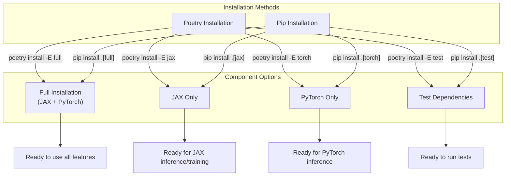
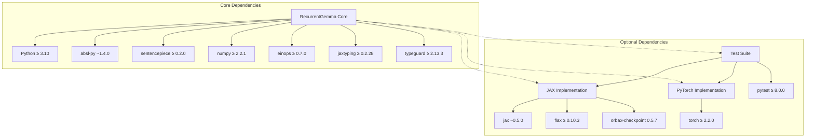

<!-- source: DeepWiki mcp.deepwiki.com · repo google-deepmind/recurrentgemma · page 6.1 Installation · fetched 2026-10-26 -->

# Installation

<details>
<summary>Relevant source files</summary>

The following files were used as context for generating this wiki page:

- [LICENSE](LICENSE)
- [README.md](README.md)
- [pyproject.toml](pyproject.toml)

</details>


This document provides detailed instructions for installing RecurrentGemma and its dependencies. It covers multiple installation methods, component-specific installations, and how to download the model weights. For information on using RecurrentGemma after installation, see [Usage Guide](#5) and its subsections.

## System Requirements

RecurrentGemma can run on CPU, GPU, or TPU hardware. The codebase has been specifically optimized for TPU using the Flax implementation, which includes a low-level Pallas kernel for efficient linear scanning in recurrent layers.

The minimum requirements include:
- Python 3.10 or later
- Sufficient memory to load the model weights (varies by model size)
- For GPU usage: CUDA-compatible hardware
- For TPU usage: TPU v2/v3/v4 hardware

### Hardware Compatibility

The following table summarizes the hardware compatibility for different use cases:

| Hardware            | T4  | P100 | V100 | A100 | TPUv2 | TPUv3+ |
|---------------------|:---:|:----:|:----:|:----:|:-----:|:------:|
| Sampling in JAX     | ✓   | ✓    | ✓    | ✓    | ✓     | ✓     |
| Sampling in PyTorch | ✓   | ✓    | ✓    | ✓    | ✓     | ✓     |
| Finetuning in JAX   | ✓   | ✓    | ✓    | ✓    | ✗     | ✓     |

Sources: [README.md:102-106](), [README.md:94-99]()

## Installation Methods

RecurrentGemma provides two installation methods: using Poetry (recommended) or using pip. The package structure supports installing the full codebase or specific components based on your needs.

### Installation Workflow



Sources: [README.md:14-47](), [pyproject.toml:32-36]()

### Using Poetry (Recommended)

[Poetry](https://python-poetry.org/docs/) is the recommended dependency management tool for RecurrentGemma. To install using Poetry:

1. Ensure Poetry is installed on your system
2. Clone the repository:
   ```
   git clone https://github.com/google-deepmind/recurrentgemma.git
   cd recurrentgemma
   ```
3. Install the full project with all dependencies:
   ```
   poetry install -E full
   ```
4. Activate the virtual environment:
   ```
   poetry shell
   ```

Sources: [README.md:16-26]()

### Using pip

If you prefer using pip instead of Poetry:

1. Clone the repository:
   ```
   git clone https://github.com/google-deepmind/recurrentgemma.git
   cd recurrentgemma
   ```
2. Create and activate a virtual environment:
   ```
   python -m venv recurrentgemma-demo
   source recurrentgemma-demo/bin/activate  # On Windows: recurrentgemma-demo\Scripts\activate
   ```
3. Install with pip:
   ```
   pip install .[full]
   ```

Sources: [README.md:28-34]()

## Component-Specific Installation

RecurrentGemma has separate components that can be installed individually based on your needs.

### Package Dependencies Structure



Sources: [pyproject.toml:18-36]()

### JAX Implementation

To install only the JAX implementation:

With Poetry:
```
poetry install -E jax
```

With pip:
```
pip install .[jax]
```

This will install the following dependencies:
- jax ~0.5.0
- flax ≥ 0.10.3
- orbax-checkpoint 0.5.7

Sources: [README.md:37-39](), [pyproject.toml:26-28](), [pyproject.toml:34]()

### PyTorch Implementation

To install only the PyTorch implementation:

With Poetry:
```
poetry install -E torch
```

With pip:
```
pip install .[torch]
```

This will install torch ≥ 2.2.0 as a dependency.

Sources: [README.md:41-43](), [pyproject.toml:29](), [pyproject.toml:35]()

### Test Dependencies

To install dependencies required for running unit tests:

With Poetry:
```
poetry install -E test
```

With pip:
```
pip install .[test]
```

This installs pytest and all dependencies required for both JAX and PyTorch implementations to ensure all tests can run.

Sources: [README.md:45-47](), [pyproject.toml:30](), [pyproject.toml:36]()

## Downloading Model Weights

After installing the RecurrentGemma package, you'll need to download the pre-trained model weights to use the models:

1. Visit the Kaggle model page: http://kaggle.com/models/google/recurrentgemma
2. Accept the model license terms and conditions
3. Download either the Flax (JAX) or PyTorch model variations by clicking the download button
4. Extract the downloaded archive to a local directory

Both the Flax and PyTorch archives contain the model weights and the tokenizer. You'll need to reference the paths to these files when using the models.

Sources: [README.md:49-57]()

## Verifying Installation

### Running Unit Tests

To verify that RecurrentGemma is correctly installed, you can run the provided unit tests:

1. Ensure you've installed the test dependencies:
   ```
   pip install .[test]
   ```
2. Run the tests from the repository root:
   ```
   pytest .
   ```

Sources: [README.md:59-65]()

### Running a Basic Example

You can also verify your installation by running one of the example scripts:

```
python examples/sampling_jax.py \
  --path_checkpoint=/path/to/archive/contents/2b/ \
  --path_tokenizer=/path/to/archive/contents/tokenizer.model
```

Replace the paths with the location of your downloaded model weights and tokenizer.

Sources: [README.md:67-75]()

## Getting Started with Colab Notebooks

RecurrentGemma provides several Colab notebooks to help you get started:

1. **JAX Sampling Tutorial** - Demonstrates text generation using the JAX implementation
   - Located at `colabs/sampling_tutorial_jax.ipynb`

2. **PyTorch Sampling Tutorial** - Demonstrates text generation using the PyTorch implementation
   - Located at `colabs/sampling_tutorial_pytorch.ipynb`

3. **JAX Fine-tuning Tutorial** - Shows how to fine-tune RecurrentGemma for tasks like translation
   - Located at `colabs/fine_tuning_tutorial_jax.ipynb`

These notebooks are designed to automatically download the weights and tokenizer after you've accepted the license terms on Kaggle.

Sources: [README.md:77-91]()

---

