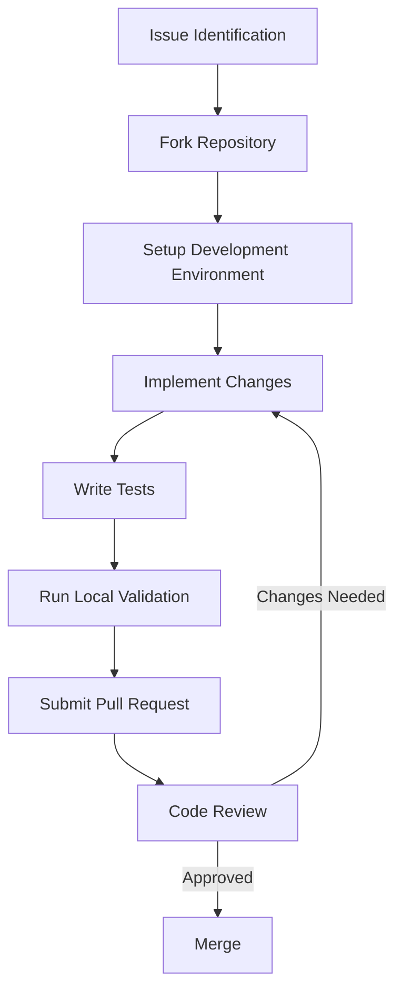
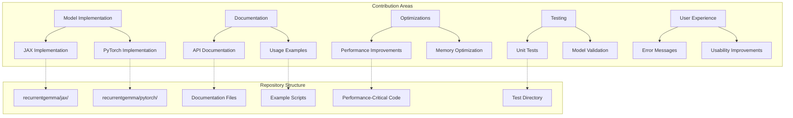

<!-- source: DeepWiki mcp.deepwiki.com · repo google-deepmind/recurrentgemma · page 6.2 Contributing · fetched 2026-10-26 -->

# Contributing

Relevant source files

The following files were used as context for generating this wiki page:

- [CONTRIBUTING.md](CONTRIBUTING.md)

This document outlines the guidelines and processes for contributing to the RecurrentGemma project. It explains the current contribution status, requirements for contributors, and the project's community guidelines. For installation instructions, see [Installation](#6.1).

## Current Contribution Status

Currently, RecurrentGemma **is not accepting external Pull Requests**. This policy may change in the future, but at present, the project is maintained exclusively by its original authors.

Sources: [CONTRIBUTING.md:1-3]()

## Contribution Requirements

Although external contributions are not currently accepted, future contributors should be aware of the following requirements:

### Contributor License Agreement (CLA)

All contributions to RecurrentGemma must be accompanied by a signed [Contributor License Agreement](https://cla.developers.google.com/about). This agreement allows the project to use and redistribute your contributions while you or your employer retain the copyright.

- If you or your current employer have already signed the Google CLA for another project, you likely don't need to sign it again
- To check your current agreements or sign a new one, visit the [Google CLA page](https://cla.developers.google.com/)

Sources: [CONTRIBUTING.md:7-19]()

### Community Guidelines

RecurrentGemma follows Google's Open Source Community Guidelines. All contributors are expected to adhere to these guidelines when interacting with the project and its community.

Sources: [CONTRIBUTING.md:21-24]()

## Potential Contribution Workflow

When external contributions are accepted in the future, the typical contribution process would likely follow this workflow:

### Contribution Process Diagram

Sources: [CONTRIBUTING.md:1-25]()

## Potential Contribution Areas

While external contributions are not currently accepted, understanding the codebase structure can help identify potential areas for future contributions. The following diagram shows the main components of RecurrentGemma and possible contribution entry points:

### Contribution Areas Diagram

Sources: [CONTRIBUTING.md:1-25]()

## Issue and Pull Request Guidelines

When external contributions are accepted, the following guidelines would likely apply to issues and pull requests:

### Issue Reporting

Before creating an issue:
- Check existing issues to avoid duplicates
- Provide detailed information about your environment
- Include clear steps to reproduce the issue
- Specify the version of RecurrentGemma you're using

### Pull Request Guidelines

When submitting pull requests:
- Each PR should address a single concern
- Include relevant tests for your changes
- Ensure all tests pass before submitting
- Follow the project's coding style and conventions
- Provide a clear description of changes and their purpose

## Code Standards and Development Guidelines

### Code Style

RecurrentGemma would likely follow Google's coding standards for both Python and JAX/PyTorch code. This includes:

- Following PEP 8 for Python code
- Using appropriate docstrings for functions and classes
- Maintaining consistent naming conventions
- Writing clear, maintainable code with appropriate comments

### Testing Requirements

Changes would likely need to maintain or improve test coverage:

| Test Type | Purpose | Expected Coverage |
|-----------|---------|-------------------|
| Unit Tests | Test individual functions and classes | High coverage for core model components |
| Integration Tests | Test interactions between components | Cover main usage patterns |
| Regression Tests | Prevent previously fixed bugs from recurring | Include tests for all bug fixes |
| Performance Tests | Ensure code remains efficient | Benchmark key operations |

## Conclusion

While RecurrentGemma is not currently accepting external contributions, this document provides guidelines for potential future contributors. As the project evolves, contribution policies may change. Contributors should check back for updates to these guidelines.

Sources: [CONTRIBUTING.md:1-25]()