# Page: Overview

# Overview

<details>
<summary>Relevant source files</summary>

The following files were used as context for generating this wiki page:

- [README.md](README.md)

</details>


This document provides a high-level introduction to RecurrentGemma, a family of open-weights Language Models developed by Google DeepMind. It covers the core architecture, implementation approaches, and key technical components. For detailed information about specific components, refer to other sections in this documentation, such as the [Griffin Model](#2.1), [Recurrent Components](#3.1), or [Usage Guide](#5).

## What is RecurrentGemma?

RecurrentGemma is a collection of language models based on the novel Griffin architecture, which achieves fast inference when generating long sequences. The key innovation is replacing traditional global attention mechanisms with a mixture of local attention and linear recurrences, making inference more efficient while maintaining quality.

The repository provides:

1. Model implementations in both JAX/Flax (optimized) and PyTorch (reference)
2. Pre-trained model weights (2B and 9B parameter variants)
3. Examples for text generation and fine-tuning
4. TPU-optimized kernels for high-performance operation

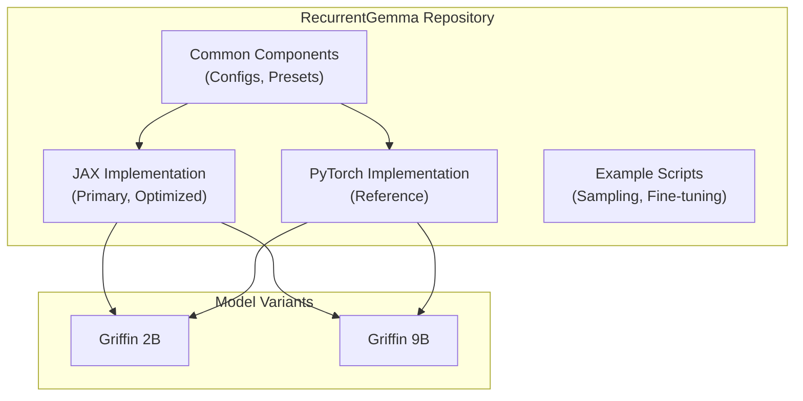

Sources: [README.md:1-5]()

## Technical Architecture

RecurrentGemma's Griffin architecture combines aspects of traditional transformer models with recurrent neural network elements. This hybrid approach delivers efficient processing of long sequences while maintaining the modeling capacity needed for language understanding and generation.

### Key Architecture Components

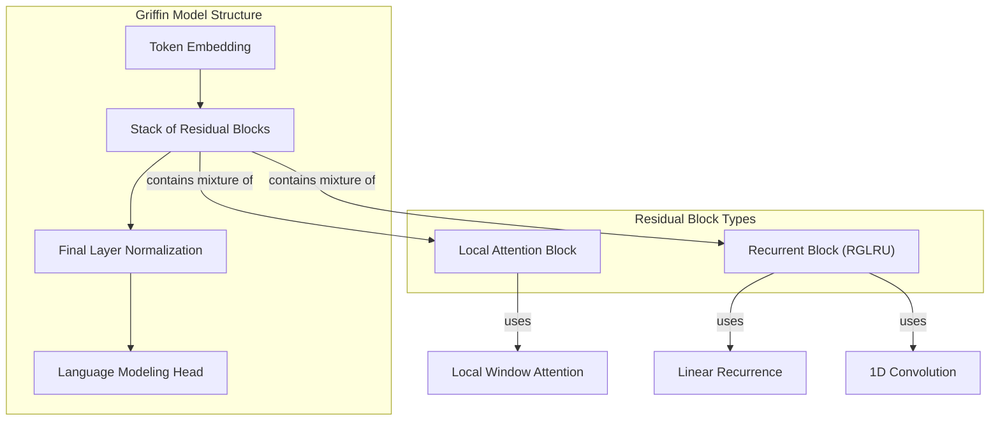

The core architectural innovation is the combination of:

1. **Local attention blocks** - Process information within a limited window rather than across the entire sequence
2. **Recurrent blocks** - Use linear recurrences via the Recurrent Gated Linear Recurrent Unit (RGLRU) to efficiently process long-range dependencies
3. **Residual connections** - Connect blocks in a way that information can flow through the network

This design enables efficient processing of long contexts by combining the strengths of transformers and recurrent neural networks.

Sources: [README.md:3-5]()

## Implementation Overview

RecurrentGemma provides two parallel implementations with distinct performance characteristics:

### JAX/Flax Implementation

The JAX implementation is the primary, performance-optimized version recommended for most users. It features:

- Highly optimized code for TPU acceleration
- Custom Pallas kernels for efficient linear scan operations 
- Support for both model inference and training/fine-tuning

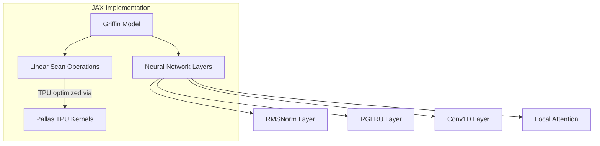

### PyTorch Implementation

The PyTorch implementation is provided as a reference for users who prefer or require PyTorch:

- Functionally equivalent to the JAX implementation
- Less optimized for performance-critical operations
- Simpler implementation without custom kernels

### Framework Conversion

The repository also includes utilities to convert model weights between frameworks, allowing users to train in one framework and deploy in another if needed.

Sources: [README.md:5-6](), [README.md:105-107]()

## System Requirements and Performance

RecurrentGemma can run on CPU, GPU, or TPU hardware:

| Hardware            | T4  | P100 | V100 | A100 | TPUv2 | TPUv3+ |
|---------------------|:---:|:----:|:----:|:----:|:-----:|:------:|
| Sampling in JAX     | ✅  | ✅   | ✅   | ✅   | ✅    | ✅    |
| Sampling in PyTorch | ✅  | ✅   | ✅   | ✅   | ✅    | ✅    |
| Finetuning in JAX   | ✅  | ✅   | ✅   | ✅   | ❌    | ✅    |

The JAX implementation with Pallas kernels delivers the best performance on TPU hardware. The linear recurrence operation, which is a key component of the Griffin architecture, is particularly optimized in the JAX implementation.

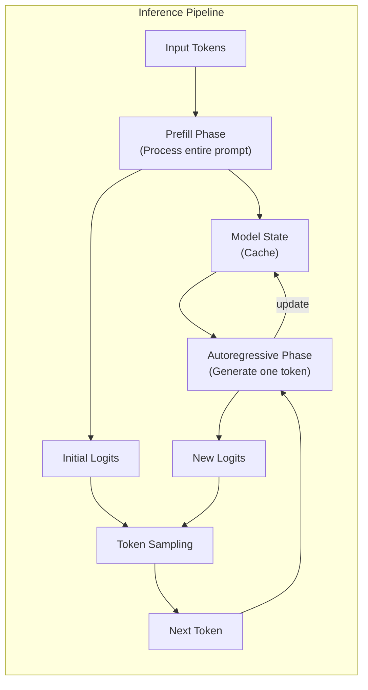

This inference pipeline shows how RecurrentGemma processes input and generates text. The model first processes the entire prompt in a single "prefill" phase, then generates tokens one at a time in the "autoregressive" phase, updating the model state after each token.

Sources: [README.md:102-107](), [README.md:95-100]()

## Getting Started

RecurrentGemma can be installed using either Poetry or pip:

```
# Using Poetry
poetry install -E full  # For all dependencies
poetry install -E jax   # For JAX dependencies only
poetry install -E torch # For PyTorch dependencies only

# Using pip
pip install .[full]     # For all dependencies
pip install .[jax]      # For JAX dependencies only
pip install .[torch]    # For PyTorch dependencies only
```

Model weights are available through Kaggle at http://kaggle.com/models/google/recurrentgemma. The repository includes example scripts and Colab notebooks for:

1. Text generation (sampling) using both JAX and PyTorch
2. Fine-tuning using JAX
3. Model evaluation

For detailed usage instructions, refer to the [Usage Guide](#5) section.

Sources: [README.md:14-49](), [README.md:67-90]()

## Additional Resources

For more in-depth understanding of RecurrentGemma:

- [RecurrentGemma technical report](https://storage.googleapis.com/deepmind-media/gemma/recurrentgemma-report.pdf) - Details on training and evaluation
- [Griffin paper](https://arxiv.org/abs/2402.19427) - Underlying model architecture
- GitHub repository: https://github.com/google-deepmind/recurrentgemma

For specific implementation details, refer to the [Architecture](#2) and [Technical Components](#3) sections of this documentation.

Sources: [README.md:7-11]()

---

# Page: Architecture

# Architecture

<details>
<summary>Relevant source files</summary>

The following files were used as context for generating this wiki page:

- [README.md](README.md)
- [recurrentgemma/jax/griffin.py](recurrentgemma/jax/griffin.py)
- [recurrentgemma/jax/modules.py](recurrentgemma/jax/modules.py)

</details>


This document outlines the overall architecture of RecurrentGemma, explaining how its components fit together to form a language model optimized for processing long sequences. RecurrentGemma is based on the novel Griffin architecture that replaces global attention with a mixture of local attention and linear recurrences for more efficient inference.

For details on specific components, see [Griffin Model](#2.1) and [Neural Network Layers](#2.2). For information about the configuration system, see [Model Configuration](#2.3).

## High-Level Architecture

RecurrentGemma provides implementations in both JAX/Flax (primary, highly-optimized) and PyTorch (reference implementation). Both implementations share the same underlying architectural principles but differ in optimization techniques.

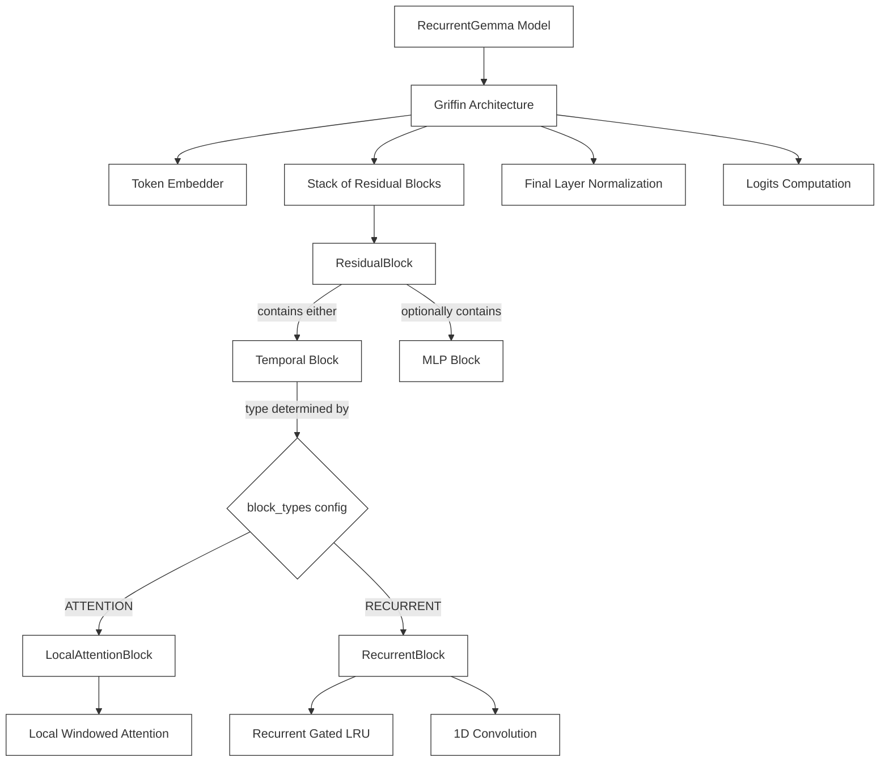

Sources: [recurrentgemma/jax/griffin.py:31-201](), [recurrentgemma/jax/modules.py:696-888]()

The Griffin architecture consists of:
1. **Token Embedder**: Converts token IDs to embeddings
2. **Residual Blocks**: A stack of blocks that can contain either attention or recurrent mechanisms
3. **Final Layer Normalization**: Applied to the output of the last residual block
4. **Logits Computation**: Converts the normalized output back to vocabulary logits

## Model Components

The core of RecurrentGemma is the Griffin model, implemented as a `Griffin` class. It coordinates all model components and implements the forward pass logic.

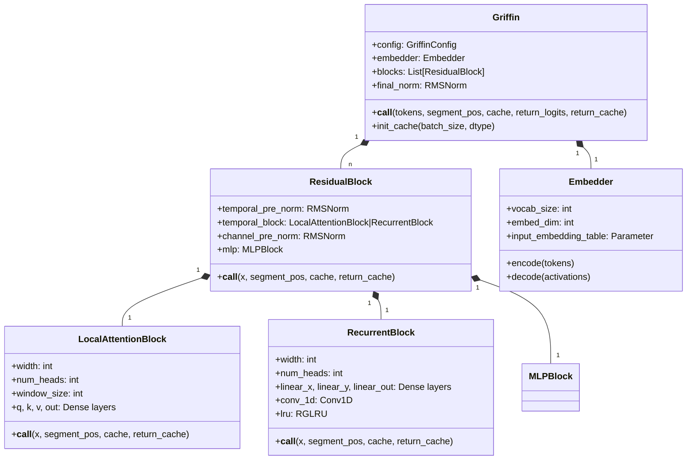

Sources: [recurrentgemma/jax/griffin.py:31-201](), [recurrentgemma/jax/modules.py:251-428](), [recurrentgemma/jax/modules.py:445-630](), [recurrentgemma/jax/modules.py:633-693](), [recurrentgemma/jax/modules.py:890-941]()

### Griffin Model

The `Griffin` class is the main model class that ties all components together:

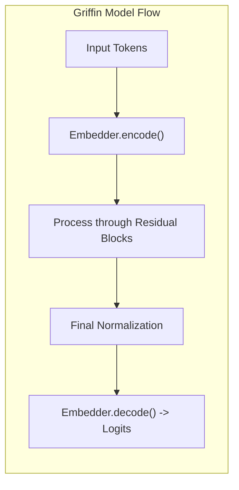

Sources: [recurrentgemma/jax/griffin.py:129-181]()

Key components in the Griffin model:

- **Embedder**: Converts input tokens to embeddings and output embeddings back to logits
- **Residual Blocks**: A sequence of blocks configured by `block_types` in the config
- **Final Normalization**: RMSNorm layer applied before computing logits
- **Cache Handling**: Manages caches for each residual block for efficient autoregressive generation

## Residual Block Architecture

The `ResidualBlock` is the fundamental building block of the Griffin architecture. Each residual block can contain either a `LocalAttentionBlock` or a `RecurrentBlock` based on the configuration.

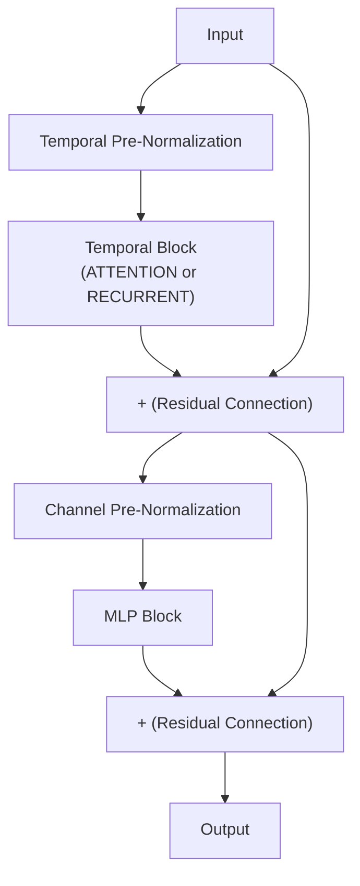

Sources: [recurrentgemma/jax/modules.py:696-855]()

The residual block:
1. Applies RMSNorm (temporal pre-norm) to the input
2. Processes the normalized input through either a LocalAttentionBlock or RecurrentBlock
3. Adds the output back to the input (residual connection)
4. Optionally applies another RMSNorm (channel pre-norm) and processes through an MLP
5. Adds another residual connection to the output

## Temporal Blocks

RecurrentGemma uses two types of temporal blocks:

### 1. Local Attention Block

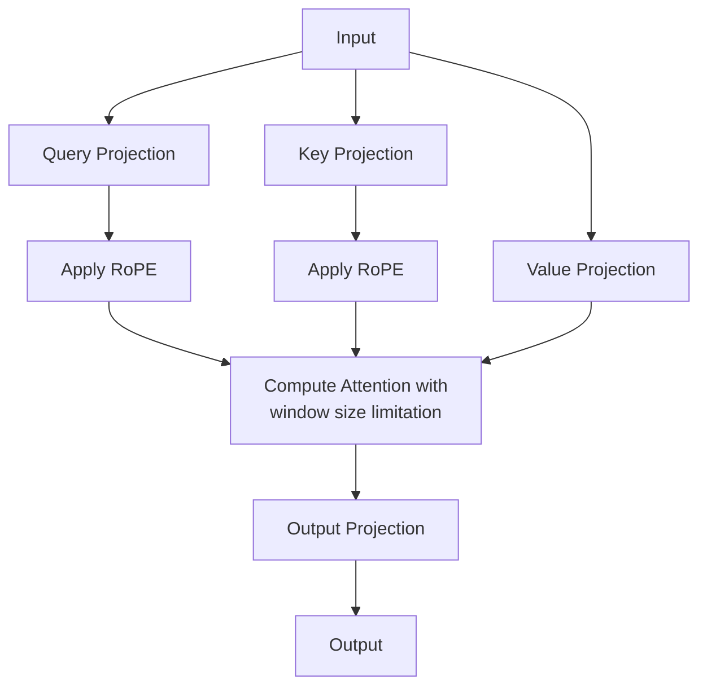

Sources: [recurrentgemma/jax/modules.py:251-428]()

The `LocalAttentionBlock` implements windowed attention:
- Only attends to a limited window of previous tokens
- Uses RoPE (Rotary Position Embeddings) for positional information
- Maintains a cache of keys and values for efficient autoregressive generation

### 2. Recurrent Block

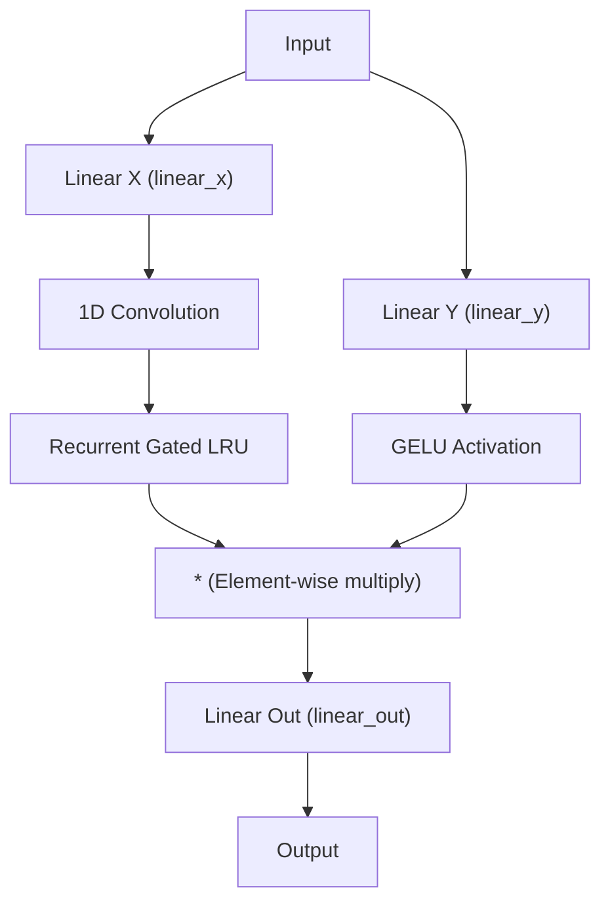

Sources: [recurrentgemma/jax/modules.py:445-630]()

The `RecurrentBlock` combines linear projections, convolution, and recurrence:
- Processes input through parallel x and y branches
- The x branch applies 1D convolution followed by RGLRU
- The y branch applies a linear transformation and GELU activation
- The outputs are combined through element-wise multiplication
- A final linear projection produces the output

## Caching Mechanism

RecurrentGemma implements efficient caching for autoregressive generation:

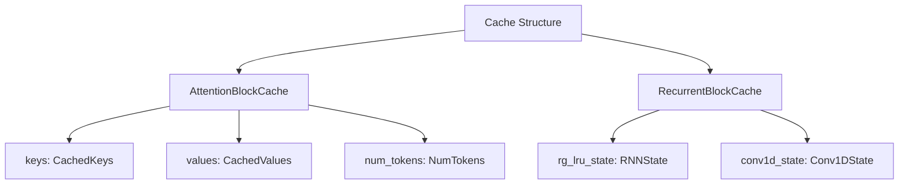

Sources: [recurrentgemma/jax/modules.py:28-51](), [recurrentgemma/jax/griffin.py:28-28](), [recurrentgemma/jax/modules.py:183-248](), [recurrentgemma/jax/modules.py:429-630]()

The caching mechanism ensures efficient memory usage during text generation:

- **AttentionBlockCache**: Stores keys, values, and the count of processed tokens
- **RecurrentBlockCache**: Stores the state of the RGLRU and the Conv1D components
- **Griffin init_cache**: Creates an empty cache structure for the entire model

## Execution Flow

The execution flow of RecurrentGemma varies between the prompt processing (prefill) phase and the autoregressive generation phase:

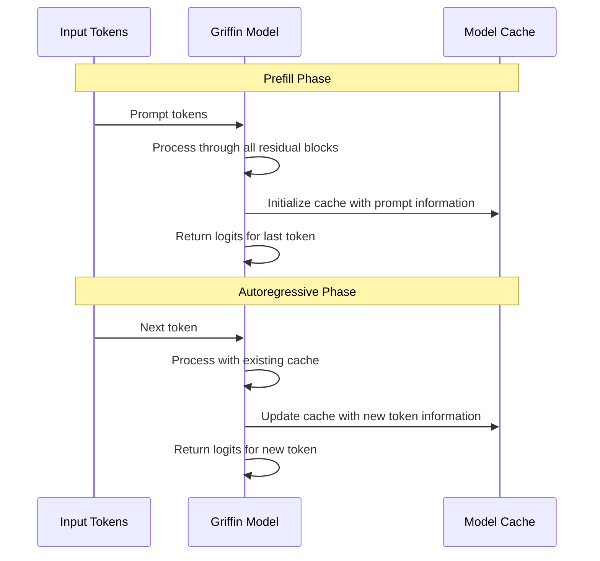

Sources: [recurrentgemma/jax/griffin.py:129-181](), [recurrentgemma/jax/modules.py:350-427](), [recurrentgemma/jax/modules.py:558-606]()

This two-phase approach allows RecurrentGemma to process prompts efficiently and then generate tokens one at a time by reusing computation through caching.

## Optimizations

RecurrentGemma includes several optimizations for efficient computation:

1. **Gradient Checkpointing**: Optional feature to reduce memory usage during training
2. **Pallas Optimization**: For TPU-optimized kernels (particularly for the linear scan in recurrent layers)
3. **Multiple Scan Implementations**: Different scan implementations (Linear Pallas, Linear Native, Associative Native) for different hardware
4. **Efficient Caching**: Special handling for autoregressive generation vs. prompt processing

Sources: [recurrentgemma/jax/griffin.py:45-45](), [recurrentgemma/jax/modules.py:466-466](), [README.md:103-106]()

## Summary

The RecurrentGemma architecture combines transformer-like components with recurrent mechanisms to create a model that efficiently handles long sequences. By using a mixture of local attention and linear recurrences, it achieves better inference speed than traditional transformer models when generating long sequences.

Key innovations include:
- Combination of attention and recurrence in a unified architecture
- Local windowed attention for efficient computation
- Recurrent Gated LRU for linear scaling with sequence length
- Efficient caching mechanism for autoregressive generation

For more details on the specific components, see [Neural Network Layers](#2.2) and [Recurrent Components](#3.1).

---

# Page: Griffin Model

# Griffin Model

<details>
<summary>Relevant source files</summary>

The following files were used as context for generating this wiki page:

- [README.md](README.md)
- [recurrentgemma/jax/griffin.py](recurrentgemma/jax/griffin.py)
- [recurrentgemma/jax/modules.py](recurrentgemma/jax/modules.py)

</details>


The Griffin Model is the core neural network architecture behind RecurrentGemma, a family of language models designed to achieve fast inference for long sequences. This page describes the Griffin model architecture, its components, and how they work together to efficiently process text.

For information about specific neural network layers used in Griffin, see [Neural Network Layers](#2.2). For details on the recurrent mechanisms, see [Recurrent Components](#3.1).

## Overview of Griffin Architecture

The Griffin architecture represents a novel approach to language modeling that combines traditional transformer components with recurrent elements. It replaces the global attention mechanism found in standard transformers with a mixture of local attention and linear recurrences, allowing for more efficient processing of long sequences.

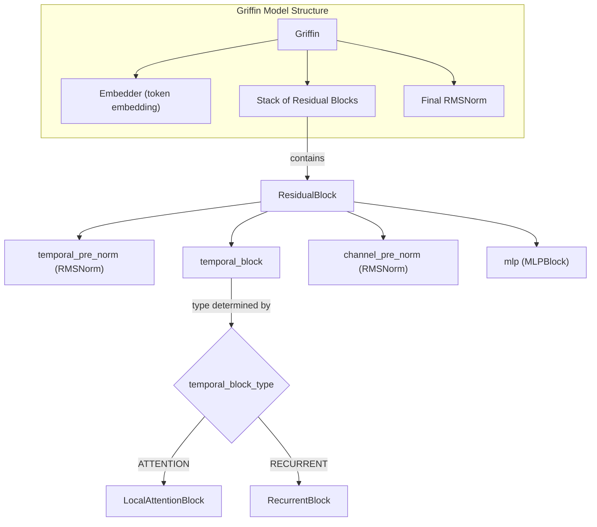

Sources: [recurrentgemma/jax/griffin.py:31-83](), [recurrentgemma/jax/modules.py:696-887]()

## Main Components

The Griffin model is composed of three primary components:

1. **Token Embedder** - Converts input tokens to embeddings
2. **Stack of Residual Blocks** - The main processing layers that consist of either recurrent or attention blocks
3. **Final Layer Normalization** - Normalizes the output before generating logits

Each of these components works together to form the complete Griffin model, with the implementation defined in the `Griffin` class.

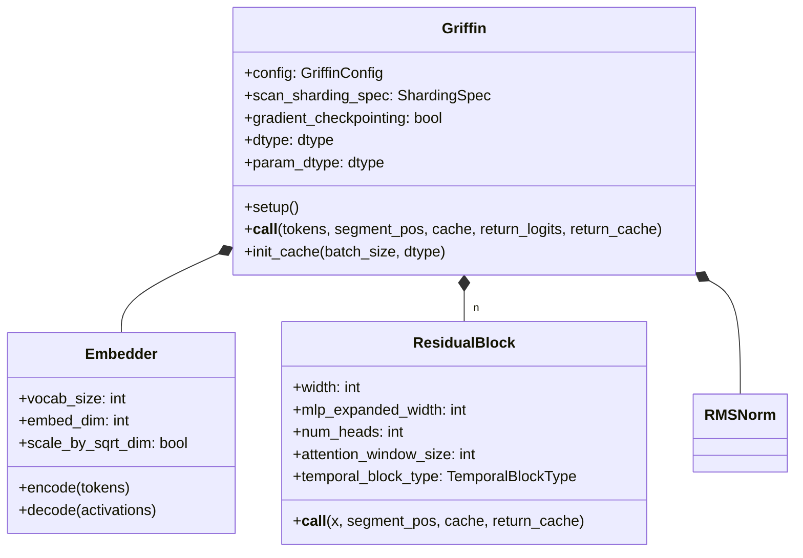

Sources: [recurrentgemma/jax/griffin.py:31-201]()

## Residual Blocks

The heart of the Griffin architecture is the `ResidualBlock`, which combines sequential processing with residual connections. Each residual block contains:

1. A temporal pre-normalization layer (`RMSNorm`)
2. A temporal block (either `LocalAttentionBlock` or `RecurrentBlock`)
3. A channel pre-normalization layer (`RMSNorm`)
4. An MLP block

The type of temporal block used in each residual block is determined by the configuration parameter `temporal_block_type`, which can be either `ATTENTION` or `RECURRENT`.

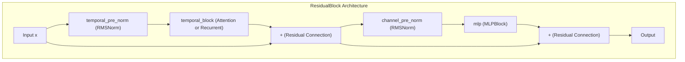

Sources: [recurrentgemma/jax/modules.py:696-855]()

## Temporal Block Types

Griffin uses two types of temporal blocks that can be configured in any combination across the model's layers:

### Local Attention Block

The `LocalAttentionBlock` implements a windowed multi-head attention mechanism that attends only to a limited window of tokens around the current position, rather than the full sequence. This approach reduces computational complexity while maintaining good performance for many tasks.

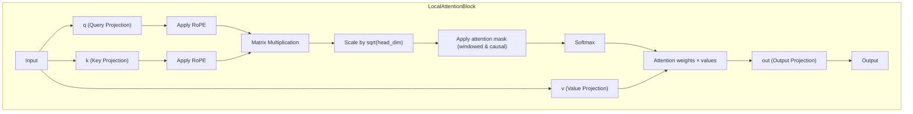

Sources: [recurrentgemma/jax/modules.py:251-442]()

### Recurrent Block

The `RecurrentBlock` implements a novel approach using Recurrent Gated Linear Recurrent Units (RGLRU) combined with 1D convolution. This enables efficient processing of long-range dependencies without the quadratic complexity of traditional attention mechanisms.

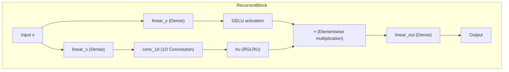

Sources: [recurrentgemma/jax/modules.py:445-630]()

## MLP Block

The `MLPBlock` in Griffin follows a standard design with a few optimizations:

1. It uses a dense up-projection that produces two outputs
2. One output passes through a GELU activation
3. The activated output gates the second output via element-wise multiplication
4. The result is projected back down to the original dimension

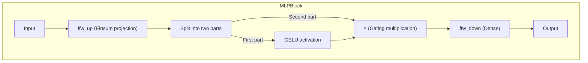

Sources: [recurrentgemma/jax/modules.py:633-693]()

## Cache Mechanism for Efficient Inference

Griffin supports efficient autoregressive generation through a sophisticated caching mechanism. The model maintains two types of caches:

1. **AttentionBlockCache** - Stores keys and values for the local attention blocks
2. **RecurrentBlockCache** - Stores states for the recurrent blocks (RGLRU state and Conv1D state)

These caches allow the model to avoid recomputing previously processed tokens during text generation, significantly speeding up inference.

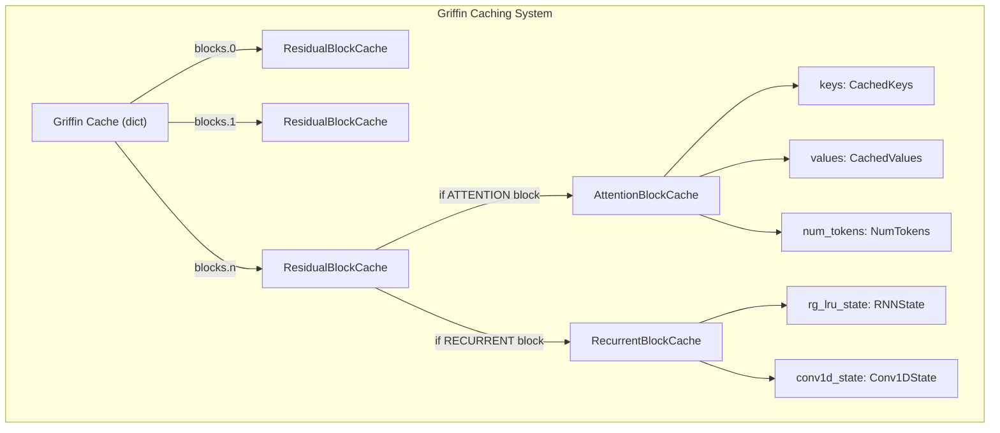

Sources: [recurrentgemma/jax/modules.py:34-50](), [recurrentgemma/jax/griffin.py:28-28](), [recurrentgemma/jax/griffin.py:183-201]()

## Model Configuration

The Griffin model is configured through the `GriffinConfig` class, which defines parameters such as:

- Model dimensions (width, number of heads, etc.)
- Block types sequence (which layers use attention vs. recurrent)
- Vocabulary size
- Window size for local attention
- Scan type for recurrent components

For detailed information about model configuration options, see [Model Configuration](#2.3).

## Forward Pass Execution

When the Griffin model is called, it executes the following sequence of operations:

1. Embed input tokens using the Embedder
2. Pass the embeddings through each ResidualBlock, maintaining cache if provided
3. Apply final layer normalization
4. Generate logits by decoding the normalized output
5. Apply optional soft cap to logits
6. Return the logits and/or updated cache based on the function arguments

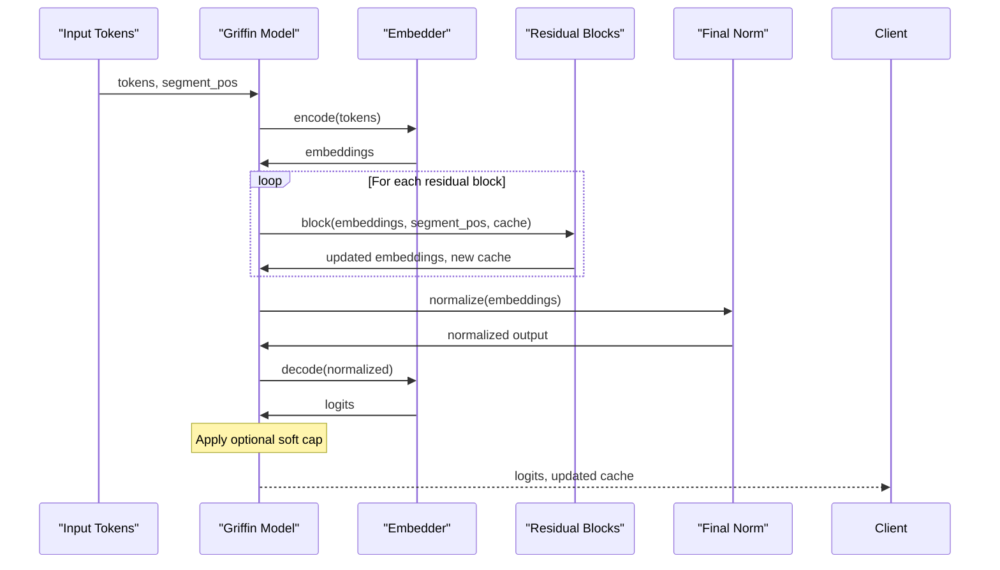

Sources: [recurrentgemma/jax/griffin.py:129-181]()

## Summary

The Griffin model represents a novel architecture that combines the best aspects of transformers and recurrent neural networks. By using a mixture of local attention and linear recurrences, it achieves efficient processing of long sequences without the quadratic complexity of standard transformer models.

The core innovation lies in the `RecurrentBlock` components that incorporate the Recurrent Gated Linear Recurrent Unit (RGLRU), enabling the model to capture long-range dependencies efficiently. This design makes Griffin particularly well-suited for tasks that require processing and generating long texts while maintaining high computational efficiency.

---

# Page: Neural Network Layers

# Neural Network Layers

<details>
<summary>Relevant source files</summary>

The following files were used as context for generating this wiki page:

- [recurrentgemma/jax/layers.py](recurrentgemma/jax/layers.py)
- [recurrentgemma/jax/layers_test.py](recurrentgemma/jax/layers_test.py)

</details>


This document details the fundamental neural network layers that serve as building blocks for the RecurrentGemma models. These layers are primarily implemented in the JAX framework and provide the core mathematical operations required for both traditional transformer components and recurrent elements. For information about the overall architecture design, see [Architecture](#2), and for detailed information about recurrent mechanisms, see [Recurrent Components](#3.1).

## Layer Overview

RecurrentGemma implements several specialized neural network layers that together form the foundation of the Griffin model. These include normalization layers, linear transformations, and recurrent components with specific optimizations for efficient sequence processing.

```mermaid
graph TD
    subgraph "RecurrentGemma Layer Types"
        RMSNorm["RMSNorm - Layer Normalization"]
        BlockDiag["BlockDiagonalLinear - Efficient Linear Transformation"]
        RGLRU["RGLRU - Recurrent Gated Linear Recurrent Unit"]
        Conv1D["Conv1D - Temporal Convolution"]
        Einsum["Einsum - Parameterized Tensor Operations"]
    end

    subgraph "Supporting Components"
        InitFuncs["Parameter Initialization Functions"]
        ComplexOps["Complex Number Operations"]
        Scanning["Linear Scan Operations"]
    end

    RMSNorm --> ResidualBlock["Used in Residual Blocks"]
    BlockDiag --> RGLRU
    RGLRU --> RecurrentBlock["Forms Recurrent Block"]
    Conv1D --> RecurrentBlock
    Einsum --> VariousModules["Used Throughout Model"]
    
    InitFuncs --> RGLRU
    ComplexOps --> RGLRU
    Scanning --> RGLRU
    
    ResidualBlock --> GriffinModel["Griffin Model"]
    RecurrentBlock --> GriffinModel
```

Sources: [recurrentgemma/jax/layers.py:15-788]()

## Core Layers

### RMSNorm

RMSNorm (Root Mean Square Normalization) is a normalization technique that scales inputs by the root mean square of the features. It's simpler than LayerNorm as it doesn't perform mean centering.

```mermaid
graph LR
    Input["Input Tensor x"] --> RMS["Calculate RMS √(mean(x²))"]
    RMS --> Normalize["x / RMS"]
    Normalize --> Scale["Apply learned scale"]
    Scale --> Output["Normalized Output"]
```

Key implementation details:
- Unlike LayerNorm, RMSNorm only performs scaling, not centering
- Includes a small epsilon term for numerical stability
- Uses a learned scale parameter initialized to zeros

**Implementation:**
```
def __call__(self, x):
    # Calculate variance (mean of squared values)
    var = jnp.mean(jnp.square(x), axis=-1, keepdims=True)
    # Normalize by root mean square
    normed_x = x * jax.lax.rsqrt(var + self.eps)
    # Apply learned scale parameter (offset by 1)
    return normed_x * (scale + 1)
```

Sources: [recurrentgemma/jax/layers.py:32-66]()

### BlockDiagonalLinear

A specialized linear transformation that uses a block-diagonal structure to reduce parameter count while maintaining expressiveness.

```mermaid
graph TD
    Input["Input [batch, seq_len, width]"] --> Split["Split input along width dimension<br>into num_blocks blocks"]
    Split --> Transform["Apply separate linear transform<br>to each block"]
    Transform --> Concat["Concatenate results"]
    Concat --> Output["Output [batch, seq_len, width]"]
```

Key properties:
- Divides input/output into blocks for more efficient computation
- Each block has its own weight matrix, forming a block-diagonal structure
- Includes bias terms for each block
- Reduces parameters compared to full matrix while maintaining expressiveness

Sources: [recurrentgemma/jax/layers.py:69-139]()

### RGLRU (Recurrent Gated Linear Recurrent Unit)

RGLRU is a key innovation in RecurrentGemma that enables efficient processing of long sequences through linear recurrences. It combines gating mechanisms with linear state transitions.

```mermaid
graph TD
    subgraph "RGLRU Layer"
        Input["Input x"] --> InputGate["Input Gate<br>BlockDiagonalLinear"]
        Input --> AParam["A Parameter Gate<br>BlockDiagonalLinear"]
        
        InputGate --> GatedInput["Gate Input<br>σ(InputGate(x)) * x"]
        AParam --> LogA["Compute log(A)<br>-8 * σ(AParam(x)) * softplus(a_param)"]
        
        LogA --> A["Compute A = exp(log(A))"]
        
        GatedInput --> Normalize["Apply γ normalization<br>multiplier = √(1 - A²)"]
        
        Normalize --> LinearScan["Apply linear recurrence<br>y[t] = A * y[t-1] + input[t]"]
        
        LinearScan --> OutputY["Output y"]
        LinearScan --> LastState["Last state h"]
    end
```

Key features:
- Uses complex number operations for certain configurations
- Applies specialized gradient stabilization techniques
- Supports both real and complex recurrent dynamics
- Manages document boundaries via segment positions
- Optimized for TPU through Pallas kernels for linear scan operations
- Maintains a persistent cache for autoregressive generation

Sources: [recurrentgemma/jax/layers.py:142-478]()

### Conv1D

A 1D temporal convolution layer that processes information across the sequence dimension.

```mermaid
graph TD
    subgraph "Conv1D Processing"
        Input["Input Sequence"] --> Window["Apply Sliding Window<br>of temporal_width tokens"]
        Window --> Convolve["Apply Convolution Weights<br>with Boundary Handling"]
        Convolve --> Output["Output Sequence"]
        
        Convolve --> UpdateCache["Update Cache State<br>(for autoregressive generation)"]
    end
```

Key implementation details:
- Performs 1D convolution along the temporal dimension
- Handles document boundaries to prevent information leakage between documents
- Provides specialized caching for autoregressive generation
- Manages state for efficient decoding during inference
- Ensures proper padding for different sequence lengths

Sources: [recurrentgemma/jax/layers.py:481-735]()

### Einsum

A utility layer that implements parameterized tensor operations using Einstein summation notation.

```mermaid
graph LR
    Input["Input Tensor"] --> TensorContract["Contract with Weight Tensor<br>Using Einstein Notation"]
    TensorContract --> AddBias["Add Bias Term"]
    AddBias --> Output["Output Tensor"]
```

Key features:
- Flexible tensor operations through configurable Einstein summation equations
- Supports arbitrary tensor shapes through the equation specification
- Includes learned weights and bias parameters
- Simplifies implementation of custom linear transformations

Sources: [recurrentgemma/jax/layers.py:738-787]()

## Layer Integration in Griffin Architecture

The neural network layers described above are composed to build the Griffin model architecture. This diagram shows how these layers integrate into the larger model structure:

```mermaid
graph TD
    subgraph "Griffin Model"
        TokenEmb["Token Embedder"] --> ResBlocks["Stack of Residual Blocks"]
        ResBlocks --> FinalNorm["Final RMSNorm"]
        FinalNorm --> Output["Output Logits"]
    end
    
    subgraph "Residual Block"
        Input["Block Input"] --> TempNorm["Temporal RMSNorm"]
        TempNorm --> BlockType{{"Block Type?"}}
        BlockType -- "Attention Block" --> LocalAtt["Local Attention"]
        BlockType -- "Recurrent Block" --> RecBlock["Recurrent Block"]
        
        LocalAtt --> AddFirst["Residual Add"]
        RecBlock --> AddFirst
        
        AddFirst --> ChanNorm["Channel RMSNorm"]
        ChanNorm --> MLP["MLP Block<br>(uses BlockDiagonalLinear)"]
        MLP --> AddSecond["Residual Add"]
        AddSecond --> BlockOutput["Block Output"]
    end
    
    subgraph "Recurrent Block"
        RecInput["Input"] --> RGLRU_Layer["RGLRU Layer"]
        RGLRU_Layer --> Conv1D_Layer["Conv1D Layer"]
        Conv1D_Layer --> RecOutput["Output"]
    end
```

Sources: [recurrentgemma/jax/layers.py:32-788]()

## Complex Number Handling

The RGLRU layer includes specialized handling for complex numbers, which is important for certain configurations of the recurrent dynamics.

### Complex Number Implementation

```mermaid
graph TD
    subgraph "Complex Number Handling"
        UseComplex{{"Using Complex Numbers?"}}
        UseComplex -- "Yes" --> CustomComplex{{"BFloat16 or Pallas?"}}
        UseComplex -- "No (real only)" --> RealImpl["Use Real-valued Implementation"]
        
        CustomComplex -- "Yes" --> ComplexLib["Use Complex_lib.Complex<br>Custom Implementation"]
        CustomComplex -- "No" --> NativeComplex["Use Native JAX Complex Numbers"]
        
        ComplexLib --> ComplexOps["Handle Complex Operations<br>exp(), sigmoid(), etc."]
        NativeComplex --> ComplexOps
    end
```

Key aspects:
- Supports both real-only and complex modes through the `only_real` flag
- Uses custom complex number implementation for bfloat16 compatibility
- Handles complex operations like exponential and sigmoid
- Includes utilities for converting between merged representation (real and imaginary parts concatenated) and complex representation

Sources: [recurrentgemma/jax/layers.py:218-322](), [recurrentgemma/jax/layers.py:347-471]()

## Parameter Initialization

The RGLRU layer uses specialized parameter initialization techniques to ensure stable recurrent dynamics.

```mermaid
graph LR
    subgraph "RNN Parameter Initialization"
        RealInit["rnn_real_param_init<br>Initialize on Ring [min_rad, max_rad]"]
        ImagInit["rnn_imag_param_init<br>Initialize Phase [0, max_rad×π]"]
        
        RealInit --> TransformReal["Apply Inverse Transform<br>log(exp(-a_real) - 1)"]
        ImagInit --> TransformImag["Scale to Parameter Space"]
        
        TransformReal --> InitializedParams["Initialized RNN Parameters"]
        TransformImag --> InitializedParams
    end
```

Key features:
- Initializes recurrent parameters on a ring in complex plane for stability
- Uses specialized transforms to ensure proper parameter ranges
- Separates real and imaginary parameter initialization
- Controls the magnitude of recurrent dynamics through min_rad and max_rad parameters

Sources: [recurrentgemma/jax/layers.py:142-181]()

## Gradient Control Mechanisms

RecurrentGemma implements specialized mechanisms to control gradients for numerical stability, especially in operations like square root where gradients can explode.

```mermaid
graph LR
    subgraph "Gradient Stabilization"
        SqrtOp["sqrt_bound_derivative<br>Custom VJP Implementation"]
        
        Input["Input x"] --> Forward["Forward Pass:<br>Regular sqrt(x)"]
        Forward --> Output["Output"]
        
        Gradient["Incoming Gradient g"] --> ModifiedBwd["Backward Pass:<br>Clip x to Prevent Gradient Explosion"]
        ModifiedBwd --> OutGradient["Stable Output Gradient"]
    end
```

Key aspects:
- Custom VJP (vector-Jacobian product) implementation for sqrt
- Prevents gradient explosion by clipping values in backward pass
- Essential for stable training in bfloat16 precision
- Particularly used in the RGLRU normalization logic

Sources: [recurrentgemma/jax/layers.py:184-214](), [recurrentgemma/jax/layers.py:451-453]()

## Caching Mechanisms for Autoregressive Generation

Both RGLRU and Conv1D layers implement specialized caching mechanisms to support efficient autoregressive generation.

```mermaid
graph TD
    subgraph "Layer Caching System"
        InitCache["Initialize Empty Cache<br>RGLRU.init_cache() / Conv1D.init_cache()"]
        
        Process["Process Input Sequence<br>Layer.__call__(x, segment_pos, cache)"]
        
        Process --> UpdatedCache["Updated Cache State"]
        Process --> Output["Layer Output"]
        
        UpdatedCache --> NextToken["Process Next Token<br>with Updated Cache"]
    end
```

Key aspects:
- RGLRU maintains state as a compact representation of sequence history
- Conv1D stores previous `temporal_width-1` inputs for proper convolution
- Both layers handle cache initialization, updates, and propagation
- Crucial for efficient autoregressive generation with recurrent components

Sources: [recurrentgemma/jax/layers.py:474-478](), [recurrentgemma/jax/layers.py:725-735]()

## Conclusion

The neural network layers in RecurrentGemma provide a foundation for efficient sequence processing with a focus on linear recurrences and proper handling of document boundaries. The RGLRU and Conv1D layers in particular are key innovations that enable the model's strong performance on long sequences. These layers are integrated into the Griffin model architecture to form the complete RecurrentGemma system.

---

# Page: Model Configuration

# Model Configuration

<details>
<summary>Relevant source files</summary>

The following files were used as context for generating this wiki page:

- [README.md](README.md)
- [recurrentgemma/common.py](recurrentgemma/common.py)

</details>


## Purpose and Scope

This document explains the configuration system for RecurrentGemma models, including how the default presets are defined, the structure of model configurations, and methods for creating or modifying configurations. For information about the neural network layers and components that these configurations govern, see [Neural Network Layers](#2.2) and [Griffin Model](#2.1).

## Configuration Overview

RecurrentGemma's configuration system centers around the `GriffinConfig` class, which defines all necessary parameters for instantiating models based on the Griffin architecture. The system includes predefined presets for different model sizes and provides methods to create configurations from existing model parameters.

```mermaid
graph TD
    subgraph "Configuration Components"
        GC["GriffinConfig"] --> |"contains"| MA["Model Attributes"]
        PS["Preset Enum"] --> |"provides defaults for"| GC
        MA --> VA["vocab_size"]
        MA --> WI["width"]
        MA --> MW["mlp_expanded_width"]
        MA --> NH["num_heads"]
        MA --> BT["block_types"]
        MA --> ES["embeddings_scale_by_sqrt_dim"]
        MA --> AW["attention_window_size"]
        MA --> LS["logits_soft_cap"]
        MA --> LW["lru_width"]
        MA --> ST["scan_type"]
    end
    
    subgraph "Configuration Creation Methods"
        FM["from_preset()"] --> GC
        FF["from_flax_params_or_variables()"] --> GC
        FT["from_torch_params()"] --> GC
    end
    
    subgraph "Configuration Usage"
        GC --> JAX["JAX Implementation"]
        GC --> PYT["PyTorch Implementation"]
    end
```

Sources: [recurrentgemma/common.py:117-163]()

## GriffinConfig Class

The `GriffinConfig` is a NamedTuple that encapsulates all parameters required to define a Griffin model architecture. It contains the following attributes:

| Attribute | Type | Description |
|-----------|------|-------------|
| `vocab_size` | int | Number of tokens in the vocabulary |
| `width` | int | Dimensionality of the model (embeddings and output of each layer) |
| `mlp_expanded_width` | int | Width of the hidden layer in the MLP block |
| `num_heads` | int | Number of attention heads and number of blocks for block-diagonal layers in RG-LRU gates |
| `block_types` | tuple of `TemporalBlockType` | Sequence defining the type of each residual block (ATTENTION or RECURRENT) |
| `embeddings_scale_by_sqrt_dim` | bool | Whether to scale embeddings output by `sqrt(width)` |
| `attention_window_size` | int | Size of the attention window in attention blocks |
| `logits_soft_cap` | float | Caps logits values (if >0) by applying tanh |
| `lru_width` | int or None | Width of the RG-LRU if different from `width` |
| `scan_type` | ScanType | Implementation to use for the scan in the RG-LRU (for JAX) |

The class also provides two property methods:
- `max_cache_length`: Returns the maximum length of the cache used for the model (equal to `attention_window_size`)
- `num_layers`: Returns the number of layers in the model (equal to the length of `block_types`)

Sources: [recurrentgemma/common.py:117-163]()

## Model Presets

RecurrentGemma provides four predefined model presets:

```mermaid
flowchart TD
    Preset["Preset Enum"] --> GRIFFIN["GRIFFIN_PAPER_7B"]
    Preset --> HAWK["HAWK_PAPER_7B"]
    Preset --> RG2B["RECURRENT_GEMMA_2B_V1"]
    Preset --> RG9B["RECURRENT_GEMMA_9B_V1"]
    
    GRIFFIN --> |"create model with"| GC1["GriffinConfig.from_preset()"]
    HAWK --> |"create model with"| GC2["GriffinConfig.from_preset()"]
    RG2B --> |"create model with"| GC3["GriffinConfig.from_preset()"]
    RG9B --> |"create model with"| GC4["GriffinConfig.from_preset()"]
    
    subgraph "Block Pattern"
        Pattern["Griffin Pattern"] --> |"itertools.cycle"| SeqBlocks["RECURRENT, RECURRENT, ATTENTION, ..."]
    end
    
    GRIFFIN --> |"uses"| Pattern
    RG2B --> |"uses"| Pattern
    RG9B --> |"uses"| Pattern
    HAWK --> |"uses all recurrent"| AllRec["RECURRENT, RECURRENT, ..."]
```

Sources: [recurrentgemma/common.py:44-114]()

### Preset Configurations

The table below compares the key configurations across the available presets:

| Parameter | GRIFFIN_PAPER_7B | HAWK_PAPER_7B | RECURRENT_GEMMA_2B_V1 | RECURRENT_GEMMA_9B_V1 |
|-----------|-----------------|---------------|------------------------|------------------------|
| `width` | 4096 | 4096 | 2560 | 4096 |
| `mlp_expanded_width` | 12288 | 12288 | 7680 | 12288 |
| `num_heads` | 32 | 32 | 10 | 16 |
| `lru_width` | 5632 | 5632 | 2560 | 4096 |
| `num_layers` | 32 | 32 | 26 | 38 |
| `block_pattern` | R-R-A cycle | All Recurrent | R-R-A cycle | R-R-A cycle |
| `embeddings_scale_by_sqrt_dim` | False | False | True | True |
| `attention_window_size` | 1024 | 1024 | 2048 | 2048 |
| `logits_soft_cap` | 0.0 | 0.0 | 30.0 | 30.0 |

R-R-A cycle refers to a repeating pattern of two Recurrent blocks followed by one Attention block.

Sources: [recurrentgemma/common.py:54-114]()

## Creating Model Configurations

There are three main ways to create a `GriffinConfig`:

1. From preset:
```python
config = GriffinConfig.from_preset(
    preset=Preset.RECURRENT_GEMMA_2B_V1,
    vocab_size=256_000,  # Optional, defaults to 256,000
    max_sequence_length=None,  # Optional, limits attention window size
)
```

2. From Flax parameters:
```python
config = GriffinConfig.from_flax_params_or_variables(
    flax_params_or_variables=params,
    preset=Preset.RECURRENT_GEMMA_2B_V1,  # Optional
    embeddings_scale_by_sqrt_dim=None,  # Optional, from preset if None
    attention_window_size=None,  # Optional, from preset if None
    logits_soft_cap=None,  # Optional, from preset if None
    scan_type=ScanType.AUTO,  # Optional
    max_sequence_length=None,  # Optional
)
```

3. From PyTorch parameters:
```python
config = GriffinConfig.from_torch_params(
    params=params,
    preset=Preset.RECURRENT_GEMMA_2B_V1,  # Optional
    embeddings_scale_by_sqrt_dim=None,  # Optional, from preset if None
    attention_window_size=None,  # Optional, from preset if None
    logits_soft_cap=None,  # Optional, from preset if None
    scan_type=None,  # Optional, from preset if None
    max_sequence_length=None,  # Optional
)
```

Sources: [recurrentgemma/common.py:164-409]()

## Configuration Loading Process

The following diagram illustrates how the configuration is reconstructed from model parameters:

```mermaid
flowchart TD
    subgraph "Configuration from Parameters"
        FP["from_flax_params_or_variables()"] --> FPKW["_from_parameter_kwargs()"]
        TP["from_torch_params()"] --> FPKW
        
        FPKW --> |"extracts"| PA["Parameter Attributes"]
        PA --> VS["vocab_size"]
        PA --> W["width"]
        PA --> MEW["mlp_expanded_width"]
        PA --> NH["num_heads"]
        PA --> LW["lru_width"]
        PA --> BT["block_types"]
        
        FPKW --> |"applies"| CA["Configuration Attributes"]
        CA --> ES["embeddings_scale_by_sqrt_dim"]
        CA --> AWS["attention_window_size"]
        CA --> LSC["logits_soft_cap"]
        CA --> ST["scan_type"]
        
        subgraph "Block Type Detection"
            BTD["Block type detection"] --> |"check for"| RB["recurrent_block presence"]
            BTD --> |"check for"| AB["attention_block presence"]
            RB --> |"if present"| TR["TemporalBlockType.RECURRENT"]
            AB --> |"if present"| TA["TemporalBlockType.ATTENTION"]
        end
        
        FPKW --> BTD
        
        subgraph "Model Parameters"
            MP["Model Parameters"] --> |"input to"| FP
            MP --> |"input to"| TP
        end
        
        FPKW --> GC["GriffinConfig"]
    end
```

Sources: [recurrentgemma/common.py:179-409]()

## Using Temporal Block Types

Model configurations use the `TemporalBlockType` enum to define the pattern of blocks in the model. This determines whether each layer uses attention or recurrence for temporal mixing:

```mermaid
graph TD
    TBT["TemporalBlockType Enum"] --> ATT["ATTENTION"]
    TBT --> REC["RECURRENT"]
    
    subgraph "Block Type Patterns"
        GP["Griffin Pattern"]
        HP["Hawk Pattern"]
        GP --> |"uses"| Mix["RECURRENT, RECURRENT, ATTENTION, ..."]
        HP --> |"uses"| AllR["RECURRENT, RECURRENT, ..."]
    end
    
    subgraph "Block Implementation"
        RB["Residual Block"] --> |"contains either"| TB["Temporal Block"]
        TB --> |"if type is"| ATT
        TB --> |"if type is"| REC
        ATT --> LAB["Local Attention Block"]
        REC --> RGLB["Recurrent Gated LRU Block"]
    end
```

Sources: [recurrentgemma/common.py:22-28](), [recurrentgemma/common.py:56-60]()

## Scan Type Configuration

For JAX implementations, the `ScanType` enum controls which implementation to use for the scan operation in the RG-LRU:

```mermaid
flowchart TD
    ST["ScanType Enum"] --> AUTO["AUTO"]
    ST --> LN["LINEAR_NATIVE"]
    ST --> AN["ASSOCIATIVE_NATIVE"]
    ST --> LP["LINEAR_PALLAS"]
    
    AUTO --> |"running on"| TPU{"TPU?"}
    TPU --> |"yes"| LP
    TPU --> |"no"| LN
    
    LP --> |"optimized for"| TPUPerf["TPU performance"]
    LN --> |"uses"| JAXScan["jax.lax.scan"]
    AN --> |"uses"| JAXAScan["jax.lax.associative_scan"]
```

Sources: [recurrentgemma/common.py:30-42]()

## Relationship to Other Components

The `GriffinConfig` defines the structure and behavior of model components in both the JAX and PyTorch implementations:

```mermaid
graph TD
    subgraph "Configuration System"
        GC["GriffinConfig"] --> |"defines"| MS["Model Structure"]
        GC --> |"defines"| MB["Model Behavior"]
    end
    
    subgraph "JAX Implementation"
        MS --> JGM["JAX Griffin Model"]
        MB --> JGM
        JGM --> JRB["JAX Residual Blocks"]
        JRB --> |"uses block_types to determine"| JTB["JAX Temporal Blocks"]
        JTB --> |"if ATTENTION"| JLA["JAX Local Attention"]
        JTB --> |"if RECURRENT"| JRL["JAX RGLRU"]
        JRL --> |"uses scan_type"| JST["JAX Scan Implementation"]
    end
    
    subgraph "PyTorch Implementation"
        MS --> PGM["PyTorch Griffin Model"]
        MB --> PGM
        PGM --> PRB["PyTorch Residual Blocks"]
        PRB --> |"uses block_types to determine"| PTB["PyTorch Temporal Blocks"]
        PTB --> |"if ATTENTION"| PLA["PyTorch Local Attention"]
        PTB --> |"if RECURRENT"| PRL["PyTorch RGLRU"]
    end
```

Sources: [recurrentgemma/common.py:117-163](), [README.md:1-128]()

---

# Page: Technical Components

# Technical Components

<details>
<summary>Relevant source files</summary>

The following files were used as context for generating this wiki page:

- [recurrentgemma/jax/layers.py](recurrentgemma/jax/layers.py)
- [recurrentgemma/jax/pallas.py](recurrentgemma/jax/pallas.py)
- [recurrentgemma/jax/scan.py](recurrentgemma/jax/scan.py)

</details>


This page provides an overview of the key technical innovations in RecurrentGemma that enable efficient processing of long sequences. For the high-level model architecture, see [Architecture](#2), and for detailed implementation specifics in different frameworks, see [Implementations](#4).

RecurrentGemma introduces several novel technical components that differentiate it from traditional transformer architectures, with a focus on leveraging recurrent mechanisms for efficient long-sequence processing.

## Key Innovations Overview

```mermaid
graph TD
    RC["RecurrentGemma Core Components"]
    
    RC --> RG["Recurrent Gated LRU (RGLRU)"]
    RC --> LS["Linear Scan Operations"]
    RC --> CN["Complex Number Support"]
    RC --> PO["Pallas Optimization"]
    
    RG --> |"Enables"| ELSP["Efficient Long Sequence Processing"]
    LS --> |"Provides"| SCANS["Multiple Scan Implementations"]
    CN --> |"Supports"| COMPLEX["Complex-valued Operations"]
    PO --> |"Optimizes for"| TPU["TPU Hardware"]
    
    SCANS --> LINEAR["Linear Native Scan"]
    SCANS --> ASSOC["Associative Native Scan"]
    SCANS --> PALLAS["Linear Pallas Scan"]
    
    ELSP --> |"Reduces"| MEM["Memory Requirements"]
    ELSP --> |"Increases"| SPEED["Processing Speed"]
    
    classDef main fill:#f9f9f9,stroke:#333,stroke-width:1px;
    classDef component fill:#f9f9f9,stroke:#333,stroke-width:1px;
    
    class RC main;
    class RG,LS,CN,PO component;
```

Sources: [recurrentgemma/jax/layers.py](), [recurrentgemma/jax/scan.py](), [recurrentgemma/jax/pallas.py]()

## Recurrent Gated LRU (RGLRU)

The RGLRU (Recurrent Gated Linear Recurrent Unit) is a core innovation in RecurrentGemma that enables efficient processing of long sequences through linear recurrence mechanisms.

```mermaid
graph TD
    subgraph "RGLRU Architecture"
        input["Input (x)"] --> gates["Gate Computations"]
        gates --> gateX["Input Gate"]
        gates --> gateA["A Gate"]
        
        gateX --> |"sigmoid"| gatedX["Gated Input"]
        gateA --> |"sigmoid"| logA["Log A Parameter"]
        
        logA --> |"exp"| A["Recurrence Parameter A"]
        
        h0["Previous State (h0)"] --> recurrence["Linear Recurrence"]
        A --> recurrence
        gatedX --> recurrence
        
        recurrence --> output["Output (y)"]
        recurrence --> h_last["Updated State"]
    end
```

Sources: [recurrentgemma/jax/layers.py:217-478]()

The RGLRU layer combines:

1. **Gating mechanisms** - Controls information flow with sigmoid gates
2. **Linear recurrence** - Enables efficient processing of arbitrary sequence lengths
3. **Complex-valued operations** - Uses complex numbers for enhanced representational capacity

Key implementation details:

- **Parameter initialization** - Special initialization methods for real and imaginary parameters on a ring
- **Gamma normalization** - Includes normalization to prevent numerical instability
- **Hidden state management** - Tracks sequence state for efficient processing

Example usage context:
```
RGLRU(
    width=model_width,                 # Hidden dimension size
    num_heads=num_recurrent_heads,     # Number of heads for block-diagonal computation
    scan_type=ScanType.AUTO,           # Automatically select scan implementation
    only_real=only_real,               # Whether to use complex numbers
    dtype=dtype                        # Computation precision
)
```

Sources: [recurrentgemma/jax/layers.py:217-478]()

## Linear Scan Operations

RecurrentGemma implements multiple scan operations for the linear recurrence, with automatic selection based on hardware platform.

```mermaid
flowchart TD
    subgraph "Linear Scan Framework"
        linearScan["linear_scan Function"]
        linearScan --> |"resolves to"| scanType{"ScanType"}
        
        scanType --> |"TPU"| pallasImpl["LINEAR_PALLAS"]
        scanType --> |"Other Hardware"| nativeImpl["LINEAR_NATIVE"]
        scanType --> |"Explicit Selection"| assocImpl["ASSOCIATIVE_NATIVE"]
        
        pallasImpl --> pallasOpt["Pallas TPU Optimization"]
        pallasOpt --> multiShard["Multi-Shard Correction"]
        
        nativeImpl --> jaxScan["jax.lax.scan"]
        assocImpl --> jaxAssoc["jax.lax.associative_scan"]
        
        pallasOpt -.-> |"Used by"| RGLRU["RGLRU Layer"]
        jaxScan -.-> |"Used by"| RGLRU
        jaxAssoc -.-> |"Used by"| RGLRU
    end
```

Sources: [recurrentgemma/jax/scan.py:15-470](), [recurrentgemma/jax/pallas.py:15-982]()

### Scan Type Resolution

The system automatically selects the appropriate scan implementation based on the hardware platform:

```python
def resolve_scan_type(scan_type: common.ScanType) -> common.ScanType:
  match scan_type:
    case common.ScanType.AUTO:
      if jax.local_devices()[0].platform == "tpu":
        return common.ScanType.LINEAR_PALLAS
      else:
        return common.ScanType.LINEAR_NATIVE
    case _:
      return scan_type
```

The scan implementations include:

1. **LINEAR_NATIVE** - Uses `jax.lax.scan` for standard hardware
2. **ASSOCIATIVE_NATIVE** - Uses `jax.lax.associative_scan` which can be more efficient for certain sequence lengths
3. **LINEAR_PALLAS** - TPU-optimized implementation using the Pallas compiler

Sources: [recurrentgemma/jax/scan.py:33-42](), [recurrentgemma/jax/scan.py:352-470]()

### Multi-Shard Correction

For distributed computation across multiple devices, RecurrentGemma implements a multi-shard correction mechanism that ensures correct computation of the recurrence when the sequence is sharded across devices:

```python
def multi_shard_correction(
    *,
    y: complex_lib.RealOrComplex,
    a_prod: complex_lib.RealOrComplex,
    h0: complex_lib.RealOrComplex | None,
    reverse: bool,
    h_last: complex_lib.RealOrComplex | None = None,
    a_prod_last: complex_lib.RealOrComplex | None = None,
    acc_float_dtype: jnp.dtype = jnp.float32,
    seq_axis: str | None = None,
    seq_axis_index_groups: list[list[int]] | None = None,
    shift_a_prod: bool = False,
    sync_h_last: bool = True,
) -> tuple[
    complex_lib.RealOrComplex,
    complex_lib.RealOrComplex,
    complex_lib.RealOrComplex,
]:
  # Implementation details
```

This correction is a critical component for scaling recurrent computation to large sequences distributed across multiple accelerators.

Sources: [recurrentgemma/jax/pallas.py:71-193]()

## Complex Number Support

RecurrentGemma includes custom implementations for complex number operations, particularly important for the RGLRU layer which can operate in the complex domain.

```mermaid
graph TD
    subgraph "Complex Number System"
        CXL["complex_lib Module"]
        CXL --> CUST["Custom Complex Class"]
        CXL --> NATIVE["Native Complex Support"]
        
        CUST --> BF16["bfloat16 Support"]
        CUST --> PALLAS["Pallas Compatibility"]
        
        BF16 --> OPS["Complex Operations"]
        PALLAS --> OPS
        
        OPS --> ADD["Addition"]
        OPS --> MULT["Multiplication"]
        OPS --> EXP["Exponential"]
        OPS --> SQT["Square Root"]
        
        RGLRU["RGLRU Layer"] --> |"Uses"| CUST
        RGLRU --> |"Uses"| NATIVE
    end
```

Sources: [recurrentgemma/jax/layers.py:217-478]()

The complex number implementation provides:

1. Support for `bfloat16` precision, which normally cannot represent complex numbers
2. Compatibility with the Pallas TPU compiler
3. Custom implementation of complex number arithmetic operations
4. Safety mechanisms for numerical stability

Key methods in the RGLRU layer for handling complex numbers:

```python
def merged_to_complex(self, x): # Converts merged real/imag array to complex
def real_imag_complex(self, real, imag): # Creates complex from components
def complex_to_merged(self, x): # Converts complex to merged representation
def use_custom_complex(self, real_dtype): # Determines when to use custom class
```

Sources: [recurrentgemma/jax/layers.py:244-322]()

## Pallas Optimization for TPUs

RecurrentGemma uses JAX's Pallas compiler for highly optimized TPU kernels, particularly for the linear recurrence operation which is a performance bottleneck in traditional implementations.

```mermaid
flowchart TD
    subgraph "Pallas TPU Optimization"
        LRU["Linear Recurrence Unit"]
        LRU --> Kernel["Pallas Custom Kernel"]
        
        Kernel --> Grid["Grid/Block Computation"]
        Kernel --> Memory["Memory Optimization"]
        Kernel --> Parallel["Parallel Processing"]
        
        Grid --> BlockSpec["Block Specifications"]
        Memory --> Padding["Padding for Alignment"]
        Parallel --> ShardSpec["Sharding Specification"]
        
        ShardSpec --> Correction["Multi-Shard Correction"]
        
        Kernel --> Forward["Forward Pass"]
        Kernel --> Backward["Backward Pass"]
        
        Forward --> |"produces"| Output["Output & State"]
        Backward --> |"computes"| Gradients["Gradients"]
    end
```

Sources: [recurrentgemma/jax/pallas.py:15-982]()

The Pallas optimization includes:

1. **Custom kernels** - Specialized implementations for linear recurrence
2. **Grid and block computation** - Efficient tiling for TPU hardware
3. **Memory optimizations** - Padding and alignment for optimal memory access patterns
4. **Multi-device support** - Sharding and correction for distributed computation

Key components:

- **PallasKernelSpec** - Defines the grid and tile sizes for the Pallas kernel
- **ShardingSpec** - Configuration for distributed computation across TPUs
- **lru_pallas_scan** - Main entry point for the Pallas-optimized scan

The Pallas kernel includes specialized logic for both forward and backward passes to ensure efficient gradient computation during training.

Sources: [recurrentgemma/jax/pallas.py:266-982]()

## Performance Implications

The combination of these technical components enables RecurrentGemma to efficiently process long sequences with substantially reduced memory requirements compared to traditional transformer models.

| Component | Role | Performance Impact |
|-----------|------|-------------------|
| RGLRU | Recurrent processing | O(n) complexity vs O(n²) for full attention |
| Linear Scan | Efficient recurrence | Enables parallel processing of batches |
| Complex Support | Enhanced representation | Increases model capacity per parameter |
| Pallas Optimization | Hardware acceleration | Maximizes TPU throughput |

The technical innovations in RecurrentGemma allow the model to:

1. Process much longer contexts with fixed memory requirements
2. Provide faster autoregressive inference for generation tasks
3. Scale efficiently across multiple accelerator devices
4. Maintain high performance with bfloat16 precision

Sources: [recurrentgemma/jax/layers.py](), [recurrentgemma/jax/scan.py](), [recurrentgemma/jax/pallas.py]()

---

# Page: Recurrent Components

# Recurrent Components

<details>
<summary>Relevant source files</summary>

The following files were used as context for generating this wiki page:

- [recurrentgemma/jax/layers.py](recurrentgemma/jax/layers.py)
- [recurrentgemma/jax/modules.py](recurrentgemma/jax/modules.py)
- [recurrentgemma/jax/scan.py](recurrentgemma/jax/scan.py)

</details>


This page details the recurrent mechanisms in RecurrentGemma, focusing on the Recurrent Gated Linear Recurrent Unit (RGLRU) and related components that enable efficient processing of long sequences. For information about attention mechanisms, see [Attention Mechanisms](#3.2). For complex number implementation details, see [Complex Number Support](#3.3).

## 1. Overview of Recurrent Mechanisms

RecurrentGemma uses recurrent components as a key innovation to achieve efficient processing of long sequences. Unlike traditional transformers that rely solely on attention mechanisms (which have quadratic complexity with sequence length), RecurrentGemma introduces linear recurrences that allow processing sequences with linear complexity.

The two primary recurrent components are:
- **Recurrent Gated Linear Recurrent Unit (RGLRU)**: A specialized recurrent unit that efficiently processes sequential data
- **1D Convolution (Conv1D)**: Provides local context across token sequences

These components are combined in the `RecurrentBlock`, which is used in alternate layers of the model, interspersed with attention-based blocks.

```mermaid
graph TD
    subgraph "RecurrentBlock Components"
        RBlock["RecurrentBlock"] --> |"contains"| LRUUnit["RGLRU"]
        RBlock --> |"contains"| Conv["Conv1D"]
        RBlock --> |"contains"| LinearLayers["Linear Layers"]
    end

    LRUUnit --> |"uses"| ScanOps["Linear Scan Operations"]
    ScanOps --> |"implements"| PallasScan["LINEAR_PALLAS (TPU)"]
    ScanOps --> |"implements"| NativeScan["LINEAR_NATIVE (Other Hardware)"]
    ScanOps --> |"implements"| AssociativeScan["ASSOCIATIVE_NATIVE"]

    LRUUnit --> |"supports"| Complex["Complex Numbers"]
    Complex --> |"implemented via"| CustomComplex["Custom Complex Class"]
    Complex --> |"or"| NativeComplex["Native Complex Types"]

    Conv --> |"provides"| LocalContext["Local Token Context"]
```

Sources: [recurrentgemma/jax/modules.py:445-630](), [recurrentgemma/jax/layers.py:217-479](), [recurrentgemma/jax/scan.py:352-470]()

## 2. RGLRU Architecture

The Recurrent Gated Linear Recurrent Unit (RGLRU) is the core recurrent component in RecurrentGemma. It implements a specialized form of gated recurrent processing that can efficiently handle long sequences.

### 2.1 Mathematical Foundation

RGLRU implements the following recurrence relation:

1. Compute gating factors for inputs and recurrence parameters
2. Apply exponential parameterization to ensure stability
3. Apply a linear recurrence with proper normalization

The general form of the linear recurrence is:
```
h_t = a_t * h_{t-1} + x_t
```

Where:
- `h_t` is the hidden state at time `t`
- `a_t` is the recurrence parameter (potentially complex-valued)
- `x_t` is the input at time `t`

```mermaid
graph TD
    input["Input x"] --> gateX["Input Gate"]
    input --> gateA["A Gate"]
    
    gateX --> |"sigmoid"| gatedInput["Gated Input"]
    gateA --> |"sigmoid"| gatedA["Gated A Parameter"]
    
    A_param["A Parameter"] --> |"softplus"| negA["-A"]
    negA --> |"* -8.0 * gatedA"| logA["log(A)"]
    logA --> |"exp"| A["A Value"]
    
    gatedInput --> |"* multiplier"| normalizedInput["Normalized Input"]
    normalizedInput --> LinearScan["Linear Scan"]
    A --> LinearScan
    H_prev["Previous State h_{t-1}"] --> LinearScan
    
    LinearScan --> output["Output y"]
    LinearScan --> H_new["Updated State h_t"]
```

Sources: [recurrentgemma/jax/layers.py:217-479]()

### 2.2 Implementation Details

The RGLRU class is implemented in `layers.py` and contains several key components:

- **Input Gate**: Controls how much of the input is passed through
- **A Gate**: Controls the recurrence parameter strength
- **Gamma Normalization**: Ensures stability of the recurrence
- **Complex Number Support**: Can operate with either real or complex numbers

The code uses block-diagonal matrices for efficiency and implements special handling for segment boundaries (document starts).

```python
# Key configuration parameters for RGLRU
class RGLRU:
  width: int                   # Dimension of input/output
  num_heads: int               # Number of diagonal blocks
  scan_type: ScanType          # Scan implementation type
  only_real: bool = True       # Whether to use complex numbers
  min_rad: float = 0.9         # Minimum radius for initialization
```

Sources: [recurrentgemma/jax/layers.py:217-228]()

## 3. The RecurrentBlock

The `RecurrentBlock` combines RGLRU with other components to form a complete recurrent processing unit. It integrates RGLRU with Conv1D and several linear transformations.

### 3.1 Architecture

```mermaid
graph TD
    Input["Input x"] --> LinearX["Linear_x"]
    Input --> LinearY["Linear_y"]
    
    LinearY --> |"GELU"| GatedY["Y Branch"]
    
    LinearX --> Conv1D["Conv1D Layer"]
    Conv1D --> RGLRU["RG-LRU Layer"]
    RGLRU --> XBranch["X Branch"]
    
    XBranch --> |"*"| GatedY
    GatedY --> LinearOut["Linear_out"]
    LinearOut --> Output["Output"]
    
    subgraph "Caching Components"
        RGLRU -->|"stores"| RGLRUState["RG-LRU State"]
        Conv1D -->|"stores"| Conv1DState["Conv1D State"] 
    end
```

Sources: [recurrentgemma/jax/modules.py:445-630]()

### 3.2 Component Interactions

The RecurrentBlock processes inputs through two parallel branches:

1. **Y-Branch**: Linear transformation followed by GELU activation
2. **X-Branch**: Linear transformation, Conv1D, and RGLRU processing

These branches are then combined through element-wise multiplication before a final linear projection.

The block maintains two types of state for caching:
- **RGLRU State**: The hidden state from the recurrent unit
- **Conv1D State**: Previous token context for convolution

```python
# RecurrentBlock forward pass (simplified):
# 1. Process y-branch 
y = linear_y(x)
y = gelu(y)

# 2. Process x-branch
x = linear_x(x)
x, conv1d_state = conv_1d(x)
x, rg_lru_state = lru(x)

# 3. Combine branches and project
x = x * y
x = linear_out(x)
```

Sources: [recurrentgemma/jax/modules.py:558-606]()

## 4. Conv1D Temporal Processing

The Conv1D component provides local context by applying a 1D convolution over the sequence dimension. This captures short-range dependencies and complements the longer-range processing of RGLRU.

### 4.1 Implementation

The Conv1D layer:
- Performs a "valid" convolution (no padding beyond sequence boundaries)
- Respects document boundaries to prevent mixing information between documents
- Implements efficient caching for autoregressive generation

```mermaid
graph LR
    subgraph "Conv1D Operation"
        Input["Input Sequence"] --> Window1["Window t-3"]
        Input --> Window2["Window t-2"]
        Input --> Window3["Window t-1"]
        Input --> Window4["Window t"]
        
        Window1 --> |"* weight_3"| Sum((+))
        Window2 --> |"* weight_2"| Sum
        Window3 --> |"* weight_1"| Sum
        Window4 --> |"* weight_0"| Sum
        
        Sum --> |"+ bias"| Output["Output at t"]
    end
    
    subgraph "Caching Mechanism"
        PrevInputs["Previous Inputs"] --> |"store for next step"| Cache["Conv1D Cache"]
        Cache --> |"retrieve for convolution"| WindowAccess["Window Access"]
    end
```

Sources: [recurrentgemma/jax/layers.py:481-736]()

### 4.2 Document Boundary Handling

The Conv1D layer includes special handling for document boundaries to prevent information leakage:

```python
# Document boundary mask creation
not_a_document_boundary = (segment_pos != 0).astype(jnp.int32)
mask = jnp.ones((batch_size, end_idx - start_idx))
for shift in range(1, max_look_ahead + 1):
  # Prevent looking ahead across document boundaries
  mask *= not_a_document_boundary[:, start_idx + shift : end_idx + shift]
```

Sources: [recurrentgemma/jax/layers.py:673-702]()

## 5. Linear Scan Operations

The linear recurrence computations in RGLRU are performed through different scan implementations, selected based on hardware and configuration.

### 5.1 Scan Types

RecurrentGemma provides three scan implementations:

1. **LINEAR_PALLAS**: Optimized for TPUs using the Pallas kernel system
2. **LINEAR_NATIVE**: Uses JAX's native scan operations
3. **ASSOCIATIVE_NATIVE**: Uses JAX's associative scan for higher parallelism

The system automatically selects the appropriate implementation based on hardware, defaulting to Pallas on TPUs.

```mermaid
graph TD
    Scan["linear_scan Function"] --> |"resolves via"| ScanType{"Scan Type"}
    
    ScanType --> |"AUTO on TPU"| PallasKernel["LINEAR_PALLAS"]
    ScanType --> |"AUTO on other hardware"| NativeScan["LINEAR_NATIVE"]
    ScanType --> |"explicit selection"| AssociativeScan["ASSOCIATIVE_NATIVE"]
    
    PallasKernel --> |"uses"| PallasOptimized["Pallas Optimized Implementation"]
    NativeScan --> |"uses"| JAXScan["jax.lax.scan"]
    AssociativeScan --> |"uses"| JAXAssociativeScan["jax.lax.associative_scan"]
    
    subgraph "Multi-Device Support"
        PallasOptimized --> Sharding["Sharding Support"]
        NativeScan --> MultiShard["Multi-Shard Correction"]
        AssociativeScan --> MultiShard
    end
```

Sources: [recurrentgemma/jax/scan.py:32-43](), [recurrentgemma/jax/scan.py:352-470]()

### 5.2 Multi-Device Processing

When running on multiple devices, special handling is needed to correctly compute recurrences across device boundaries:

1. Each device computes local recurrences independently
2. The system applies a multi-shard correction to propagate states across devices
3. Final outputs and states are properly combined

For Pallas kernels, this correction is handled internally. For other scan types, explicit correction is applied.

```python
# Multi-shard correction pattern
(y, h_last), (a_prod, a_prod_last) = lru_linear_scan(...)
y, h_last, _ = pallas.multi_shard_correction(
    y=y,
    a_prod=a_prod,
    h0=h0,
    reverse=reverse,
    h_last=h_last,
    a_prod_last=a_prod_last,
    acc_float_dtype=acc_float_dtype,
    seq_axis=seq_axis,
    seq_axis_index_groups=seq_axis_index_groups,
)
```

Sources: [recurrentgemma/jax/scan.py:292-313](), [recurrentgemma/jax/scan.py:327-346]()

## 6. Integration with Griffin Model

The recurrent components are integrated into the Griffin model architecture through alternating residual blocks. Each `ResidualBlock` can contain either a `RecurrentBlock` or a `LocalAttentionBlock`.

### 6.1 Residual Block Structure

```mermaid
graph TD
    Input["Input"] --> TempPreNorm["Temporal Pre-Norm"]
    TempPreNorm --> BlockType{"Block Type"}
    
    BlockType --> |"RECURRENT"| RecurrentBlock["RecurrentBlock"]
    BlockType --> |"ATTENTION"| AttentionBlock["LocalAttentionBlock"]
    
    RecurrentBlock --> |"+"| Residual1["Residual Connection"]
    AttentionBlock --> |"+"| Residual1
    
    Input --> |"direct"| Residual1
    Residual1 --> ChanPreNorm["Channel Pre-Norm"]
    ChanPreNorm --> MLP["MLP Block"]
    MLP --> |"+"| Output["Output"]
    Residual1 --> |"direct"| Output
```

Sources: [recurrentgemma/jax/modules.py:696-854]()

### 6.2 Caching System

For autoregressive generation, the recurrent components maintain state through a caching system:

- **RGLRU State**: Contains the hidden state vector for continuing recurrences
- **Conv1D State**: Stores the previous `temporal_width-1` tokens

These caches are organized in a `RecurrentBlockCache` named tuple structure.

```python
# Cache structure
class RecurrentBlockCache(NamedTuple):
  rg_lru_state: RNNState       # State for the RGLRU
  conv1d_state: Conv1DState    # State for the Conv1D
```

Sources: [recurrentgemma/jax/modules.py:33-39]()

## 7. Performance Characteristics

The recurrent components provide several performance advantages:

1. **Linear Complexity**: O(n) with sequence length rather than O(n²) for attention
2. **Memory Efficiency**: Requires only fixed-size state regardless of sequence length
3. **Hardware Optimization**: Special implementations for TPUs using Pallas

These characteristics make RecurrentGemma particularly well-suited for processing long sequences efficiently.

Sources: [recurrentgemma/jax/scan.py:352-470](), [recurrentgemma/jax/layers.py:217-479]()

---

# Page: Attention Mechanisms

# Attention Mechanisms

<details>
<summary>Relevant source files</summary>

The following files were used as context for generating this wiki page:

- [recurrentgemma/jax/modules.py](recurrentgemma/jax/modules.py)

</details>


## Purpose and Scope

This document describes the attention mechanisms implemented in RecurrentGemma, specifically focusing on the local attention implementation and how it differs from standard transformer attention mechanisms. RecurrentGemma employs a specialized windowed attention approach that enables efficient processing of long sequences with bounded computational complexity. For information about recurrent components used alongside attention, see [Recurrent Components](#3.1).

## Overview of Local Attention

RecurrentGemma implements a windowed attention mechanism called `LocalAttentionBlock` that restricts each token's attention to a fixed window of preceding tokens, rather than attending to the entire context as in standard transformer architectures. This design choice offers linear scaling with sequence length instead of quadratic scaling, enabling more efficient processing of long sequences.

```mermaid
graph TD
    subgraph "LocalAttentionBlock Architecture"
        input["Input Activations"] --> proj_q["Query Projection<br>LocalAttentionBlock.q"]
        input --> proj_k["Key Projection<br>LocalAttentionBlock.k"]
        input --> proj_v["Value Projection<br>LocalAttentionBlock.v"]
        
        proj_q --> rope_q["Apply RoPE<br>_apply_rope()"]
        proj_k --> rope_k["Apply RoPE<br>_apply_rope()"]
        
        rope_q --> attn["Compute Attention<br>with window masking"]
        rope_k --> attn
        proj_v --> attn
        
        attn --> proj_out["Output Projection<br>LocalAttentionBlock.out"]
        proj_out --> output["Output Activations"]
    end
```

Sources: [recurrentgemma/jax/modules.py:251-427]()

## Local Attention vs Standard Attention

The key difference between local attention and standard transformer attention is the attention pattern. While standard attention allows each token to attend to all previous tokens (full causal attention), local attention restricts each token to attend only to tokens within a fixed window size preceding it.

```mermaid
graph LR
    subgraph "Standard Attention"
        s_token1["Token 1"] --> s_token1
        s_token1 --> s_token2
        s_token1 --> s_token3
        s_token1 --> s_token4
        s_token1 --> s_token5
        
        s_token2["Token 2"] --> s_token2
        s_token2 --> s_token3
        s_token2 --> s_token4
        s_token2 --> s_token5
        
        s_token3["Token 3"] --> s_token3
        s_token3 --> s_token4
        s_token3 --> s_token5
        
        s_token4["Token 4"] --> s_token4
        s_token4 --> s_token5
        
        s_token5["Token 5"] --> s_token5
    end
    
    subgraph "Local Attention (window=2)"
        l_token1["Token 1"] --> l_token1
        l_token1 --> l_token2
        l_token1 --> l_token3
        
        l_token2["Token 2"] --> l_token2
        l_token2 --> l_token3
        l_token2 --> l_token4
        
        l_token3["Token 3"] --> l_token3
        l_token3 --> l_token4
        l_token3 --> l_token5
        
        l_token4["Token 4"] --> l_token4
        l_token4 --> l_token5
        
        l_token5["Token 5"] --> l_token5
    end
```

Sources: [recurrentgemma/jax/modules.py:89-178]()

## LocalAttentionBlock Implementation

The `LocalAttentionBlock` class in RecurrentGemma implements the local/windowed attention mechanism:

```mermaid
classDiagram
    class LocalAttentionBlock {
        +width: int
        +num_heads: int
        +window_size: int
        +final_w_init_variance_scale: float
        +dtype
        +param_dtype
        +setup()
        +__call__(x, segment_pos, cache, return_cache)
        +init_cache(batch_size, window_size, heads_dim, dtype)
    }
    
    LocalAttentionBlock --> "nn.Dense" : q
    LocalAttentionBlock --> "nn.Dense" : k
    LocalAttentionBlock --> "nn.Dense" : v
    LocalAttentionBlock --> "nn.Dense" : out
```

Sources: [recurrentgemma/jax/modules.py:251-427]()

### Key Parameters

| Parameter | Description |
|-----------|-------------|
| `width` | The dimension of the input/output activations |
| `num_heads` | Number of attention heads |
| `window_size` | Size of the local attention window |
| `dtype` | Data type used for computation |
| `param_dtype` | Data type used for parameters |

Sources: [recurrentgemma/jax/modules.py:251-327]()

### Query, Key, Value Projections

LocalAttentionBlock uses standard projection layers for queries, keys, and values, but with an important difference:

- The query projection produces `(num_heads, head_dim)` shaped outputs
- The key and value projections produce `(1, head_dim)` shaped outputs

This design allows for efficient implementation of the local attention mechanism with a shared key-value representation across heads.

Sources: [recurrentgemma/jax/modules.py:374-381]()

## Rotary Positional Embeddings (RoPE)

Instead of using absolute positional embeddings, RecurrentGemma implements Rotary Positional Embeddings (RoPE) which encode token positions directly into the key and query representations. The `_apply_rope` function applies rotations to the first half of the key and query vectors based on their positions in the sequence.

```mermaid
graph TD
    subgraph "RoPE Implementation"
        input["Query/Key Vector"] --> split["Split into rope_x and x"]
        split --> compute_freq["Compute Frequencies<br>based on max_wavelength"]
        
        positions["Token Positions"] --> sinusoid["Compute Sinusoids"]
        compute_freq --> sinusoid
        
        split --> split_rope["Split rope_x into<br>first and second halves"]
        sinusoid --> rotation["Apply Rotation"]
        split_rope --> rotation
        
        rotation --> concat["Concatenate Rotated<br>Parts with Original x"]
        concat --> output["Rotated Query/Key Vector"]
    end
```

Sources: [recurrentgemma/jax/modules.py:54-86]()

## Attention Masking

RecurrentGemma implements several masking functions for different usage scenarios:

1. **Causal Masking**: Ensures tokens can only attend to themselves and preceding tokens
2. **Local Window Masking**: Restricts attention to tokens within the defined window size
3. **Segment Masking**: Ensures tokens only attend to tokens within the same segment

The attention matrix is computed as follows:
- The dot product between queries and keys is scaled by `1/sqrt(head_dim)`
- The appropriate mask is applied by setting masked positions to a large negative value
- The softmax operation is applied to compute attention probabilities
- These probabilities are used to weight the values

Sources: [recurrentgemma/jax/modules.py:89-178](), [recurrentgemma/jax/modules.py:417-421]()

## KV-Cache Mechanism

For efficient autoregressive generation, RecurrentGemma implements a key-value caching mechanism through the `AttentionBlockCache` class. This cache stores previously computed keys and values to avoid recomputation during autoregressive inference.

```mermaid
graph TD
    subgraph "KV-Cache Mechanism"
        init["Initialize Empty Cache<br>keys, values, num_tokens"] --> inference[("First Inference Step")]
        
        inference --> store["Store Keys/Values<br>in Cache"]
        store --> next_token["Generate Next Token"]
        
        next_token --> reuse["Reuse Cached Keys/Values"]
        next_token --> compute["Compute New K/V<br>for Current Token"]
        
        reuse --> concat["Concatenate with<br>New K/V"]
        compute --> concat
        
        concat --> attn["Compute Attention"]
        attn --> update["Update Cache"]
        update --> loop["Continue Generation"]
        
        loop --> reuse
    end
```

The cache is updated differently depending on the scenario:
- During prompt processing, the entire prompt's keys and values are stored
- During autoregressive generation, the cache is updated one token at a time

Sources: [recurrentgemma/jax/modules.py:183-248](), [recurrentgemma/jax/modules.py:391-399]()

## Integration with Residual Blocks

The `LocalAttentionBlock` is integrated into the RecurrentGemma architecture through the `ResidualBlock` which can contain either an attention block or a recurrent block based on the `temporal_block_type` configuration.

```mermaid
graph TD
    subgraph "ResidualBlock with LocalAttention"
        input["Input"] --> norm1["temporal_pre_norm<br>RMSNorm"]
        norm1 --> attention["LocalAttentionBlock"]
        attention --> residual1["+ Input (Residual)"]
        
        residual1 --> norm2["channel_pre_norm<br>RMSNorm"]
        norm2 --> mlp["MLPBlock"]
        mlp --> residual2["+ Residual1 (Residual)"]
        
        residual2 --> output["Output"]
    end
```

Sources: [recurrentgemma/jax/modules.py:696-888]()

## Forward Pass and Inference

The `LocalAttentionBlock` handles two primary modes of operation:

1. **Forward Pass** (processing a prompt): Processes the entire input sequence at once
2. **Autoregressive Inference**: Processes one token at a time, using the cache from previous tokens

The block automatically detects the mode based on whether a cache is provided and adjusts its computation accordingly.

Sources: [recurrentgemma/jax/modules.py:350-427]()

## Performance Considerations

The windowed attention approach offers several performance benefits:

- **Linear scaling** with sequence length rather than quadratic
- **Bounded memory usage** since each token only attends to a fixed window
- **Efficient caching** for autoregressive generation
- **Compatible with parallel computation** across the batch dimension

These properties make RecurrentGemma suitable for processing long sequences efficiently, a key advantage over models with standard transformer attention mechanisms.

Sources: [recurrentgemma/jax/modules.py:251-427]()

---

# Page: Complex Number Support

# Complex Number Support

<details>
<summary>Relevant source files</summary>

The following files were used as context for generating this wiki page:

- [recurrentgemma/jax/complex_lib.py](recurrentgemma/jax/complex_lib.py)
- [recurrentgemma/jax/complex_lib_test.py](recurrentgemma/jax/complex_lib_test.py)

</details>


This document details the custom complex number implementation in RecurrentGemma, which provides bfloat16 compatibility for complex arithmetic operations. Unlike JAX's native complex types (which require at least 64 bits), this implementation enables memory-efficient complex number operations crucial for the recurrent components of the model. For information about the recurrent components that use these complex numbers, see [Recurrent Components](#3.1).

## 1. Overview of Complex Number Implementation

RecurrentGemma implements a custom `Complex` class that stores real and imaginary parts separately, enabling complex arithmetic with smaller precision types such as bfloat16. This approach allows the model to use complex-valued weights and activations in recurrent operations while maintaining memory efficiency.

```mermaid
graph TD
    subgraph "Complex Number System"
        ComplexClass["Complex Class"] --> RealPart["real: jax.Array"]
        ComplexClass --> ImagPart["imag: jax.Array"]
        ComplexClass --> Properties["Properties (dtype, shape, etc.)"]
        ComplexClass --> Operations["Operations (+, -, *, /, @)"]
    end
    
    subgraph "Mathematical Functions"
        MathFuncs["Complex Math Functions"] --> ExpFunc["exp()"]
        MathFuncs --> LogFunc["log()"]
        MathFuncs --> SigmoidFunc["sigmoid()"]
        MathFuncs --> ConjugateFunc["conjugate()"]
    end
    
    subgraph "Array Operations"
        ArrayOps["Array Manipulation"] --> ReshapeOp["reshape()"]
        ArrayOps --> ConcatOp["concatenate()"]
        ArrayOps --> EinsumOp["einsum()"]
        ArrayOps --> TransposeOp["transpose()"]
    end
    
    ComplexClass -.-> MathFuncs
    ComplexClass -.-> ArrayOps
```

Sources: [recurrentgemma/jax/complex_lib.py:69-217]()

## 2. The Complex Class

The core of complex number support is the `Complex` dataclass, which encapsulates real and imaginary parts as separate JAX arrays, enabling bfloat16 complex operations.

### 2.1 Class Structure and Properties

```mermaid
classDiagram
    class "Complex" {
        +jax.Array real
        +jax.Array imag
        +dtype
        +shape
        +size
        +ndim
        +astype(dtype)
        +reshape(shape)
        +to_numpy()
    }
```

The `Complex` class provides:
- Separate storage for real and imaginary components
- Common array properties (dtype, shape, size, ndim)
- Type conversion methods
- Reshaping capabilities
- Conversion to NumPy complex arrays

Sources: [recurrentgemma/jax/complex_lib.py:69-116]()

### 2.2 Arithmetic Operations

The class implements standard arithmetic operations through Python's special methods:

| Operation | Method | Description |
|-----------|--------|-------------|
| Addition | `__add__` | Adds two complex numbers |
| Subtraction | `__sub__` | Subtracts complex numbers |
| Multiplication | `__mul__` | Complex number multiplication |
| Division | `__truediv__` | Complex number division |
| Matrix Multiplication | `__matmul__` | Matrix multiplication with complex numbers |
| Negation | `__neg__` | Negates a complex number |
| Indexing | `__getitem__` | Enables array-like indexing |

Each operation is optimized to work efficiently with the separate real/imaginary structure, following standard complex arithmetic formulas.

Sources: [recurrentgemma/jax/complex_lib.py:139-216]()

## 3. Extended Functionality

In addition to the core `Complex` class, the library provides various utility functions for working with complex numbers.

### 3.1 Mathematical Functions

```mermaid
graph LR
    subgraph "Complex Mathematical Functions"
        Input["Complex Input"] --> ExpFunc["exp()"]
        Input --> LogFunc["log()"]
        Input --> SigmoidFunc["sigmoid()"]
        Input --> SoftplusFunc["softplus()"]
        
        ExpFunc --> Output["Complex Output"]
        LogFunc --> Output
        SigmoidFunc --> Output
        SoftplusFunc --> Output
    end
```

The library implements specialized mathematical functions for complex numbers:

- `exp`: Complex exponential function
- `log`: Complex natural logarithm
- `sigmoid`: Complex sigmoid function
- `softplus`: Complex softplus function
- `conjugate`: Complex conjugate operation
- `abs_squared`: Squared magnitude of a complex number

These functions follow the mathematical definitions for complex analysis while leveraging the dual-array representation.

Sources: [recurrentgemma/jax/complex_lib.py:287-335]()

### 3.2 Array Operations

The module provides wrappers for common JAX/NumPy array operations that work with the custom `Complex` class:

```mermaid
graph TD
    subgraph "Array Operation Handling"
        InputOp["Function Call"] --> TreatMethod["_treat_method()"]
        TreatMethod --> IsComplex{"Is Complex?"}
        IsComplex -->|"Yes"| SplitReIm["Split Real/Imag"]
        IsComplex -->|"No"| UseJAX["Use JAX Native"]
        
        SplitReIm --> ApplyOpSeparately["Apply Operation\nto Real & Imag"]
        ApplyOpSeparately --> RecombineComplex["Recombine to Complex"]
        
        RecombineComplex --> Result["Result"]
        UseJAX --> Result
    end
```

The operations are implemented through the `_treat_method` function, which:
1. Analyzes the input types
2. If complex, applies the operation to real and imaginary parts separately
3. Recombines the results into a `Complex` instance

Supported operations include:
- JAX/NumPy: `broadcast_to`, `concatenate`, `reshape`, `transpose`, etc.
- JAX LAX: `add`, `pad`, `slice_in_dim` 
- Einops: `rearrange`, `repeat`

Sources: [recurrentgemma/jax/complex_lib.py:222-284]()

### 3.3 Einsum Implementation

The module provides a special implementation of `einsum` for complex numbers that handles:
- Operations with one complex argument
- Operations with two complex arguments 
- Mixed operations with both complex and real arguments

```python
def einsum(sum_str: str, *args: jax.Array | Complex) -> jax.Array | Complex:
    # Specialized implementation for complex number Einstein summation
```

Sources: [recurrentgemma/jax/complex_lib.py:338-366]()

## 4. Integration with RecurrentGemma

The complex number support is primarily used in the recurrent components of RecurrentGemma, specifically in the RGLRU (Recurrent Gated Linear Recurrent Unit) layer.

```mermaid
graph TD
    subgraph "RecurrentGemma Architecture"
        RGLRULayer["RGLRU Layer"] --> LinearScan["linear_scan Function"]
        LinearScan --> ComplexMath["Complex Number Operations"]
        ComplexMath --> ComplexClass["Custom Complex Class"]
        
        RGLRULayer --> StateRepresentation["State Representation"]
        StateRepresentation --> ComplexWeights["Complex-valued Weights"]
        StateRepresentation --> ComplexActivations["Complex-valued Activations"]
    end
```

### 4.1 Use Cases in Recurrent Components

The complex number implementation:
1. Enables efficient representation of recurrent state in complex space
2. Allows for bfloat16 precision for complex operations
3. Supports complex-valued linear recurrences in the RGLRU layer
4. Provides necessary mathematical operations for complex-valued model components

### 4.2 Memory and Performance Benefits

| Feature | Benefit |
|---------|---------|
| bfloat16 compatibility | 2x memory efficiency compared to native complex64 |
| Optimized operations | Efficient complex arithmetic without conversion overhead |
| Custom implementation | Support for complex math on platforms with limited complex number support |
| JAX compatibility | Integration with JAX transformation and compilation systems |

## 5. Testing and Validation

The complex number implementation is thoroughly tested, with verification that:
- All operations produce results consistent with JAX's native complex types
- Error handling properly validates inputs and operations
- All array manipulation functions work correctly with complex values
- Type compatibility is enforced appropriately

Sources: [recurrentgemma/jax/complex_lib_test.py:1-318]()

## 6. Usage Examples

### 6.1 Creating Complex Values

```python
# Create a Complex instance with separate real and imaginary parts
real_part = jnp.array([[0.1, 0.2], [0.3, 0.4]], dtype=jnp.bfloat16)
imag_part = jnp.array([[0.5, 0.6], [0.7, 0.8]], dtype=jnp.bfloat16) 
complex_value = Complex(real=real_part, imag=imag_part)
```

### 6.2 Complex Arithmetic

```python
# Perform arithmetic operations
result1 = complex_value * complex_value  # Multiplication
result2 = complex_value + complex_value  # Addition
result3 = complex_value @ complex_value  # Matrix multiplication
```

### 6.3 Mathematical Functions

```python
# Apply mathematical functions
exp_result = complex_lib.exp(complex_value)
log_result = complex_lib.log(complex_value)
conj_result = complex_lib.conjugate(complex_value)
```

Through this comprehensive custom complex number implementation, RecurrentGemma achieves efficient complex-valued operations that are crucial for its recurrent neural network components, particularly when operating with memory-constrained precision types like bfloat16.

---

# Page: Pallas Optimization

# Pallas Optimization

<details>
<summary>Relevant source files</summary>

The following files were used as context for generating this wiki page:

- [recurrentgemma/jax/pallas.py](recurrentgemma/jax/pallas.py)

</details>


This document describes the specialized TPU optimization using JAX's Pallas framework implemented in RecurrentGemma. Pallas optimization is a critical component for achieving efficient computation in the recurrent components of the model, particularly for the Linear Recurrent Unit (LRU) operations. For information about the recurrent mechanisms themselves, see [Recurrent Components](#3.1).

## 1. Overview and Purpose

Pallas is a low-level programming model for accelerators in JAX that allows for fine-grained control over memory and computation. In RecurrentGemma, Pallas is used to implement highly optimized kernels for linear scan operations, which are essential for efficient processing of long sequences in recurrent components.

The primary purpose of the Pallas optimization is to:

1. Accelerate linear recurrence computation on TPUs
2. Efficiently handle multi-device computation through sharding
3. Support complex number operations required for state-space models
4. Provide efficient gradient computation

```mermaid
graph TD
    subgraph "RecurrentGemma"
        RGLRU["RGLRU Layer"] --> |uses| LinearScan["linear_scan Function"]
        LinearScan --> |resolves to| ScanType{"ScanType"}
        ScanType --> |AUTO on TPU| PallasScan["LINEAR_PALLAS"]
        ScanType --> |AUTO on other| NativeScan["LINEAR_NATIVE"]
        ScanType --> |explicit| AssociativeScan["ASSOCIATIVE_NATIVE"]
    
        PallasScan --> PallasKernel["Pallas Kernel Implementation"]
        PallasKernel --> ShardCorrection["Multi-Shard Correction"]
    end
```

Sources: [recurrentgemma/jax/pallas.py:15-16](), [recurrentgemma/jax/pallas.py:844-983]()

## 2. Architecture and Components

The Pallas optimization module consists of several key components that work together to implement efficient linear recurrence:

```mermaid
flowchart TB
    subgraph "Public API"
        pallas_lru["pallas_lru()"] --> _lru["_lru()"]
        lru_pallas_scan["lru_pallas_scan()"] --> _lru
    end

    subgraph "Core Implementation"
        _lru --> |forward pass| _lru_fwd["_lru_fwd()"]
        _lru --> |backward pass| _lru_bwd["_lru_bwd()"]
        _lru_fwd --> linear_rnn_shard_corrected_pallas_call
        _lru_bwd --> linear_rnn_shard_corrected_pallas_call
    end

    subgraph "Kernel Infrastructure"
        linear_rnn_shard_corrected_pallas_call --> |single shard| linear_rnn_pallas_call
        linear_rnn_shard_corrected_pallas_call --> |multi shard| multi_shard_correction

        linear_rnn_pallas_call --> |grid setup| compute_pallas_kernel_spec
        linear_rnn_pallas_call --> |execution| pl.pallas_call
        
        pl.pallas_call --> linear_rnn_pallas_kernel["linear_rnn_pallas_kernel()"]
        linear_rnn_pallas_kernel --> linear_rnn_loop_body
    end
```

Sources: [recurrentgemma/jax/pallas.py:844-983](), [recurrentgemma/jax/pallas.py:738-842]()

### 2.1 Component Descriptions

| Component | Description |
|-----------|-------------|
| `pallas_lru` / `lru_pallas_scan` | Public entry points to perform LRU scan using Pallas |
| `_lru` | Core function with custom VJP implementation for gradient computation |
| `linear_rnn_shard_corrected_pallas_call` | Handles execution with shard correction if needed |
| `linear_rnn_pallas_call` | Prepares and executes the Pallas kernel |
| `linear_rnn_pallas_kernel` | The actual Pallas kernel implementation |
| `multi_shard_correction` | Corrects results when computation is sharded across devices |
| `compute_pallas_kernel_spec` | Determines optimal grid configuration for the kernel |

Sources: [recurrentgemma/jax/pallas.py:846-983](), [recurrentgemma/jax/pallas.py:623-736](), [recurrentgemma/jax/pallas.py:348-390]()

## 3. Linear RNN Pallas Kernel

The core of the optimization is the Pallas kernel implementation for linear recurrent neural networks:

```mermaid
graph TD
    subgraph "Kernel Execution Flow"
        initialization["Initialize Carries"] --> firstStep["Process First Step"] 
        firstStep --> forLoop["Execute Main Loop"]
        forLoop --> |per step| loopBody["Linear RNN Loop Body"]
        loopBody --> storeResults["Store Results"]
    end
    
    subgraph "Kernel Components"
        LRUKernel["linear_rnn_pallas_kernel"] --> initialize_carry
        LRUKernel --> linear_rnn_loop_body
        linear_rnn_loop_body --> |computes| RNNStep["h_next = a_t * h_t + x_t"]
    end
```

Sources: [recurrentgemma/jax/pallas.py:521-590](), [recurrentgemma/jax/pallas.py:487-519]()

The linear RNN kernel performs the following key operations:

1. Initializes carry variables (hidden state and accumulated products)
2. Processes each step of the sequence either forward or backward
3. For each step, computes the recurrence operation: `h_next = a_t * h_t + x_t`
4. Accumulates products of the `a` coefficient when needed for multi-shard correction

The kernel is designed to be highly efficient on TPUs through careful memory access patterns and parallelization.

## 4. Multi-Shard Correction

When running on multiple devices, the sequence is partitioned across devices (shards), requiring a correction mechanism to ensure correct results. The `multi_shard_correction` function implements this.

```mermaid
flowchart TD
    subgraph "Multi-Shard Correction"
        Input["Uncorrected outputs from each shard"] --> GatherStates["Gather hidden states and a_prod from all shards"]
        GatherStates --> ComputeCorrectH0["Compute correct initial state for each shard"]
        ComputeCorrectH0 --> UpdateY["Update y: y_corrected = y + h0_corrected * a_prod"]
        UpdateY --> UpdateHLast["Update h_last"]
    end
```

Sources: [recurrentgemma/jax/pallas.py:71-193]()

The correction process:

1. Gathers the last hidden states and accumulated products from all shards
2. Computes corrected initial states for each shard
3. Updates the output using the formula: `y_corrected = y + h0_corrected * a_prod`
4. Ensures the last hidden state is properly computed

This allows the recurrent computation to be efficiently distributed across multiple TPU devices while maintaining mathematical correctness.

## 5. Kernel Configuration and Optimization

The Pallas kernel's efficiency depends on proper configuration of block sizes and grid layout to match TPU hardware characteristics:

```mermaid
graph TD
    Input["Input Shape"] --> |analyzed by| KernelSpecComputation["compute_pallas_kernel_spec"]
    KernelSpecComputation --> |produces| GridConfig["Grid Configuration"]
    KernelSpecComputation --> |produces| TileSizes["Tile Sizes"]
    
    GridConfig --> |used by| PallasCall["pl.pallas_call"]
    TileSizes --> |used by| PallasCall
    
    PallasCall --> |executes| KernelExecution["Kernel Execution"]
```

Sources: [recurrentgemma/jax/pallas.py:348-390](), [recurrentgemma/jax/pallas.py:623-680]()

Key optimization aspects:

1. **Adaptive Block Sizing**: The `compute_tile_size` function determines optimal block sizes based on input dimensions and hardware constraints
2. **Hardware-Specific Tuning**: Different configurations for TPUs vs GPUs
3. **Dimension Padding**: Inputs are padded to ensure dimensions are divisible by specific values for optimal performance
4. **Multi-Device Optimization**: Special handling for cases when computation is sharded across multiple devices

## 6. Custom Vector-Jacobian Products (VJPs)

The implementation includes custom VJPs to efficiently compute gradients for the recurrent operation:

```mermaid
graph TD
    subgraph "Gradient Computation"
        _lru["_lru custom_vjp"] --> |forward| _lru_fwd
        _lru --> |backward| _lru_bwd
        
        _lru_fwd --> |returns| OutputsAndResiduals["Outputs and Residuals"]
        
        _lru_bwd --> |receives| OutputGradients["Gradients of outputs"]
        _lru_bwd --> |computes| ReverseRNN["Reverse RNN computation"]
        ReverseRNN --> InputGradients["Gradients of inputs"]
    end
```

Sources: [recurrentgemma/jax/pallas.py:738-842]()

The custom VJP implementation:

1. Forward pass captures intermediate values needed for the backward pass
2. Backward pass implements an efficient algorithm for computing gradients
3. Handles multi-shard correction specifically for gradients
4. Ensures proper handling of complex numbers when computing gradients

## 7. Usage and Configuration

The main entry points for using the Pallas optimization are `pallas_lru` and `lru_pallas_scan` functions, which provide the following configuration options:

| Parameter | Description |
|-----------|-------------|
| `max_seq_block_size` | Maximum sequence block size for Pallas tiling (default: 256) |
| `min_seq_block_size` | Minimum sequence block size for Pallas tiling (default: 16) |
| `pad_seq_to_min_block_size` | Whether to pad sequence to be divisible by min_seq_block_size |
| `pad_last_dim_to_128` | Whether to pad last dimension to be divisible by 128 |
| `seq_axis` | Name of the sequence axis for sharded computation |
| `seq_axis_index_groups` | Index groups for the sequence axis in sharded computation |

Sources: [recurrentgemma/jax/pallas.py:846-983]()

The optimization automatically handles:
- Detection of complex number types and conversion if needed
- Padding sequences to optimal block sizes
- Reversing sequence computation if requested
- Multi-device sharding correction

## Summary

The Pallas optimization in RecurrentGemma provides significant performance improvements for the linear recurrent operations central to the model's architecture. By leveraging JAX's Pallas framework, it implements highly efficient kernels specifically optimized for TPU hardware, with careful handling of multi-device computation, complex numbers, and gradient propagation.

Sources: [recurrentgemma/jax/pallas.py:15-983]()

---

# Page: Implementations

# Implementations

<details>
<summary>Relevant source files</summary>

The following files were used as context for generating this wiki page:

- [recurrentgemma/jax/__init__.py](recurrentgemma/jax/__init__.py)
- [recurrentgemma/torch/layers_test.py](recurrentgemma/torch/layers_test.py)

</details>


This page provides an overview of the dual implementations of RecurrentGemma: JAX and PyTorch. It describes the high-level architecture of each implementation, their key components, and how they relate to each other. For detailed information about specific implementations, see [JAX Implementation](#4.1), [PyTorch Implementation](#4.2), and [Framework Conversion](#4.3).

## Implementation Strategy

RecurrentGemma is implemented in two major deep learning frameworks:

1. **JAX/Flax Implementation**: The primary, high-performance implementation optimized for TPUs through Pallas kernels.
2. **PyTorch Implementation**: A secondary implementation focused on accessibility and compatibility with the PyTorch ecosystem.

Both implementations share the same model architecture (Griffin) and conceptual components, but differ in their internal implementation details and optimizations.

Sources: [recurrentgemma/jax/__init__.py:15-71]()

## Framework Comparison

The following table summarizes the key differences between the JAX and PyTorch implementations:

| Feature | JAX Implementation | PyTorch Implementation |
|---------|-------------------|------------------------|
| **Primary Focus** | High performance on TPUs | Accessibility and ecosystem compatibility |
| **Optimization** | Pallas kernels for linear scan operations | Native PyTorch operations |
| **Scan Types** | Multiple (LINEAR_PALLAS, LINEAR_NATIVE, ASSOCIATIVE_NATIVE) | Single implementation |
| **Model Coverage** | Complete Griffin architecture | Complete Griffin architecture |
| **Precision Support** | float32, bfloat16 | float32, bfloat16 |
| **Parameter Conversion** | ✓ (export to PyTorch) | ✓ (import from JAX) |

Sources: [recurrentgemma/torch/layers_test.py:15-72]()

## Architecture Overview

Both implementations follow the same fundamental architecture, maintaining feature parity while leveraging framework-specific optimizations.

```mermaid
graph TD
    subgraph "Common Components"
        GriffinConfig["GriffinConfig (model hyperparameters)"]
        Presets["Presets (2B, 9B model variants)"]
        Architecture["Griffin Architecture Specification"]
    end

    subgraph "JAX Implementation"
        GriffinJAX["Griffin (JAX Model)"]
        LayersJAX["Layers (RMSNorm, RGLRU, Conv1D)"]
        ModulesJAX["Modules (Attention, Recurrent Blocks)"]
        ScanJAX["Linear Scan (with multiple backends)"]
        PallasJAX["Pallas Optimized Kernels"]
        SamplerJAX["Sampler (text generation)"]
    end

    subgraph "PyTorch Implementation"
        GriffinPyTorch["Griffin (PyTorch Model)"]
        LayersPyTorch["Layers (RMSNorm, RGLRU, Conv1D)"]
        ModulesPyTorch["Modules (Attention, Recurrent Blocks)"]
        ScanPyTorch["Linear Scan (PyTorch native)"]
        SamplerPyTorch["Sampler (text generation)"]
    end

    GriffinConfig --> GriffinJAX
    GriffinConfig --> GriffinPyTorch
    Presets --> GriffinJAX
    Presets --> GriffinPyTorch
    Architecture --> GriffinJAX
    Architecture --> GriffinPyTorch

    ConversionUtils["Parameter Conversion Utilities"]
    GriffinJAX <--> ConversionUtils
    ConversionUtils <--> GriffinPyTorch
```

Sources: [recurrentgemma/jax/__init__.py:15-71](), [recurrentgemma/torch/layers_test.py:15-72]()

## Core Components

Both implementations share the same key components with framework-specific implementations:

```mermaid
graph LR
    subgraph "Core Components"
        subgraph "Fundamental Layers"
            RMSNorm["RMSNorm (normalization)"]
            BlockDiagonalLinear["BlockDiagonalLinear (efficient projection)"]
            RGLRU["RGLRU (recurrent gated linear unit)"]
            Conv1D["Conv1D (temporal convolution)"]
            Einsum["Einsum (flexible matrix operations)"]
        end

        subgraph "Module Components"
            RecurrentBlock["RecurrentBlock"]
            LocalAttentionBlock["LocalAttentionBlock"]
            ResidualBlock["ResidualBlock"]
        end

        subgraph "Model & Utilities"
            Griffin["Griffin (main model)"]
            Sampler["Sampler (text generation)"]
        end
    end

    RMSNorm --> ResidualBlock
    RGLRU --> RecurrentBlock
    Conv1D --> RecurrentBlock
    BlockDiagonalLinear --> LocalAttentionBlock
    Einsum --> LocalAttentionBlock
    
    RecurrentBlock --> ResidualBlock
    LocalAttentionBlock --> ResidualBlock
    
    ResidualBlock --> Griffin
    Griffin --> Sampler
```

Sources: [recurrentgemma/jax/__init__.py:26-65](), [recurrentgemma/torch/layers_test.py:28-238]()

## JAX Implementation

The JAX implementation is the primary, reference implementation of RecurrentGemma, optimized for performance on TPUs.

### Key Features

- **Pallas-optimized kernels**: Custom TPU kernels for maximum performance on linear scan operations
- **Multiple scan implementations**: Support for different scan types (LINEAR_PALLAS, LINEAR_NATIVE, ASSOCIATIVE_NATIVE)
- **Automatic scan type selection**: Depending on hardware capabilities and model configuration
- **Advanced sharding support**: For distributed training and inference
- **Parameter typing**: Supports configuration of parameter precision

The JAX implementation exports the following key components, as defined in [recurrentgemma/jax/__init__.py:46-65]():

```
ScanType
TemporalBlockType
ShardingSpec
linear_scan
BlockDiagonalLinear
RGLRU
Conv1D
RecurrentBlockCache
RecurrentBlock
AttentionBlockCache
LocalAttentionBlock
ResidualBlockCache
ResidualBlock
Preset
GriffinConfig
Griffin
Sampler
load_parameters
```

Sources: [recurrentgemma/jax/__init__.py:15-71]()

## PyTorch Implementation

The PyTorch implementation provides feature parity with the JAX implementation, with a focus on accessibility and integration with the PyTorch ecosystem.

### Key Features

- **Numerically equivalent**: Produces the same outputs as the JAX implementation (within numerical tolerance)
- **Native PyTorch tensors**: Uses PyTorch's native tensor operations
- **Simplified recurrence**: Implemented without the multiple scan backends of the JAX version
- **PyTorch-style API**: Follows PyTorch conventions for module interfaces
- **Direct parameter loading**: Can load parameters from the JAX implementation

### Implementation Equivalence

The PyTorch implementation maintains numerical equivalence with the JAX implementation, as confirmed by comprehensive tests that compare outputs between the two frameworks. These tests, such as those in [recurrentgemma/torch/layers_test.py](), ensure that both implementations produce similar results within acceptable numerical tolerance.

For example, the numerical comparisons include:
- RMSNorm layer [torch/layers_test.py:28-59]()
- BlockDiagonalLinear layer [torch/layers_test.py:62-93]()
- RGLRU layer [torch/layers_test.py:96-133]()
- Conv1D layer [torch/layers_test.py:136-172]()
- Einsum operations [torch/layers_test.py:175-238]()

Sources: [recurrentgemma/torch/layers_test.py:15-240]()

## Framework Interoperability

RecurrentGemma supports conversion of model parameters between JAX and PyTorch implementations, allowing users to train models in one framework and deploy in another. The conversion utilities handle the mapping of parameter names and tensor transformations between the different frameworks' conventions.

For details on how to convert models between frameworks, see the [Framework Conversion](#4.3) page.

## Conclusion

RecurrentGemma provides two complete implementations of the Griffin architecture, each targeting different use cases:

1. The **JAX implementation** serves as the reference implementation with high-performance optimizations for TPUs.
2. The **PyTorch implementation** offers wider accessibility and ecosystem compatibility.

Both implementations are numerically equivalent and maintain full feature parity, allowing users to choose the framework that best suits their needs while accessing the same model capabilities.

---

# Page: JAX Implementation

# JAX Implementation

<details>
<summary>Relevant source files</summary>

The following files were used as context for generating this wiki page:

- [examples/simple_run_jax.py](examples/simple_run_jax.py)
- [recurrentgemma/jax/__init__.py](recurrentgemma/jax/__init__.py)

</details>


This page details the primary JAX/Flax implementation of RecurrentGemma, which serves as the reference implementation for the model. For information about the PyTorch implementation, see [PyTorch Implementation](#4.2). For details on converting between the JAX and PyTorch implementations, see [Framework Conversion](#4.3).

## Overview

The JAX implementation of RecurrentGemma provides a high-performance, TPU-optimized version of the Griffin model architecture. It leverages JAX's functional programming paradigm, XLA compilation, and Flax's neural network library to deliver efficient training and inference capabilities.

```mermaid
graph TD
    subgraph "RecurrentGemma JAX Implementation"
        Griffin["Griffin Model"] --> Layers["Core Layers"]
        Griffin --> Modules["Neural Network Modules"]
        
        Layers --> RMSNorm["RMSNorm"]
        Layers --> RGLRU["RGLRU"]
        Layers --> Conv1D["Conv1D"]
        Layers --> BlockDiagonal["BlockDiagonalLinear"]
        
        Modules --> ResidualBlock["ResidualBlock"]
        Modules --> RecurrentBlock["RecurrentBlock"]
        Modules --> LocalAttention["LocalAttentionBlock"]
        
        Griffin --> Sampler["Sampler"]
        
        ScanOps["Scan Operations"] --> LinearScan["linear_scan"]
        ScanOps --> PallasOpt["Pallas Optimization"]
        
        RGLRU --> ScanOps
    end

    classDef default stroke-width:1px;
```

Sources: [recurrentgemma/jax/__init__.py:15-65]()

## Implementation Structure

The JAX implementation is organized into several key modules that provide the building blocks for the Griffin model architecture.

```mermaid
graph LR
    subgraph "JAX Implementation Structure"
        Init["jax/__init__.py"] --> Griffin["griffin.py"]
        Init --> Layers["layers.py"]
        Init --> Modules["modules.py"]
        Init --> Sampler["sampler.py"]
        Init --> Scan["scan.py"]
        Init --> Utils["utils.py"]
        
        Griffin --> |uses| Modules
        Modules --> |uses| Layers
        Modules --> |uses| Scan
        Sampler --> |uses| Griffin
    end

    classDef default stroke-width:1px;
```

Sources: [recurrentgemma/jax/__init__.py:17-23]()

## Core Components

### Griffin Model

The `Griffin` class implements the complete RecurrentGemma model. It integrates all the components necessary for text processing and generation, including token embedding, a stack of residual blocks with different temporal block types, and a final normalization layer.

Key features:
- Token embedding with optional position embedding
- Configurable stack of residual blocks
- Support for both attention and recurrent mechanisms
- Efficient caching system for autoregressive generation

### Layers

The JAX implementation includes several specialized neural network layers:

| Layer | Description |
|-------|-------------|
| `RGLRU` | Recurrent Gated Linear Recurrent Unit - the core recurrent mechanism |
| `Conv1D` | One-dimensional convolution layer |
| `BlockDiagonalLinear` | Efficient block-diagonal linear transformation |
| `RMSNorm` | Root Mean Square Layer Normalization |

### Modules

Modules combine multiple layers into functional blocks:

- `RecurrentBlock`: Implements the recurrent processing architecture
- `LocalAttentionBlock`: Implements windowed local attention
- `ResidualBlock`: Wraps either a recurrent or attention block with residual connections and normalization

### Scan Operations

The `linear_scan` function is a critical component that implements the linear recurrence operations used in the RGLRU. It supports multiple scan implementations:

```mermaid
graph TD
    subgraph "Scan Operation Types"
        LinearScan["linear_scan()"] --> |resolves to| ScanType
        
        ScanType --> PallasScan["LINEAR_PALLAS (TPU-optimized)"]
        ScanType --> NativeScan["LINEAR_NATIVE (CPU/GPU)"]
        ScanType --> AssocScan["ASSOCIATIVE_NATIVE"]
        
        PallasScan --> |uses| PallasKernel["Custom Pallas kernel"]
        NativeScan --> |uses| JAXScan["jax.lax.scan"]
        AssocScan --> |uses| AssocJAX["jax.lax.associative_scan"]
    end

    classDef default stroke-width:1px;
```

Sources: [recurrentgemma/jax/__init__.py:30-31]()

### Pallas Optimization

The JAX implementation leverages Pallas for TPU-optimized kernels, particularly for efficient linear recurrence operations. These optimizations are crucial for achieving high performance when processing long sequences.

## Public API

The JAX implementation exposes a comprehensive API that allows users to access and utilize all the components of RecurrentGemma.

### Key Classes and Functions

```mermaid
graph LR
    subgraph "Public API"
        Griffin["Griffin"] --- |config| GriffinConfig
        Griffin --- |interface| Sampler
        
        subgraph "Building Blocks"
            RGLRU
            Conv1D
            RecurrentBlock
            LocalAttentionBlock
            ResidualBlock
        end
        
        subgraph "Utilities"
            linear_scan["linear_scan()"]
            load_parameters["load_parameters()"]
        end
        
        subgraph "Types & Enums"
            ScanType
            TemporalBlockType
            Preset
            ShardingSpec
        end
    end

    classDef default stroke-width:1px;
```

Sources: [recurrentgemma/jax/__init__.py:26-65]()

## Example Usage

The JAX implementation can be used for both model inference and training. Below is an example of how to perform text generation using the JAX implementation.

### Model Initialization

To initialize the Griffin model, you need to create a configuration and then instantiate the model:

```python
# Import the JAX implementation
from recurrentgemma import jax as recurrentgemma

# Create configuration for RecurrentGemma 2B
config = recurrentgemma.GriffinConfig.from_preset(
    vocab_size=256_000,
    preset=recurrentgemma.Preset.RECURRENT_GEMMA_2B_V1,
)

# Initialize the model
model = recurrentgemma.Griffin(config)
```

Sources: [examples/simple_run_jax.py:56-62]()

### Forward Pass (Prefill)

To process a prompt or input sequence, you perform a forward pass which initializes the cache:

```python
# Initialize parameters
rng = jax.random.PRNGKey(seed)
params = model.init(rng, tokens, segment_pos=positions)

# JIT-compile the apply function for better performance
apply_func = jax.jit(model.apply)

# Forward pass (prefill)
logits, cache = apply_func(params, tokens, segment_pos=positions)
```

Sources: [examples/simple_run_jax.py:77-80]()

### Autoregressive Generation

After the initial forward pass, you can generate text token by token in an autoregressive manner:

```python
# Initial position for the new tokens
pos = positions[:, -1:] + 1

# Sample tokens autoregressively
for i in range(num_tokens_to_generate):
    # Sample next token using the logits
    next_token = jax.random.categorical(rng, logits[:, -1])
    
    # Forward pass with cached state
    logits, cache = apply_func(
        params,
        next_token[:, None],
        segment_pos=pos + i,
        cache=cache,
    )
```

Sources: [examples/simple_run_jax.py:84-96]()

## Performance Considerations

The JAX implementation is optimized for TPU performance through several mechanisms:

1. **Pallas-optimized kernels**: Custom implementations of linear recurrence operations that leverage TPU hardware capabilities.

2. **JIT compilation**: All core operations are designed to be JIT-compilable with JAX's `jit` for optimal execution.

3. **Efficient caching**: The implementation includes carefully designed cache data structures for both attention and recurrent blocks to minimize memory usage during autoregressive generation.

4. **Scan operation variants**: Multiple implementation options for linear scans allow for optimal performance across different hardware platforms.

Sources: [recurrentgemma/jax/__init__.py:30-31](), [examples/simple_run_jax.py:79-96]()

## Integration with the Ecosystem

The JAX implementation integrates smoothly with the broader JAX/Flax ecosystem, including:

- **Orbax** for checkpointing and parameter storage
- **Optax** for optimization algorithms (during training)
- **JAX's parallelism primitives** for multi-device training and inference

Sources: [examples/simple_run_jax.py:112-113]()

---

# Page: PyTorch Implementation

# PyTorch Implementation

<details>
<summary>Relevant source files</summary>

The following files were used as context for generating this wiki page:

- [examples/simple_run_pytorch.py](examples/simple_run_pytorch.py)
- [recurrentgemma/torch/layers_test.py](recurrentgemma/torch/layers_test.py)
- [recurrentgemma/torch/sampler.py](recurrentgemma/torch/sampler.py)
- [recurrentgemma/torch/sampler_test.py](recurrentgemma/torch/sampler_test.py)

</details>


This page documents the PyTorch implementation of RecurrentGemma, which serves as a secondary implementation alongside the primary JAX implementation. For details on the JAX implementation, see [JAX Implementation](#4.1).

The PyTorch implementation provides a framework-specific alternative that maintains functional equivalence with the JAX version while leveraging PyTorch's programming model and ecosystem. This implementation is particularly useful for users who prefer PyTorch or need to integrate RecurrentGemma into existing PyTorch-based applications.

## Architecture Overview

The PyTorch implementation mirrors the core architecture of the JAX implementation but is adapted to utilize PyTorch's module hierarchy and execution model. It implements the Griffin model architecture with its recurrent and attention-based blocks, providing equivalent functionality while following PyTorch conventions.

```mermaid
graph TD
    subgraph "RecurrentGemma PyTorch Implementation"
        PytorchGriffin["Griffin Model"]
        PytorchLayers["Neural Network Layers"]
        PytorchSampler["Sampler"]
        
        PytorchGriffin --> PytorchLayers
        PytorchSampler --> PytorchGriffin
        
        subgraph "PyTorch Layers"
            RMSNorm["RMSNorm"]
            BlockDiagonalLinear["BlockDiagonalLinear"]
            RGLRU["RGLRU"]
            Conv1D["Conv1D"]
            Einsum["Einsum"]
        end
        
        PytorchLayers --> RMSNorm
        PytorchLayers --> BlockDiagonalLinear
        PytorchLayers --> RGLRU
        PytorchLayers --> Conv1D
        PytorchLayers --> Einsum
    end
    
    CommonConfig["GriffinConfig (Common)"] --> PytorchGriffin
```

Sources: [recurrentgemma/torch/layers_test.py:19-60](), [recurrentgemma/torch/sampler.py:16-70]()

## Key Components

### Griffin Model

The `Griffin` class is the main model implementation in PyTorch, which follows the same neural network architecture as its JAX counterpart. The model accepts token inputs and segment positions, and can optionally use a cache for efficient autoregressive generation.

Key operations include:
- Token embedding
- Processing through stacked residual blocks (which contain either attention or recurrent blocks)
- Final layer normalization
- Output projection to vocabulary logits

```mermaid
graph TD
    subgraph "Griffin Forward Pass"
        Input["Tokens Input"] --> Embedder["Token Embedder"]
        Embedder --> ResBlocks["Residual Blocks"]
        ResBlocks --> FinalNorm["Final Layer Norm"]
        FinalNorm --> LogitsProj["Logits Projection"]
        LogitsProj --> Output["Output Logits"]
        
        subgraph "Residual Block Types"
            AttBlock["Attention Block"]
            RecBlock["Recurrent Block"]
        end
        
        ResBlocks --- AttBlock
        ResBlocks --- RecBlock
    end
```

Sources: [examples/simple_run_pytorch.py:60-74]()

### Neural Network Layers

The PyTorch implementation includes the following core layers, which mirror their JAX counterparts:

1. **RMSNorm**: Root Mean Square Normalization layer for stabilizing activations.
2. **BlockDiagonalLinear**: Specialized linear projection layer with block-diagonal structure.
3. **RGLRU**: Recurrent Gated Linear Recurrent Unit, a key innovation in RecurrentGemma that enables efficient processing of long sequences.
4. **Conv1D**: One-dimensional convolution layer for temporal processing.
5. **Einsum**: Flexible layer for Einstein summation operations.

Each layer is implemented to be numerically equivalent to its JAX counterpart, as verified by the test suite.

Sources: [recurrentgemma/torch/layers_test.py:28-238]()

### RGLRU Implementation

The RGLRU (Recurrent Gated Linear Recurrent Unit) is a critical component that enables efficient sequence processing. The PyTorch implementation maintains functional equivalence with the JAX version:

```mermaid
graph TD
    subgraph "RGLRU in PyTorch"
        Input["Input Sequence"] --> GateProj["Gate Projection"]
        Input --> StateProj["State Projection"]
        
        GateProj --> GateSigmoid["Gate Sigmoid"]
        StateProj --> LinearRecurrence["Linear Recurrence"]
        
        GateSigmoid --> Gating["Gating Mechanism"]
        LinearRecurrence --> Gating
        
        Gating --> Output["Output Sequence"]
    end
```

Sources: [recurrentgemma/torch/layers_test.py:96-133]()

## Text Generation with Sampler

The PyTorch implementation includes a `Sampler` class that handles text generation. It supports both the prefill stage (processing the entire prompt at once) and autoregressive generation (token-by-token).

```mermaid
graph TD
    subgraph "PyTorch Sampler"
        Input["Input Strings"] --> Tokenize["Tokenize"]
        Tokenize --> PadTokens["Pad Tokens"]
        
        PadTokens --> PromptProcessing["Prompt Processing\n_prompt_processing_fn"]
        PromptProcessing --> Cache["Model Cache"]
        PromptProcessing --> InitialLogits["Initial Logits"]
        
        subgraph "Autoregressive Sampling Loop"
            SamplingState["Sampling State"] --> SampleStep["Sample Step\n_sample_step"]
            SampleStep --> UpdatedState["Updated State"]
            UpdatedState --> SamplingState
        end
        
        PromptProcessing --> SamplingState
        
        SamplingState --> Decode["Decode Tokens"]
        Decode --> OutputText["Output Text"]
    end
```

### Sampling Process

The sampling process consists of two main phases:

1. **Prompt Processing**: The input prompt is tokenized, padded, and processed by the model to initialize the cache and generate the first set of logits.

2. **Autoregressive Generation**: Tokens are generated one by one using the model's predictions and the cached state.

Key methods involved:
- `__call__`: Main entry point for sampling
- `_prompt_processing_fn`: Handles the prefill phase
- `_sample_fn`: Manages the autoregressive loop
- `_sample_step`: Generates a single token

Sources: [recurrentgemma/torch/sampler.py:200-336](), [recurrentgemma/torch/sampler.py:363-434]()

### SamplingState

The sampler maintains internal state through the `SamplingState` dataclass, which includes:

| Field | Type | Description |
|-------|------|-------------|
| tokens_buffer | Tensor | Buffer for accumulating output tokens |
| step | Tensor | Current decoding step |
| total_steps | Tensor | Total number of sampling steps |
| positions | Tensor | Position of the latest token in sequence |
| cache | Cache | Model state for conditioning |
| done | Tensor | Whether decoding is complete |
| logits_buffer | Tensor | Buffer for accumulating output logits (optional) |

Sources: [recurrentgemma/torch/sampler.py:33-53]()

## Usage Example

The following is a basic flow for using the PyTorch implementation:

1. **Model Initialization**:
   ```python
   from recurrentgemma import torch as recurrentgemma
   
   # Use preset configuration
   config = recurrentgemma.GriffinConfig.from_preset(
       vocab_size=256_000,
       preset=recurrentgemma.Preset.RECURRENT_GEMMA_2B_V1,
   )
   
   # Create model
   model = recurrentgemma.Griffin(config)
   ```

2. **Text Generation**:
   ```python
   # Initialize sampler with model and vocabulary
   sampler = recurrentgemma.Sampler(model=model, vocab=vocab)
   
   # Generate text
   output = sampler(
       input_strings=["Your prompt here"],
       total_generation_steps=128,
       echo=True,
       return_logits=False,
   )
   
   # Access generated text
   generated_text = output.text[0]
   ```

For a complete example, see the simple run script at [examples/simple_run_pytorch.py]().

Sources: [examples/simple_run_pytorch.py:33-106](), [recurrentgemma/torch/sampler.py:363-434]()

## Implementation Equivalence

The PyTorch implementation maintains numerical equivalence with the JAX implementation. This is enforced through the test suite, which verifies that each layer produces similar outputs when given the same inputs.

```mermaid
graph LR
    JAXImpl["JAX Implementation"] --> NumComp["Numerical Comparison"]
    PyTorchImpl["PyTorch Implementation"] --> NumComp
    NumComp --> |"Ensures equivalence"| VerifiedImpl["Verified Implementations"]
```

The test suite includes numerical comparison tests for:
- RMSNorm
- BlockDiagonalLinear
- RGLRU
- Conv1D
- Einsum

Different tolerance thresholds are used for different data types (e.g., higher tolerance for bfloat16).

Sources: [recurrentgemma/torch/layers_test.py:43-59](), [recurrentgemma/torch/layers_test.py:77-93](), [recurrentgemma/torch/layers_test.py:114-133]()

## Limitations and Differences

While the PyTorch implementation aims to be functionally equivalent to the JAX implementation, there are some differences:

1. The JAX implementation includes optimized Pallas kernels for TPU acceleration, which are not available in the PyTorch version.

2. The scan operation in JAX (used for linear recurrences) has different implementations (LINEAR_PALLAS, LINEAR_NATIVE, ASSOCIATIVE_NATIVE), while the PyTorch implementation uses a more straightforward approach.

3. The PyTorch implementation may have slightly different numerical characteristics due to framework differences, especially when using reduced precision formats like bfloat16.

For applications requiring the highest performance on TPUs, the JAX implementation is recommended. For integration with PyTorch ecosystems or where PyTorch-specific features are needed, the PyTorch implementation provides a compatible alternative.

Sources: [recurrentgemma/torch/layers_test.py:127-132](), [recurrentgemma/torch/sampler_test.py:217-223]()

---

# Page: Framework Conversion

# Framework Conversion

<details>
<summary>Relevant source files</summary>

The following files were used as context for generating this wiki page:

- [recurrentgemma/conversion.py](recurrentgemma/conversion.py)
- [recurrentgemma/conversion_test.py](recurrentgemma/conversion_test.py)

</details>


This document describes the framework conversion system in RecurrentGemma, which enables parameter conversion between the JAX/Flax and PyTorch implementations. For information about the specific implementations themselves, see [JAX Implementation](#4.1) and [PyTorch Implementation](#4.2).

## 1. Overview

RecurrentGemma provides implementations in both JAX/Flax and PyTorch frameworks. To ensure model compatibility and enable users to work in their preferred framework while sharing the same model weights, RecurrentGemma includes a conversion system that handles the translation of parameters between these frameworks.

```mermaid
graph TD
    subgraph "Framework Conversion System"
        JaxToTorch["flax_params_to_pytorch_state_dict()"]
        TorchToJax["pytorch_state_dict_to_flax_params()"]
    end
    
    subgraph "JAX Implementation"
        FlaxParams["Flax Nested Parameters"]
        JaxArrays["JAX Arrays"]
    end
    
    subgraph "PyTorch Implementation"
        TorchStateDict["PyTorch Flat State Dict"]
        TorchTensors["PyTorch Tensors"]
    end
    
    FlaxParams --> JaxToTorch
    JaxToTorch --> TorchStateDict
    
    TorchStateDict --> TorchToJax
    TorchToJax --> FlaxParams
    
    JaxArrays --> |"jax_array_to_torch_tensor()"| TorchTensors
    TorchTensors --> |"torch_tensor_to_jax_array()"| JaxArrays
```

Sources: [recurrentgemma/conversion.py:15-127]()

## 2. Conversion Components

The conversion system consists of several key components that handle different aspects of the parameter translation process.

### 2.1 Array and Tensor Conversion

At the core of the conversion system are functions that translate between JAX arrays and PyTorch tensors:

- `jax_array_to_torch_tensor`: Converts JAX arrays to PyTorch tensors
- `torch_tensor_to_jax_array`: Converts PyTorch tensors to JAX arrays

These functions handle data type compatibility, with special consideration for bfloat16, which requires additional handling.

```mermaid
flowchart LR
    subgraph "JAX to PyTorch"
        J1["JAX Array"] --> J2{"Is bfloat16?"}
        J2 -->|"Yes"| J3["Cast to float32"]
        J3 --> J4["Convert to numpy"]
        J4 --> J5["Create torch.bfloat16 tensor"]
        J2 -->|"No"| J6["Convert to numpy"]
        J6 --> J7["Create tensor with matching dtype"]
    end
    
    subgraph "PyTorch to JAX"
        T1["PyTorch Tensor"] --> T2{"Is bfloat16?"}
        T2 -->|"Yes"| T3["Cast to float32"]
        T3 --> T4["Convert to numpy"]
        T4 --> T5["Create jnp.bfloat16 array"]
        T2 -->|"No"| T6["Convert to numpy"]
        T6 --> T7["Create array with matching dtype"]
    end
```

Sources: [recurrentgemma/conversion.py:26-46]()

### 2.2 Dictionary Structure Handling

The parameter organization differs between frameworks:
- Flax uses a nested dictionary structure
- PyTorch uses a flat state dictionary

To bridge this gap, the conversion system includes:

- `flatten_nested_dict`: Recursively flattens Flax's nested dictionaries
- Path-based reconstruction for nested dictionaries when converting back to Flax

```mermaid
graph TD
    subgraph "Dictionary Structure Conversion"
        NestedDict["Nested Dictionary"] -->|"flatten_nested_dict()"| FlatDict["Flat Dictionary"]
        FlatDict -->|"Path-based reconstruction"| NestedDict
    end
    
    subgraph "Examples"
        FlaxNested["params.blocks.0.mlp.kernel"]
        PyTorchFlat["params.blocks.0.mlp.weight"]
    end
```

Sources: [recurrentgemma/conversion.py:49-62](), [recurrentgemma/conversion.py:104-126]()

## 3. Parameter Naming and Axis Conventions

The conversion system addresses differences in parameter naming conventions and tensor layouts between frameworks:

1. **Name Mapping**:
   - JAX/Flax uses `kernel` for weight matrices
   - PyTorch uses `weight` for the same parameters

2. **Axis Conventions**:
   - For linear layers, JAX and PyTorch use different axis orderings
   - Weight matrices are transposed during conversion (except for Conv1D layers)

```mermaid
graph TB
    subgraph "Parameter Name Mapping"
        FlaxNames["Flax Parameter Names"] -->|"Replace kernel → weight"| TorchNames["PyTorch Parameter Names"]
        TorchNames -->|"Replace weight → kernel"| FlaxNames
    end
    
    subgraph "Axis Conventions (Linear Layers)"
        FlaxAxis["Flax: [in_dim, out_dim]"] -->|"Transpose"| TorchAxis["PyTorch: [out_dim, in_dim]"]
        TorchAxis -->|"Transpose"| FlaxAxis
    end
```

Sources: [recurrentgemma/conversion.py:72-81](), [recurrentgemma/conversion.py:93-101]()

## 4. Full Conversion Process

### 4.1 JAX to PyTorch Conversion

The `flax_params_to_pytorch_state_dict` function performs the following steps:

1. Flatten the nested Flax parameter dictionary
2. For each parameter:
   - Convert parameter names (replace "kernel" with "weight")
   - Convert JAX arrays to PyTorch tensors
   - Transpose weight matrices for linear layers

```mermaid
flowchart TD
    J1["Flax Params Dict"] -->|"flatten_nested_dict()"| J2["Flat Parameter Dict"]
    J2 --> J3["For each parameter"]
    J3 --> J4["Rename kernel → weight"]
    J4 --> J5["Convert JAX array to PyTorch tensor"]
    J5 --> J6{"Is linear weight?"}
    J6 -->|"Yes"| J7["Transpose tensor"]
    J6 -->|"No"| J8["Keep as is"]
    J7 --> J9["Add to PyTorch state dict"]
    J8 --> J9
```

Sources: [recurrentgemma/conversion.py:65-83]()

### 4.2 PyTorch to JAX Conversion

The `pytorch_state_dict_to_flax_params` function performs these steps:

1. For each parameter in the PyTorch state dictionary:
   - Convert parameter names (replace "weight" with "kernel")
   - Convert PyTorch tensors to JAX arrays
   - Transpose weight matrices for linear layers
   - Reconstruct the nested Flax structure using the parameter path

```mermaid
flowchart TD
    T1["PyTorch State Dict"] --> T2["For each parameter"]
    T2 --> T3["Rename weight → kernel"]
    T3 --> T4["Convert PyTorch tensor to JAX array"]
    T4 --> T5{"Is linear weight?"}
    T5 -->|"Yes"| T6["Transpose array"]
    T5 -->|"No"| T7["Keep as is"]
    T6 --> T8["Parse path components"]
    T7 --> T8
    T8 --> T9["Reconstruct nested structure"]
```

Sources: [recurrentgemma/conversion.py:86-127]()

## 5. Usage Example

The conversion system can be used to:
1. Initialize a model in one framework
2. Convert the parameters to the other framework
3. Run the same model with identical parameters in either framework

```python
# Initialize a JAX/Flax model
jax_model = griffin_jax.Griffin(config)
jax_params = jax_model.init(rng, tokens, segment_pos=segment_pos)

# Convert to PyTorch
torch_params = conversion.flax_params_to_pytorch_state_dict(jax_params)

# Load parameters into PyTorch model
torch_model = griffin_torch.Griffin(config)
torch_model.load_state_dict(torch_params)

# Convert back to JAX if needed
jax_params_restored = conversion.pytorch_state_dict_to_flax_params(torch_params)
```

The conversion is lossless, as verified by the conversion test, which ensures parameters can be converted back and forth without changes.

Sources: [recurrentgemma/conversion_test.py:41-81]()

## 6. Framework-Specific Considerations

### 6.1 Data Type Handling

Special attention is given to bfloat16 data type, which is handled differently in JAX and PyTorch:

- When converting bfloat16 JAX arrays to PyTorch, they are temporarily cast to float32 for numpy conversion
- Similarly, bfloat16 PyTorch tensors are temporarily cast to float32 when converting to JAX

### 6.2 Parameter Structure Assumptions

The conversion system makes assumptions about the Griffin model parameter structure:

- Top-level keys in Flax are expected to be `params`
- Second-level keys are expected to be `blocks`, `embedder`, or `final_norm`
- This structure is enforced in the conversion process

```
Flax Parameter Structure:
params
├── blocks
│   ├── 0
│   │   ├── temporal_block
│   │   ├── mlp
│   │   ├── temp_norm
│   │   └── chan_norm
│   ├── 1
│   └── ...
├── embedder
└── final_norm
```

Sources: [recurrentgemma/conversion.py:104-109]()

## 7. Limitations

- The conversion system is specifically designed for the Griffin model architecture
- Custom or modified model architectures may require adjustments to the conversion process
- The system assumes standard parameter naming conventions in both frameworks

---

# Page: Usage Guide

# Usage Guide

<details>
<summary>Relevant source files</summary>

The following files were used as context for generating this wiki page:

- [README.md](README.md)
- [colabs/sampling_tutorial_jax.ipynb](colabs/sampling_tutorial_jax.ipynb)
- [examples/sampling_jax.py](examples/sampling_jax.py)

</details>


## Purpose and Scope

This guide provides instructions for using RecurrentGemma, a family of open-weights Language Models based on the Griffin architecture. It covers the general usage patterns, including loading models and basic operations. For detailed instructions on specific use cases, please refer to:

- [Text Generation (Sampling)](#5.1) for comprehensive guidance on generating text
- [Fine-tuning](#5.2) for instructions on adapting RecurrentGemma to custom tasks
- [Evaluation](#5.3) for methods to benchmark model performance

## Model Overview

RecurrentGemma features multiple model variants in both JAX and PyTorch implementations, with different parameters and training objectives:

| Model Variant | Parameters | Training | Best For |
|---------------|------------|----------|----------|
| 2b            | 2 billion  | Base     | Next-token prediction |
| 2b-it         | 2 billion  | Instruction-tuned | Chat and QA |
| 9b            | 9 billion  | Base     | Next-token prediction |
| 9b-it         | 9 billion  | Instruction-tuned | Chat and QA |

The JAX implementation is highly optimized, especially for TPUs, while the PyTorch implementation is provided primarily for reference.

Sources: [README.md:1-5](), [colabs/sampling_tutorial_jax.ipynb:98-102]()

## Installation and Setup

### Installation Options

RecurrentGemma can be installed using either Poetry or pip:

```bash
# Using Poetry (recommended)
poetry install -E full  # Installs all dependencies
poetry shell            # Activates virtual environment

# Using pip
python -m venv recurrentgemma-demo
. recurrentgemma-demo/bin/activate
pip install .[full]
```

For specific framework implementations:
- JAX only: `poetry install -E jax` or `pip install .[jax]`
- PyTorch only: `poetry install -E torch` or `pip install .[torch]`
- Test dependencies: `poetry install -E test` or `pip install .[test]`

### Model Downloads

Model checkpoints are available through Kaggle at http://kaggle.com/models/google/recurrentgemma. You'll need to:

1. Create a Kaggle account
2. Accept the model license terms
3. Download either the Flax (JAX) or PyTorch model variants

The downloaded archive contains both model weights and the tokenizer.

Sources: [README.md:14-57]()

## Basic Usage Workflow

The typical workflow for using RecurrentGemma follows these steps:

```mermaid
flowchart TD
    A["Installation"] --> B["Download Models"]
    B --> C["Load Tokenizer"]
    C --> D["Load Model Parameters"]
    D --> E["Create Model Configuration"]
    E --> F["Initialize Model"]
    F --> G["Create Sampler"]
    G --> H["Generate Text"]
```

Sources: [examples/sampling_jax.py:15-32](), [colabs/sampling_tutorial_jax.ipynb:38-250]()

## Loading and Initializing Models

### JAX Implementation

```mermaid
flowchart LR
    subgraph "Model Loading Process"
        A["load_parameters(...)"] --> B["params"]
        C["SentencePieceProcessor"] --> D["vocab"]
        B --> E["GriffinConfig.from_flax_params_or_variables()"]
        E --> F["model_config"]
        F --> G["Griffin(model_config)"]
        G --> H["model"]
        H --> I["Sampler(model, vocab, params, is_it_model)"]
        D --> I
        B --> I
    end
```

The JAX implementation uses the following components:

1. Load parameters from checkpoint:
```python
params = recurrentgemma.load_parameters(ckpt_path, "single_device")
```

2. Load the tokenizer:
```python
vocab = spm.SentencePieceProcessor()
vocab.Load(str(vocab_path))
```

3. Create model configuration:
```python
model_config = recurrentgemma.GriffinConfig.from_flax_params_or_variables(
    params, preset=recurrentgemma.Preset.RECURRENT_GEMMA_2B_V1)
```

4. Initialize the model:
```python
model = recurrentgemma.Griffin(model_config)
```

5. Create a sampler:
```python
sampler = recurrentgemma.Sampler(
    model=model, vocab=vocab, params=params, is_it_model="it" in VARIANT)
```

Note that the `is_it_model` parameter should be set to `True` for instruction-tuned models (those with `-it` in their name).

Sources: [colabs/sampling_tutorial_jax.ipynb:115-220](), [examples/sampling_jax.py:67-78]()

### PyTorch Implementation

The PyTorch implementation follows a similar pattern but uses PyTorch-specific components. For detailed PyTorch usage, refer to the PyTorch sampling tutorial notebook provided in the repository.

Sources: [README.md:78-83]()

## Text Generation

Once the model is loaded and the sampler is created, generating text is straightforward:

```python
input_batch = ["What are the planets of the solar system?"]

# Generate up to 300 tokens
out_data = sampler(input_strings=input_batch, total_generation_steps=300)

# Print results
for input_string, out_string in zip(input_batch, out_data.text):
    print(f"Prompt:\n{input_string}\nOutput:\n{out_string}")
```

The `sampler` function takes the following key parameters:
- `input_strings`: A list of input prompts (batch)
- `total_generation_steps`: Maximum number of tokens to generate

For instruction-tuned models (2b-it, 9b-it), questions and instructions work best. For base models (2b, 9b), the model is trained for next-token prediction and may not respond to instructions as expected.

Sources: [colabs/sampling_tutorial_jax.ipynb:239-249](), [examples/sampling_jax.py:59-85]()

## Generation Pipeline

```mermaid
sequenceDiagram
    participant U as "User Input"
    participant T as "Tokenizer"
    participant M as "Griffin Model"
    participant S as "Sampler"
    participant O as "Output Text"
    
    U->>T: Input prompt
    T->>S: Tokenized input
    
    Note over S,M: Prefill Phase
    S->>M: Process entire prompt
    M->>S: Create initial cache state and logits
    
    Note over S,M: Autoregressive Phase
    loop For each generation step
        S->>M: Generate next token
        M->>S: Return new logits
        S->>S: Sample next token
    end
    
    S->>T: Detokenize output
    T->>O: Generated text
```

The text generation process consists of two main phases:
1. **Prefill Phase**: The entire prompt is processed at once to create an initial cache state
2. **Autoregressive Phase**: Tokens are generated one by one

The sampler uses just-in-time compilation, so keeping the batch size consistent between calls is recommended for optimal performance.

Sources: [colabs/sampling_tutorial_jax.ipynb:229-233]()

## Hardware Considerations

RecurrentGemma can run on CPU, GPU, or TPU with the following capabilities:

| Hardware            | T4  | P100 | V100 | A100 | TPUv2 | TPUv3+ |
|---------------------|:---:|:----:|:----:|:----:|:-----:|:------:|
| Sampling in JAX     | ✓   | ✓    | ✓    | ✓    | ✓     | ✓      |
| Sampling in PyTorch | ✓   | ✓    | ✓    | ✓    | ✓     | ✓      |
| Finetuning in JAX   | ✓   | ✓    | ✓    | ✓    | ✗     | ✓      |

The JAX implementation is highly optimized for TPUs, with a low-level [Pallas](https://jax.readthedocs.io/en/latest/pallas/index.html) kernel to efficiently perform the linear scan in recurrent layers.

Sources: [README.md:94-106]()

## Common Usage Patterns

### Command-line Text Generation

The repository includes a sampling example script that can be run from the command line:

```bash
python examples/sampling_jax.py \
  --path_checkpoint=/path/to/archive/contents/2b/ \
  --path_tokenizer=/path/to/archive/contents/tokenizer.model \
  --string_to_sample="What is machine learning?" \
  --total_sampling_steps=256
```

Sources: [README.md:68-75](), [examples/sampling_jax.py:15-32]()

### Interactive Exploration

For interactive exploration, you can use the provided Colab notebooks:
- `colabs/sampling_tutorial_jax.ipynb` - Text generation with JAX
- `colabs/sampling_tutorial_pytorch.ipynb` - Text generation with PyTorch
- `colabs/fine_tuning_tutorial_jax.ipynb` - Fine-tuning example with JAX

These notebooks provide an environment with necessary hardware acceleration and demonstrate the full workflow from loading models to generating text.

Sources: [README.md:77-90]()

## Conclusion

RecurrentGemma offers different usage pathways depending on your needs and preferences. The JAX implementation provides higher performance, especially on TPUs, while the PyTorch implementation offers greater flexibility and accessibility for certain use cases.

For more detailed guidance on specific aspects of using RecurrentGemma, refer to the dedicated wiki pages on [Text Generation](#5.1), [Fine-tuning](#5.2), and [Evaluation](#5.3).

---

# Page: Text Generation (Sampling)

# Text Generation (Sampling)

<details>
<summary>Relevant source files</summary>

The following files were used as context for generating this wiki page:

- [colabs/sampling_tutorial_jax.ipynb](colabs/sampling_tutorial_jax.ipynb)
- [colabs/sampling_tutorial_pytorch.ipynb](colabs/sampling_tutorial_pytorch.ipynb)
- [examples/sampling_jax.py](examples/sampling_jax.py)
- [examples/sampling_pytorch.py](examples/sampling_pytorch.py)

</details>


This page describes the text generation (sampling) capabilities of RecurrentGemma, explaining how to generate text using both the JAX and PyTorch implementations. It covers loading models, setting up samplers, and running the text generation process.

## Text Generation Overview

RecurrentGemma's text generation process follows a two-phase approach common in modern language models, but with optimizations specific to its recurrent architecture.

```mermaid
graph LR
    subgraph "Text Generation Pipeline"
        Prompt["Input Prompt"] --> Tokenizer["Tokenizer (SentencePiece)"]
        Tokenizer --> Tokens["Token IDs"]
        
        subgraph "Phase 1: Prefill"
            Tokens --> PrefillProcess["Process Entire Prompt Sequence"]
            PrefillProcess --> InitialCache["Initial Cache State"]
            PrefillProcess --> LogitsForLastToken["Logits for Last Token"]
        end
        
        subgraph "Phase 2: Autoregressive"
            LogitsForLastToken --> Sampling["Token Sampling"]
            Sampling --> NextToken["Next Token"]
            NextToken --> AutoregStep["Autoregressive Step"]
            InitialCache --> AutoregStep
            AutoregStep --> UpdatedCache["Updated Cache"]
            AutoregStep --> NewLogits["New Logits"]
            NewLogits --> Sampling
        end
        
        NextToken --> GeneratedTokens["Generated Tokens"]
        GeneratedTokens --> Detokenizer["Detokenizer"]
        Detokenizer --> OutputText["Generated Text"]
    end
```

The text generation process:

1. **Prefill Phase**: Process the entire input prompt at once, generating:
   - The initial cache state (storing recurrent states and attention key-values)
   - Logits for the last token of the input

2. **Autoregressive Phase**: For each generation step:
   - Sample the next token from the logits
   - Process only this new token while using the cached state
   - Update the cache and generate new logits
   - Repeat until completion or reaching the maximum generation steps

Sources: [colabs/sampling_tutorial_jax.ipynb:229-249](), [colabs/sampling_tutorial_pytorch.ipynb:229-249]()

## Sampler Component

The `Sampler` class is the central component for text generation in RecurrentGemma, handling the entire process from tokenization to output generation.

```mermaid
classDiagram
    class "Sampler" {
        -model: Griffin
        -vocab: SentencePieceProcessor
        -params: Parameters (JAX)
        -is_it_model: bool
        +__call__(input_strings, total_generation_steps): SamplerOutput
    }
    
    class "SamplerOutput" {
        +text: List[str]
        +tokens: List[List[int]]
    }
    
    "Sampler" --> "Griffin" : uses
    "Sampler" --> "SentencePieceProcessor" : uses for tokenization
    "Sampler" ..> "SamplerOutput" : produces
```

Key features of the Sampler:
- Handles tokenization and detokenization
- Manages the prefill and autoregressive phases
- Implements the token sampling logic
- Returns both the generated text and token IDs

Sources: [examples/sampling_jax.py:78-86](), [examples/sampling_pytorch.py:82-89]()

## Sampling with JAX

### Setup and Initialization

```python
# Load parameters
params = recurrentgemma.load_parameters(checkpoint_path, "single_device")

# Load tokenizer
vocab = spm.SentencePieceProcessor()
vocab.Load(tokenizer_path)

# Create model configuration and initialize model
model_config = recurrentgemma.GriffinConfig.from_flax_params_or_variables(
    params, preset=recurrentgemma.Preset.RECURRENT_GEMMA_2B_V1)
model = recurrentgemma.Griffin(model_config)

# Create sampler
sampler = recurrentgemma.Sampler(model=model, vocab=vocab, params=params, is_it_model=is_it_model)
```

### Generating Text

```python
# Define input prompts
input_batch = ["What are the planets of the solar system?"]

# Generate text with specified number of steps
output = sampler(input_strings=input_batch, total_generation_steps=300)

# Access generated text
for input_string, output_string in zip(input_batch, output.text):
    print(f"Input: {input_string}")
    print(f"Output: {output_string}")
```

Sources: [colabs/sampling_tutorial_jax.ipynb:113-249](), [examples/sampling_jax.py:59-85]()

## Sampling with PyTorch

### Setup and Initialization

```python
# Load parameters
device = "cuda" if torch.cuda.is_available() else "cpu"
params = torch.load(checkpoint_path)
params = {k: v.to(device=device) for k, v in params.items()}

# Load tokenizer
vocab = spm.SentencePieceProcessor()
vocab.Load(tokenizer_path)

# Create model configuration and initialize model
model_config = recurrentgemma.GriffinConfig.from_torch_params(
    params, preset=recurrentgemma.Preset.RECURRENT_GEMMA_2B_V1)
model = recurrentgemma.Griffin(model_config, device=device, dtype=torch.bfloat16)
model.load_state_dict(params)

# Create sampler
sampler = recurrentgemma.Sampler(model=model, vocab=vocab, is_it_model=is_it_model)
```

### Generating Text

```python
# Define input prompts
input_batch = ["What are the planets of the solar system?"]

# Generate text with specified number of steps
output = sampler(input_strings=input_batch, total_generation_steps=300)

# Access generated text
for input_string, output_string in zip(input_batch, output.text):
    print(f"Input: {input_string}")
    print(f"Output: {output_string}")
```

Sources: [colabs/sampling_tutorial_pytorch.ipynb:113-257](), [examples/sampling_pytorch.py:60-89]()

## Sampler Implementation Details

The Sampler implementation combines several key components to efficiently generate text:

```mermaid
flowchart TD
    subgraph "Sampler Internal Flow"
        Call["sampler(input_strings, total_generation_steps)"] --> Tokenize["Tokenize inputs"]
        Tokenize --> PrepareInputs["Prepare model inputs"]
        PrepareInputs --> Prefill["Run prefill phase"]
        Prefill --> InitLoop["Initialize generation loop"]
        
        InitLoop --> AutoregLoop["For each generation step"]
        AutoregLoop --> SampleToken["Sample next token"]
        SampleToken --> UpdateState["Update cache state"]
        UpdateState --> CheckEOS["Check for EOS token"]
        CheckEOS -->|"Not EOS and\nsteps remaining"| AutoregLoop
        CheckEOS -->|"EOS or max steps\nreached"| Detokenize["Detokenize outputs"]
        
        Detokenize --> CreateOutput["Create SamplerOutput"]
    end
```

Key implementation details:
- **Model Presets**: Supports different model variants (2B, 9B)
- **Instruction Tuning Detection**: The `is_it_model` parameter indicates if the model is instruction-tuned, affecting prompt formatting
- **Efficient Caching**: Maintains and updates cache state for efficient autoregressive generation
- **JIT Compilation**: Takes advantage of JAX's just-in-time compilation for performance

Sources: [examples/sampling_jax.py:59-86](), [examples/sampling_pytorch.py:60-90]()

## Model Variants and Checkpoints

RecurrentGemma offers several model variants with different capabilities:

| Variant | Size | Instruction Tuned | Best For |
|---------|------|-------------------|----------|
| 2b      | 2B   | No                | Next token prediction |
| 2b-it   | 2B   | Yes               | Chat and Q&A |
| 9b      | 9B   | No                | Next token prediction |
| 9b-it   | 9B   | Yes               | Chat and Q&A |

When using a model for text generation, it's important to select the appropriate variant:
- For chat applications or question answering, the instruction-tuned models (with `-it` suffix) perform better
- For pure text completion tasks, the base models may be suitable

Sources: [colabs/sampling_tutorial_jax.ipynb:102-103](), [colabs/sampling_tutorial_pytorch.ipynb:102-103]()

## Performance Considerations

For optimal performance when using the Sampler:

1. **Consistent Batch Size**: Keep the batch size consistent to avoid recompilation in JIT-compiled code
2. **Device Placement**: 
   - JAX: Parameters are automatically placed on the appropriate device
   - PyTorch: Explicitly move parameters to the target device (CPU/CUDA)
3. **Precision**: The models use `bfloat16` precision for efficiency
4. **Generation Length**: Setting an appropriate `total_generation_steps` value balances output quality and computational cost

Sources: [colabs/sampling_tutorial_jax.ipynb:237-238](), [colabs/sampling_tutorial_pytorch.ipynb:237-238]()

## Practical Example

Here's a complete example of loading a model and generating text:

```python
# For JAX implementation:
import pathlib
import sentencepiece as spm
from recurrentgemma import jax as recurrentgemma

# Download or locate checkpoint and tokenizer
weights_dir = pathlib.Path("/path/to/weights")
ckpt_path = weights_dir / "2b-it"
vocab_path = weights_dir / "tokenizer.model"

# Load parameters and tokenizer
params = recurrentgemma.load_parameters(ckpt_path, "single_device")
vocab = spm.SentencePieceProcessor()
vocab.Load(str(vocab_path))

# Initialize model
model_config = recurrentgemma.GriffinConfig.from_flax_params_or_variables(
    params, preset=recurrentgemma.Preset.RECURRENT_GEMMA_2B_V1)
model = recurrentgemma.Griffin(model_config)

# Create sampler and generate text
sampler = recurrentgemma.Sampler(model=model, vocab=vocab, params=params, is_it_model=True)
input_text = "What are the planets of the solar system?"
output = sampler(input_strings=[input_text], total_generation_steps=300)
print(output.text[0])
```

Sources: [colabs/sampling_tutorial_jax.ipynb:129-249]()

---

# Page: Fine-tuning

# Fine-tuning

<details>
<summary>Relevant source files</summary>

The following files were used as context for generating this wiki page:

- [colabs/fine_tuning_tutorial_jax.ipynb](colabs/fine_tuning_tutorial_jax.ipynb)

</details>


This document provides detailed instructions for fine-tuning RecurrentGemma models on custom datasets using JAX. Fine-tuning enables you to adapt pre-trained RecurrentGemma models to specific tasks such as translation, summarization, or domain-specific text generation. For information about using already trained models for text generation, see [Text Generation (Sampling)](#5.1). For methods to evaluate model performance, see [Evaluation](#5.3).

## Fine-tuning Workflow

Fine-tuning RecurrentGemma involves several key components working together to adapt a pre-trained model to new tasks.

```mermaid
graph TD
    InputData["Raw Dataset"] --> DataPrep["Data Preparation"]
    DataPrep --> Tokenizer["GriffinTokenizer"]
    Tokenizer --> DatasetBuilder["Dataset Builder"]
    DatasetBuilder --> TrainingDS["Training Dataset"]
    DatasetBuilder --> ValidationDS["Validation Dataset"]
    
    CheckpointLoading["Load Checkpoint"] --> PretrainedModel["Pre-trained Griffin Model"]
    ConfigLoading["Load Configuration"] --> PretrainedModel
    
    PretrainedModel --> ForwardPass["forward_and_loss_fn"]
    TrainingDS --> |"input_tokens, target_mask"| ForwardPass
    ForwardPass --> |"jax.value_and_grad()"| Gradients["Gradients"]
    Gradients --> Optimizer["Optimizer (SGD/AdamW)"]
    Optimizer --> |"optax.apply_updates()"| PretrainedModel
    
    ValidationDS --> |"Periodic Evaluation"| ValidationStep["validation_step"]
    ValidationStep --> |"Validation Loss"| Monitoring["Training Monitoring"]
    ForwardPass --> |"Training Loss"| Monitoring
```

Sources: [colabs/fine_tuning_tutorial_jax.ipynb:627-673](), [colabs/fine_tuning_tutorial_jax.ipynb:694-747](), [colabs/fine_tuning_tutorial_jax.ipynb:801-856]()

## Data Preparation

### Tokenization

RecurrentGemma uses a SentencePiece tokenizer that must be appropriately wrapped for fine-tuning tasks. The tutorial implements a `GriffinTokenizer` class that adds functionality specific to fine-tuning:

```mermaid
graph TD
    SentencePiece["SentencePieceProcessor"] --> GriffinTokenizer["GriffinTokenizer"]
    
    InputText["Input Text"] --> InputProcessing["Process Input"]
    InputProcessing --> |"Add prefix"| Prefix["Add Task Prefix"]
    Prefix --> |"Add suffix"| Suffix["Add Task Delimiter"]
    Suffix --> |"tokenize() / tokenize_tf_op()"| Tokenization["Tokenization"]
    
    Tokenization --> |"Add BOS token"| BOS["Add Beginning-of-Sequence"]
    BOS --> |"Encode text"| Encoded["Encoded Text"]
    Encoded --> |"Add EOS token (optional)"| EOS["Add End-of-Sequence"]
```

Sources: [colabs/fine_tuning_tutorial_jax.ipynb:246-300]()

### Dataset Structure

Fine-tuning requires a proper dataset structure. The key data structure is the `TrainingInput` dataclass which contains:

1. `input_tokens`: The tokenized sequence fed to the model
2. `target_mask`: A boolean mask indicating which tokens should contribute to the loss calculation

For tasks like translation, the input tokens consist of both the source text (with a task-specific prefix) and the target translation, while the target mask is set to `0` for source tokens and `1` for target tokens.

```mermaid
graph TD
    RawText["Raw Dataset"] --> SourceText["Source Text"]
    RawText --> TargetText["Target Text"]
    
    SourceText --> |"tokenize_source()"| SourceTokens["Source Tokens"]
    TargetText --> |"tokenize_destination()"| TargetTokens["Target Tokens"]
    
    SourceTokens --> |"Concatenate"| InputTokens["input_tokens"]
    TargetTokens --> InputTokens
    
    subgraph "Mask Generation"
        SourceLength["Source Length"] --> |"zeros_like()"| SourceMask["Source Mask (0s)"]
        TargetLength["Target Length"] --> |"ones_like()"| TargetMask["Target Mask (1s)"]
    end
    
    SourceMask --> |"Concatenate"| FullMask["target_mask"]
    TargetMask --> FullMask
    
    InputTokens --> |"_pad_up_to_max_len()"| PaddedTokens["Padded Tokens"]
    FullMask --> |"_pad_up_to_max_len()"| PaddedMask["Padded Mask"]
    
    PaddedTokens --> TrainingInput["TrainingInput"]
    PaddedMask --> TrainingInput
```

Sources: [colabs/fine_tuning_tutorial_jax.ipynb:366-490]()

## Model Configuration and Loading

Loading a pre-trained model for fine-tuning involves these steps:

1. Download a checkpoint from a model repository
2. Load the model parameters
3. Create a Griffin configuration from those parameters
4. Instantiate the Griffin model

```python
# Load parameters
params = recurrentgemma.load_parameters(ckpt_path, "single_device")
config = recurrentgemma.GriffinConfig.from_flax_params_or_variables(
    params,
    preset=recurrentgemma.Preset.RECURRENT_GEMMA_2B_V1,
)
model = recurrentgemma.Griffin(config)
```

Sources: [colabs/fine_tuning_tutorial_jax.ipynb:542-550]()

## Forward Pass and Loss Calculation

The forward pass and loss calculation function is the core of fine-tuning:

```mermaid
graph TD
    InputTokens["input_tokens[:, :-1]"] --> ModelApply["model.apply()"]
    Positions["positions[:, :-1]"] --> ModelApply
    
    ModelApply --> Logits["logits"]
    
    InputTokens --> |"[:, 1:]"| TargetTokens["target_tokens"]
    InputMask["input_mask[:, 1:]"] --> |"target_mask"| MaskTargets["Filter predictions"] 
    
    TargetTokens --> |"jax.nn.one_hot()"| OneHotTargets["One-Hot Targets"]
    OneHotTargets --> |"*"| MaskedOneHot["Masked One-Hot Targets"]
    MaskTargets --> MaskedOneHot
    
    Logits --> |"jax.nn.log_softmax()"| LogProbs["Log Probabilities"]
    LogProbs --> |"*"| NLLLoss["Negative Log-Likelihood"]
    MaskedOneHot --> NLLLoss
    
    NLLLoss --> |"jnp.sum() / norm_factor"| FinalLoss["Final Loss"]
```

The key aspects of this process include:
- Token shifting: Using `[:-1]` for input and `[1:]` for targets creates the next-token prediction task
- Target masking: Using the `target_mask` ensures the model only learns from specific tokens (e.g., only the translation portion)
- Cross-entropy loss: Calculating the negative log-likelihood between predictions and targets

Sources: [colabs/fine_tuning_tutorial_jax.ipynb:628-673]()

## Training and Validation Steps

The training and validation steps are implemented as JIT-compiled functions for efficiency:

### Training Step
- Takes the model, parameters, optimizer, optimizer state, and training example
- Computes positions for the input tokens
- Performs forward pass and computes gradients in a single operation
- Updates parameters using the optimizer
- Returns the loss, updated parameters, and updated optimizer state

### Validation Step
- Similar to the training step but only computes the loss without gradients or parameter updates
- Used for monitoring model performance on validation data

Sources: [colabs/fine_tuning_tutorial_jax.ipynb:694-747](), [colabs/fine_tuning_tutorial_jax.ipynb:767-780]()

## Optimizer Selection

RecurrentGemma supports different optimizers for fine-tuning, each with different trade-offs:

| Optimizer | Memory Usage | Convergence Speed | Best For |
|-----------|--------------|-------------------|----------|
| SGD       | Low          | Slower            | Memory-constrained devices (T4 GPU) |
| AdamW     | High         | Faster            | Higher memory devices, better results |

A custom weight decay mask is implemented to exclude certain parameters from regularization:

```python
def griffin_weight_decay_mask(params_like: optax.Params) -> Any:
  # Don't apply weight decay to RGLRU, embeddings, and any biases
  def enable_weight_decay(path: list[Any], _: Any) -> bool:
    path = [dict_key.key for dict_key in path]
    if 'rg_lru' in path or 'embedder' in path:
      return False
    if path[-1] in ('b', 'scale'):
      return False
    return True
  
  return jax.tree_util.tree_map_with_path(enable_weight_decay, params_like)
```

Sources: [colabs/fine_tuning_tutorial_jax.ipynb:876-905]()

## Training Loop

The training loop coordinates the entire fine-tuning process:

```mermaid
graph TD
    InitOptState["optimizer.init(params)"] --> TrainingLoop["Training Loop"]
    
    TrainingLoop --> |"For each batch"| TrainStep["train_step()"]
    TrainStep --> |"Update metrics"| MetricsUpdate["Accumulate Loss"]
    
    MetricsUpdate --> |"Every eval_every_n steps"| EvalCheck{"Evaluation Check"}
    EvalCheck --> |"True"| Evaluation["Run Validation"]
    EvalCheck --> |"False"| Continue["Continue Training"]
    
    Evaluation --> |"For validation examples"| ValStep["validation_step()"]
    ValStep --> |"Accumulate"| ValLoss["Calculate Validation Loss"]
    ValLoss --> |"Log metrics"| LogMetrics["Log Training/Validation Loss"]
    LogMetrics --> Continue
    
    Continue --> |"num_steps reached?"| StepCheck{"Step Check"}
    StepCheck --> |"True"| End["Return final parameters"]
    StepCheck --> |"False"| TrainingLoop
```

Sources: [colabs/fine_tuning_tutorial_jax.ipynb:801-856]()

## Example: Translation Task

The fine-tuning tutorial demonstrates adapting the 2B Griffin model for English to French translation using the MTNT dataset.

### Task-Specific Prompt Formatting

For translation, the input is formatted with a specific prefix and suffix:
```
Translate this into French:
[English text]
```

The expected output is the French translation. The target mask ensures the model only learns to predict the French translation tokens, not the English prompt.

### Recommended Hyperparameters

| Parameter | SGD Value | AdamW Value |
|-----------|-----------|-------------|
| Learning Rate | 1e-3 | 1e-4 |
| Batch Size | 1-8 | 1-8 |
| Sequence Length | 32-128 | 32-128 |
| Training Steps | ~300 | ~100 |
| Weight Decay | N/A | 0.1 |

Sources: [colabs/fine_tuning_tutorial_jax.ipynb:890-905](), [colabs/fine_tuning_tutorial_jax.ipynb:924-944]()

## Performance and Memory Considerations

- For memory-constrained environments:
  - Use SGD instead of AdamW
  - Reduce batch size and sequence length
  - Consider gradient accumulation (not implemented in the tutorial)

- For optimal performance:
  - Use AdamW with appropriate weight decay masking
  - Increase batch size if memory allows
  - Monitor validation loss to prevent overfitting

Sources: [colabs/fine_tuning_tutorial_jax.ipynb:876-905]()

## Complete Fine-tuning Pipeline

The complete fine-tuning pipeline can be summarized as:

1. **Setup**:
   - Load the tokenizer and pre-trained model
   - Configure the optimizer
   - Create dataset builders for training and validation

2. **Data Processing**:
   - Format examples with appropriate task-specific prefixes/suffixes
   - Tokenize inputs and targets
   - Create target masks to focus learning on specific tokens
   - Batch and pad sequences

3. **Training Loop**:
   - Perform training steps with forward pass, loss calculation, and parameter updates
   - Periodically evaluate on validation data
   - Monitor training and validation loss
   - Return the fine-tuned parameters

4. **Evaluation**:
   - Test the fine-tuned model on new examples
   - Compare performance to the pre-fine-tuned model

Sources: [colabs/fine_tuning_tutorial_jax.ipynb:801-856](), [colabs/fine_tuning_tutorial_jax.ipynb:992-998]()

---

# Page: Evaluation

# Evaluation

<details>
<summary>Relevant source files</summary>

The following files were used as context for generating this wiki page:

- [colabs/gsm8k_eval.ipynb](colabs/gsm8k_eval.ipynb)

</details>


This document provides a comprehensive guide to evaluating RecurrentGemma models on standard benchmarks. It covers methods to assess model performance, available benchmarks, and practical instructions for running evaluations. For information about fine-tuning RecurrentGemma models, see [Fine-tuning](#5.2).

## Evaluation Benchmarks

RecurrentGemma can be evaluated on various benchmarks to assess its capabilities. This section outlines the supported benchmarks and why they're useful for evaluating model performance.

### GSM8K (Grade School Math)

The [GSM8K dataset](https://arxiv.org/pdf/2110.14168.pdf) provides a good evaluation challenge for small models for several reasons:

1. **Conceptual Simplicity:** Problems involve elementary mathematical concepts and basic arithmetic operations accessible to smaller models
2. **Linguistic Diversity:** Problems are varied rather than simple templates, forcing models to generalize
3. **Moderate Difficulty:** Problems are challenging enough to test model capabilities without being intractable 
4. **Natural Language Solutions:** Solutions are in natural language, testing verbal analytical skills

RecurrentGemma-2B is reported to achieve a 19.33% accuracy score on GSM8K.

Sources: [colabs/gsm8k_eval.ipynb:26-38]()

## Evaluation Methodology

The evaluation process involves several key components that are consistent across different benchmarks:

```mermaid
flowchart TD
    A["Dataset Loading"] --> B["Prompt Construction"]
    B --> C["Model Inference"]
    C --> D["Answer Extraction"]
    D --> E["Metric Calculation"]
    
    subgraph "Prompt Components"
    P1["Preamble"]
    P2["Few-shot Examples"]
    P3["Test Question"]
    end
    
    P1 --> B
    P2 --> B
    P3 --> B
```

Sources: [colabs/gsm8k_eval.ipynb:156-251](), [colabs/gsm8k_eval.ipynb:348-389]()

### Prompt Construction

For evaluations, prompts typically consist of:

1. **Preamble** - A task description that sets the context
2. **Few-shot examples** - Demonstrations to guide the model's approach
3. **Test question** - The actual problem to solve

For GSM8K, the prompt structure follows:

```
[Preamble]
As an expert problem solver solve step by step the following mathematical questions.

[Few-shot examples]
Q: There are 15 trees in the grove...
A: We start with 15 trees...

[More examples...]

[Test question]
Q: {actual_question}
A:
```

Sources: [colabs/gsm8k_eval.ipynb:222-251](), [colabs/gsm8k_eval.ipynb:355-357]()

### Answer Extraction

For benchmarks like GSM8K that require numerical answers, RegEx-based extraction techniques are used to find the final answer in the model's response.

```mermaid
flowchart TD
    A["Model Response"] --> B{"Contains 'The answer is'?"}
    B -->|Yes| C["Extract first number after delimiter"]
    B -->|No| D["Extract last number in response"]
    C --> E["Final Answer"]
    D --> E
    
    F["Ground Truth"] --> G["Compare"]
    E --> G
    G --> H["Accuracy Score"]
```

Utilities are provided for:
- Extracting all numbers from a string
- Finding the most relevant number (typically the final answer)
- Removing formatting characters (like commas in large numbers)

Sources: [colabs/gsm8k_eval.ipynb:180-211]()

## Running Evaluations

### Evaluating on GSM8K

The following steps outline the process to evaluate RecurrentGemma models on the GSM8K benchmark:

```mermaid
flowchart LR
    A["Load Model"] --> B["Load Tokenizer"]
    B --> C["Create Sampler"]
    C --> D["Load Dataset"]
    D --> E["Run Evaluation Loop"]
    E --> F["Calculate Accuracy"]
    
    subgraph "Evaluation Loop Details"
    E1["Format Prompt"]
    E2["Generate Response"]
    E3["Extract Answer"]
    E4["Compare with Ground Truth"]
    end
    
    E --- E1
    E1 --> E2
    E2 --> E3
    E3 --> E4
```

#### Installation Requirements

To run evaluations, you'll need:
- RecurrentGemma library (JAX version for best performance)
- Access to model weights (via Kaggle)
- Datasets library for loading benchmark datasets

Sources: [colabs/gsm8k_eval.ipynb:51-61]()

#### Loading the Model

The evaluation requires loading the model parameters, tokenizer, and creating a sampler:

```python
# Load parameters
params = recurrentgemma.load_parameters(ckpt_path, 'single_device')

# Load tokenizer
vocab = spm.SentencePieceProcessor()
vocab.Load(str(vocab_path))

# Create sampler
model_config = recurrentgemma.GriffinConfig.from_flax_params_or_variables(
    params, preset=recurrentgemma.Preset.RECURRENT_GEMMA_2B_V1)
model = recurrentgemma.Griffin(model_config)
sampler = recurrentgemma.Sampler(model=model, vocab=vocab, params=params)
```

Sources: [colabs/gsm8k_eval.ipynb:269-327]()

#### Evaluation Loop

The evaluation loop processes each problem in the test set:
1. Format the full prompt with preamble, few-shot examples, and the test question
2. Run the model inference to generate a response
3. Extract the numerical answer from the response
4. Compare with the ground truth answer
5. Calculate overall accuracy

Sources: [colabs/gsm8k_eval.ipynb:348-389]()

## Performance Baselines

RecurrentGemma models have been evaluated on GSM8K with the following reported results:

| Model | GSM8K Accuracy |
|-------|----------------|
| RecurrentGemma-2B | 19.33% |

These baselines provide a reference point for comparing model variants and measuring improvements through fine-tuning or prompt engineering.

Sources: [colabs/gsm8k_eval.ipynb:337-338]()

## Customizing Evaluations

You can customize evaluations by:
1. Modifying the prompt format and few-shot examples
2. Changing sampling parameters (temperature, top-p, etc.)
3. Developing custom answer extraction techniques for specific benchmarks

For math-oriented benchmarks like GSM8K, providing explicit instructions to "solve step by step" and including well-formatted few-shot examples are crucial for good performance.

Sources: [colabs/gsm8k_eval.ipynb:222-251]()

---

# Page: Development

# Development

<details>
<summary>Relevant source files</summary>

The following files were used as context for generating this wiki page:

- [CONTRIBUTING.md](CONTRIBUTING.md)
- [LICENSE](LICENSE)
- [pyproject.toml](pyproject.toml)

</details>


This page provides essential information for developers working with the RecurrentGemma repository. It covers the development environment, project structure, and key considerations for developers. For specific installation instructions, see [Installation](#6.1), and for contribution guidelines, see [Contributing](#6.2).

## Development Environment

RecurrentGemma is built with Python 3.10+ and uses [Poetry](https://python-poetry.org/) for dependency management. The codebase supports both JAX and PyTorch implementations of the Griffin model architecture.

```mermaid
graph TD
    subgraph "Development Environment"
        Python["Python 3.10+"]
        Poetry["Poetry Package Manager"]
        Git["Git Version Control"]
    end
    
    subgraph "Framework Options"
        JAX["JAX + Flax"]
        PyTorch["PyTorch"]
    end
    
    subgraph "Optional Dependencies"
        TPU["TPU Support"]
        GPU["GPU Support"]
        Test["Testing Tools"]
    end
    
    Python --> Poetry
    Poetry --> JAX
    Poetry --> PyTorch
    Poetry --> Test
    JAX --> TPU
    JAX --> GPU
    PyTorch --> GPU
```

The project uses a flexible dependency system that allows developers to install only the components they need. Core dependencies are required, while framework-specific dependencies (JAX/PyTorch) can be installed separately.

Sources: [pyproject.toml:18-36]()

## Project Structure

RecurrentGemma is organized into parallel implementations with shared configuration components. The repository structure reflects this dual-framework approach while maintaining common components.

```mermaid
graph TD
    Root["RecurrentGemma Repository"] --> Common["Common Components"]
    Root --> JAXImpl["JAX Implementation"]
    Root --> PyTorchImpl["PyTorch Implementation"]
    Root --> Tools["Development Tools"]
    
    Common --> Config["GriffinConfig"]
    Common --> Presets["Model Presets (2B, 9B)"]
    Common --> Tokenizer["Tokenization"]
    
    JAXImpl --> GriffinJAX["griffin_model.py (JAX)"]
    JAXImpl --> LayersJAX["layers/*.py (JAX)"]
    JAXImpl --> PallasJAX["pallas/*.py"]
    
    PyTorchImpl --> GriffinPT["griffin_model.py (PyTorch)"]
    PyTorchImpl --> LayersPT["layers/*.py (PyTorch)"]
    
    Tools --> Tests["Testing Framework"]
    Tools --> Conversion["Framework Conversion"]
```

The project structure is designed to maintain parallel implementations while sharing common configuration and architecture components. This approach allows developers to work with their preferred framework while ensuring compatibility.

Sources: Based on system architecture diagrams

## Development Workflow

Developing for RecurrentGemma requires understanding the relationship between components and the testing workflow. The diagram below illustrates the typical development workflow:

```mermaid
flowchart TD
    subgraph "Environment Setup"
        Install["Install Dependencies"]
        Configure["Configure Environment"]
    end
    
    subgraph "Development Cycle"
        Modify["Modify Code"]
        UnitTest["Run Unit Tests"]
        EndToEnd["Run End-to-End Tests"]
        Review["Code Review"]
    end
    
    Install --> Configure
    Configure --> Modify
    Modify --> UnitTest
    UnitTest --> |"Pass"| EndToEnd
    UnitTest --> |"Fail"| Modify
    EndToEnd --> |"Pass"| Review
    EndToEnd --> |"Fail"| Modify
```

Note that as stated in the [Contributing](#6.2) guidelines, the project is currently not accepting external PRs.

Sources: Based on repository structure and [CONTRIBUTING.md:1-4]()

## Dependencies Management

RecurrentGemma uses Poetry for managing dependencies, with a flexible system that allows installing different subsets based on development needs.

### Core Dependencies

These are required for all RecurrentGemma installations:

| Dependency | Version | Purpose |
|------------|---------|---------|
| Python | ≥ 3.10 | Core language |
| absl-py | ~1.4.0 | Command-line utilities |
| sentencepiece | ≥ 0.2.0 | Tokenization |
| numpy | ≥ 2.2.1 | Numerical operations |
| einops | ≥ 0.7.0 | Tensor operations |
| jaxtyping | ≥ 0.2.28 | Type hints for JAX |
| typeguard | ≥ 2.13.3 | Runtime type checking |

### Optional Dependencies

These dependencies are grouped into "extras" that can be installed based on your development focus:

| Extra | Dependencies | Purpose |
|-------|-------------|---------|
| jax | jax (~0.5.0), orbax-checkpoint (0.5.7), flax (≥ 0.10.3) | JAX/Flax implementation |
| torch | torch (≥ 2.2.0) | PyTorch implementation |
| test | pytest (≥ 8.0.0) | Testing framework |
| full | All of the above | Complete development environment |

Sources: [pyproject.toml:18-36]()

## Installation for Development

For development purposes, you'll typically want to install the repository with all extras:

```bash
# Clone the repository
git clone https://github.com/google-deepmind/recurrentgemma.git
cd recurrentgemma

# Install with Poetry (all dependencies)
poetry install --extras "full"

# For JAX-only development
poetry install --extras "jax"

# For PyTorch-only development
poetry install --extras "torch"

# For testing
poetry install --extras "test"
```

See [Installation](#6.1) for more detailed instructions.

Sources: [pyproject.toml:32-36]()

## Testing Framework

Testing RecurrentGemma components is essential for maintaining quality. The project uses `pytest` for testing both JAX and PyTorch implementations.

```mermaid
graph TD
    subgraph "Testing Types"
        Unit["Unit Tests"]
        Integration["Integration Tests"]
        EndToEnd["End-to-End Tests"]
    end
    
    subgraph "Test Focus Areas"
        Model["Model Architecture"]
        Layers["Neural Network Layers"]
        Recurrence["Recurrence Implementation"]
        Sampling["Text Generation/Sampling"]
        Conversion["Framework Conversion"]
    end
    
    Unit --> Model
    Unit --> Layers
    Unit --> Recurrence
    Integration --> Sampling
    Integration --> Conversion
    EndToEnd --> FullPipeline["Full Text Generation Pipeline"]
```

When developing new components or modifying existing ones, ensure that you run the relevant tests to verify that your changes don't break existing functionality.

Sources: [pyproject.toml:30]()

## Development Best Practices

When working with RecurrentGemma, consider these best practices:

1. **Framework Consistency**: Ensure compatibility between JAX and PyTorch implementations when modifying shared components.

2. **Type Checking**: Use the provided type hints and typeguard to ensure type correctness, especially for tensor operations.

3. **Optimization Awareness**: Be aware of the performance implications, especially for the recurrent components and TPU-optimized kernels.

4. **Testing**: Write comprehensive tests for both implementations when adding new features.

5. **Documentation**: Update documentation when changing the public API or behavior.

## Legal Considerations

RecurrentGemma is released under the Apache 2.0 License. Any contributions to the codebase must comply with this license.

Note: As stated in the CONTRIBUTING.md file, external pull requests are currently not being accepted, but future contributors should be aware of the licensing requirements.

Sources: [LICENSE:1-203](), [CONTRIBUTING.md:1-4]()

## Technical Development Areas

When developing RecurrentGemma, you'll likely work with these key technical areas:

```mermaid
graph TD
    Developer["Developer"] --> |"Works with"| Areas["Technical Areas"]
    
    Areas --> Griffin["Griffin Model Architecture"]
    Areas --> Recurrence["Recurrent Components (RGLRU)"]
    Areas --> Attention["Local Attention Mechanisms"]
    Areas --> Pallas["Pallas TPU Optimization"]
    Areas --> Sampling["Text Generation Pipeline"]
    Areas --> Conversion["Framework Conversion"]
    
    Griffin --> |"Defined in"| GriffinFiles["griffin_model.py"]
    Recurrence --> |"Defined in"| RGLRUFiles["layers/rglru.py"]
    Attention --> |"Defined in"| AttentionFiles["layers/attention.py"]
    Pallas --> |"Defined in"| PallasFiles["pallas/*.py"]
    Sampling --> |"Defined in"| SamplingFiles["sampler.py"]
    Conversion --> |"Defined in"| ConversionFiles["convert.py"]
```

Understanding these core technical areas is essential for effective development in the RecurrentGemma codebase.

Sources: Based on system architecture diagrams

---

# Page: Installation

# Installation

<details>
<summary>Relevant source files</summary>

The following files were used as context for generating this wiki page:

- [LICENSE](LICENSE)
- [README.md](README.md)
- [pyproject.toml](pyproject.toml)

</details>


This document provides detailed instructions for installing RecurrentGemma and its dependencies. It covers multiple installation methods, component-specific installations, and how to download the model weights. For information on using RecurrentGemma after installation, see [Usage Guide](#5) and its subsections.

## System Requirements

RecurrentGemma can run on CPU, GPU, or TPU hardware. The codebase has been specifically optimized for TPU using the Flax implementation, which includes a low-level Pallas kernel for efficient linear scanning in recurrent layers.

The minimum requirements include:
- Python 3.10 or later
- Sufficient memory to load the model weights (varies by model size)
- For GPU usage: CUDA-compatible hardware
- For TPU usage: TPU v2/v3/v4 hardware

### Hardware Compatibility

The following table summarizes the hardware compatibility for different use cases:

| Hardware            | T4  | P100 | V100 | A100 | TPUv2 | TPUv3+ |
|---------------------|:---:|:----:|:----:|:----:|:-----:|:------:|
| Sampling in JAX     | ✓   | ✓    | ✓    | ✓    | ✓     | ✓     |
| Sampling in PyTorch | ✓   | ✓    | ✓    | ✓    | ✓     | ✓     |
| Finetuning in JAX   | ✓   | ✓    | ✓    | ✓    | ✗     | ✓     |

Sources: [README.md:102-106](), [README.md:94-99]()

## Installation Methods

RecurrentGemma provides two installation methods: using Poetry (recommended) or using pip. The package structure supports installing the full codebase or specific components based on your needs.

### Installation Workflow

```mermaid
flowchart TB
    subgraph "Installation Methods"
        Poetry["Poetry Installation"]
        Pip["Pip Installation"]
    end
    
    subgraph "Component Options"
        Full["Full Installation\n(JAX + PyTorch)"]
        JAXOnly["JAX Only"]
        PyTorchOnly["PyTorch Only"]
        TestDeps["Test Dependencies"]
    end
    
    Poetry --> |"poetry install -E full"| Full
    Poetry --> |"poetry install -E jax"| JAXOnly
    Poetry --> |"poetry install -E torch"| PyTorchOnly
    Poetry --> |"poetry install -E test"| TestDeps
    
    Pip --> |"pip install .[full]"| Full
    Pip --> |"pip install .[jax]"| JAXOnly
    Pip --> |"pip install .[torch]"| PyTorchOnly
    Pip --> |"pip install .[test]"| TestDeps
    
    Full --> Usage["Ready to use all features"]
    JAXOnly --> JAXUsage["Ready for JAX inference/training"]
    PyTorchOnly --> PyTorchUsage["Ready for PyTorch inference"]
    TestDeps --> Testing["Ready to run tests"]
```

Sources: [README.md:14-47](), [pyproject.toml:32-36]()

### Using Poetry (Recommended)

[Poetry](https://python-poetry.org/docs/) is the recommended dependency management tool for RecurrentGemma. To install using Poetry:

1. Ensure Poetry is installed on your system
2. Clone the repository:
   ```
   git clone https://github.com/google-deepmind/recurrentgemma.git
   cd recurrentgemma
   ```
3. Install the full project with all dependencies:
   ```
   poetry install -E full
   ```
4. Activate the virtual environment:
   ```
   poetry shell
   ```

Sources: [README.md:16-26]()

### Using pip

If you prefer using pip instead of Poetry:

1. Clone the repository:
   ```
   git clone https://github.com/google-deepmind/recurrentgemma.git
   cd recurrentgemma
   ```
2. Create and activate a virtual environment:
   ```
   python -m venv recurrentgemma-demo
   source recurrentgemma-demo/bin/activate  # On Windows: recurrentgemma-demo\Scripts\activate
   ```
3. Install with pip:
   ```
   pip install .[full]
   ```

Sources: [README.md:28-34]()

## Component-Specific Installation

RecurrentGemma has separate components that can be installed individually based on your needs.

### Package Dependencies Structure

```mermaid
graph TD
    subgraph "Core Dependencies"
        Core["RecurrentGemma Core"]
        Core --> PythonReq["Python ≥ 3.10"]
        Core --> AbslPy["absl-py ~1.4.0"]
        Core --> Sentencepiece["sentencepiece ≥ 0.2.0"]
        Core --> Numpy["numpy ≥ 2.2.1"]
        Core --> Einops["einops ≥ 0.7.0"]
        Core --> Jaxtyping["jaxtyping ≥ 0.2.28"]
        Core --> Typeguard["typeguard ≥ 2.13.3"]
    end
    
    subgraph "Optional Dependencies"
        JAX["JAX Implementation"]
        PyTorch["PyTorch Implementation"]
        Tests["Test Suite"]
        
        JAX --> JaxDep["jax ~0.5.0"]
        JAX --> FlaxDep["flax ≥ 0.10.3"]
        JAX --> OrbaxDep["orbax-checkpoint 0.5.7"]
        
        PyTorch --> TorchDep["torch ≥ 2.2.0"]
        
        Tests --> PytestDep["pytest ≥ 8.0.0"]
        Tests --> JAX
        Tests --> PyTorch
    end
    
    Core -.-> JAX
    Core -.-> PyTorch
    Core -.-> Tests
```

Sources: [pyproject.toml:18-36]()

### JAX Implementation

To install only the JAX implementation:

With Poetry:
```
poetry install -E jax
```

With pip:
```
pip install .[jax]
```

This will install the following dependencies:
- jax ~0.5.0
- flax ≥ 0.10.3
- orbax-checkpoint 0.5.7

Sources: [README.md:37-39](), [pyproject.toml:26-28](), [pyproject.toml:34]()

### PyTorch Implementation

To install only the PyTorch implementation:

With Poetry:
```
poetry install -E torch
```

With pip:
```
pip install .[torch]
```

This will install torch ≥ 2.2.0 as a dependency.

Sources: [README.md:41-43](), [pyproject.toml:29](), [pyproject.toml:35]()

### Test Dependencies

To install dependencies required for running unit tests:

With Poetry:
```
poetry install -E test
```

With pip:
```
pip install .[test]
```

This installs pytest and all dependencies required for both JAX and PyTorch implementations to ensure all tests can run.

Sources: [README.md:45-47](), [pyproject.toml:30](), [pyproject.toml:36]()

## Downloading Model Weights

After installing the RecurrentGemma package, you'll need to download the pre-trained model weights to use the models:

1. Visit the Kaggle model page: http://kaggle.com/models/google/recurrentgemma
2. Accept the model license terms and conditions
3. Download either the Flax (JAX) or PyTorch model variations by clicking the download button
4. Extract the downloaded archive to a local directory

Both the Flax and PyTorch archives contain the model weights and the tokenizer. You'll need to reference the paths to these files when using the models.

Sources: [README.md:49-57]()

## Verifying Installation

### Running Unit Tests

To verify that RecurrentGemma is correctly installed, you can run the provided unit tests:

1. Ensure you've installed the test dependencies:
   ```
   pip install .[test]
   ```
2. Run the tests from the repository root:
   ```
   pytest .
   ```

Sources: [README.md:59-65]()

### Running a Basic Example

You can also verify your installation by running one of the example scripts:

```
python examples/sampling_jax.py \
  --path_checkpoint=/path/to/archive/contents/2b/ \
  --path_tokenizer=/path/to/archive/contents/tokenizer.model
```

Replace the paths with the location of your downloaded model weights and tokenizer.

Sources: [README.md:67-75]()

## Getting Started with Colab Notebooks

RecurrentGemma provides several Colab notebooks to help you get started:

1. **JAX Sampling Tutorial** - Demonstrates text generation using the JAX implementation
   - Located at `colabs/sampling_tutorial_jax.ipynb`

2. **PyTorch Sampling Tutorial** - Demonstrates text generation using the PyTorch implementation
   - Located at `colabs/sampling_tutorial_pytorch.ipynb`

3. **JAX Fine-tuning Tutorial** - Shows how to fine-tune RecurrentGemma for tasks like translation
   - Located at `colabs/fine_tuning_tutorial_jax.ipynb`

These notebooks are designed to automatically download the weights and tokenizer after you've accepted the license terms on Kaggle.

Sources: [README.md:77-91]()

---

# Page: Contributing

# Contributing

<details>
<summary>Relevant source files</summary>

The following files were used as context for generating this wiki page:

- [CONTRIBUTING.md](CONTRIBUTING.md)

</details>


This document outlines the guidelines and processes for contributing to the RecurrentGemma project. It explains the current contribution status, requirements for contributors, and the project's community guidelines. For installation instructions, see [Installation](#6.1).

## Current Contribution Status

Currently, RecurrentGemma **is not accepting external Pull Requests**. This policy may change in the future, but at present, the project is maintained exclusively by its original authors.

Sources: [CONTRIBUTING.md:1-3]()

## Contribution Requirements

Although external contributions are not currently accepted, future contributors should be aware of the following requirements:

### Contributor License Agreement (CLA)

All contributions to RecurrentGemma must be accompanied by a signed [Contributor License Agreement](https://cla.developers.google.com/about). This agreement allows the project to use and redistribute your contributions while you or your employer retain the copyright.

- If you or your current employer have already signed the Google CLA for another project, you likely don't need to sign it again
- To check your current agreements or sign a new one, visit the [Google CLA page](https://cla.developers.google.com/)

Sources: [CONTRIBUTING.md:7-19]()

### Community Guidelines

RecurrentGemma follows Google's Open Source Community Guidelines. All contributors are expected to adhere to these guidelines when interacting with the project and its community.

Sources: [CONTRIBUTING.md:21-24]()

## Potential Contribution Workflow

When external contributions are accepted in the future, the typical contribution process would likely follow this workflow:

### Contribution Process Diagram

```mermaid
graph TD
    A["Issue Identification"] --> B["Fork Repository"]
    B --> C["Setup Development Environment"]
    C --> D["Implement Changes"]
    D --> E["Write Tests"]
    E --> F["Run Local Validation"]
    F --> G["Submit Pull Request"]
    G --> H["Code Review"]
    H --> |"Changes Needed"| D
    H --> |"Approved"| I["Merge"]
    
    class A,B,C,D,E,F,G,H,I default;
```

Sources: [CONTRIBUTING.md:1-25]()

## Potential Contribution Areas

While external contributions are not currently accepted, understanding the codebase structure can help identify potential areas for future contributions. The following diagram shows the main components of RecurrentGemma and possible contribution entry points:

### Contribution Areas Diagram

```mermaid
graph TD
    subgraph "Contribution Areas"
        A["Model Implementation"] --> A1["JAX Implementation"]
        A --> A2["PyTorch Implementation"]
        
        B["Documentation"] --> B1["API Documentation"]
        B --> B2["Usage Examples"]
        
        C["Optimizations"] --> C1["Performance Improvements"]
        C --> C2["Memory Optimization"]
        
        D["Testing"] --> D1["Unit Tests"]
        D --> D2["Model Validation"]
        
        E["User Experience"] --> E1["Error Messages"]
        E --> E2["Usability Improvements"]
    end
    
    subgraph "Repository Structure"
        A1 -.-> JAX["recurrentgemma/jax/"]
        A2 -.-> PyTorch["recurrentgemma/pytorch/"]
        B1 -.-> Docs["Documentation Files"]
        B2 -.-> Examples["Example Scripts"]
        C1 -.-> Performance["Performance-Critical Code"]
        D1 -.-> Tests["Test Directory"]
    end
    
    class A,B,C,D,E,A1,A2,B1,B2,C1,C2,D1,D2,E1,E2 default;
    class JAX,PyTorch,Docs,Examples,Performance,Tests default;
```

Sources: [CONTRIBUTING.md:1-25]()

## Issue and Pull Request Guidelines

When external contributions are accepted, the following guidelines would likely apply to issues and pull requests:

### Issue Reporting

Before creating an issue:
- Check existing issues to avoid duplicates
- Provide detailed information about your environment
- Include clear steps to reproduce the issue
- Specify the version of RecurrentGemma you're using

### Pull Request Guidelines

When submitting pull requests:
- Each PR should address a single concern
- Include relevant tests for your changes
- Ensure all tests pass before submitting
- Follow the project's coding style and conventions
- Provide a clear description of changes and their purpose

## Code Standards and Development Guidelines

### Code Style

RecurrentGemma would likely follow Google's coding standards for both Python and JAX/PyTorch code. This includes:

- Following PEP 8 for Python code
- Using appropriate docstrings for functions and classes
- Maintaining consistent naming conventions
- Writing clear, maintainable code with appropriate comments

### Testing Requirements

Changes would likely need to maintain or improve test coverage:

| Test Type | Purpose | Expected Coverage |
|-----------|---------|-------------------|
| Unit Tests | Test individual functions and classes | High coverage for core model components |
| Integration Tests | Test interactions between components | Cover main usage patterns |
| Regression Tests | Prevent previously fixed bugs from recurring | Include tests for all bug fixes |
| Performance Tests | Ensure code remains efficient | Benchmark key operations |

## Conclusion

While RecurrentGemma is not currently accepting external contributions, this document provides guidelines for potential future contributors. As the project evolves, contribution policies may change. Contributors should check back for updates to these guidelines.

Sources: [CONTRIBUTING.md:1-25]()