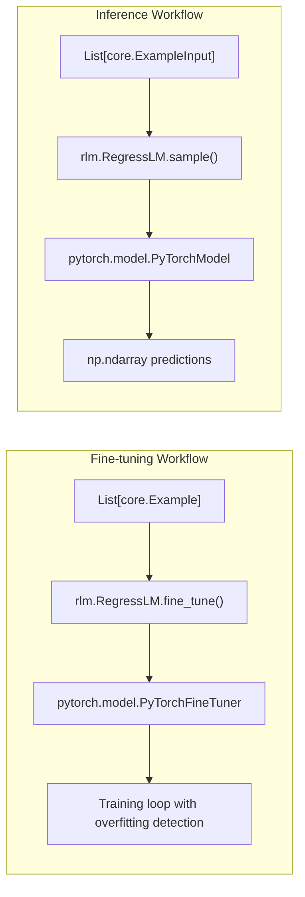

<!-- source: DeepWiki mcp.deepwiki.com · repo google-deepmind/regress-lm · page 1 Overview · fetched 2026-10-26 -->

# Overview

<details>
<summary>Relevant source files</summary>

The following files were used as context for generating this wiki page:

- [README.md](README.md)

</details>


## Purpose and Scope

This document provides a high-level introduction to the RegressLM repository, a specialized library for text-to-text regression tasks. RegressLM enables converting arbitrary text inputs into floating-point numerical predictions through transformer-based neural networks with custom tokenization strategies.

The system supports both inference on pre-trained models and fine-tuning on new regression datasets. For detailed API usage, see [API Reference](#3). For implementation details of the model system, see [Model System](#5). For tokenization specifics, see [Data Processing](#6).

## System Architecture

RegressLM implements a layered architecture centered around the `rlm.RegressLM` class, which provides the main user interface for text-to-numerical regression tasks.

### High-Level Component Structure

```mermaid
graph TB
    subgraph "User Interface"
        RegressLM["rlm.RegressLM"]
    end
    
    subgraph "Core Abstractions"
        Model["models.base.Model"]
        FineTuner["models.base.FineTuner"] 
        Example["core.Example"]
        ExampleInput["core.ExampleInput"]
    end
    
    subgraph "PyTorch Implementation"
        PyTorchModel["pytorch.model.PyTorchModel"]
        PyTorchFineTuner["pytorch.model.PyTorchFineTuner"]
        EncoderDecoder["pytorch.architecture.EncoderDecoder"]
    end
    
    subgraph "Tokenization System"
        EncoderVocab["vocabs.EncoderVocab"]
        DecoderVocab["vocabs.DecoderVocab"]
        DecoderTokenizer["tokenizers.DecoderTokenizer"]
    end
    
    RegressLM --> Model
    RegressLM --> FineTuner
    RegressLM --> Example
    RegressLM --> ExampleInput
    
    Model <|-- PyTorchModel
    FineTuner <|-- PyTorchFineTuner
    
    PyTorchModel --> EncoderDecoder
    PyTorchModel --> EncoderVocab
    PyTorchModel --> DecoderVocab
    
    DecoderVocab --> DecoderTokenizer
```

Sources: [README.md:1-55]()

## Core Functionality

RegressLM operates through two primary data structures that define the input-output interface:

| Data Structure | Purpose | Components |
|---------------|---------|------------|
| `core.Example` | Training data with input text and target value | `x: str`, `y: float` |
| `core.ExampleInput` | Inference input with text only | `x: str` |

The system transforms text inputs through a specialized encoder-decoder architecture where:
- **Encoder**: Processes input text using standard text tokenization
- **Decoder**: Generates numerical predictions using custom numerical tokenization

### Key Workflows



Sources: [README.md:17-31](), [README.md:38-53]()

## Architecture Highlights

### Numerical Tokenization Strategy

RegressLM implements specialized tokenization for floating-point numbers, converting them into discrete token sequences that transformer models can process effectively. This approach enables direct regression without intermediate classification steps.

### Modular Design

The system uses abstract base classes (`models.base.Model`, `models.base.FineTuner`) to separate interface definitions from implementations, currently providing PyTorch-based concrete implementations while allowing for future extensions to other frameworks.

### Encoder-Decoder Architecture

The neural architecture combines:
- **RopeEncoder**: Text encoder with Rotary Positional Embeddings
- **TransformerDecoder**: Standard transformer decoder for numerical sequence generation

This design enables the model to maintain separate representations for text understanding and numerical prediction while allowing cross-attention between modalities.

Sources: [README.md:1-55]()

---

