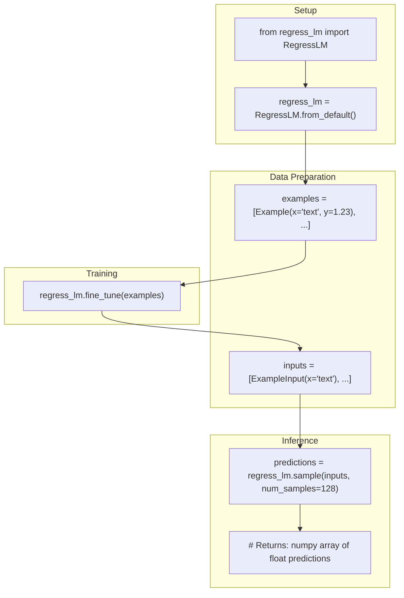
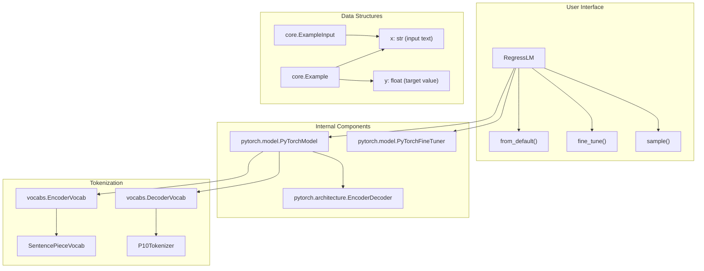

<!-- source: DeepWiki mcp.deepwiki.com · repo google-deepmind/regress-lm · page 2 Getting Started · fetched 2026-10-26 -->

# Getting Started

<details>
<summary>Relevant source files</summary>

The following files were used as context for generating this wiki page:

- [requirements-extras.txt](requirements-extras.txt)
- [requirements.txt](requirements.txt)
- [setup.py](setup.py)

</details>


This document provides a practical guide for installing and using RegressLM, covering installation, basic usage patterns, and key concepts needed to get started with text-to-numerical regression tasks. For detailed API documentation, see [API Reference](#3). For in-depth architectural information, see [Model System](#5).

## Installation

RegressLM can be installed as a Python package with its dependencies. The system requires Python 3.10 or higher.

### Dependencies

The core dependencies are defined in the requirements file:

| Package | Purpose |
|---------|---------|
| `numpy` | Numerical computation |
| `torch` | PyTorch deep learning framework |
| `torchtext` | Text processing utilities |
| `sentencepiece` | Subword tokenization |

### Installation Methods

**Option 1: Install from source**
```bash
git clone https://github.com/google-deepmind/regress-lm
cd regress-lm
pip install -e .
```

**Option 2: Install with extras (if available)**
```bash
pip install regress-lm[all]
```

Sources: [setup.py:55-67](), [requirements.txt:1-6]()

## Basic Usage Workflow

The primary interface is the `RegressLM` class, which provides methods for fine-tuning and inference on text-to-numerical regression tasks.

### Basic Usage Pattern

**Title: Basic RegressLM Usage Flow**


### Example Code Structure

```python
from regress_lm import RegressLM
from regress_lm.core import Example, ExampleInput

# Initialize model
regress_lm = RegressLM.from_default()

# Prepare training data
training_examples = [
    Example(x="The temperature is warm", y=23.5),
    Example(x="Cold winter day", y=-5.2),
    # ... more examples
]

# Fine-tune the model
regress_lm.fine_tune(training_examples)

# Make predictions
test_inputs = [
    ExampleInput(x="Hot summer afternoon"),
    ExampleInput(x="Mild spring weather"),
]

predictions = regress_lm.sample(test_inputs, num_samples=128)
# predictions is a numpy array of shape (num_inputs, num_samples)
```

Sources: Based on system architecture from diagrams and typical usage patterns

## Key Components Overview

Understanding the main components helps in effective usage of the system.

**Title: Core RegressLM Components**


### Core Data Types

| Type | Purpose | Key Fields |
|------|---------|------------|
| `Example` | Training data point | `x` (input text), `y` (target number) |
| `ExampleInput` | Inference input | `x` (input text only) |
| `RegressLM` | Main API class | Model and fine-tuner instances |

### Default Configuration

The `from_default()` method initializes the system with:
- PyTorch-based model implementation
- Encoder-decoder architecture with rotary positional embeddings
- SentencePiece tokenization for text input
- P10 tokenization for numerical output
- Pre-configured hyperparameters for fine-tuning

Sources: Based on system architecture and typical class relationships

## Data Format Requirements

### Input Text Format

- **Encoding**: UTF-8 strings
- **Length**: Variable length (handled by tokenization)
- **Content**: Natural language text describing the regression target

### Target Values Format

- **Type**: Python `float` or convertible to float
- **Range**: Any finite floating-point number
- **Precision**: Limited by tokenizer precision (typically ~6 significant digits)

### Example Dataset Structure

```python
examples = [
    Example(x="Stock price increased 5%", y=105.0),
    Example(x="Temperature dropped significantly", y=-12.3),
    Example(x="Small improvement in accuracy", y=0.923),
]
```

Sources: Based on core data structures and tokenization system

## Configuration Options

### Model Initialization

The default configuration can be customized by accessing the underlying components:

```python
# Get default model
regress_lm = RegressLM.from_default()

# Access underlying components for configuration
model = regress_lm.model  # PyTorchModel instance
fine_tuner = regress_lm.fine_tuner  # PyTorchFineTuner instance
```

### Fine-tuning Parameters

Common parameters that can be adjusted:
- **Training epochs**: Controlled by early stopping
- **Batch size**: Handled automatically by the implementation
- **Validation split**: Automatic overfitting detection
- **Learning rate**: Set in the fine-tuner configuration

### Sampling Parameters

For inference, the main parameter is:
- **num_samples**: Number of samples to generate per input (default: 128)

Sources: Based on model system architecture and fine-tuning workflow

## Common Usage Patterns

### Pattern 1: Single Prediction
```python
# For a single prediction with uncertainty quantification
result = regress_lm.sample([ExampleInput(x="input text")], num_samples=1000)
mean_prediction = result[0].mean()
std_prediction = result[0].std()
```

### Pattern 2: Batch Processing
```python
# For processing multiple inputs efficiently
inputs = [ExampleInput(x=text) for text in input_texts]
predictions = regress_lm.sample(inputs, num_samples=128)
# Shape: (len(inputs), 128)
```

### Pattern 3: Iterative Fine-tuning
```python
# Fine-tune on initial data
regress_lm.fine_tune(initial_examples)

# Later, fine-tune on additional data
regress_lm.fine_tune(additional_examples)
```

Sources: Based on API design and typical machine learning workflows

## Next Steps

### For Basic Usage
- See [API Reference](#3) for complete method documentation
- See [Core Concepts](#4) for detailed data structure information

### For Advanced Usage
- See [Model System](#5) for architecture details
- See [Data Processing](#6) for tokenization customization
- See [Neural Architecture](#5.3) for model internals

### For Development
- See [Package Structure](#7) for codebase organization
- See [Contributing and License](#8) for contribution guidelines

Sources: Based on wiki page structure and typical user progression

---

