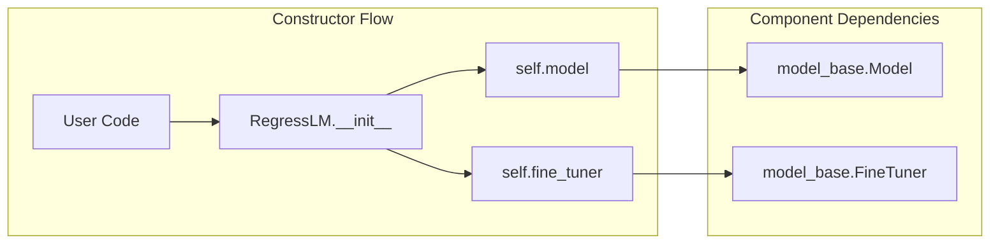
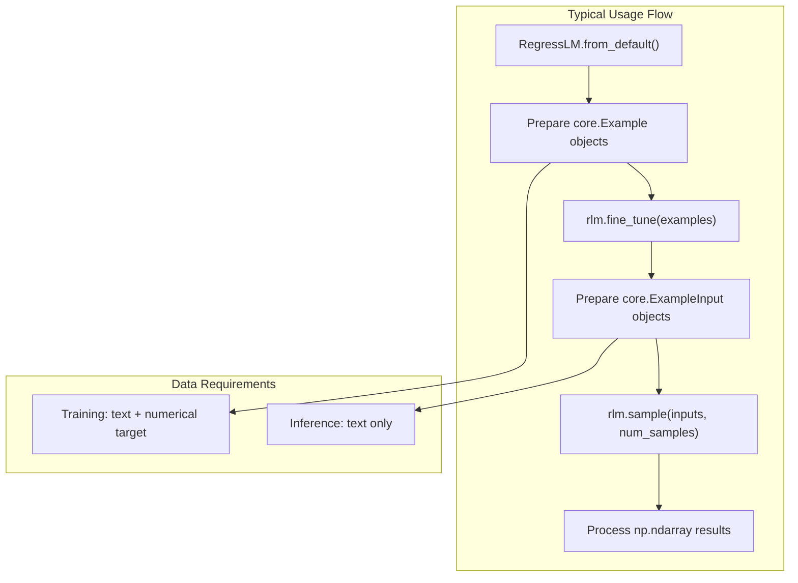
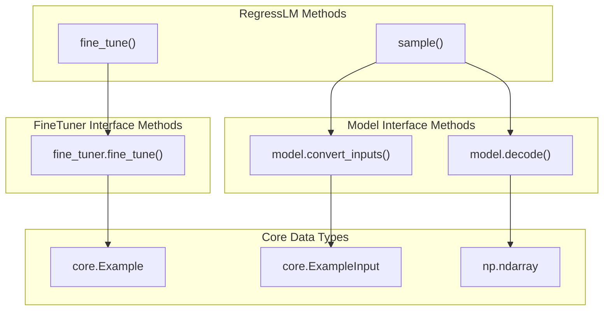

<!-- source: DeepWiki mcp.deepwiki.com · repo google-deepmind/regress-lm · page 3 API Reference · fetched 2026-10-26 -->

# API Reference

<details>
<summary>Relevant source files</summary>

The following files were used as context for generating this wiki page:

- [regress_lm/rlm.py](regress_lm/rlm.py)

</details>


This page documents the main user-facing `RegressLM` API class and its methods. The `RegressLM` class provides a high-level interface for text-to-numerical regression tasks, abstracting away the underlying model architecture and training details.

For information about the underlying model abstractions, see [Model Abstractions](#5.1). For details about the core data structures used by these APIs, see [Core Concepts](#4).

## RegressLM Class Overview

The `RegressLM` class serves as the primary entry point for users of the regress-lm system. It encapsulates a regression model and fine-tuner, providing simplified methods for training and inference.

```mermaid
graph TB
    subgraph "RegressLM API Layer"
        RLM["RegressLM"]
        Init["__init__(model, fine_tuner)"]
        FineTune["fine_tune(examples, validation_examples)"]
        FromDefault["from_default() -> RegressLM"]
        Sample["sample(xs, num_samples) -> np.ndarray[]"]
        
        RLM --> Init
        RLM --> FineTune
        RLM --> FromDefault
        RLM --> Sample
    end
    
    subgraph "Underlying Components"
        Model["model_base.Model"]
        FineTuner["model_base.FineTuner"]
        PyTorchModel["pytorch_model.PyTorchModel"]
        PyTorchFineTuner["pytorch_model.PyTorchFineTuner"]
        
        Model <|-- PyTorchModel
        FineTuner <|-- PyTorchFineTuner
    end
    
    subgraph "Data Types"
        Example["core.Example"]
        ExampleInput["core.ExampleInput"]
        NpArray["np.ndarray"]
    end
    
    Init --> Model
    Init --> FineTuner
    FromDefault --> PyTorchModel
    FromDefault --> PyTorchFineTuner
    FineTune --> Example
    Sample --> ExampleInput
    Sample --> NpArray
```

**API Class Structure**

Sources: [regress_lm/rlm.py:26-68]()

## Constructor and Configuration

### `__init__(model, fine_tuner)`

The constructor takes two required parameters:

| Parameter | Type | Description |
|-----------|------|-------------|
| `model` | `model_base.Model` | The underlying regression model implementation |
| `fine_tuner` | `model_base.FineTuner` | The fine-tuning implementation for the model |



**Constructor Implementation**

Sources: [regress_lm/rlm.py:29-31]()

### `from_default()` Class Method

Creates a `RegressLM` instance with default configuration suitable for most text-to-numerical regression tasks.

**Default Configuration:**

| Component | Implementation | Configuration |
|-----------|----------------|---------------|
| Encoder Vocabulary | `SentencePieceVocab.from_t5()` | T5-based sentence piece tokenization |
| Decoder Vocabulary | `DecoderVocab(P10Tokenizer())` | P10 scientific notation tokenizer |
| Model Architecture | `PyTorchModel` | Transformer encoder-decoder |
| Fine-tuner | `PyTorchFineTuner` | PyTorch-based optimization |

**Model Hyperparameters:**

| Parameter | Default Value | Description |
|-----------|---------------|-------------|
| `max_input_len` | 2048 | Maximum input sequence length |
| `learning_rate` | 1e-4 | Learning rate for optimization |
| `d_model` | 512 | Model dimension |
| `nhead` | 8 | Number of attention heads |
| `num_encoder_layers` | 2 | Number of encoder layers |
| `num_decoder_layers` | 2 | Number of decoder layers |
| `dim_feedforward` | 2048 | Feedforward dimension |

Sources: [regress_lm/rlm.py:40-59]()

## Core Methods

### `fine_tune(examples, validation_examples=None)`

Performs fine-tuning on the provided training examples.

**Parameters:**

| Parameter | Type | Required | Description |
|-----------|------|----------|-------------|
| `examples` | `Sequence[core.Example]` | Yes | Training examples with input text and target values |
| `validation_examples` | `Sequence[core.Example] \| None` | No | Optional validation examples for overfitting detection |

**Behavior:**
- Delegates to the underlying `fine_tuner.fine_tune()` method
- Supports early stopping based on validation performance
- Modifies the model parameters in-place

Sources: [regress_lm/rlm.py:33-38]()

### `sample(xs, num_samples)`

Generates numerical predictions for the given input texts.

**Parameters:**

| Parameter | Type | Description |
|-----------|------|-------------|
| `xs` | `Sequence[core.ExampleInput]` | Input texts to generate predictions for |
| `num_samples` | `int` | Number of samples to generate per input |

**Returns:**
- `Sequence[np.ndarray]`: List of numpy arrays, one per input, each containing `num_samples` predictions

**Processing Flow:**

```mermaid
graph TB
    subgraph "sample() Method Flow"
        Input["xs: Sequence[ExampleInput]"]
        Convert["model.convert_inputs(xs)"]
        Decode["model.decode(examples, num_samples)"]
        Split["output_floats.split(axis=0)"]
        Output["Sequence[np.ndarray]"]
        
        Input --> Convert
        Convert --> Decode
        Decode --> Split
        Split --> Output
    end
    
    subgraph "Data Transformation"
        ExampleInput1["core.ExampleInput"]
        ConvertedEx["Converted Examples"]
        DecodedFloats["Decoded Float Arrays"]
        SplitArrays["Split Arrays"]
        
        ExampleInput1 --> ConvertedEx
        ConvertedEx --> DecodedFloats
        DecodedFloats --> SplitArrays
    end
```



**Sampling Process Details**

Sources: [regress_lm/rlm.py:61-67]()

## Usage Patterns

### Basic Usage Pattern



**Common Integration Pattern**

### Method Dependencies

The following diagram shows how `RegressLM` methods depend on underlying components:



**Method Dependency Graph**

Sources: [regress_lm/rlm.py:33-67]()

## Import Requirements

To use the `RegressLM` API, the following imports are typically needed:

| Module | Purpose |
|--------|---------|
| `regress_lm.rlm` | Main `RegressLM` class |
| `regress_lm.core` | `Example` and `ExampleInput` data structures |
| `numpy` | Handling numerical output arrays |

Sources: [regress_lm/rlm.py:17-24]()

---

