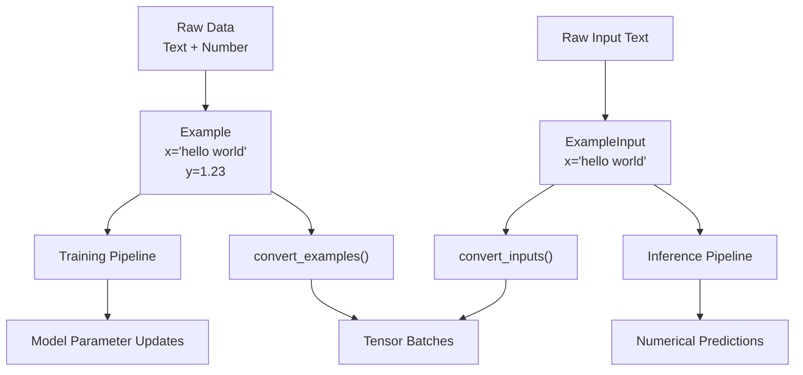
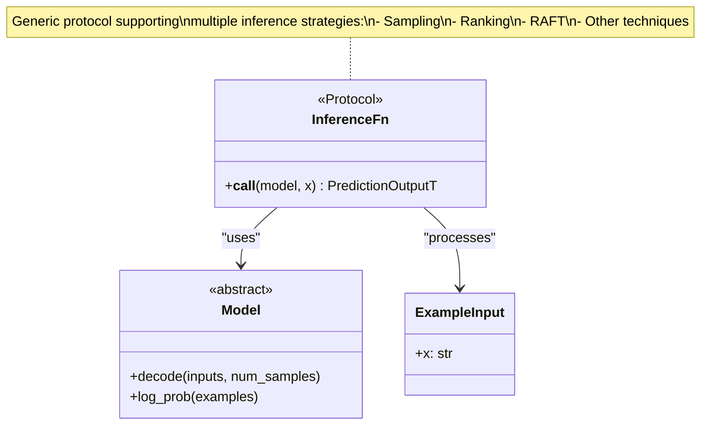
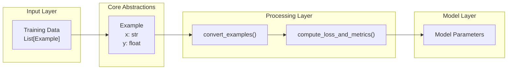
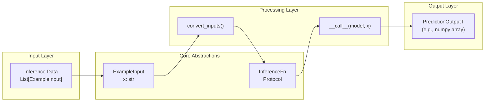

<!-- source: DeepWiki mcp.deepwiki.com · repo google-deepmind/regress-lm · page 4 Core Concepts · fetched 2026-10-26 -->

# Core Concepts

Relevant source files

The following files were used as context for generating this wiki page:

- [regress_lm/core.py](regress_lm/core.py)
- [regress_lm/inference.py](regress_lm/inference.py)

This document explains the fundamental data structures and conceptual abstractions that form the foundation of RegressLM. These core concepts define how data flows through the system and how different components interact with each other.

For detailed information about the model implementations that use these concepts, see [Model System](#5). For specifics about data processing and tokenization, see [Data Processing](#6).

## Data Structures

RegressLM is built around two primary data structures that represent the inputs and outputs of the regression system.

### Example and ExampleInput

The system uses two closely related dataclasses to represent data at different stages of processing:

| Data Structure | Purpose | Fields | Usage |
|----------------|---------|--------|-------|
| `ExampleInput` | Represents input data for inference | `x: str` | Used when making predictions |
| `Example` | Represents complete training data | `x: str`, `y: float` | Used during training and evaluation |

The `ExampleInput` class contains only the input text that needs to be processed, while `Example` extends it to include the target numerical value for supervised learning.

**Data Flow Through System**

Sources: [regress_lm/core.py:20-29]()

## Inference Protocol

The `InferenceFn` protocol defines a standardized interface for performing inference operations on models. This abstraction allows the system to support different inference strategies while maintaining a consistent API.

### InferenceFn Interface

The protocol is designed with the following characteristics:

- **Generic Type Parameter**: `PredictionOutputT` allows different inference functions to return different output types
- **Model Agnostic**: Works with any model implementing the base `Model` interface
- **Extensible**: Supports various inference techniques beyond basic sampling

Sources: [regress_lm/inference.py:26-37]()

## Conceptual Data Flow

The core concepts work together to enable the text-to-numerical regression workflow:

**Training Flow**

**Inference Flow**

Sources: [regress_lm/core.py:20-29](), [regress_lm/inference.py:26-37]()

## Type System Integration

The core concepts are designed to work seamlessly with Python's type system and the broader RegressLM architecture:

| Concept | Type Annotation | Generic Parameter | Purpose |
|---------|-----------------|-------------------|---------|
| `ExampleInput` | `@dataclasses.dataclass` | None | Simple data container |
| `Example` | `@dataclasses.dataclass` | None | Extends `ExampleInput` |
| `InferenceFn` | `Protocol[PredictionOutputT]` | `PredictionOutputT` | Flexible inference interface |

The use of protocols and generic types allows the system to maintain type safety while supporting extensibility for different inference strategies and output formats.

Sources: [regress_lm/core.py:17-29](), [regress_lm/inference.py:17-37]()

---

