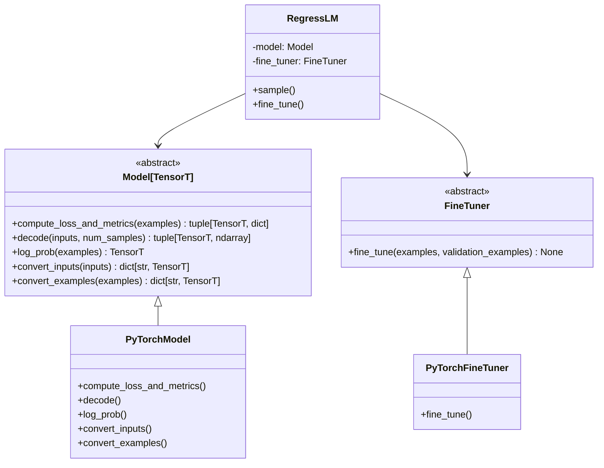
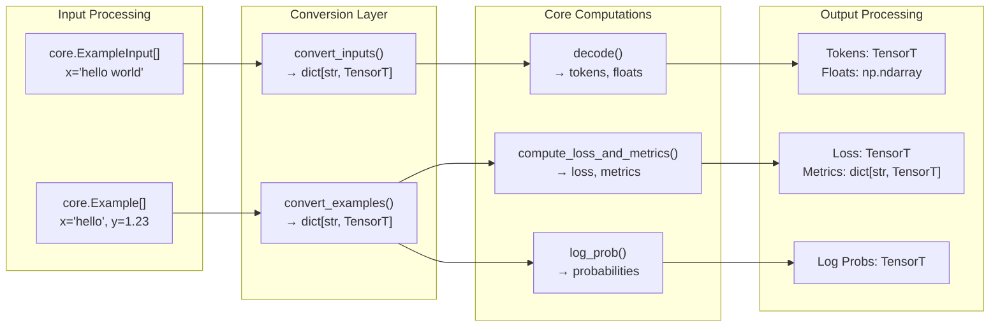

<!-- source: DeepWiki mcp.deepwiki.com · repo google-deepmind/regress-lm · page 5 Model System · fetched 2026-10-26 -->

# Model System

<details>
<summary>Relevant source files</summary>

The following files were used as context for generating this wiki page:

- [regress_lm/models/__init__.py](regress_lm/models/__init__.py)
- [regress_lm/models/base.py](regress_lm/models/base.py)

</details>


This document provides an overview of the model system architecture in RegressLM, explaining how abstract model interfaces are designed and implemented to support text-to-numerical regression tasks. The model system consists of abstract base classes that define the core functionality and concrete implementations that provide the actual neural network computations.

For detailed information about the abstract interfaces, see [Model Abstractions](#5.1). For the concrete PyTorch implementation details, see [PyTorch Implementation](#5.2). For the neural network architecture specifics, see [Neural Architecture](#5.3).

## System Architecture Overview

The model system is built around two main abstract base classes that define the core functionality: `Model` for inference and training computations, and `FineTuner` for model adaptation workflows.



**Sources:** [regress_lm/models/base.py:26-86](), [regress_lm/models/__init__.py:23-25]()

## Core Abstractions

The model system uses generic type parameters to support different tensor frameworks while maintaining a consistent interface. The `TensorT` type variable allows the same abstract interface to work with PyTorch tensors, JAX arrays, or other tensor types.

### Model Interface

The `Model` class defines five essential methods that any implementation must provide:

| Method | Purpose | Input | Output |
|--------|---------|-------|---------|
| `compute_loss_and_metrics` | Training loss computation | Batched examples as tensors | Loss tensor and metrics dict |
| `decode` | Autoregressive generation | Batched inputs as tensors | Token sequences and float predictions |
| `log_prob` | Probability evaluation | Batched examples as tensors | Log probability tensor |
| `convert_inputs` | Input preprocessing | High-level `ExampleInput` objects | Batched tensor dict |
| `convert_examples` | Example preprocessing | High-level `Example` objects | Batched tensor dict |

### FineTuner Interface

The `FineTuner` class provides a single method `fine_tune` that handles model adaptation with optional validation-based early stopping. The interface is designed to be stateful, modifying the underlying model parameters directly.

**Sources:** [regress_lm/models/base.py:36-62](), [regress_lm/models/base.py:67-85]()

## Implementation Architecture

The system currently provides a PyTorch-based implementation that instantiates the abstract interfaces with concrete neural network components.

```mermaid
graph TB
    subgraph "Abstract Layer"
        ModelABC["Model[TensorT]<br/>base.py"]
        FineTunerABC["FineTuner<br/>base.py"]
    end
    
    subgraph "PyTorch Implementation"
        PyTorchModelImpl["PyTorchModel<br/>pytorch/model.py"]
        PyTorchFineTunerImpl["PyTorchFineTuner<br/>pytorch/model.py"]
        EncoderDecoderArch["EncoderDecoder<br/>pytorch/architecture.py"]
    end
    
    subgraph "External Dependencies"
        TorchTensors["torch.Tensor<br/>TensorT=torch.Tensor"]
        TorchOptim["torch.optim<br/>Training Loop"]
    end
    
    ModelABC <|-- PyTorchModelImpl
    FineTunerABC <|-- PyTorchFineTunerImpl
    PyTorchModelImpl --> EncoderDecoderArch
    PyTorchModelImpl --> TorchTensors
    PyTorchFineTunerImpl --> TorchOptim
    PyTorchFineTunerImpl --> PyTorchModelImpl
```

**Sources:** [regress_lm/models/__init__.py:22-25](), [regress_lm/models/base.py:22-23]()

## Data Flow Through Model System

The model system processes data through a standardized pipeline that converts high-level objects to tensor representations, performs neural computations, and converts results back to usable formats.



**Sources:** [regress_lm/models/base.py:36-62]()

## Integration Points

The model system integrates with other RegressLM components through well-defined interfaces:

- **Vocabulary System**: Models use encoder and decoder vocabularies to convert between text/numbers and token IDs
- **Core Data Structures**: The `convert_inputs` and `convert_examples` methods bridge between high-level `core.Example` objects and low-level tensor representations
- **Fine-tuning Workflow**: The `FineTuner` abstraction provides a clean interface for model adaptation that can be used by the main `RegressLM` API
- **Inference Pipeline**: The `decode` method supports the sampling-based inference required for numerical predictions

The generic type system (`TensorT`) allows the same abstract interfaces to work with different tensor frameworks, making the system extensible to JAX, TensorFlow, or other backends without changing the high-level API.

**Sources:** [regress_lm/models/base.py:18-23](), [regress_lm/models/base.py:53-62]()

---

