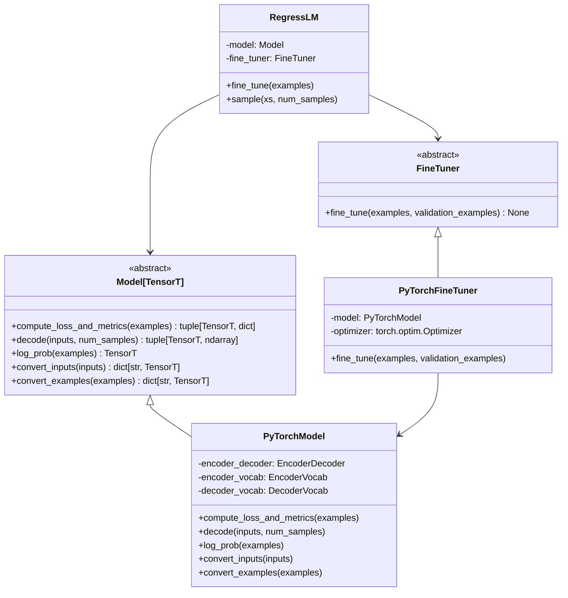
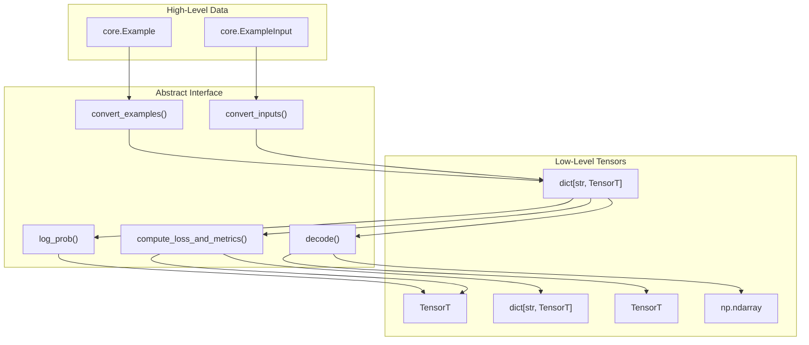

<!-- source: DeepWiki mcp.deepwiki.com · repo google-deepmind/regress-lm · page 5.1 Model Abstractions · fetched 2026-10-26 -->

# Model Abstractions

<details>
<summary>Relevant source files</summary>

The following files were used as context for generating this wiki page:

- [regress_lm/models/base.py](regress_lm/models/base.py)

</details>


This document covers the abstract base classes that define the core model interface and fine-tuning protocols in RegressLM. These abstractions provide a framework-agnostic interface that enables different tensor library implementations (PyTorch, JAX, etc.) while maintaining consistent behavior.

For concrete implementations of these abstractions, see [PyTorch Implementation](#5.2). For details on the neural architecture used by implementations, see [Neural Architecture](#5.3).

## Abstract Base Classes Overview

The model abstraction layer consists of two primary abstract base classes located in [regress_lm/models/base.py:26-86]():

- `Model`: Defines the core model interface for training, inference, and data conversion
- `FineTuner`: Defines the interface for fine-tuning models on new data

### Model Class Interface

The `Model` class is a generic abstract base class that uses type parameters to support different tensor frameworks:

```python
class Model(Generic[TensorT], abc.ABC)
```

The generic `TensorT` type parameter allows implementations to use framework-specific tensor types (e.g., `torch.Tensor`, `jax.Array`) while maintaining the same interface.

#### Core Model Methods

The `Model` class defines five abstract methods that implementations must provide:

| Method | Purpose | Input | Output |
|--------|---------|-------|--------|
| `compute_loss_and_metrics` | Training loss computation | Tensor batch | Loss + metrics |
| `decode` | Autoregressive decoding | Tensor inputs + sample count | Tokens + float predictions |
| `log_prob` | Probability evaluation | Tensor examples | Log probabilities |
| `convert_inputs` | Input preprocessing | `ExampleInput` sequence | Tensor batch |
| `convert_examples` | Example preprocessing | `Example` sequence | Tensor batch |

**Training Interface**

The [compute_loss_and_metrics:37-40]() method handles supervised learning:

```python
def compute_loss_and_metrics(
    self, examples: dict[str, TensorT]
) -> tuple[TensorT, dict[str, TensorT]]
```

This method takes batched tensor examples and returns both the scalar loss for backpropagation and a dictionary of metrics for monitoring.

**Inference Interface**

The [decode:43-46]() method performs autoregressive generation:

```python
def decode(
    self, inputs: dict[str, TensorT], num_samples: int
) -> tuple[TensorT, np.ndarray]
```

It takes tensor inputs and the number of samples to generate, returning both the raw token predictions and the corresponding floating-point values.

**Data Conversion Interface**

Two methods handle the conversion between high-level Python objects and low-level tensor representations:

- [convert_inputs:53-56](): Converts `core.ExampleInput` objects to tensor batches for inference
- [convert_examples:59-62](): Converts `core.Example` objects to tensor batches for training

### FineTuner Class Interface

The `FineTuner` abstract base class defines the interface for adapting pre-trained models to new data:

```python
class FineTuner(abc.ABC):
    def fine_tune(
        self,
        examples: Sequence[core.Example],
        validation_examples: Sequence[core.Example] | None = None,
    ) -> None
```

The [fine_tune:68-85]() method is stateful and modifies the model in-place rather than returning a new model instance. This design supports the common pattern where fine-tuning updates the existing model parameters.

## Abstraction Layer Architecture

The following diagram shows how the abstract base classes relate to the concrete implementations and the overall system:



Sources: [regress_lm/models/base.py:26-86]()

## Data Flow Through Abstractions

The abstraction layer facilitates a clean separation between high-level user data and low-level tensor operations:



Sources: [regress_lm/models/base.py:37-62]()

## Generic Type Support

The `Model` class uses a generic type parameter `TensorT` to support different tensor frameworks:

```python
TensorT = TypeVar('TensorT')
class Model(Generic[TensorT], abc.ABC):
```

This design enables the same abstract interface to work with:
- PyTorch tensors (`torch.Tensor`)
- JAX arrays (`jax.Array`) 
- NumPy arrays (`np.ndarray`)
- Other tensor libraries

The [TensorT:23]() type variable is defined at the module level and represents the low-level tensor type used by a specific implementation.

## Implementation Requirements

Concrete implementations of these abstractions must:

1. **Specify the tensor type**: Choose a specific type for `TensorT` (e.g., `torch.Tensor`)
2. **Implement all abstract methods**: Provide concrete implementations for all five `Model` methods and the `FineTuner` method
3. **Handle data conversion**: Properly convert between `core.Example`/`core.ExampleInput` objects and tensor batches
4. **Maintain consistency**: Ensure that tensor shapes and types are consistent across all methods

The abstraction layer provides flexibility while enforcing a consistent interface that the main `RegressLM` class can depend on.

Sources: [regress_lm/models/base.py:22-86]()

---

