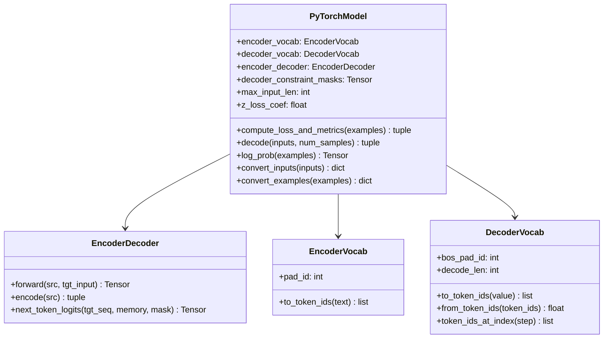
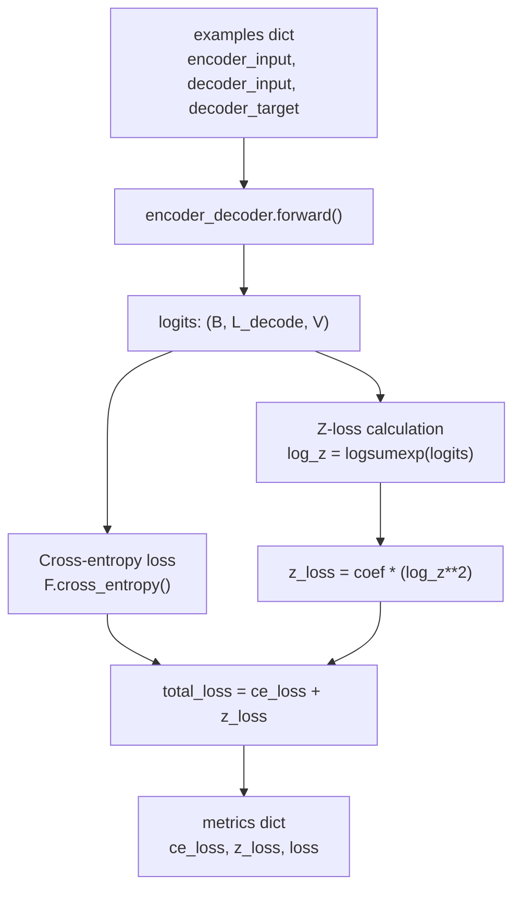
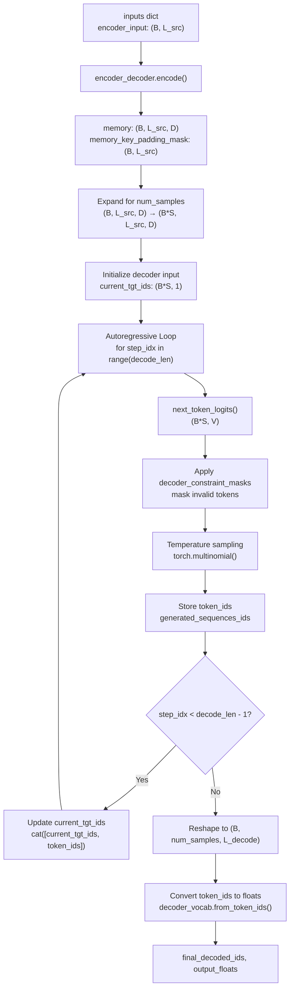
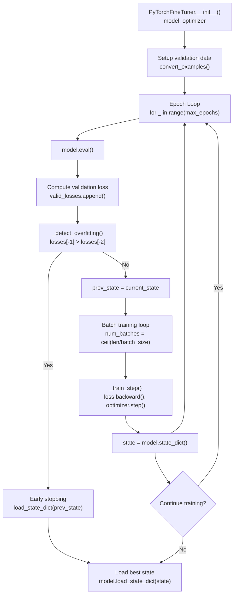
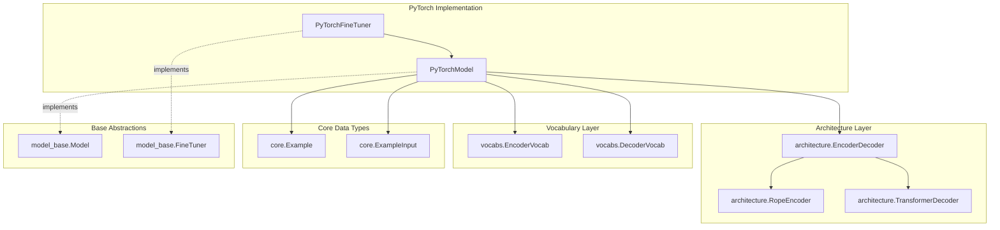

<!-- source: DeepWiki mcp.deepwiki.com · repo google-deepmind/regress-lm · page 5.2 PyTorch Implementation · fetched 2026-10-26 -->

# PyTorch Implementation

<details>
<summary>Relevant source files</summary>

The following files were used as context for generating this wiki page:

- [regress_lm/models/pytorch/model.py](regress_lm/models/pytorch/model.py)

</details>


This page documents the concrete PyTorch implementation of the RegressLM model system, including the `PyTorchModel` and `PyTorchFineTuner` classes. These classes provide the actual neural network implementation that realizes the abstract interfaces defined in the model system.

For information about the abstract base classes and interfaces, see [Model Abstractions](#5.1). For details about the underlying neural architecture, see [Neural Architecture](#5.3).

## Overview

The PyTorch implementation consists of two main classes that implement the abstract model interfaces:

| Class | Purpose | Base Class |
|-------|---------|------------|
| `PyTorchModel` | Core model implementation with loss computation, inference, and tokenization | `nn.Module`, `model_base.Model[Tensor]` |
| `PyTorchFineTuner` | Fine-tuning orchestration with overfitting detection and early stopping | `model_base.FineTuner` |

## PyTorchModel Architecture

The `PyTorchModel` class serves as the primary implementation of the regression language model, combining PyTorch's `nn.Module` with the abstract `Model` interface.



**Sources:** [regress_lm/models/pytorch/model.py:35-65]()

### Key Components

The `PyTorchModel` constructor initializes several critical components:

- **Vocabularies**: `encoder_vocab` and `decoder_vocab` handle text and numerical tokenization respectively
- **Architecture**: `encoder_decoder` provides the underlying transformer architecture 
- **Constraints**: `decoder_constraint_masks` pre-computed masks ensure valid token generation at each decoding step
- **Configuration**: `max_input_len`, `z_loss_coef` control model behavior

**Sources:** [regress_lm/models/pytorch/model.py:38-64]()

## Core Model Operations

### Loss Computation and Training

The `compute_loss_and_metrics` method implements the primary training objective using cross-entropy loss with optional z-loss regularization:



The method handles padding tokens by using `ignore_index=self.decoder_vocab.bos_pad_id` in the cross-entropy calculation and applying masks for z-loss computation.

**Sources:** [regress_lm/models/pytorch/model.py:66-93]()

### Autoregressive Decoding

The `decode` method implements constrained autoregressive generation with multiple sampling:



The decoding process uses pre-computed constraint masks to ensure only valid tokens are generated at each position, maintaining the numerical format requirements.

**Sources:** [regress_lm/models/pytorch/model.py:95-170]()

### Data Conversion Methods

The model provides conversion methods that bridge between high-level data types and tensor representations:

| Method | Input | Output | Purpose |
|--------|-------|--------|---------|
| `convert_inputs` | `Sequence[core.ExampleInput]` | `dict[str, Tensor]` | Convert inference inputs to tensors |
| `convert_examples` | `Sequence[core.Example]` | `dict[str, Tensor]` | Convert training examples to tensors |

Both methods handle tokenization and padding/truncation according to `max_input_len`.

**Sources:** [regress_lm/models/pytorch/model.py:190-207]()

## PyTorchFineTuner Implementation

The `PyTorchFineTuner` class orchestrates the fine-tuning process with built-in overfitting detection:



### Overfitting Detection

The fine-tuner implements a simple but effective overfitting detection mechanism:

```python
def _detect_overfitting(losses: Sequence[float]) -> bool:
  if len(losses) <= 1:
    return False
  return losses[-1] > losses[-2]
```

This compares consecutive validation losses and triggers early stopping when validation loss increases.

**Sources:** [regress_lm/models/pytorch/model.py:233-236](), [regress_lm/models/pytorch/model.py:252-302]()

## Integration with System Components

The PyTorch implementation integrates with several key system components:



The implementation serves as the concrete realization of the abstract model interfaces, utilizing the specialized architecture and vocabulary components while maintaining compatibility with the core data types.

**Sources:** [regress_lm/models/pytorch/model.py:15-28](), [regress_lm/models/pytorch/model.py:35-60]()

---

