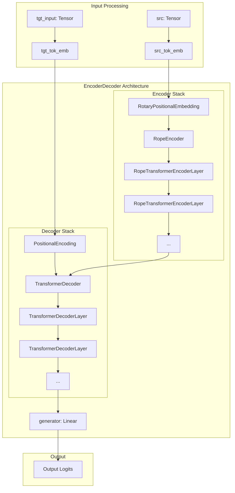
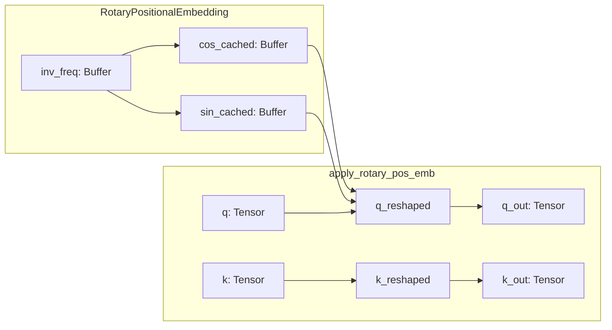
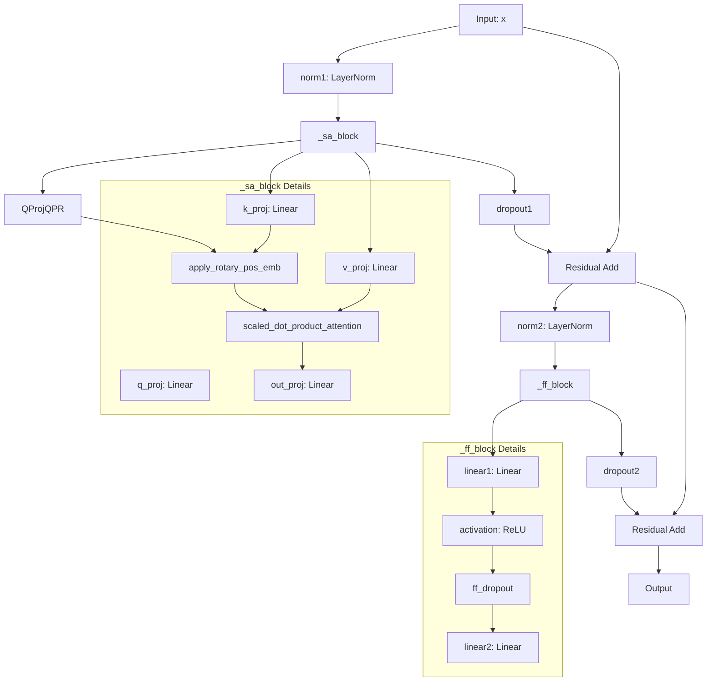
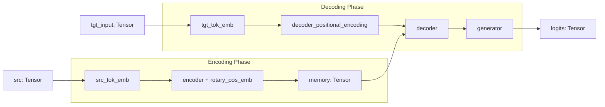

<!-- source: DeepWiki mcp.deepwiki.com · repo google-deepmind/regress-lm · page 5.3 Neural Architecture · fetched 2026-10-26 -->

# Neural Architecture

<details>
<summary>Relevant source files</summary>

The following files were used as context for generating this wiki page:

- [regress_lm/models/pytorch/architecture.py](regress_lm/models/pytorch/architecture.py)

</details>


This document describes the neural network architecture implementation in RegressLM's PyTorch backend. The architecture consists of an encoder-decoder transformer model with specialized positional encoding strategies optimized for text-to-number regression tasks.

For information about the abstract model interfaces, see [Model Abstractions](#5.1). For the PyTorch model implementation that uses this architecture, see [PyTorch Implementation](#5.2).

## Architecture Overview

The core neural architecture is implemented in the `EncoderDecoder` class, which combines a RoPE-enabled encoder with a standard transformer decoder. This hybrid approach leverages the length generalization benefits of Rotary Positional Embeddings for input text processing while using conventional positional encodings for numerical output generation.



Sources: [regress_lm/models/pytorch/architecture.py:225-333]()

## Encoder Architecture with RoPE

The encoder uses Rotary Positional Embeddings (RoPE) to achieve better length generalization for input text sequences. The `RopeEncoder` consists of multiple `RopeTransformerEncoderLayer` instances, each implementing multi-head self-attention with rotary embeddings.

### RoPE Implementation Details



The `RotaryPositionalEmbedding` class precomputes rotation matrices based on inverse frequencies and caches sine/cosine values for efficiency. The rotation is applied to query and key tensors by reshaping them to separate even and odd dimensions, then applying the rotation formula.

Key implementation details:
- **Base frequency**: Default 10000, configurable via constructor
- **Cached computations**: Sine and cosine values precomputed up to `max_len`
- **Head dimension**: RoPE applied per attention head (`d_model // nhead`)

Sources: [regress_lm/models/pytorch/architecture.py:24-76]()

### Encoder Layer Structure



The encoder uses Pre-LayerNorm architecture where normalization is applied before each sub-layer. This structure is implemented in the `RopeTransformerEncoderLayer.forward` method with residual connections around both attention and feed-forward blocks.

Sources: [regress_lm/models/pytorch/architecture.py:78-197]()

## Decoder Architecture with Standard Positional Encoding

The decoder uses PyTorch's built-in `TransformerDecoder` with standard sinusoidal positional encodings. This choice provides stable performance for the relatively short numerical token sequences produced by the decoder vocabulary.

### Positional Encoding Implementation

The `PositionalEncoding` class implements the standard transformer positional encoding formula:

- **Even positions**: `PE(pos, 2i) = sin(pos / 10000^(2i/d_model))`
- **Odd positions**: `PE(pos, 2i+1) = cos(pos / 10000^(2i/d_model))`

The encoding is added to token embeddings and includes dropout for regularization.

Sources: [regress_lm/models/pytorch/architecture.py:199-216]()

### Decoder Configuration

| Component | Implementation | Purpose |
|-----------|---------------|---------|
| `decoder` | `nn.TransformerDecoder` | Standard transformer decoder stack |
| `decoder_layer` | `nn.TransformerDecoderLayer` | Individual decoder layers with causal masking |
| `generator` | `nn.Linear` | Final projection to vocabulary logits |
| **Architecture Options** | `batch_first=True, norm_first=True` | Optimized tensor layout and Pre-LN |

Sources: [regress_lm/models/pytorch/architecture.py:263-275]()

## Forward Pass and Inference Methods

The `EncoderDecoder` class provides three main computation methods:

### Training Forward Pass



The `forward` method processes complete sequences for training, applying causal masking to prevent the decoder from seeing future tokens.

### Encoding-Only Method

The `encode` method processes only the source sequence and returns the encoded memory along with padding masks. This is used during inference to avoid recomputing encoder outputs.

### Next Token Prediction

The `next_token_logits` method performs single-step decoding given the current target sequence and pre-computed memory. This enables efficient autoregressive generation during sampling.

Sources: [regress_lm/models/pytorch/architecture.py:280-333]()

## Attention Optimization

The architecture uses PyTorch's Scaled Dot-Product Attention with backend selection for optimal performance:

```python
SPD_BACKENDS = [
    nn.attention.SDPBackend.FLASH_ATTENTION,
    nn.attention.SDPBackend.MATH,
    nn.attention.SDPBackend.EFFICIENT_ATTENTION,
]
```

The `sdpa_kernel` context manager enables Flash Attention when available, falling back to optimized implementations for memory efficiency and speed.

Sources: [regress_lm/models/pytorch/architecture.py:218-223](), [regress_lm/models/pytorch/architecture.py:286-300](), [regress_lm/models/pytorch/architecture.py:307-331]()

---

