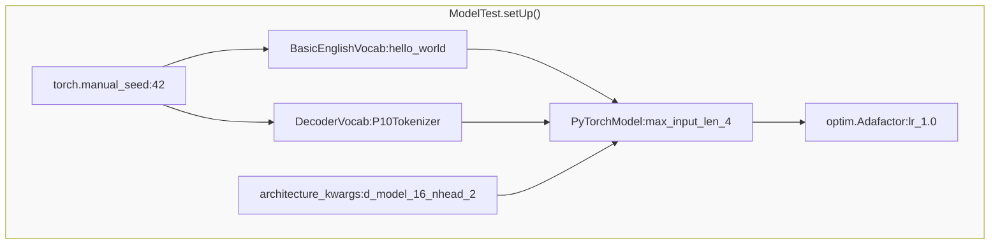
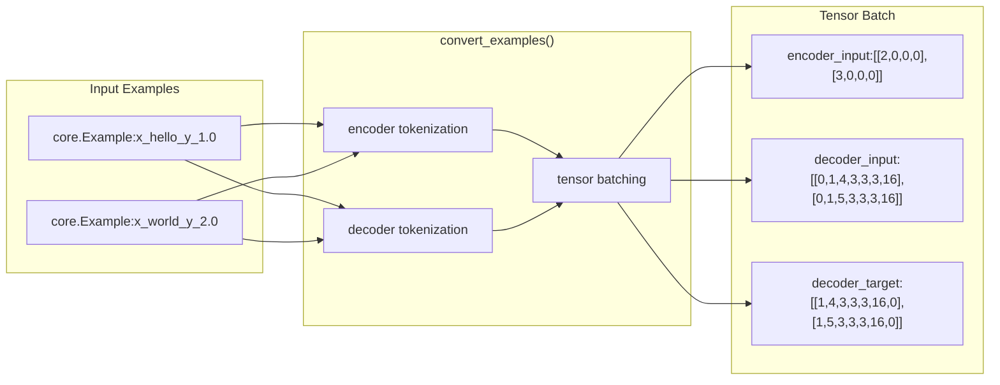
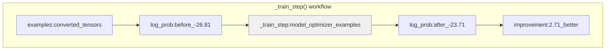
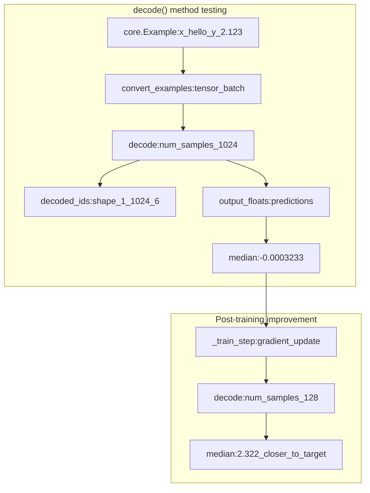
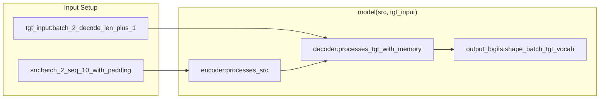
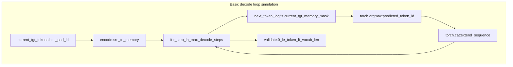

<!-- source: DeepWiki mcp.deepwiki.com · repo google-deepmind/regress-lm · page 5.4 Model Testing and Examples · fetched 2026-10-26 -->

# Model Testing and Examples

Relevant source files

The following files were used as context for generating this wiki page:

- [regress_lm/models/pytorch/architecture_test.py](regress_lm/models/pytorch/architecture_test.py)
- [regress_lm/models/pytorch/model_test.py](regress_lm/models/pytorch/model_test.py)

This page demonstrates how the model system works through concrete test examples and usage patterns. It covers the test infrastructure, data conversion workflows, training procedures, and inference patterns used to validate the PyTorch model implementation.

For information about the abstract model interfaces, see [Model Abstractions](#5.1). For details about the PyTorch implementation classes, see [PyTorch Implementation](#5.2). For the underlying neural architecture, see [Neural Architecture](#5.3).

## Test Infrastructure and Setup

The model testing infrastructure demonstrates how to properly initialize and configure the PyTorch model components for both training and inference scenarios.

### Model Configuration

The test setup in `ModelTest` shows the standard pattern for creating a complete model instance with vocabularies and architecture parameters:

Sources: [regress_lm/models/pytorch/model_test.py:29-50]()

### Architecture Testing Setup

The `ArchitectureTest` demonstrates direct testing of the `EncoderDecoder` architecture without the full model wrapper:

| Component | Configuration | Purpose |
|-----------|---------------|---------|
| `encoder_vocab` | `BasicEnglishVocab(["hello", "world", "foo", "bar"])` | Text tokenization |
| `decoder_vocab` | `DecoderVocab(P10Tokenizer())` | Numerical tokenization |
| `max_encoder_len` | `15` | Input sequence limit |
| `d_model` | `32` | Model dimension |
| `nhead` | `2` | Attention heads |
| `num_encoder_layers` | `1` | Encoder depth |
| `num_decoder_layers` | `1` | Decoder depth |

Sources: [regress_lm/models/pytorch/architecture_test.py:26-51]()

## Data Conversion Pipeline Testing

The data conversion process transforms `core.Example` instances into tensor batches suitable for model training and inference.

### Example-to-Tensor Conversion

The test validates the specific token sequences produced:
- Input text "hello" → encoder tokens `[2, 0, 0, 0]`
- Target value `1.0` → decoder input `[0, 1, 4, 3, 3, 3, 16]`
- Decoder target shifts input by one position: `[1, 4, 3, 3, 3, 16, 0]`

Sources: [regress_lm/models/pytorch/model_test.py:52-67]()

## Training Loop Testing

The training workflow demonstrates how gradient-based learning improves model performance through repeated forward and backward passes.

### Gradient Step Workflow

The test demonstrates measurable learning:
- Initial log probability: `-26.81`
- Post-training log probability: `-23.71` 
- Improvement: `2.71` increase in log probability

Sources: [regress_lm/models/pytorch/model_test.py:69-80]()

### Training Step Implementation

The `_train_step` function (referenced but not shown in tests) follows the standard pattern:
1. Forward pass through model
2. Loss computation
3. Backward pass (`loss.backward()`)
4. Optimizer step (`optimizer.step()`)
5. Gradient reset (`optimizer.zero_grad()`)

Sources: [regress_lm/models/pytorch/model_test.py:78]()

## Inference and Decoding Testing

The inference workflow shows how trained models generate numerical predictions through autoregressive decoding.

### Decoding Process

Key validation points:
- Decoded tensor shape: `(1, 1024, 6)` for 1 example, 1024 samples, 6 tokens each
- Sample predictions: first sample `-0.2398`, second sample `-230200000.0`
- Pre-training median: `-0.0003233`
- Post-training median: `2.322` (closer to target `2.123`)

Sources: [regress_lm/models/pytorch/model_test.py:82-96]()

## Architecture Component Testing

The architecture tests validate individual components of the `EncoderDecoder` system without the full model wrapper.

### Forward Pass Testing

Expected output shape: `(batch_size, tgt_seq_len, len(decoder_vocab))`

Sources: [regress_lm/models/pytorch/architecture_test.py:53-73]()

### Autoregressive Decoding Simulation

The architecture test includes a manual autoregressive loop that demonstrates step-by-step token generation:

The loop validates:
- Token IDs remain within vocabulary bounds: `0 <= token_id < len(decoder_vocab)`
- Sequence grows by one token per step
- Process starts with `decoder_vocab.bos_pad_id`

Sources: [regress_lm/models/pytorch/architecture_test.py:131-163]()

### Memory and Attention Mask Testing

The encoder testing validates memory tensor creation and padding mask generation:

| Test Aspect | Expected Behavior | Validation |
|-------------|-------------------|------------|
| Memory shape | `(batch_size, src_seq_len, d_model)` | Tensor dimensions |
| Padding mask shape | `(batch_size, src_seq_len)` | Boolean tensor |
| Padding detection | `True` for pad positions | `torch.all(memory_key_padding_mask[0, -3:])` |
| Non-padding positions | `False` for content | `torch.any(memory_key_padding_mask[0, :-3])` |

Sources: [regress_lm/models/pytorch/architecture_test.py:74-92]()

## Test Patterns and Best Practices

The testing infrastructure demonstrates several important patterns:

### Deterministic Testing
- `torch.manual_seed(42)` ensures reproducible results
- Specific numeric assertions with tolerance (e.g., `assertAlmostEqual(..., 1)`)

### Shape Validation
- Consistent checking of tensor dimensions at each processing stage
- Validation of batch processing with multiple examples

### Gradient Flow Testing
- Before/after comparisons to verify learning
- Integration of optimizer with model training steps

### Comprehensive Coverage
- Unit tests for individual components (`ArchitectureTest`)
- Integration tests for complete workflows (`ModelTest`)

Sources: [regress_lm/models/pytorch/model_test.py:29-100](), [regress_lm/models/pytorch/architecture_test.py:24-167]()

---

