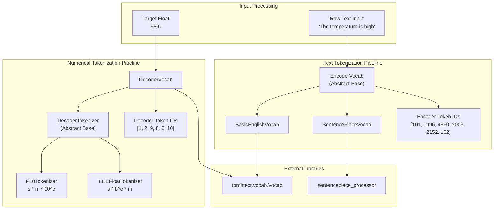
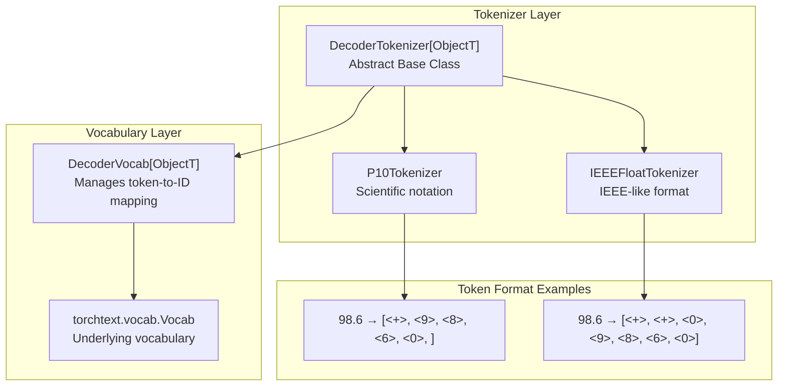
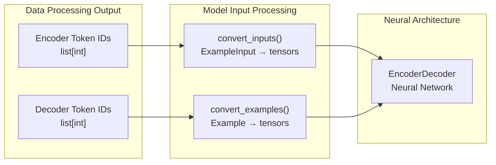

<!-- source: DeepWiki mcp.deepwiki.com · repo google-deepmind/regress-lm · page 6 Data Processing · fetched 2026-10-26 -->

# Data Processing

Relevant source files

The following files were used as context for generating this wiki page:

- [regress_lm/tokenizers.py](regress_lm/tokenizers.py)
- [regress_lm/vocabs.py](regress_lm/vocabs.py)

## Purpose and Scope

The data processing system in RegressLM handles the conversion of raw text and numerical data into tokenized representations suitable for neural network training and inference. This system provides two main capabilities: text tokenization for the encoder input and specialized numerical tokenization for the decoder output.

For detailed information about the abstract model interfaces that consume these processed tokens, see [Model Abstractions](#5.1). For the neural architecture that processes these tokens, see [Neural Architecture](#5.3).

## System Architecture

The data processing system consists of two parallel tokenization pipelines that work together to handle the text-to-number regression task:

Sources: [regress_lm/vocabs.py:27-144](), [regress_lm/tokenizers.py:50-262]()

## Text Processing Pipeline

The encoder side handles text input through a vocabulary abstraction that supports multiple tokenization strategies:

| Vocabulary Class | Purpose | Tokenization Method | Use Case |
|------------------|---------|-------------------|----------|
| `BasicEnglishVocab` | Simple word-level tokenization | TorchText basic_english | Testing and development |
| `SentencePieceVocab` | Subword tokenization | SentencePiece model | Production use with pretrained models |

Both vocabulary classes inherit from `EncoderVocab` and implement the `to_token_ids` method to convert raw text into integer token sequences. The `pad_id` property provides the padding token for batch processing.

Sources: [regress_lm/vocabs.py:39-49](), [regress_lm/vocabs.py:91-144]()

## Numerical Processing Pipeline

The decoder side uses a two-layer architecture for numerical tokenization:

The `DecoderTokenizer` abstract class defines the interface for converting floats to token sequences, while `DecoderVocab` manages the mapping from token strings to integer IDs using TorchText's vocabulary system.

Sources: [regress_lm/tokenizers.py:50-76](), [regress_lm/vocabs.py:51-89]()

## Tokenization Methods

### P10 Tokenization

The `P10Tokenizer` implements the P10 method from research literature, representing floats as `s * m * 10^e`:

- **Sign token**: `<+>` or `<->`
- **Mantissa digits**: `<0>` through `<9>` (configurable length)
- **Exponent token**: `<E-10>` through `<E10>` (configurable range)

The tokenizer handles rounding and range constraints automatically through the `_round_float` method.

### IEEE-like Tokenization

The `IEEEFloatTokenizer` uses a format similar to IEEE floating-point standards, representing floats as `s * b^e * m`:

- **Sign token**: `<+>` or `<->`
- **Exponent sign**: `<+>` or `<->`
- **Exponent digits**: Base-b representation (configurable base and digit count)
- **Mantissa digits**: Base-b representation (configurable digit count)

Sources: [regress_lm/tokenizers.py:78-171](), [regress_lm/tokenizers.py:173-262]()

## Integration with Model System

The processed tokens flow into the model system through standardized interfaces:

The vocabulary classes provide metadata needed for model configuration, including vocabulary sizes (`__len__`), padding tokens (`pad_id`, `bos_pad_id`), and sequence lengths (`decode_len`).

Sources: [regress_lm/vocabs.py:63-88]()

## Detailed Documentation

For implementation details of the vocabulary management system, see [Vocabulary Management](#6.1).

For in-depth coverage of the numerical tokenization algorithms and their mathematical foundations, see [Numerical Tokenization](#6.2).

---

