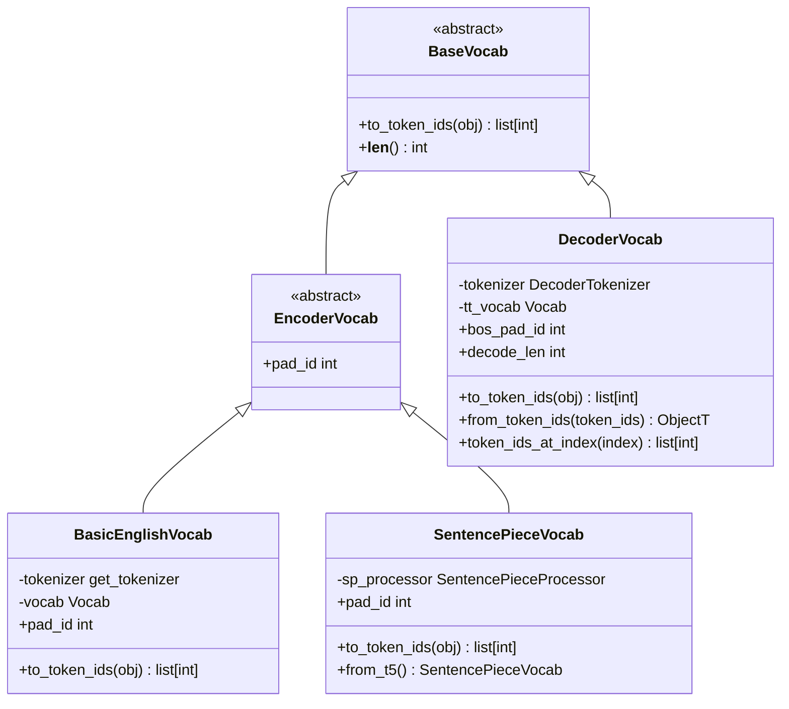
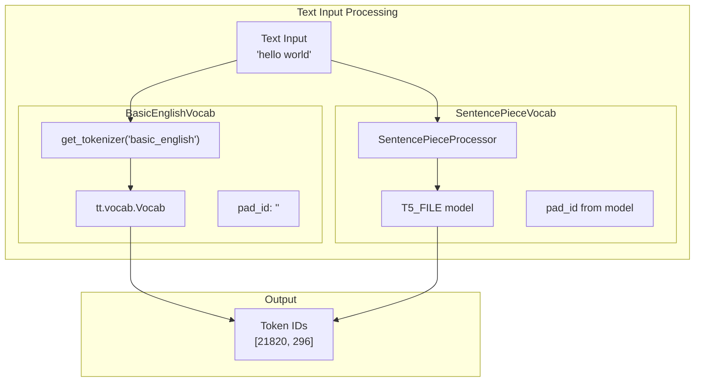
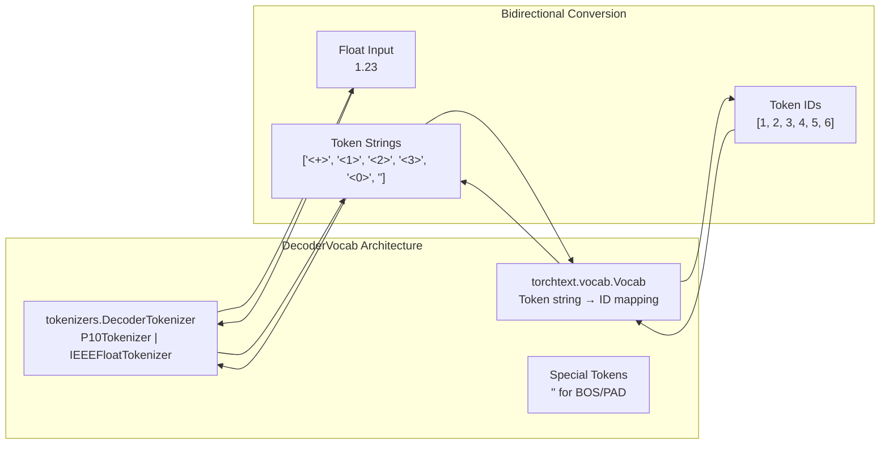
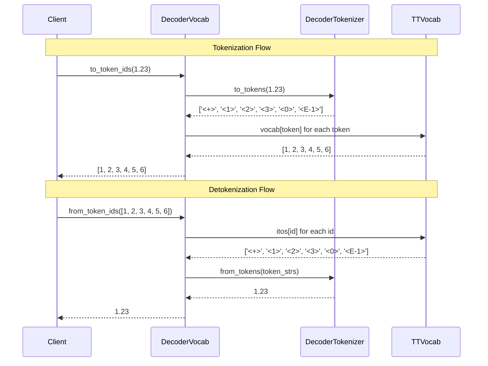

<!-- source: DeepWiki mcp.deepwiki.com · repo google-deepmind/regress-lm · page 6.1 Vocabulary Management · fetched 2026-10-26 -->

# Vocabulary Management

Relevant source files

The following files were used as context for generating this wiki page:

- [regress_lm/vocabs.py](regress_lm/vocabs.py)
- [regress_lm/vocabs_test.py](regress_lm/vocabs_test.py)

This document covers the vocabulary management system in RegressLM, which handles the conversion between text/numerical data and discrete token IDs for neural network processing. The vocabulary system provides abstract interfaces and concrete implementations for both encoder (text input) and decoder (numerical output) tokenization.

For information about the underlying numerical tokenization algorithms, see [Numerical Tokenization](#6.2). For details about how vocabularies integrate with the overall model system, see [Model System](#5).

## System Architecture

The vocabulary management system is built around a hierarchical class structure that separates concerns between encoding text inputs and decoding numerical outputs:

**Sources:** [regress_lm/vocabs.py:27-89]()

## Encoder Vocabulary System

Encoder vocabularies handle text input tokenization and are designed for one-way conversion (text to token IDs only). They implement the `EncoderVocab` abstract class which extends `BaseVocab` with padding token support:

### BasicEnglishVocab Implementation

The `BasicEnglishVocab` class provides simple tokenization for testing and development:

| Property | Description | Implementation |
|----------|-------------|----------------|
| Tokenizer | TorchText basic English tokenizer | `tt.data.utils.get_tokenizer('basic_english')` |
| Vocabulary | Custom word list with special tokens | `tt.vocab.Vocab` with `<pad>` and `<unk>` |
| Padding | Fixed pad token ID | Returns `vocab['<pad>']` |

**Sources:** [regress_lm/vocabs.py:91-110]()

### SentencePieceVocab Implementation

The `SentencePieceVocab` class provides production-ready subword tokenization:

| Property | Description | Implementation |
|----------|-------------|----------------|
| Processor | SentencePiece model processor | `sp.SentencePieceProcessor()` |
| Model Loading | Pre-trained T5 model support | `T5_FILE` constant with model path |
| Tokenization | Subword encoding | `sp_processor.EncodeAsIds(obj)` |
| Validation | Ensures PAD token exists | Raises `ValueError` if `pad_id() == -1` |

The class includes a convenience method `from_t5()` that loads the default T5 SentencePiece model:

**Sources:** [regress_lm/vocabs.py:112-144](), [regress_lm/vocabs_test.py:21-28]()

## Decoder Vocabulary System

Decoder vocabularies handle bidirectional conversion between numerical values and token sequences. Unlike encoder vocabularies, they must support both tokenization and detokenization:

### Core Methods and Properties

The `DecoderVocab` class provides several key methods for numerical tokenization:

| Method | Purpose | Return Type |
|--------|---------|-------------|
| `to_token_ids(obj)` | Convert object to token IDs | `list[int]` |
| `from_token_ids(token_ids)` | Convert token IDs back to object | `ObjectT` |
| `token_ids_at_index(index)` | Get token IDs for specific position | `list[int]` |
| `bos_pad_id` | Get beginning-of-sequence pad ID | `int` |
| `decode_len` | Get tokens per object count | `int` |

**Sources:** [regress_lm/vocabs.py:51-89]()

## Integration with Tokenization System

The vocabulary system integrates closely with the tokenization system through the `DecoderTokenizer` interface. The vocabulary acts as a bridge between tokenizer string representations and neural network token IDs:

**Sources:** [regress_lm/vocabs.py:54-71]()

## Vocabulary Construction and Initialization

### DecoderVocab Construction

The `DecoderVocab` constructor builds a TorchText vocabulary from all possible tokens provided by the tokenizer:

1. Calls `tokenizer.all_tokens()` to get complete token set
2. Creates a `collections.Counter` with uniform counts
3. Builds `tt.vocab.Vocab` with `<pad>` special token
4. Maps token strings to integer IDs

### SentencePieceVocab Construction

The `SentencePieceVocab` constructor loads pre-trained models:

1. Creates `SentencePieceProcessor` instance
2. Loads model file via `Load(file_path)`
3. Validates PAD token existence
4. Provides `T5_FILE` constant for default T5 model

**Sources:** [regress_lm/vocabs.py:54-61](), [regress_lm/vocabs.py:117-127]()

---

