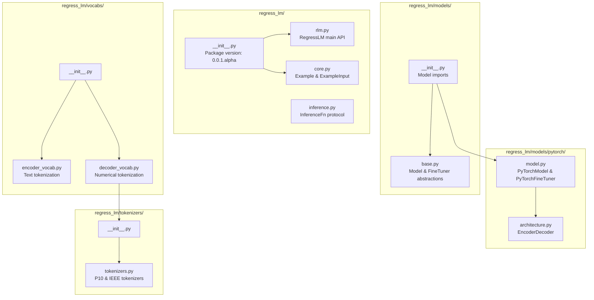
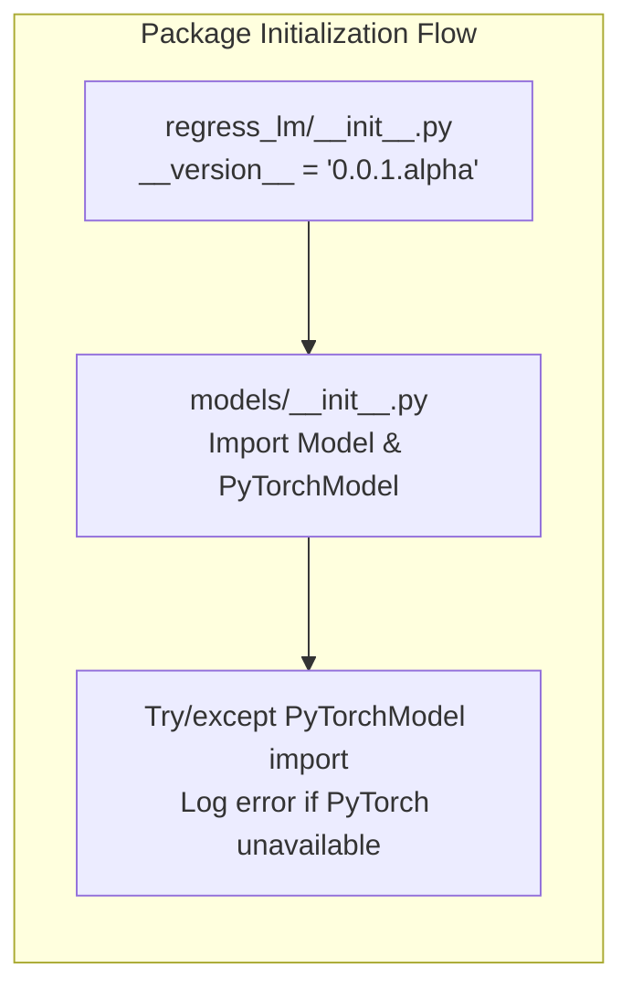
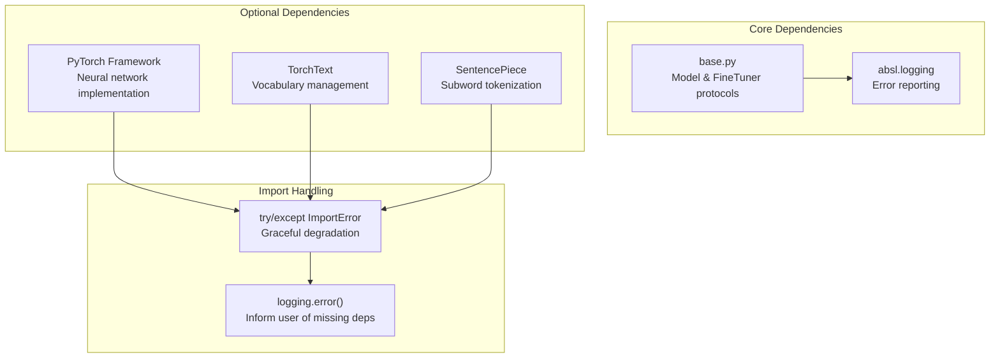
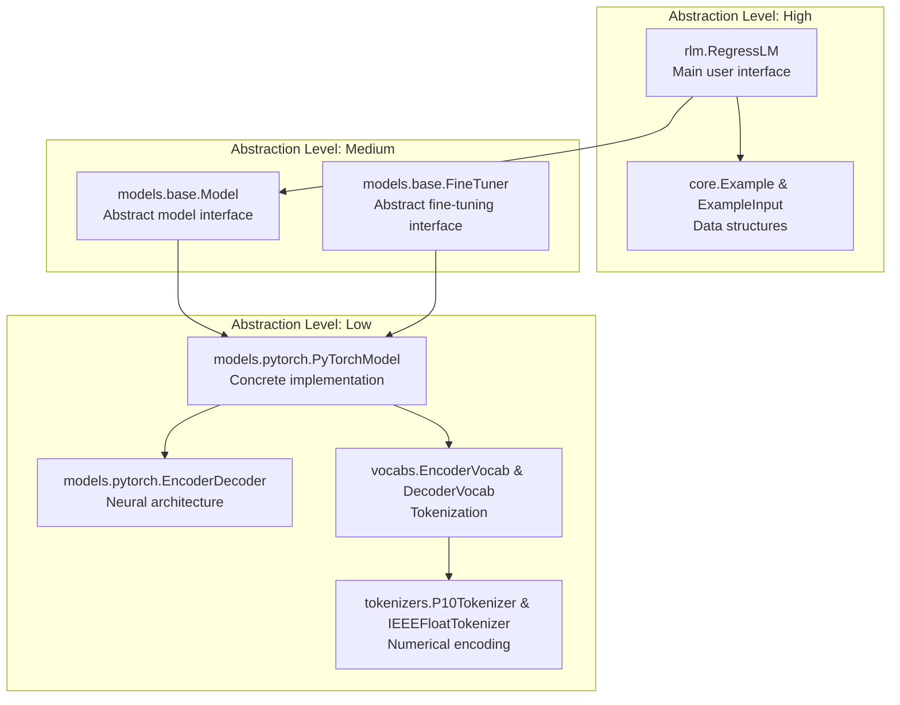

<!-- source: DeepWiki mcp.deepwiki.com · repo google-deepmind/regress-lm · page 7 Package Structure · fetched 2026-10-26 -->

# Package Structure

<details>
<summary>Relevant source files</summary>

The following files were used as context for generating this wiki page:

- [regress_lm/__init__.py](regress_lm/__init__.py)
- [regress_lm/models/__init__.py](regress_lm/models/__init__.py)

</details>


This document covers the internal organization of the `regress_lm` Python package, including its subpackage hierarchy, initialization patterns, and import structure. For detailed information about the core data structures and concepts, see [Core Concepts](#4). For specific model implementation details, see [Model System](#5).

## Package Organization

The `regress_lm` package follows a layered architecture with clear separation between abstractions, implementations, and data processing components. The package structure reflects the system's modular design where abstract interfaces are defined at higher levels and concrete implementations are organized in specialized subpackages.

### Top-Level Package Layout



Sources: [regress_lm/__init__.py:1-18]()

### Package Initialization

The main package initialization is minimal, focusing only on version information. The `regress_lm` package defines its version as `"0.0.1.alpha"`, indicating it is in early development stage.



Sources: [regress_lm/__init__.py:17](), [regress_lm/models/__init__.py:15-26]()

## Import Structure and Dependencies

The package uses a hierarchical import structure with conditional imports for optional dependencies. This design allows the package to gracefully handle missing dependencies while maintaining clean public APIs.

### Models Package Import Pattern

The `models` subpackage demonstrates the package's approach to handling optional dependencies:

| Import | Status | Error Handling |
|--------|--------|----------------|
| `Model` from `base.py` | Always imported | Required base class |
| `PyTorchModel` from `pytorch.model` | Conditional | Logs error if PyTorch unavailable |

The models package uses a try-except pattern to handle PyTorch availability:

```python
try:
  from regress_lm.models.pytorch.model import PyTorchModel
except ImportError:
  logging.error('Cannot import PyTorchModel.')
```

Sources: [regress_lm/models/__init__.py:22-25]()

### Dependency Management Strategy



Sources: [regress_lm/models/__init__.py:18](), [regress_lm/models/__init__.py:24-25]()

## Subpackage Architecture

The package structure reflects the system's layered architecture with clear separation of concerns:

### Core Layer
- **`core.py`**: Defines `Example` and `ExampleInput` data structures
- **`inference.py`**: Defines `InferenceFn` protocol for type safety
- **`rlm.py`**: Contains the main `RegressLM` user-facing API class

### Model Layer
- **`models/base.py`**: Abstract `Model` and `FineTuner` interfaces
- **`models/pytorch/`**: Concrete PyTorch implementations
  - `model.py`: `PyTorchModel` and `PyTorchFineTuner` classes
  - `architecture.py`: `EncoderDecoder` neural architecture

### Data Processing Layer
- **`vocabs/`**: Vocabulary management for text and numerical data
  - `encoder_vocab.py`: Text tokenization vocabularies
  - `decoder_vocab.py`: Numerical tokenization vocabularies
- **`tokenizers/`**: Specialized numerical tokenizers
  - `tokenizers.py`: `P10Tokenizer` and `IEEEFloatTokenizer` classes

### Package Hierarchy Relationships



Sources: [regress_lm/models/__init__.py:19](), [regress_lm/models/__init__.py:23]()

---

