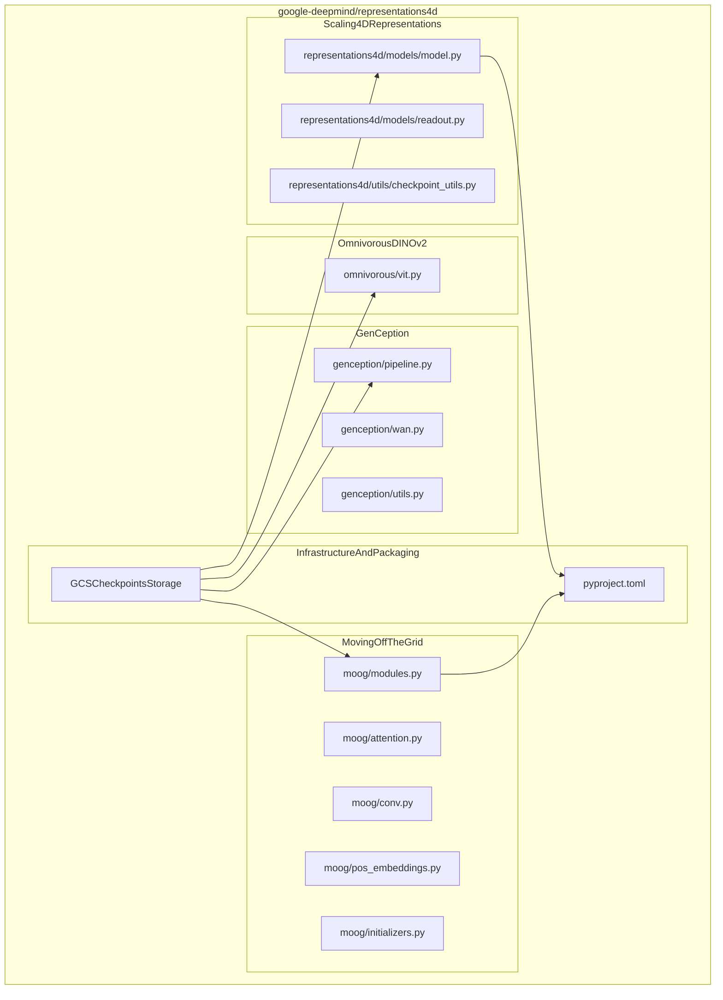
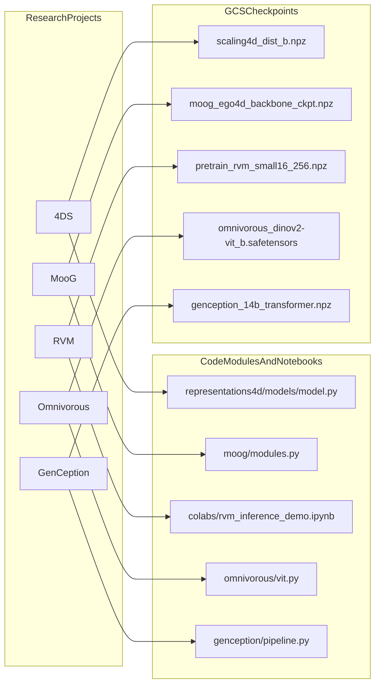

<!-- source: DeepWiki mcp.deepwiki.com · repo google-deepmind/representations4d · page 1 Overview · fetched 2026-10-26 -->

# Overview

Relevant source files

The following files were used as context for generating this wiki page:

- [README.md](README.md)
- [assets/RVM.png](assets/RVM.png)
- [assets/genception.png](assets/genception.png)
- [assets/moog.png](assets/moog.png)
- [assets/scaling_20M_20B.png](assets/scaling_20M_20B.png)

This page describes the purpose, scope, and organization of the `google-deepmind/representations4d` repository. It introduces the five core research projects contained in the repository, the shared concept of 4D video representations, and how the codebase is structured.

For step-by-step setup instructions, see [Installation and Setup](#1.1). For a reference listing of all pretrained model weights and loading mechanisms, see [Pretrained Checkpoints](#1.2).

Sources: [README.md:1-5]()

---

## Purpose

The `representations4d` repository is the official Google DeepMind release for research projects focused on learning **4D video representations** — spatial (3D) features enriched with a temporal dimension (+1D). Rather than focusing purely on semantic classification, these projects target perception tasks that require understanding geometry, motion, and 3D scene structure directly from video or multi-sensory visual streams.

The repository contains five major projects:

| Project | Short name | Paper | Key idea |
|---|---|---|---|
| Scaling 4D Representations | **4DS** | [arXiv:2412.15212](https://arxiv.org/abs/2412.15212) | MAE pretraining scales from 20M to 22B parameters on non-semantic 4D tasks [README.md:5-7]() |
| Moving Off-the-Grid | **MooG** | [NeurIPS 2024](https://openreview.net/pdf?id=rjSPDVdUaw) | Latent tokens move freely over space/time via cross-attention; next-frame prediction objective [README.md:11-13]() |
| Recurrent Video Masked Autoencoders | **RVM** | [arXiv:2512.13684](https://arxiv.org/abs/2512.13684) | Recurrent ViT with asymmetric masking and pixel reconstruction loss [README.md:15-17]() |
| Omnivorous DINOv2 | **Omnivorous** | [arXiv:2602.24181](https://arxiv.org/abs/2602.24181) | Lightweight post-training aligning features across sensory modalities like RGB and depth [README.md:19-21]() |
| GenCeption | **GenCeption** | [arXiv:2607.09024](https://arxiv.org/abs/2607.09024) | WAN 2.1 generative diffusion backbone fine-tuned as a feed-forward multi-task perception model [README.md:23-25]() |

Sources: [README.md:1-26]()

---

## What is a 4D Representation?

The term "4D" in this repository refers to **three spatial dimensions plus time**. The evaluation tasks shared across these models emphasize:
- **Depth and normal estimation** — inferring dense geometry from video [README.md:5-24]()
- **Camera pose estimation** — recovering 6-DoF camera motion across frames [README.md:5-23]()
- **Point, box, and object tracking** — following locations consistently over time [README.md:5-15]()
- **Dense multi-task perception** — semantic segmentation, reference video object segmentation (RefVOS), and 3D keypoints [README.md:23-24]()

Sources: [README.md:5-25]()

---

## Repository Organization

RepoLayoutDiagram

Sources: [README.md:27-76](), [pyproject.toml:1-18]()

The repository is organized into distinct Python modules and package directories (`representations4d/`, `moog/`, `omnivorous/`, `genception/`), supported by a shared packaging configuration in `pyproject.toml` [pyproject.toml:1-18]().

---

## The Research Projects

### Scaling 4D Representations (4DS)
4DS investigates masked autoencoding (MAE) scaling laws with ViT-style video models on geometric tasks [README.md:5-7](). 
- For architecture details, see [4DS Model Architecture](#2.1).
- For the depth estimation demo, see [Depth Estimation Demo](#2.2).

Sources: [README.md:5-7]()

### Moving Off-the-Grid (MooG)
MooG decouples representation structure from rigid pixel grids using latent tokens that move freely via cross-attention [README.md:11-13]().
- For core model details, see [MooG Core Model](#3.1).
- For tracking inference, see [Inference Demo](#3.5).

Sources: [README.md:11-13]()

### Recurrent Video Masked Autoencoders (RVM)
RVM utilizes a recurrent transformer with asymmetric masking and pixel reconstruction loss for high parameter efficiency [README.md:15-17]().
- For architecture details, see [RVM Model Architecture](#4.1).
- For evaluation benchmarks, see [Evaluation Framework](#4.3).

Sources: [README.md:15-17]()

### Omnivorous Vision Encoders (Omnivorous DINOv2)
Omnivorous post-training adapts DINOv2 models to align features across multiple sensory modalities such as RGB, depth, and x-ray [README.md:19-21]().
- For ViT implementation details, see [ViT Implementation](#6.1).
- For cross-modal inference, see [Cross-Modal Inference Demo](#6.2).

Sources: [README.md:19-21]()

### GenCeption
GenCeption leverages the WAN 2.1 video generative diffusion backbone as a feed-forward multi-task perception model driven by text instructions [README.md:23-25]().
- For pipeline details, see [GenCeption Pipeline](#5.1).
- For inference demos, see [GenCeption Inference Demo](#5.4).

Sources: [README.md:23-25]()

---

## Project-to-Code Mapping

ProjectToCodeMappingDiagram

Sources: [README.md:58-76](), [pyproject.toml:1-18]()

---

## License

Software is licensed under the Apache License 2.0. Model weights and supplementary assets are licensed under CC-BY 4.0 [README.md:92-111](). This is not an official Google product.

Sources: [README.md:92-111]()

---

