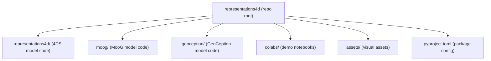
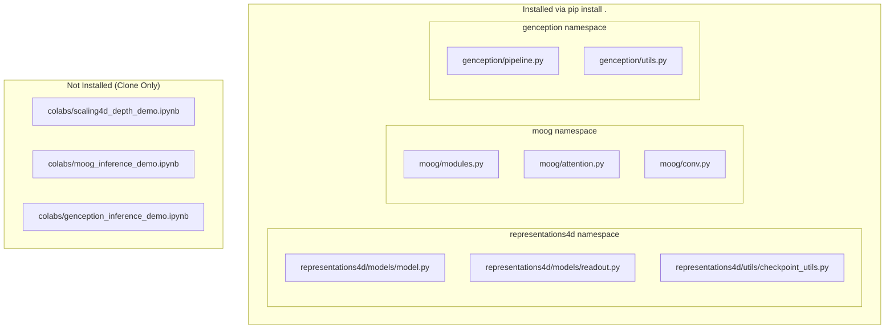

<!-- source: DeepWiki mcp.deepwiki.com · repo google-deepmind/representations4d · page 1.1 Installation and Setup · fetched 2026-10-26 -->

# Installation and Setup

<details>
<summary>Relevant source files</summary>

The following files were used as context for generating this wiki page:

- [README.md](README.md)
- [pyproject.toml](pyproject.toml)

</details>


This page covers the steps required to clone the repository, install the `representations4d` package and its core or optional dependencies via `pyproject.toml`, and verify that the environment is ready for execution. It does not cover downloading pretrained checkpoints (see [Pretrained Checkpoints](#1.2)) or running specific project demos.

---

## Repository Structure at a Glance

The repository layout is governed by `pyproject.toml`, which defines the installable packages (`representations4d`, `moog`, and `genception`) as well as optional dependency groups [pyproject.toml:23-25]().



Sources: [pyproject.toml:23-25](), [README.md:30-36]()

The `colabs/` and `assets/` directories are excluded from package installation and are intended to be accessed directly from a local clone of the repository.

---

## Prerequisites

| Requirement | Notes |
|---|---|
| Python 3.x | A dedicated virtual environment is strongly recommended |
| `pip` | Package installer for Python |
| Git | Version control system for cloning the repository |
| Hardware Accelerator | Optional; JAX defaults to CPU if no compatible GPU/TPU is available |

Sources: [README.md:30-36]()

---

## Installation Steps

### 1. Clone the Repository

Retrieve the repository from GitHub:

```bash
git clone https://github.com/google-deepmind/representations4d.git
cd representations4d
```

Sources: [README.md:30-32]()

### 2. Create and Activate a Virtual Environment

Isolate the project dependencies from system-wide Python packages:

```bash
python3 -m venv representations4d_env
source representations4d_env/bin/activate
```

Sources: [README.md:33-34]()

### 3. Install the Package and Dependencies

To install the core packages (`representations4d`, `moog`, and `genception`) along with standard dependencies:

```bash
pip install .
```

If you plan to run GenCeption workflows requiring PyTorch and video utilities, install with the optional `genception` extra:

```bash
pip install ".[genception]"
```

Sources: [pyproject.toml:5-20](), [README.md:35]()

---

## Declared Dependencies

Dependencies are specified in `pyproject.toml` under core requirements and optional extras:

### Core Dependencies (`[project]`)
* `einops`: Flexible tensor manipulation and reshaping [pyproject.toml:6]()
* `flax`: Neural network library built on JAX [pyproject.toml:7]()
* `jax`: High-performance numerical computing and autograd [pyproject.toml:8]()
* `kauldron`: Training and configuration framework used by MooG [pyproject.toml:9]()
* `numpy`: Array manipulation and `.npz` checkpoint handling [pyproject.toml:10]()
* `typeguard`: Runtime type checking for modules [pyproject.toml:11]()

### Optional Dependencies (`[project.optional-dependencies].genception`)
* `ml_dtypes`: Additional DTypes for JAX/NumPy interop [pyproject.toml:16]()
* `torch`: Tensor operations required by WAN 2.1 / GenCeption backbones [pyproject.toml:17]()
* `safetensors`: Safe tensor serialization format [pyproject.toml:18]()
* `mediapy`: Video loading and rendering utilities [pyproject.toml:19]()

Sources: [pyproject.toml:1-20]()

> **Note on JAX Hardware Support:** The default `jax` package installed from PyPI targets CPU execution. For accelerated GPU support, install the appropriate CUDA-enabled wheel for JAX following the official JAX installation guidelines.

---

## Package Mappings and Code Entities

The following diagram associates the installable Python namespaces with their respective source directories and primary modules:



Sources: [pyproject.toml:23-25]()

---

## Verifying the Installation

To verify that the packages and foundational libraries are correctly installed, execute a Python interpreter and import the core modules:

```python
import representations4d
import moog
import genception
import jax
import flax

print("JAX active devices:", jax.devices())
```

If the imports succeed and `jax.devices()` reports your available hardware device(s), the environment is properly configured.

---

## Next Steps

| Goal | Reference Section |
|---|---|
| Review and download pretrained weights | [Pretrained Checkpoints](#1.2) |
| Run 4DS depth estimation | [Depth Estimation Demo](#2.2) |
| Run MooG tracking inference | [Inference Demo](#3.5) |
| Run GenCeption multi-task perception | [GenCeption Inference Demo](#5.4) |
| Inspect checkpoint loading utilities | [Checkpoint Utilities](#7.1) |

Sources: [README.md:40-56]()

---

