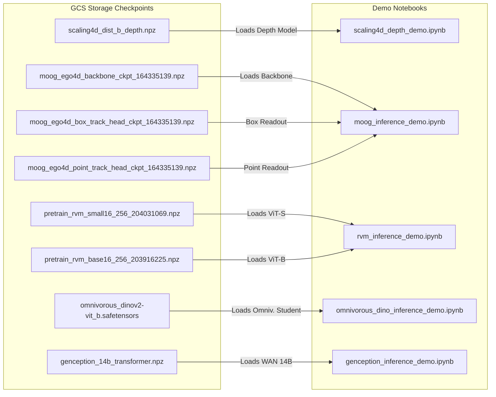
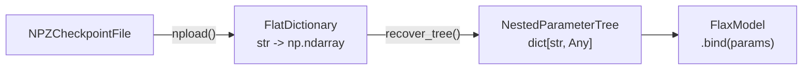

<!-- source: DeepWiki mcp.deepwiki.com · repo google-deepmind/representations4d · page 1.2 Pretrained Checkpoints · fetched 2026-10-26 -->

# Pretrained Checkpoints

<details>
<summary>Relevant source files</summary>

The following files were used as context for generating this wiki page:

- [README.md](README.md)
- [representations4d/utils/checkpoint_utils.py](representations4d/utils/checkpoint_utils.py)

</details>


This page provides a comprehensive reference listing of all pretrained model checkpoints released with the `representations4d` repository. It covers checkpoint filenames, file sizes, parameter counts, hosting URLs, supported downstream tasks, and the technical mechanism (`npload` and `recover_tree`) used to load them into memory.

For an in-depth explanation of checkpoint utilities, see [Checkpoint Utilities](#7.1). For project-specific usage of these checkpoints inside demo notebooks, see [Depth Estimation Demo](#2.2), [Inference Demo](#3.5), and [Inference Demo](#4.2).

Sources: [README.md:58-76](), [representations4d/utils/checkpoint_utils.py:1-61]()

---

## Storage Location

All pretrained checkpoints are hosted on Google Cloud Storage under the following base URL:

```
https://storage.googleapis.com/representations4d/checkpoints/
```

Files are distributed primarily as `.npz` archives (for JAX/Flax-based projects) or `.safetensors` (for PyTorch-based models like DINOv2), and can be downloaded using standard utilities such as `curl` or `wget`.

Sources: [README.md:58-76]()

---

## Checkpoint Reference

### 4DS (Scaling 4D Representations)

| Short Name | Description | Architecture | Params | File Size | Filename |
|---|---|---|---|:---:|:---:|
| `4DS-B-dist-e` | Backbone only, distilled from 4DS-e | ViT-B | 88M | 334MB | `scaling4d_dist_b.npz` |
| `4DS-e` | Full-scale backbone | ViT-e | 3.8B | 14GB | `scaling4d_e.npz` |
| `4DS-B-dist-e ScanNet depth` | Backbone + ScanNet depth readout head | ViT-B + AttentionReadout | 105M | 420MB | `scaling4d_dist_b_depth.npz` |

Sources: [README.md:62-66]()

---

### MooG (Moving Off-the-Grid)

| Short Name | Description | Architecture | Params | File Size | Filename |
|---|---|---|---|:---:|:---:|
| `MooG backbone` | Pretrained backbone | ConvNet + Transformer | 35M | 140MB | `moog_ego4d_backbone_ckpt_164335139.npz` |
| `MooG box track` | Box tracking readout head | Cross-Attention | 35M | 140MB | `moog_ego4d_box_track_head_ckpt_164335139.npz` |
| `MooG point track` | Point tracking readout head | Cross-Attention | 35M | 140MB | `moog_ego4d_point_track_head_ckpt_164335139.npz` |

Sources: [README.md:67-69]()

---

### RVM (Recurrent Video Masked Autoencoders)

| Short Name | Description | Architecture | Params | File Size | Filename |
|---|---|---|---|:---:|:---:|
| `RVM ViT-S` | Small backbone | ViT-S/16 | 34M | 270MB | `pretrain_rvm_small16_256_204031069.npz` |
| `RVM ViT-B` | Base backbone | ViT-B/16 | 117M | 641MB | `pretrain_rvm_base16_256_203916225.npz` |
| `RVM ViT-L` | Large backbone | ViT-L/16 | 375M | 1.6GB | `pretrain_rvm_large16_256_202497301.npz` |
| `RVM ViT-H` | Huge backbone | ViT-H/16 | 743M | 3.1GB | `pretrain_rvm_huge16_256_203854202.npz` |

Sources: [README.md:70-73]()

---

### Omnivorous Vision Encoders (DINOv2)

| Short Name | Description | Architecture | Params | File Size | Filename |
|---|---|---|---|:---:|:---:|
| `DINOv2 Frozen Teacher` | Baseline visual foundation model | ViT-B | 86.5M | 1.6GB | `frozen_dinov2-vit_b.safetensors` |
| `Omnivorous DINOv2` | Adapted multi-sensory student | ViT-B | 86.5M | 1.6GB | `omnivorous_dinov2-vit_b.safetensors` |

Sources: [README.md:74-75]()

---

### GenCeption

| Short Name | Description | Architecture | Params | File Size | Filename |
|---|---|---|---|:---:|:---:|
| `GenCeption` | Video diffusion transformer backbone | WAN 14B | 14B | 26.7GB | `genception/genception_14b_transformer.npz` |

Sources: [README.md:76-76]()

---

## Checkpoint-to-Task Mapping

The diagram below maps each checkpoint file to its corresponding demo notebook or evaluation suite.

**Checkpoint Consumers and Demo Mapping**



Sources: [README.md:40-76]()

---

## Loading Checkpoints Implementation

Checkpoint loading for JAX/Flax models relies on two core functions defined in `representations4d/utils/checkpoint_utils.py`: `npload` and `recover_tree`.

### `npload`
`npload` [representations4d/utils/checkpoint_utils.py:23-25]() reads raw `.npz` archive files using `numpy.load` with `allow_pickle=False` to ensure safety, returning a flat dictionary of NumPy arrays.

```python
def npload(fname: str) -> dict[str, np.ndarray]:
  loaded = np.load(fname, allow_pickle=False)
  return dict(loaded)
```

### `recover_tree`
`recover_tree` [representations4d/utils/checkpoint_utils.py:28-61]() reconstructs a nested dictionary tree structure from the flattened slash-delimited key names (e.g., `"encoder/block_0/attn/query"`).

```python
def recover_tree(flat_dict: dict[str, np.ndarray]) -> dict[str, Any]:
  tree = {}
  for k, v in flat_dict.items():
    parts = k.split("/")
    node = tree
    for part in parts[:-1]:
      if part not in node:
        node[part] = {}
      node = node[part]
    node[parts[-1]] = v
  return tree
```

**Checkpoint Tree Recovery Flow**



Sources: [representations4d/utils/checkpoint_utils.py:23-61]()

---

## Checkpoint Architecture Summary

| Checkpoint File Prefix | Primary Model Class | Code Module Path |
|---|---|---|
| `scaling4d_dist_b` | `Model` (ViT-B) | `representations4d/models/model.py` |
| `scaling4d_e` | `Model` (ViT-e) | `representations4d/models/model.py` |
| `scaling4d_dist_b_depth` | `Model` + `AttentionReadout` | `representations4d/models/model.py`, `representations4d/models/readout.py` |
| `moog_ego4d_backbone_ckpt_*` | `Moog` | `moog/modules.py` |
| `moog_ego4d_box_track_head_*` | `AttentionReadout` | `moog/modules.py` |
| `moog_ego4d_point_track_head_*` | `ConditionalAutoregressiveReadout` | `moog/modules.py` |
| `pretrain_rvm_*16_256_*` | `VideoSiamMAE` | *(RVM internal modules)* |
| `omnivorous_dinov2-vit_b` | `VisionTransformer` | `omnivorous/vit.py` |
| `genception_14b_transformer` | `WanModel` | *(GenCeption internal modules)* |

Sources: [README.md:62-76](), [representations4d/utils/checkpoint_utils.py:1-61]()

---

