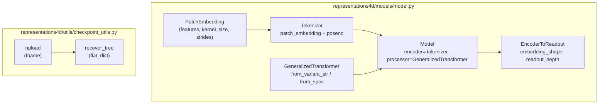

<!-- source: DeepWiki mcp.deepwiki.com · repo google-deepmind/representations4d · page 2 Scaling 4D Representations (4DS) · fetched 2026-10-26 -->

# Scaling 4D Representations (4DS)

Relevant source files

The following files were used as context for generating this wiki page:

- [README.md](README.md)
- [representations4d/models/model.py](representations4d/models/model.py)

This page introduces the 4DS project: its research motivation, model variants, pretraining approach, and available downstream tasks. For a detailed technical walkthrough of model internal components such as `PatchEmbedding`, `Tokenizer`, `GeneralizedTransformer`, `EncoderToReadout`, and `AttentionReadout`, see [4DS Model Architecture](#2.1). For a practical walkthrough of setting up model construction, checkpoint loading, and inference visualization in the depth estimation demo, see [Depth Estimation Demo](#2.2).

---

## Overview and Research Motivation

4DS (Scaling 4D Representations) focuses on evaluating self-supervised learning on non-semantic vision tasks that are spatial (3D) and temporal (+1D = 4D), such as camera pose estimation, point and object tracking, and depth estimation [README.md:5-7](). The central finding is that by learning from large video datasets, masked auto-encoding (MAE) with transformer video models scales consistently, improving performance on 4D tasks as model size increases from 20M all the way up to 22B parameters [README.md:5-7]().

The primary 4D downstream tasks evaluated include:
- Camera pose estimation (relative camera pose between frames) [README.md:5-7]()
- Point tracking (per-pixel motion through time) [README.md:5-7]()
- Object tracking (bounding box tracking) [README.md:5-7]()
- Depth estimation (monocular video depth maps) [README.md:5-7]()

Sources: [README.md:5-7]()

---

## Pretraining Approach and Model Variants

4DS uses masked autoencoding (MAE) as its pretraining objective, processing spatiotemporal video patches through a standard Vision Transformer (ViT) backbone without requiring manual labels [README.md:5-7](). Released checkpoints range from smaller distilled variants to massive multi-billion parameter encoders, paired with specialized readout heads for downstream tasks like depth estimation [README.md:5-7](), [README.md:62-76]().

The following table summarizes the official 4DS checkpoints:

| Checkpoint Name | Backbone | Parameters | File Size | Description |
|---|---|:---:|:---:|---|
| `4DS-B-dist-e` | ViT-B | 88M | 334MB | Distilled backbone [README.md:64]() |
| `4DS-e` | ViT-e | 3.8B | 14GB | Full-scale backbone [README.md:65]() |
| `4DS-B-dist-e ScanNet depth` | ViT-B + Readout | 105M | 420MB | Backbone with depth readout head [README.md:66]() |

Sources: [README.md:5-7](), [README.md:62-76]()

---

## System Architecture Overview

The codebase implements 4DS using modular JAX/Flax components defined in `representations4d/models/model.py` and `representations4d/models/readout.py`. The diagram below bridges natural language descriptions to exact code entities.

**Diagram: 4DS Code Entity Component Map**

Sources: [representations4d/models/model.py:41-184](), [representations4d/models/model.py:211-235]()

---

## End-to-End Token Flow

Data flows from raw video tensors through patching, positional encoding, global self-attention processing via `GeneralizedTransformer`, and feature selection via `EncoderToReadout`.

**Diagram: 4DS Token Flow Pipeline**

Sources: [representations4d/models/model.py:41-235]()

---

## Child Pages

For comprehensive details on specific aspects of 4DS, refer to the child pages:
- [4DS Model Architecture](#2.1) — Detailed walkthrough of `PatchEmbedding`, `Tokenizer`, `GeneralizedTransformer` (`variant_str`/`from_spec`), `EncoderToReadout`, `MLP`, `AttentionReadout`, token flow, and `readout_depth`.
- [Depth Estimation Demo](#2.2) — Step-by-step guide through the `scaling4d_depth_demo` notebook covering model construction, checkpoint loading, inference, and depth visualization.

Sources: [README.md:5-7](), [representations4d/models/model.py:41-235]()

---

