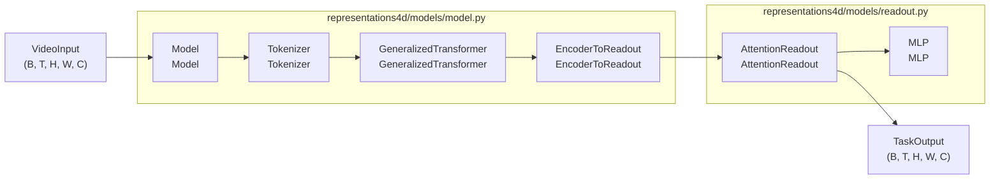
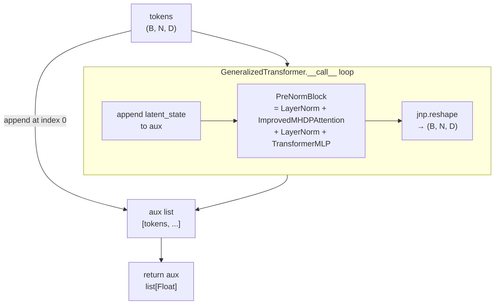
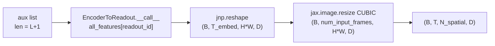
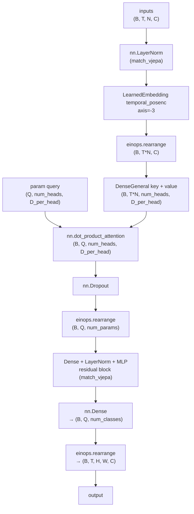

<!-- source: DeepWiki mcp.deepwiki.com · repo google-deepmind/representations4d · page 2.1 4DS Model Architecture · fetched 2026-10-26 -->

# 4DS Model Architecture

<details>
<summary>Relevant source files</summary>

The following files were used as context for generating this wiki page:

- [representations4d/models/model.py](representations4d/models/model.py)
- [representations4d/models/readout.py](representations4d/models/readout.py)

</details>


This page documents the internal structure of the 4DS model: its component classes, how they are composed, and how data flows from raw video input to task-specific predictions. It covers the classes defined in `representations4d/models/model.py` and `representations4d/models/readout.py`.

For a walkthrough of how these components are instantiated and used in practice (loading checkpoints, running inference, visualizing results), see the Depth Estimation Demo page ([Depth Estimation Demo](#2.2)). For an overview of the 4DS project's research goals and model variants, see the 4DS project page ([Scaling 4D Representations (4DS)](#2)).

---

## Component Overview

The 4DS inference pipeline is assembled as a modular chain of independently defined JAX/Flax modules mapping from video inputs to task outputs.

**Pipeline diagram: Natural Language to Code Entity Space**



Sources: [representations4d/models/model.py:41-244](), [representations4d/models/readout.py:34-188]()

---

## `PatchEmbedding`

`PatchEmbedding` [representations4d/models/model.py:186-208]() extracts spatio-temporal patches from a video tensor using a single strided `nn.Conv`. There are no non-linearities; it is a learned linear projection.

| Parameter | Type | Role |
|---|---|---|
| `patch_size` | `Sequence[int]` | Kernel and stride size in (T, H, W) |
| `num_features` | `int` | Output channel dimension D |

For the ViT-Base depth model: `patch_size=(2, 16, 16)`, `num_features=768`.

A video of shape `(B, 16, 224, 224, 3)` with `patch_size=(2, 16, 16)` produces an output of shape `(B, 8, 14, 14, 768)` — 8 temporal tokens × 14×14 spatial tokens.

Sources: [representations4d/models/model.py:186-208]()

---

## `Tokenizer`

`Tokenizer` [representations4d/models/model.py:158-183]() applies `PatchEmbedding`, adds positional encodings, then flattens the spatial/temporal dimensions into a single token sequence.

| Parameter | Type | Role |
|---|---|---|
| `patch_embedding` | `nn.Module` | Instance of `PatchEmbedding` |
| `posenc` | `nn.Module` | Positional encoding module (e.g. `LearnedEmbedding`) |
| `posenc_axes` | `tuple[int, ...]` | Axes along which posenc is broadcast; default `(-4, -3, -2)` |

Steps:
1. `patch_embedding(images)` → `(B, t, h, w, D)`
2. `posenc(tokens.shape, axis=posenc_axes)` → broadcasts over temporal and spatial axes
3. Element-wise addition: `tokens += posenc`
4. `einops.rearrange('... T h w D -> ... (T h w) D')` → `(B, N, D)`

Sources: [representations4d/models/model.py:158-183]()

---

## `GeneralizedTransformer`

`GeneralizedTransformer` [representations4d/models/model.py:41-131]() is a stack of transformer blocks that operates on the flat token sequence `(B, N, D)`. Its key distinguishing feature is that it **returns all intermediate feature states**, not just the final output.

### Return value

The `__call__` method returns a Python `list` named `aux`. Element `0` is the input tokens (before any layer), and elements `1..L` are the token states after each of the `L` transformer layers. This list is the input to `EncoderToReadout`.

### Iteration mode

`n_iter` (default `1`) controls how many times the full layer stack is applied. On iterations after the first, the current state is concatenated with the original input tokens before the next pass. Intermediate features are only collected during the last iteration.

### Factory methods

The class provides two class methods for construction:

**`from_variant_str(variant_str, **kwargs)`** [representations4d/models/model.py:88-94]()

Accepts a ViT size string (`"S"`, `"B"`, `"L"`, `"H"`, `"e"`, etc.) and delegates to `kd_vit.ViTSpec.from_variant_string` to resolve the number of heads, layers, and MLP size. Strips `patch_size` and `hidden_size` keys before forwarding to `from_spec`.

**`from_spec(num_heads, num_layers, ...)`** [representations4d/models/model.py:96-131]()

Constructs the full list of `PreNormBlock` instances. Each block contains:
- `ImprovedMultiHeadDotProductAttention` (from `kauldron.modules.attention`)
- `TransformerMLP` with configurable `hidden_size` and kernel initializer
- Two `nn.LayerNorm` instances (for attention and MLP sub-layers)

**Diagram: `GeneralizedTransformer` internals**



Sources: [representations4d/models/model.py:41-131]()

---

## `Model`

`Model` [representations4d/models/model.py:134-155]() is a thin `nn.Module` wrapper that sequences `encoder` (a `Tokenizer`) and `processor` (a `GeneralizedTransformer`). It accepts a video tensor and returns the `aux` list from `GeneralizedTransformer`.

```
video → encoder (Tokenizer) → tokens (B, N, D) → processor (GeneralizedTransformer) → list[features]
```

Sources: [representations4d/models/model.py:134-155]()

---

## `EncoderToReadout`

`EncoderToReadout` [representations4d/models/model.py:211-244]() selects one intermediate feature tensor from the list returned by `GeneralizedTransformer`, and reshapes it to a form suitable for `AttentionReadout`.

| Parameter | Type | Role |
|---|---|---|
| `embedding_shape` | `tuple[int, int, int]` | Spatial grid of tokens: `(T/pt, H/ph, W/pw)` |
| `readout_depth` | `float` | Fraction (0–1) indicating which layer to use |
| `num_input_frames` | `int` | Target temporal resolution after resize |

### Layer selection

```
readout_id = int(len(all_features) * readout_depth) - 1
```

With `readout_depth=0.95` and a 12-layer ViT-Base (13 entries in `aux` including input): `readout_id = int(13 * 0.95) - 1 = 11`. This picks the second-to-last layer's output.

### Temporal upsampling

After selecting and reshaping to `(B, T_embed, H_embed*W_embed, D)`, `jax.image.resize` with `ResizeMethod.CUBIC` interpolates the temporal dimension from `T_embed` (e.g. 8) up to `num_input_frames` (e.g. 16).

**Diagram: `EncoderToReadout` data transformation**



Sources: [representations4d/models/model.py:211-244]()

---

## `AttentionReadout`

`AttentionReadout` [representations4d/models/readout.py:55-188]() is a cross-attention head that maps the dense token grid produced by `EncoderToReadout` to task-specific predictions.

### Parameters

| Parameter | Type | Role |
|---|---|---|
| `num_classes` | `int` | Output feature size per query (e.g. pixels per patch) |
| `num_params` | `int` | Total attention dimension (must be divisible by `num_heads`) |
| `num_heads` | `int` | Number of attention heads |
| `num_queries` | `int` | Number of learnable query tokens |
| `output_shape` | `tuple` or `None` | If set, reshapes final output to `(B, T, H, W, C)` |
| `decoding_patch_size` | `tuple` or `None` | Patch layout used in output reshape |
| `add_temporal_posenc` | `bool` | Whether to add learned temporal positional encoding |
| `match_vjepa_implementation` | `bool` | Adds input LayerNorm and MLP+residual block after attention |

### Forward pass steps

1. **Input LayerNorm** (if `match_vjepa_implementation=True`): normalizes `(B, T, N, C)`.
2. **Temporal positional encoding**: `LearnedEmbedding` broadcast over axis `-3` (time), added to features.
3. **Flatten**: `(B, T, N, C)` → `(B, T*N, C)`.
4. **Queries**: either learned `(Q, num_heads, num_params_per_head)` parameters, or projected from an external `queries` argument.
5. **Cross-attention**: `nn.dot_product_attention(query, key, value)` with `key` and `value` computed from `nn.DenseGeneral`.
6. **MLP residual block** (if `match_vjepa_implementation=True`): query residual + `nn.Dense` + `nn.LayerNorm` + `MLP(hidden_size=num_params*4)`.
7. **Output projection**: `nn.Dense(num_classes)`.
8. **Output reshape** (if `output_shape` and `decoding_patch_size` are set): `einops.rearrange` reassembles patches into `(B, T, H, W, C)`.

**Diagram: `AttentionReadout` forward pass**



Sources: [representations4d/models/readout.py:55-188]()

---

## `MLP`

`MLP` [representations4d/models/readout.py:34-52]() is a simple feed-forward network used inside `AttentionReadout`'s residual block.

| Parameter | Default | Role |
|---|---|---|
| `hidden_size` | — | Width of hidden layers |
| `output_size` | `None` (→ input size) | Final output dimension |
| `num_hidden_layers` | `1` | Number of hidden `Dense + GELU` layers |

Pattern: `Dense(hidden_size) → GELU` repeated `num_hidden_layers` times, then `Dense(output_size)`.

Sources: [representations4d/models/readout.py:34-52]()

---

## Depth Estimation Configuration

The depth estimation checkpoint uses the following concrete hyperparameters, assembled as an execution pipeline:

| Component | Key Parameters |
|---|---|
| `PatchEmbedding` | `patch_size=(2, 16, 16)`, `num_features=768` |
| `Tokenizer` | `posenc=LearnedEmbedding`, `posenc_axes=(-4, -3, -2)` |
| `GeneralizedTransformer` | `variant_str="B"` (12 layers, 12 heads, mlp_size=3072) |
| `EncoderToReadout` | `embedding_shape=(8, 14, 14)`, `readout_depth=0.95`, `num_input_frames=16` |
| `AttentionReadout` | `num_classes=128`, `num_params=1024`, `num_heads=16`, `num_queries=6272`, `output_shape=(16,224,224,1)`, `decoding_patch_size=(2,8,8)` |

`num_queries = 6272` = total number of output patches = `16 * 224 * 224 / (2*8*8) = 6272`. Each query decodes into `num_classes=128` values = `2*8*8` depth values per patch.

Sources: [representations4d/models/model.py:41-244](), [representations4d/models/readout.py:35-188]()

---

## Class Relationship Diagram

**Code Entity Mapping Diagram**

```mermaid
classDiagram
    class Model {
        +encoder: nn.Module
        +processor: nn.Module
        +__call__(video) list
    }
    class Tokenizer {
        +patch_embedding: nn.Module
        +posenc: nn.Module
        +posenc_axes: tuple
        +__call__(images) Float
    }
    class PatchEmbedding {
        +patch_size: Sequence[int]
        +num_features: int
        +__call__(images) Float
    }
    class GeneralizedTransformer {
        +layers: Sequence[TransformerBlock]
        +n_iter: int
        +__call__(tokens) list
        +from_variant_str(variant_str) GeneralizedTransformer
        +from_spec(num_heads, num_layers) GeneralizedTransformer
    }
    class EncoderToReadout {
        +embedding_shape: tuple
        +readout_depth: float
        +num_input_frames: int
        +__call__(all_features) Float
    }
    class AttentionReadout {
        +num_classes: int
        +num_params: int
        +num_heads: int
        +num_queries: int
        +output_shape: tuple
        +decoding_patch_size: tuple
        +__call__(inputs) Float
    }
    class MLP {
        +hidden_size: int
        +output_size: int
        +num_hidden_layers: int
        +__call__(inputs) Float
    }

    Model --> Tokenizer : encoder [representations4d/models/model.py:138]
    Model --> GeneralizedTransformer : processor [representations4d/models/model.py:140]
    Tokenizer --> PatchEmbedding : patch_embedding [representations4d/models/model.py:161]
    AttentionReadout --> MLP : internal residual block [representations4d/models/readout.py:150]
```

Sources: [representations4d/models/model.py:1-244](), [representations4d/models/readout.py:1-188]()

---

