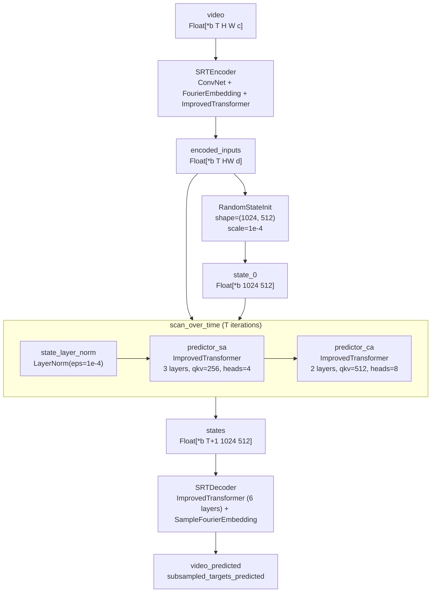
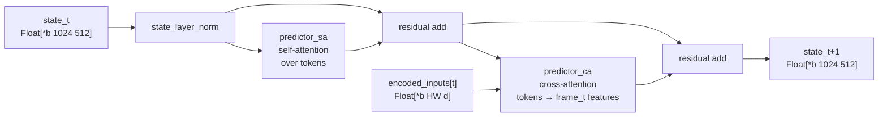
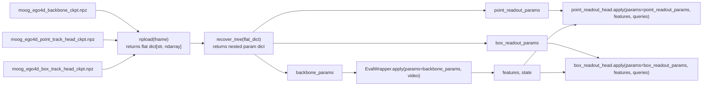

<!-- source: DeepWiki mcp.deepwiki.com · repo google-deepmind/representations4d · page 3 Moving Off-the-Grid (MooG) · fetched 2026-10-26 -->

# Moving Off-the-Grid (MooG)

<details>
<summary>Relevant source files</summary>

The following files were used as context for generating this wiki page:

- [assets/moog.png](assets/moog.png)
- [colabs/moog_inference_demo.ipynb](colabs/moog_inference_demo.ipynb)
- [moog/README.md](moog/README.md)

</details>


This page introduces the MooG project: its core concept, overall architecture, available pretrained checkpoints, and downstream tasks. For detailed documentation of individual components, see the child pages:

- Architecture internals of `Moog`, `SRTEncoder`, `SRTDecoder`, and readout heads → [MooG Core Model](#3.1)
- `ImprovedTransformer`, `ImprovedTransformerBlock`, and `ImprovedMHDPAttention` → [Transformer and Attention Modules](#3.2)
- `ConvNet`, `FourierEmbedding`, `SampleFourierEmbedding`, `RandomStateInit` → [Auxiliary Modules: ConvNet, Positional Embeddings, and Initializers](#3.3)
- `moog/configs/movi.py` training configuration → [Training Configuration](#3.4)
- Step-by-step inference walkthrough → [Inference Demo](#3.5)

---

## Overview

MooG (Moving Off-the-Grid) is a self-supervised video representation model published at NeurIPS 2024. The key departure from conventional approaches is that latent tokens are **not anchored to fixed pixel-grid positions**. Instead, they move freely through space and time by attending to video features via cross-attention combined with Fourier positional embeddings. This allows individual tokens to bind to and follow scene elements as they move.

The model is trained with a **next-frame prediction objective**: given all frames up to time `t`, reconstruct frame `t+1`. No labels are required. The resulting representations naturally learn to track objects and scene structures over time, and can be transferred to downstream tasks by attaching lightweight readout heads.

Sources: [README.md:11-11](), [moog/README.md:1-4]()

---

## The Off-the-Grid Concept

Traditional grid-based video models assign a latent token to each patch and keep those assignments fixed. When an object moves, the same object is represented by different tokens at different times.

MooG decouples token identity from spatial location. A set of latent tokens maintains a persistent state across time, and each timestep the tokens:

1. **Predict** their next state using self-attention over the token set.
2. **Correct** their state by attending (cross-attention) to newly encoded frame features.

Because attention is position-aware through Fourier embeddings but not structurally tied to the grid, tokens can effectively "follow" scene elements across frames.

**Off-the-grid vs. on-the-grid summary:**

| Property | Grid-based | MooG |
|---|---|---|
| Token count | Fixed to patch count | Fixed, independent of resolution |
| Token position | Determined by patch grid | Learned via attention + positional embeddings |
| Tracking | Implicit (patch correspondence) | Explicit (tokens move with scene elements) |
| Supervision | Reconstruction / contrastive | Next-frame pixel reconstruction |

Sources: [README.md:11-11](), [moog/README.md:1-4]()

---

## High-Level Architecture

The `Moog` class ([colabs/moog_inference_demo.ipynb:317-340]()) implements the following pipeline:

### Diagram: MooG Architecture Data Flow

Sources: [colabs/moog_inference_demo.ipynb:317-340](), [colabs/moog_inference_demo.ipynb:325-332]()

---

## Component Summary

The table below maps each logical role to its implementing class and configuration in the released checkpoint.

| Role | Class | Configuration |
|---|---|---|
| Video feature extraction | `SRTEncoder` | ConvNet 6-stage, stride 4× total |
| ConvNet backbone | `ConvNet` | `features=(64,128,128,256,256,512)`, 3×3 kernels |
| Spatial positional encoding | `FourierEmbedding` | 20 Fourier bases, `axes=(-3,-2)`, `update_type="concat"` |
| Initial latent state | `RandomStateInit` | `shape=(1024, 512)`, `scale=1e-4` |
| Token self-attention (predict) | `ImprovedTransformer` (`predictor_sa`) | 3 layers, `qkv_size=256`, `num_heads=4` |
| Token cross-attention (correct) | `ImprovedTransformer` (`predictor_ca`) | 2 layers, `qkv_size=512`, `num_heads=8` |
| Frame reconstruction | `SRTDecoder` | 6-layer `ImprovedTransformer` + `SampleFourierEmbedding` |
| Box tracking readout | `TrackingReadoutWrapper` + `AttentionReadout` | `num_classes=64`, `temporal_tile_size=1` |
| Point tracking readout | `TrackingReadoutWrapper` + `AttentionReadout` | `num_classes=8`, `temporal_tile_size=8` |

Sources: [colabs/moog_inference_demo.ipynb:453-557]()

---

## Per-Timestep Predictor-Corrector Loop

The method `scan_over_time` ([colabs/moog_inference_demo.ipynb:325-332]()) iterates over all `T` frames. For each timestep `t`:

### Diagram: Predictor-Corrector Loop per Frame


The self-attention step (`predictor_sa`) propagates token state forward in time without new observations. The cross-attention step (`predictor_ca`) corrects the tokens by attending to the frame's spatial features. The per-token positional embeddings in the frame features determine which spatial regions each token draws from.

Sources: [colabs/moog_inference_demo.ipynb:325-332]()

---

## Downstream Tasks

MooG outputs a tensor of token states `features` of shape `Float[*b T 1024 512]` (one state per timestep, after encoding). Readout heads use cross-attention from task-specific queries to this token tensor to produce predictions.

Two tasks are supported by the released checkpoints:

### Point Tracking
- Readout class: `TrackingReadoutWrapper` wrapping `AttentionReadout`
- Query input: 2D point coordinates in normalized video space, encoded with `SampleFourierEmbedding` (`update_type="replace"`) then passed through an `MLP`
- Output: predicted `(x, y)` coordinates per point per frame, plus visibility and certainty logits
- Key parameters: `num_frames_per_query=2`, `temporal_tile_size=8`, `predict_visibility=True`, `use_certainty=True`

### Box Tracking
- Readout class: `TrackingReadoutWrapper` wrapping `AttentionReadout`
- Query input: initial box coordinates, encoded identically to point tracking
- Output: `(y1, x1, y2, x2)` box coordinates per object per frame (normalized); no visibility prediction
- Key parameters: `num_frames_per_query=16`, `temporal_tile_size=1`, `predict_visibility=False`

Sources: [colabs/moog_inference_demo.ipynb:509-557]()

---

## Checkpoints

Three checkpoints are released for MooG, all trained on Ego4D. They are loaded using `npload` and `recover_tree` from `representations4d/utils/checkpoint_utils.py` (see [GenCeption Pipeline](#5.1)).

| Checkpoint file | Contents | Params | Size |
|---|---|---|---|
| `moog_ego4d_backbone_ckpt_164335139.npz` | `MooG` backbone | 35M | 140MB |
| `moog_ego4d_box_track_head_ckpt_164335139.npz` | `TrackingReadoutWrapper` (box) | 35M | 140MB |
| `moog_ego4d_point_track_head_ckpt_164335139.npz` | `TrackingReadoutWrapper` (point) | 35M | 140MB |

The backbone and each readout head are stored and loaded independently. During inference, `EvalWrapper` ([colabs/moog_inference_demo.ipynb:343-361]()) exposes the backbone's `features` and final `state` outputs, which are then passed separately to the readout heads.

### Diagram: Checkpoint Loading and Evaluation Pipeline

Sources: [README.md:53-55](), [colabs/moog_inference_demo.ipynb:591-598]()

---

## Training

MooG is trained using the [Kauldron](https://github.com/google-deepmind/kauldron) framework. The training configuration is in `moog/configs/movi.py` and targets the MOVi dataset (a synthetic multi-object video dataset from the Kubric simulator).

Training command:
```bash
cd moog/configs
python -m kauldron.main --cfg=movi.py --cfg.workdir=moog
```

The MOVi dataset can be downloaded from the Kubric public bucket before training. Full dataset and training configuration details are covered in [Training Configuration](#3.4).

Sources: [moog/README.md:7-33]()

---

## Module Organization

All MooG source modules live under the `moog/` package:

| File | Contents |
|---|---|
| `moog/modules.py` | `Moog`, `SRTEncoder`, `SRTDecoder`, `ReadoutWrapper`, `DenseReadout`, `TransformerReadout`, `ConditionalAutoregressiveReadout` |
| `moog/attention.py` | `ImprovedMHDPAttention`, `ImprovedTransformerBlock`, `ImprovedTransformer` |
| `moog/conv.py` | `ConvNet` |
| `moog/pos_embeddings.py` | `FourierEmbedding`, `SampleFourierEmbedding` |
| `moog/initializers.py` | `RandomStateInit` |
| `moog/configs/movi.py` | Kauldron training config for MOVi dataset |

The inference demo notebook (`colabs/moog_inference_demo.ipynb`) inlines all of these classes to be self-contained.

Sources: [README.md:1-4]()

---

