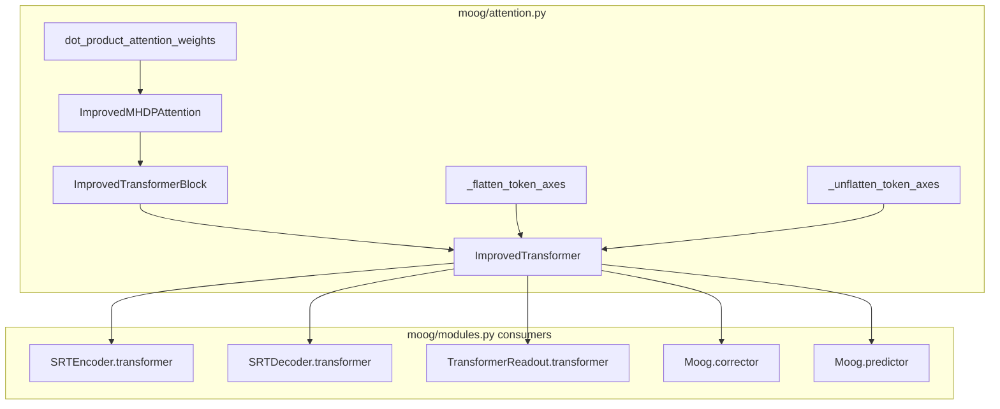
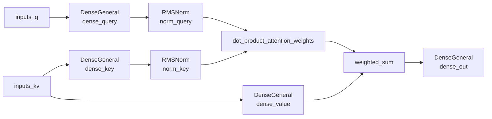
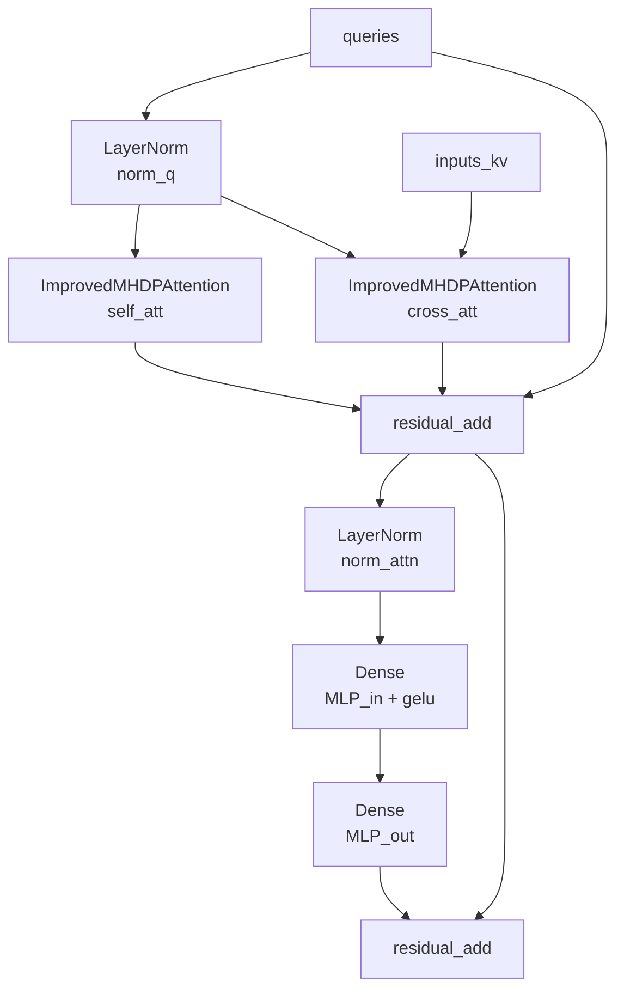
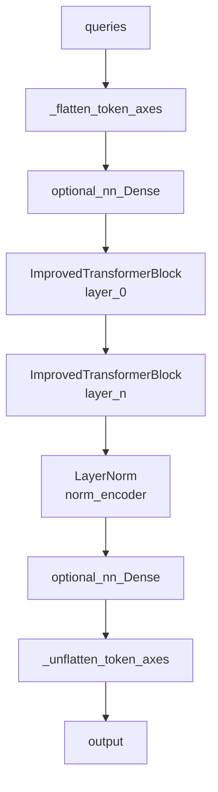
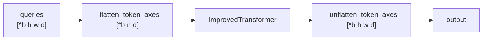

<!-- source: DeepWiki mcp.deepwiki.com · repo google-deepmind/representations4d · page 3.2 Transformer and Attention Modules · fetched 2026-10-26 -->

# Transformer and Attention Modules

Relevant source files

The following files were used as context for generating this wiki page:

- [moog/attention.py](moog/attention.py)

This page documents the attention and transformer building blocks used in the **MooG** project, defined in `moog/attention.py`. It covers `ImprovedMHDPAttention`, `ImprovedTransformerBlock`, and `ImprovedTransformer`, along with the token-axis flattening utilities that allow these modules to handle spatially-structured inputs.

For the higher-level MooG model that assembles these blocks into encoder/decoder/corrector/predictor roles, see [MooG Core Model](#3.1). For the convolutional and positional embedding modules that feed into the transformer stack, see [Auxiliary Modules: ConvNet, Positional Embeddings, and Initializers](#3.3).

---

## Module Hierarchy

**Diagram: Class relationships in `moog/attention.py`**

Sources: [moog/attention.py:1-371](), [moog/modules.py:158-391]()

---

## `dot_product_attention_weights`

[moog/attention.py:62-102]()

A standalone function that computes scaled dot-product attention weights. It takes queries `[*b q h d]` and keys `[*b k h d]` and returns weights `[*b h q k]`.

Key behaviors:

| Feature | Detail |
|---|---|
| Scaling | Divides queries by `sqrt(head_dim)` before the dot product [moog/attention.py:90]() |
| Einsum | `'...qhd,...khd->...hqk'` – head-major output [moog/attention.py:91]() |
| Bias | Optional additive bias (causal mask, proximity bias, etc.) [moog/attention.py:93-94]() |
| Mask | Optional boolean mask; masked positions receive `finfo.min` before softmax [moog/attention.py:96-98]() |
| `softmax_axes` | Defaults to `-1` (keys axis); set to `-2` for Slot-Attention style [moog/attention.py:65](), [moog/attention.py:100]() |

Sources: [moog/attention.py:62-102]()

---

## `ImprovedMHDPAttention`

[moog/attention.py:105-208]()

A Flax `nn.Module` that wraps `dot_product_attention_weights` into a full multi-head attention layer. It is a simplified version of Flax's `MultiheadDotProductAttention` with several deliberate changes.

### Attributes

| Attribute | Type | Description |
|---|---|---|
| `num_heads` | `int` | Number of attention heads [moog/attention.py:121]() |
| `qk_size` | `int` | Total dimension for queries and keys (split across heads) [moog/attention.py:122]() |
| `v_size` | `int \| None` | Total value dimension; defaults to `qk_size` [moog/attention.py:123]() |
| `softmax_axis` | `Axes` | Axis for softmax; default `-1` (keys axis) [moog/attention.py:124]() |

### Computation flow

**Diagram: Forward pass of `ImprovedMHDPAttention`**

Sources: [moog/attention.py:128-208]()

### Key design decisions

1. **RMSNorm on keys and queries** — Applied after the projection, before the dot product. This follows Gilmer et al. 2023 ("Intriguing Properties of Transformer Training Instabilities") and stabilizes training [moog/attention.py:176-180]().
2. **No bias on Q/K/V projections** — `use_bias=False` for `dense_query`, `dense_key`, and `dense_value` [moog/attention.py:165](), [moog/attention.py:171](), [moog/attention.py:184]().
3. **Attention weight interms** — Weights are stored via Kauldron's `interms_property` system [moog/attention.py:126]().

Sources: [moog/attention.py:105-208]()

---

## `ImprovedTransformerBlock`

[moog/attention.py:295-371]()

A single transformer block that optionally combines self-attention and cross-attention **in parallel** before applying the MLP.

### Attributes

| Attribute | Type | Description |
|---|---|---|
| `mlp_size` | `int` | Hidden dimension of the MLP |
| `num_heads` | `int` | Number of attention heads |
| `qkv_size` | `int` | Query/key/value dimension |
| `cross_attn_only` | `bool` | Skip self-attention, require `inputs_kv` |
| `zero_init` | `bool` | Initialize `MLP_out` kernel to zeros |
| `attention_fn` | `Callable \| None` | Override for the attention function |

### Block computation

**Diagram: Data flow through `ImprovedTransformerBlock`**

Sources: [moog/attention.py:295-371]()

### Parallel self- and cross-attention

The self-attention and cross-attention outputs are **summed before the MLP**, not sequentially applied. Both operate on the same normalized queries [moog/attention.py:329-356]().

### Zero-init MLP

When `zero_init=True`, `MLP_out` uses `kernel_init=nn.initializers.zeros`, allowing the block to initialize as an identity function [moog/attention.py:367-370]().

Sources: [moog/attention.py:295-371]()

---

## `ImprovedTransformer`

[moog/attention.py:211-292]()

The full stacked transformer, sequencing `num_layers` instances of `ImprovedTransformerBlock` and applying a final `LayerNorm` and token flattening/unflattening.

### Attributes

| Attribute | Type | Description |
|---|---|---|
| `qkv_size` | `int` | Passed to each block |
| `num_heads` | `int` | Passed to each block |
| `mlp_size` | `int` | Passed to each block |
| `num_layers` | `int` | Number of stacked blocks |
| `hidden_size` | `int \| None` | Projects queries to this size at entry |
| `output_size` | `int \| None` | Projects queries to this size at exit |

### Execution sequence

**Diagram: `ImprovedTransformer.__call__` execution sequence**

Sources: [moog/attention.py:211-292]()

---

## Token Axis Flattening

[moog/attention.py:31-58]()

Transformers operate on sequences `[*b n d]`. When inputs are spatially structured (`[*b h w d]`), token axes are collapsed before attention and restored afterward via `_flatten_token_axes` and `_unflatten_token_axes`.

**Diagram: Token axis flattening**

Sources: [moog/attention.py:31-58]()

---

## Summary of Normalization Choices

| Location | Normalization | Purpose |
|---|---|---|
| After Q/K projection in `ImprovedMHDPAttention` | `RMSNorm` [moog/attention.py:179-180]() | Stabilize attention weights [moog/attention.py:176-178]() |
| Before each attention pass in `ImprovedTransformerBlock` | `LayerNorm` [moog/attention.py:326-328]() | Pre-norm architecture |
| After attention aggregate, before MLP | `LayerNorm` [moog/attention.py:359-361]() | Separate MLP normalization |
| After all layers in `ImprovedTransformer` | `LayerNorm` [moog/attention.py:282-284]() | Final encoder norm |

Sources: [moog/attention.py:176-180](), [moog/attention.py:282-284](), [moog/attention.py:326-328](), [moog/attention.py:359-361]()

---

