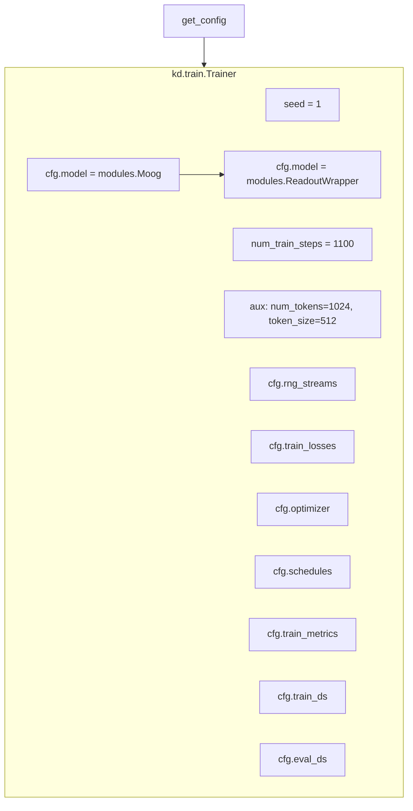
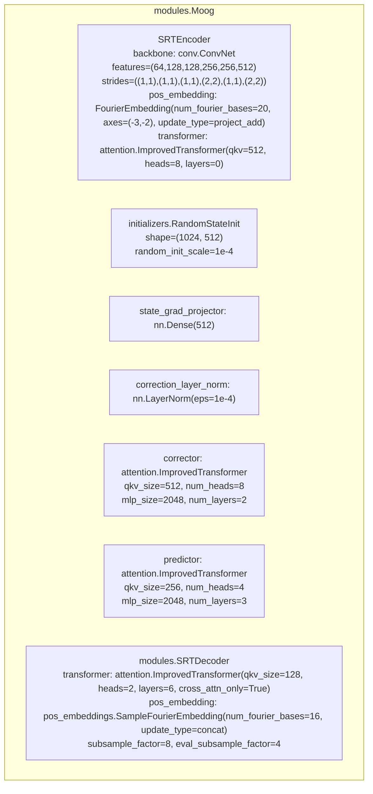
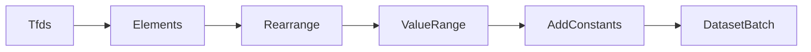
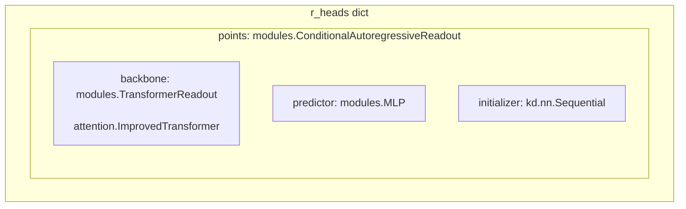
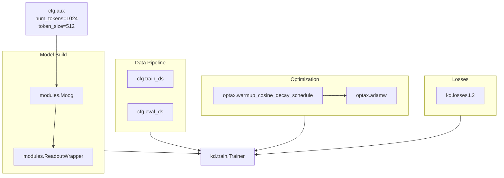

<!-- source: DeepWiki mcp.deepwiki.com · repo google-deepmind/representations4d · page 3.4 Training Configuration · fetched 2026-10-26 -->

# Training Configuration

<details>
<summary>Relevant source files</summary>

The following files were used as context for generating this wiki page:

- [moog/configs/movi.py](moog/configs/movi.py)

</details>


## Purpose and Scope

This page documents `moog/configs/movi.py`, which defines the Kauldron `Trainer` configuration for training the MooG model on the MOVi-E dataset. It covers the full `get_config()` assembly: model instantiation, dataset pipeline, loss functions, optimizer schedule, readout heads (points and depth), and evaluation setup.

For the MooG model architecture itself, see [MooG Core Model](#3.1). For the transformer and attention modules instantiated here, see [Transformer and Attention Modules](#3.2). For auxiliary modules (ConvNet, positional embeddings, initializers), see [Auxiliary Modules: ConvNet, Positional Embeddings, and Initializers](#3.3).

Sources: [moog/configs/movi.py:1-464]()

---

## Configuration Entry Points

The file exposes public configuration builders:

| Function | Purpose |
|---|---|
| `get_config()` | Assembles and returns the full `kd.train.Trainer` object [moog/configs/movi.py:32-34]() |

The entire config is built inside `get_config()` and is consumed by the Kauldron training framework.

Sources: [moog/configs/movi.py:32-275]()

---

## Top-Level Trainer Assembly

**Diagram: `get_config()` composition**



Sources: [moog/configs/movi.py:32-275]()

---

## Global Hyperparameters

```python
cfg.seed = 1
cfg.num_train_steps = 1100  # intended to be 1_000_000 at full scale
cfg.aux = {"num_tokens": 1024, "token_size": 512}
```

The `cfg.aux` dict is referenced later via `cfg.ref.aux[...]` to wire latent state dimensions into the model and initializer without duplication.

Sources: [moog/configs/movi.py:36-38]()

---

## Model Instantiation

The `modules.Moog` model is constructed with concrete submodules for all five components: encoder, initializer, corrector, predictor, and decoder. Key dimension choices are driven by `cfg.aux`.

**Diagram: Moog submodule instantiation in `get_config`**



Notable flags on the base `modules.Moog` instance:

| Parameter | Value | Meaning |
|---|---|---|
| `stop_gradient_prob` | `None` | No stochastic stop-gradient on state [moog/configs/movi.py:104]() |
| `use_loss_gradient` | `False` | Predictor-corrector uses direct encoder features, not loss gradient [moog/configs/movi.py:105]() |
| `video` | `"batch.video"` | Kauldron key for video input [moog/configs/movi.py:103]() |

Sources: [moog/configs/movi.py:42-106]()

---

## RNG Streams

Two RNG streams are registered:

| Stream name | `eval` enabled | Purpose |
|---|---|---|
| `"default"` | `True` | Used in decoder subsampling and stop-gradient branching [moog/configs/movi.py:110]() |
| `"state_init"` | `False` | Used only during training for latent state initialization [moog/configs/movi.py:111]() |

Sources: [moog/configs/movi.py:109-112]()

---

## Loss Function

A single training loss is defined before readout heads are attached:

```python
cfg.train_losses = {
    "recon_predicted": kd.losses.L2(
        preds="preds.video_predicted",
        targets="preds.subsampled_targets_predicted",
    ),
}
```

This is the next-frame prediction objective: L2 distance between the decoder's reconstruction (`video_predicted`) and the spatially subsampled target frames (`subsampled_targets_predicted`). Both outputs come from `MoogResults` (see [MooG Core Model](#3.1)).

After readout heads are configured, `cfg.train_losses.update(r_losses)` merges any readout-specific losses.

Sources: [moog/configs/movi.py:115-120](), [moog/configs/movi.py:257]()

---

## Optimizer and Schedule

The optimizer chain is:

```python
optax.chain(
    optax.clip_by_global_norm(1.0),
    optax.adamw(learning_rate=schedule, b2=0.95)
)
```

The learning rate schedule is a warmup-then-cosine-decay:

| Parameter | Value |
|---|---|
| `init_value` | `0.0` [moog/configs/movi.py:125]() |
| `peak_value` | `1e-4` [moog/configs/movi.py:126]() |
| `warmup_steps` | `1000` [moog/configs/movi.py:127]() |
| `decay_steps` | `cfg.ref.num_train_steps` [moog/configs/movi.py:128]() |
| `end_value` | `1e-7` [moog/configs/movi.py:129]() |

Gradient clipping (global norm ≤ 1.0) is applied before the AdamW update [moog/configs/movi.py:133-138]().

Sources: [moog/configs/movi.py:123-139]()

---

## Training Metrics

```python
cfg.train_metrics = {
    "psnr": kd.metrics.Psnr(
        pred="preds.video_predicted",
        target="preds.subsampled_targets_predicted",
    ),
}
```

PSNR is tracked between decoder reconstructions and subsampled targets. Logging cadence:

| Setting | Value |
|---|---|
| `log_metrics_every` | `100` steps [moog/configs/movi.py:148]() |
| `log_summaries_every` | `1000` steps [moog/configs/movi.py:149]() |

Sources: [moog/configs/movi.py:141-149]()

---

## Dataset Pipeline (`_make_ds`)

The `_make_ds` helper constructs the dataset loaders for Kauldron [moog/configs/movi.py:156-157]().

**Diagram: `_make_ds` pipeline**



Both train and eval datasets use `shared_ds_kwargs` with `batch_size=128` and `num_frames=8` [moog/configs/movi.py:152-157]().

Sources: [moog/configs/movi.py:152-158](), [moog/configs/movi.py:278-459]()

---

## Readout Heads

After the base model is constructed, readout heads are added (such as `modules.ConditionalAutoregressiveReadout` for points) [moog/configs/movi.py:160-203]().

**Diagram: Readout head composition**



Both heads read from `preds.states_concat` produced by `modules.Moog.__call__`.

Sources: [moog/configs/movi.py:160-254]()

---

## ReadoutWrapper Assembly

```python
cfg.model = modules.ReadoutWrapper(
    model=cfg.model,
    readout_heads=r_heads,
    readout_inputs=r_inputs,
    model_inputs={"video": "batch.video", "batch": "batch"},
    finetune=True,
)
```

This wraps the `modules.Moog` instance to execute downstream heads alongside the core model forward pass.

Sources: [moog/configs/movi.py:248-254]()

---

## Evaluation Setup

A single evaluator named `"eval"` is configured with `kd.evals.EveryNSteps(5000)` and evaluation datasets [moog/configs/movi.py:264-274]().

Sources: [moog/configs/movi.py:264-274]()

---

## Full Configuration Flow Summary

**Diagram: Complete `get_config` data and control flow**



Sources: [moog/configs/movi.py:32-275]()

---

