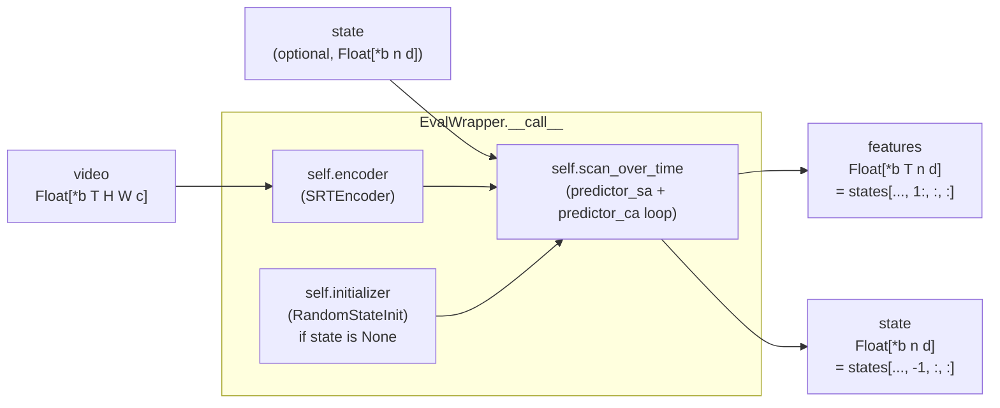
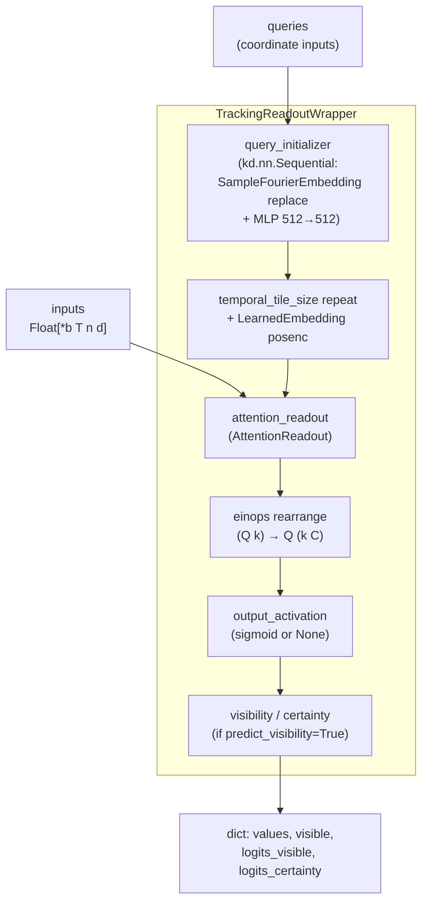
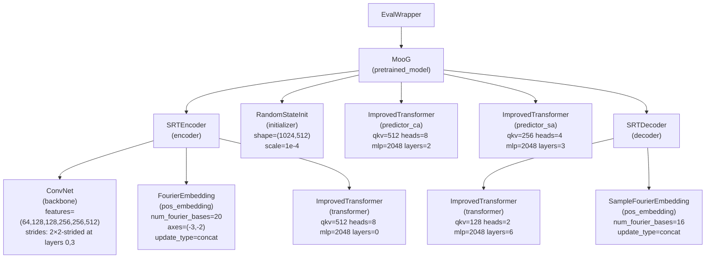
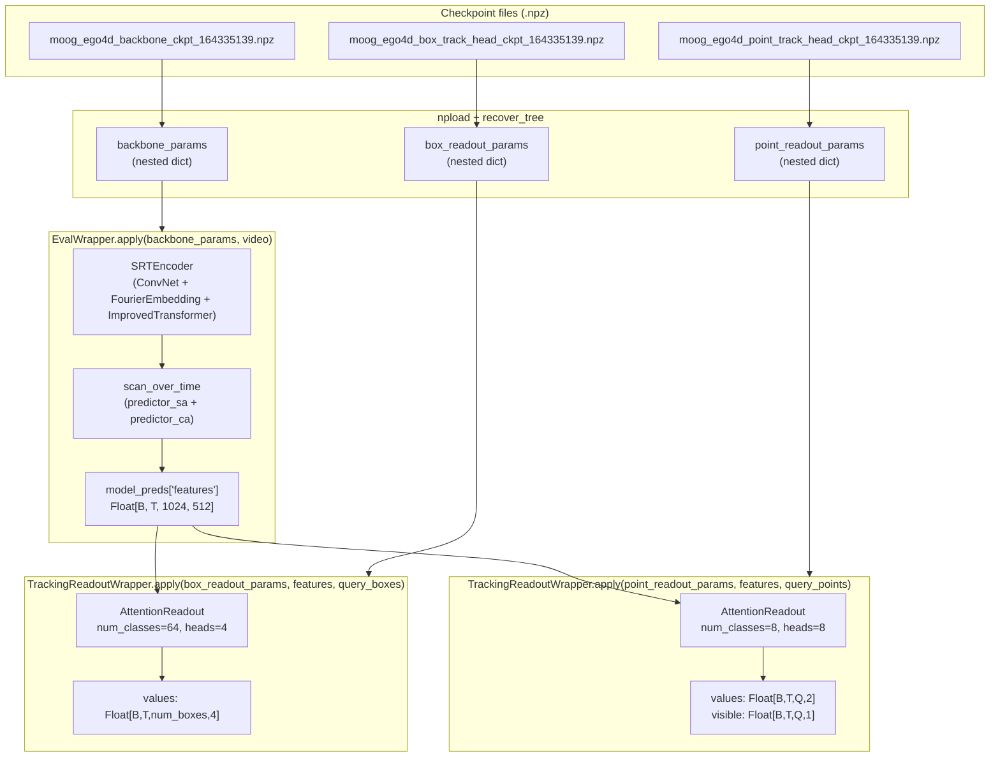

<!-- source: DeepWiki mcp.deepwiki.com · repo google-deepmind/representations4d · page 3.5 Inference Demo · fetched 2026-10-26 -->

# Inference Demo

<details>
<summary>Relevant source files</summary>

The following files were used as context for generating this wiki page:

- [colabs/moog_inference_demo.ipynb](colabs/moog_inference_demo.ipynb)
- [moog/README.md](moog/README.md)

</details>


This page walks through `colabs/moog_inference_demo.ipynb`, which demonstrates how to run the MooG model on two downstream tracking tasks: **point tracking** and **box tracking**. It covers dependency installation, model definition, checkpoint loading, inference execution, and output interpretation.

For background on the MooG architecture, see the [MooG Core Model](#3.1) page. For the training configuration that produced these checkpoints, see [Training Configuration](#3.4). For checkpoint loading utilities shared across all three projects, see [Checkpoint Utilities](#7.1).

---

## Dependencies

The notebook installs the following packages at runtime:

```
pip install kauldron mediapy
pip install git+https://github.com/google-deepmind/tapnet.git
```

| Package | Purpose |
|---------|---------|
| `kauldron` | Provides `kd.nn.LearnedEmbedding`, `kd.nn.Sequential`, Flax-compatible utilities |
| `mediapy` | Video display in Colab |
| `tapnet` | Visualization utilities (`viz_utils.paint_point_track`, `viz_utils.get_colors`) |
| `einops` | Tensor rearrangement inside readout modules |

The notebook does **not** import from the `moog` package directly. All classes are re-defined inline in the notebook cells.

Sources: [colabs/moog_inference_demo.ipynb:20-57]()

---

## Checkpoints

Three separate `.npz` files are downloaded — one for the backbone, and one for each readout head.

| Checkpoint file | Contents |
|----------------|---------|
| `moog_ego4d_backbone_ckpt_164335139.npz` | `EvalWrapper(MooG(...))` parameters |
| `moog_ego4d_point_track_head_ckpt_164335139.npz` | `TrackingReadoutWrapper` (point) parameters |
| `moog_ego4d_box_track_head_ckpt_164335139.npz` | `TrackingReadoutWrapper` (box) parameters |

All three are loaded via the `npload` / `recover_tree` pattern:

```
backbone_params    = recover_tree(npload('moog_ego4d_backbone_ckpt_164335139.npz'))
point_readout_params = recover_tree(npload('moog_ego4d_point_track_head_ckpt_164335139.npz'))
box_readout_params   = recover_tree(npload('moog_ego4d_box_track_head_ckpt_164335139.npz'))
```

`npload` reads the flat `.npz` archive; `recover_tree` reconstructs the nested parameter dictionary by splitting slash-delimited keys. These functions are inlined in the notebook at [colabs/moog_inference_demo.ipynb:570-598]() and are also defined canonically in [representations4d/utils/checkpoint_utils.py:23-61]().

Sources: [colabs/moog_inference_demo.ipynb:64-69](), [colabs/moog_inference_demo.ipynb:568-604](), [representations4d/utils/checkpoint_utils.py:23-61]()

---

## Model Definition

### `EvalWrapper` — Backbone Interface

The notebook defines `EvalWrapper` as a thin Flax module around `MooG`. It replaces the training-time `__call__` (which runs decode and returns reconstruction loss tensors) with an inference-time `__call__` that returns latent features and the final state.

Title: "EvalWrapper call interface"


Sources: [colabs/moog_inference_demo.ipynb:343-361]()

The `features` output (shape `[*b, T, num_tokens, token_size]`) is what gets passed to both readout heads.

### `MooG` — Backbone Loop

The `MooG` class defined in the notebook uses `scan_over_time` to apply the predictor-corrector loop across frames. This is a simplified version of the training-time `Moog` class in [moog/modules.py:244-371]().

Key differences from the training module:

| Aspect | Notebook `MooG` | Production `moog/modules.py Moog` |
|--------|----------------|----------------------------------|
| Predictor/corrector | Two separate transformers (`predictor_sa`, `predictor_ca`) | `corrector` + `predictor` with gradient-based correction |
| Decoder call | Returns reconstruction | Full `SRTDecoder` with subsampling |
| State handling | Simple stack | Supports `stop_gradient_prob`, `batch.state` passthrough |

Sources: [colabs/moog_inference_demo.ipynb:317-361](), [moog/modules.py:244-371]()

### Readout Heads

Two `TrackingReadoutWrapper` instances are constructed — one for point tracking and one for box tracking. Both wrap `AttentionReadout` but differ in configuration.

Title: "Readout head structure"


Sources: [colabs/moog_inference_demo.ipynb:397-441]()

**Point vs. box readout configuration:**

| Parameter | Point readout | Box readout |
|-----------|--------------|-------------|
| `num_classes` (AttentionReadout) | 8 | 64 |
| `num_params` (AttentionReadout) | 1024 | 1024 |
| `num_heads` (AttentionReadout) | 8 | 4 |
| `num_frames_per_query` | 2 | 16 |
| `temporal_tile_size` | 8 | 1 |
| `predict_visibility` | `True` | `False` |
| `use_certainty` | `True` | `False` |
| `output_activation` | `nn.sigmoid` | `None` |

Sources: [colabs/moog_inference_demo.ipynb:509-557]()

### Full Model Instantiation

Title: "Object graph constructed by the notebook"


Sources: [colabs/moog_inference_demo.ipynb:452-507]()

---

## Point Tracking Inference

### Data

A pre-packaged batch is downloaded from GCS:

```
!wget .../representations4d/assets/kubric_batch.npy
batch = np.load('kubric_batch.npy', allow_pickle=True).item()
```

Expected keys in `batch`:

| Key | Description |
|-----|-------------|
| `video` | Float tensor, shape `[B, T, H, W, 3]`, values in `[0, 1]` |
| `query_points_video` | Point queries in normalized video coordinates |
| `target_points_video` | Ground-truth point tracks |
| `target_points_visible_video` | Ground-truth visibility flags |

Sources: [colabs/moog_inference_demo.ipynb:616-622]()

### Backbone Forward Pass

```
model_preds, state = model.apply(
    {'params': backbone_params},
    batch['video'],
    is_training_property=False,
    rngs={'default': key},
    capture_intermediates=True
)
```

`model_preds` is a dict with keys `features` (shape `[B, T, 1024, 512]`) and `state` (shape `[B, 1024, 512]`).

Sources: [colabs/moog_inference_demo.ipynb:633-636]()

### Point Readout Forward Pass

```
point_readout = point_readout_head.apply(
    {'params': point_readout_params},
    model_preds['features'],
    batch['query_points_video'],
    is_training_property=False,
    rngs={'default': key}
)
```

`point_readout` is a dict with keys:

| Key | Shape | Description |
|-----|-------|-------------|
| `values` | `[B, T, Q, 2]` | Predicted (x, y) tracks in normalized coords |
| `visible` | `[B, T, Q, 1]` | Binary visibility (after certainty threshold) |
| `logits_visible` | `[B, T, Q, 1]` | Raw visibility logit |
| `logits_certainty` | `[B, T, Q, 1]` | Raw certainty logit |

Sources: [colabs/moog_inference_demo.ipynb:647-650]()

### Visualization

Predicted tracks are rescaled to pixel coordinates and rendered using `viz_utils.paint_point_track`. Ground-truth and predictions are displayed side-by-side.

```
pred_tracks   = point_readout['values'][0].transpose(1, 0, 2) * (width, height)
pred_visibles = point_readout['visible'][0, ..., 0].transpose(1, 0)
```

Sources: [colabs/moog_inference_demo.ipynb:659-676]()

---

## Box Tracking Inference

### Data

A separate batch is loaded from a Waymo scene:

```
!wget .../representations4d/assets/waymo_batch.npy
batch = np.load('waymo_batch.npy', allow_pickle=True).item()
```

Expected keys in `batch`:

| Key | Description |
|-----|-------------|
| `video` | Float tensor `[B, T, H, W, 3]` |
| `query_boxes_video` | Initial box queries in normalized coords |
| `boxes_video` | Ground-truth box tracks |

Sources: [colabs/moog_inference_demo.ipynb:696-700]()

### Backbone Forward Pass

Identical call to the point tracking case, using the same `backbone_params`:

```
model_preds, state = model.apply(
    {'params': backbone_params},
    batch['video'],
    ...
)
```

Sources: [colabs/moog_inference_demo.ipynb:710-714]()

### Box Readout Forward Pass

```
box_readout = box_readout_head.apply(
    {'params': box_readout_params},
    model_preds['features'],
    batch['query_boxes_video'],
    ...
)
```

`box_readout['values']` has shape `[B, T, num_boxes, 4]` — each entry is a `(y1, x1, y2, x2)` box in normalized coords, **not** pixel coords. Rescaling:

```
pred_boxes = box_readout['values'][0] * (width, height, width, height)
```

Note that `predict_visibility=False` for the box head, so `visible`, `logits_visible`, and `logits_certainty` are all `None`.

Sources: [colabs/moog_inference_demo.ipynb:724-728](), [colabs/moog_inference_demo.ipynb:739-763]()

### Visualization

A `draw_boxes_on_video` helper uses OpenCV `cv2.rectangle` to render bounding boxes. Predicted and ground-truth boxes are shown as separate videos.

Sources: [colabs/moog_inference_demo.ipynb:739-763]()

---

## End-to-End Inference Flow

Title: "Full inference pipeline"


Sources: [colabs/moog_inference_demo.ipynb:568-763]()

---

## Output Interpretation Reference

| Output key | Task | Shape | Value range | Notes |
|-----------|------|-------|-------------|-------|
| `values` | Point | `[B, T, Q, 2]` | `[0, 1]` normalized | `(x, y)` in video coords; multiply by `(W, H)` for pixels |
| `visible` | Point | `[B, T, Q, 1]` | `{0.0, 1.0}` | Binary after `sigmoid(logits_visible) * sigmoid(logits_certainty) > 0.5` |
| `logits_visible` | Point | `[B, T, Q, 1]` | `(-∞, ∞)` | Raw pre-sigmoid visibility logit |
| `logits_certainty` | Point | `[B, T, Q, 1]` | `(-∞, ∞)` | Raw pre-sigmoid certainty logit |
| `values` | Box | `[B, T, num_boxes, 4]` | `[0, 1]` normalized | `(y1, x1, y2, x2)`; multiply by `(W, H, W, H)` for pixels |
| `visible` | Box | — | — | Not produced; `predict_visibility=False` |

Sources: [colabs/moog_inference_demo.ipynb:659-763]()

---

