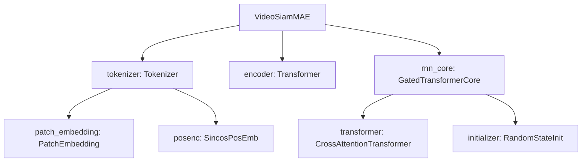
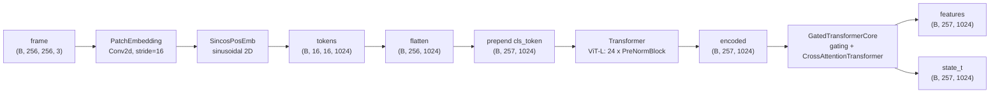
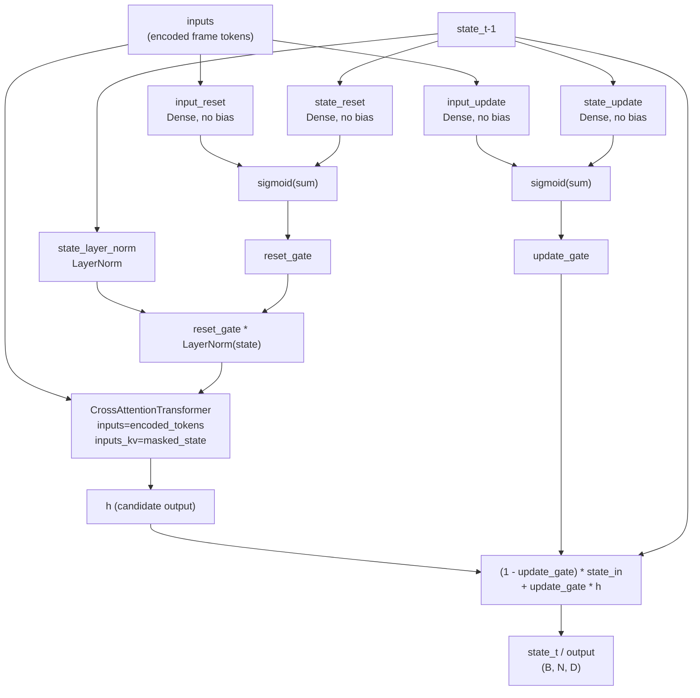
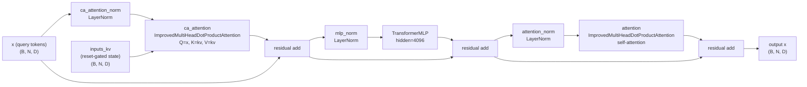

<!-- source: DeepWiki mcp.deepwiki.com · repo google-deepmind/representations4d · page 4.1 RVM Model Architecture · fetched 2026-10-26 -->

# RVM Model Architecture

<details>
<summary>Relevant source files</summary>

The following files were used as context for generating this wiki page:

- [colabs/rvm_inference_demo.ipynb](colabs/rvm_inference_demo.ipynb)

</details>


## Purpose and Scope

This page documents the internal architecture of `VideoSiamMAE`, the model class used across all Recurrent Video Masked Autoencoders (RVM) checkpoints. It covers the module hierarchy, tensor shapes at each stage, the recurrent state mechanism, and how the four available model sizes (ViT-S/B/L/H) are parameterized.

For a walkthrough of how to run inference with this model, see [4.2](). For the evaluation protocol (DAVIS, JHMDB, VIP), see [4.3](). For runtime and memory benchmarks against other video models, see [4.4](). For checkpoint loading utilities, see [5.1]().

---

## Top-Level Structure

`VideoSiamMAE` is a Flax `nn.Module` (with a PyTorch equivalent also defined in the notebook) that processes video one frame at a time. It maintains a recurrent state tensor across frames, which is updated at each step using a GRU-style gating mechanism.

**Figure: VideoSiamMAE top-level module hierarchy**



Sources: [colabs/rvm_inference_demo.ipynb:414-439]()

---

## Forward Pass Data Flow

For each frame `t`, `VideoSiamMAE.__call__` runs the following sequence:

1. `tokenizer(frame)` → patch tokens with positional embeddings, shape `(B, H, W, D)`
2. Flatten spatial dims → `(B, H*W, D)`
3. Prepend learnable `cls_token` → `(B, H*W+1, D)`
4. `encoder(frame_tokens)` → encoded tokens, same shape
5. If `state is None`, `rnn_core.initializer(...)` → zero state `(B, H*W+1, D)`
6. `rnn_core(encoded_frame_tokens, state)` → `(features, new_state)`, both shape `(B, H*W+1, D)`
7. Return `dict(features=features, state=state)`

Callers extract `output['features'][0, 1:, :]` for patch features and `output['features'][0, 0:1, :]` for the CLS token.

**Figure: Per-frame data flow with tensor shapes (ViT-L, 256×256 input)**



Sources: [colabs/rvm_inference_demo.ipynb:414-439](), [colabs/rvm_inference_demo.ipynb:514-542]()

---

## Tokenizer

`Tokenizer` wraps two sub-modules executed in sequence.

### PatchEmbedding

A single strided convolution that extracts non-overlapping patches.

- **JAX/Flax**: `nn.Conv(features=num_features, kernel_size=patch_size, strides=patch_size, padding='VALID')`
- **Input shape**: `(B, H, W, 3)`
- **Output shape**: `(B, H/patch_size, W/patch_size, num_features)`
- Patch size is `[1, 16, 16]` in the JAX notebook (the leading `1` is a no-op for 2D frames) and `[16, 16]` in the PyTorch version.

Sources: [colabs/rvm_inference_demo.ipynb:72-79]()

### SincosPosEmb

Generates fixed (non-learnable) 2D sinusoidal positional embeddings.

- Calls `get_mae_sinusoid_encoding_table(h*w, d)` to build a table of shape `(1, h*w, d)`.
- Reshapes to `(1, h, w, d)`.
- If `base_token_shape` is set (e.g. `[16, 16]`), that shape is used as the canonical grid; otherwise the actual token grid is used.
- If input token resolution differs from the canonical shape, the embedding is bicubically interpolated to match.
- The result is added element-wise to the patch tokens.

Sources: [colabs/rvm_inference_demo.ipynb:81-124]()

---

## Transformer Encoder

The encoder is a standard Vision Transformer built from `PreNormBlock` layers, with a final `LayerNorm`.

### PreNormBlock

Each block applies:
1. `LayerNorm` → multi-head self-attention (residual connection)
2. `LayerNorm` → `TransformerMLP` (residual connection)

```
tokens = tokens + attention(LayerNorm(tokens))
tokens = tokens + mlp(LayerNorm(tokens))
```

Sources: [colabs/rvm_inference_demo.ipynb:150-167]()

### TransformerMLP

Two-layer MLP with GELU activation. Hidden size defaults to `4 * d` where `d` is the token dimension.

Sources: [colabs/rvm_inference_demo.ipynb:126-148]()

### ImprovedMultiHeadDotProductAttention

Scaled dot-product attention with separate Q, K, V projections. Configurable `qk_features` and `v_features` (both default to the input dimension). The output projection maps back to the input dimension.

Sources: [colabs/rvm_inference_demo.ipynb:297-353]()

### Transformer

A stack of `PreNormBlock` layers, followed by a final `LayerNorm`. Factory method `Transformer.from_variant_str(variant_str)` parses size strings like `'S'`, `'B'`, `'L'`, `'H'` via `ViTSpec.from_variant_string`.

Sources: [colabs/rvm_inference_demo.ipynb:222-267](), [colabs/rvm_inference_demo.ipynb:169-220]()

### ViT Size Table

| Variant | `hidden_size` | `num_layers` | `mlp_size` | `num_heads` | Total Params |
|---------|--------------|-------------|-----------|------------|-------------|
| S       | 384          | 12          | 1536      | 6          | ~34M        |
| B       | 768          | 12          | 3072      | 12         | ~117M       |
| L       | 1024         | 24          | 4096      | 16         | ~375M       |
| H       | 1280         | 32          | 5120      | 16         | ~743M       |

Parameter counts include both encoder and recurrent core. The `VIT_SIZES` dict also defines `mu`, `Ti`, `M`, `g`, `G`, `e` for potential future use.

Sources: [colabs/rvm_inference_demo.ipynb:169-180]()

---

## GatedTransformerCore (Recurrent State)

`GatedTransformerCore` is the recurrent component. It holds the persistent state tensor across frames, updating it each step using a GRU-style gating scheme combined with cross-attention.

### Gating Equations

Given `inputs` (encoded frame tokens) and `state` (previous state), both shape `(B, N, D)`:

```
update_gate = sigmoid(input_update(inputs) + state_update(state))
reset_gate  = sigmoid(input_reset(inputs)  + state_reset(state))
h           = CrossAttentionTransformer(inputs, inputs_kv = reset_gate * LayerNorm(state))
output      = (1 - update_gate) * state + update_gate * h
```

- `input_update`, `input_reset`, `state_update`, `state_reset` are all `Dense(token_dim, use_bias=False)`.
- The **reset gate** modulates how much of the previous state is visible to the cross-attention.
- The **update gate** controls the blend between old state and new candidate `h`.
- `state_layer_norm` is `LayerNorm(epsilon=1e-4, use_scale=True, use_bias=False)`.

**Figure: GatedTransformerCore internals**



Sources: [colabs/rvm_inference_demo.ipynb:269-287]()

### RandomStateInit

Initializes the recurrent state to zeros with the correct shape. Takes `inputs` (to infer `(N, D)`) and `batch_shape` (typically `(1,)`).

```python
state = 0 * jax.random.normal(key=..., shape=batch_shape + inputs.shape[-2:])
```

The multiply-by-zero ensures the result is zero-valued while being JAX-traceable. The state is re-initialized at the start of each video by passing `state=None` to `VideoSiamMAE.__call__`.

Sources: [colabs/rvm_inference_demo.ipynb:405-412]()

---

## CrossAttentionTransformer

Used inside `GatedTransformerCore` as the `transformer` field. Stacks `num_layers` `CrossAttentionBlock` instances, followed by `LayerNorm`.

In the default ViT-L configuration:
- `num_layers = 4`
- `num_heads = 16`
- `num_feats = 1024`
- `mlp_dim = 4096`

Sources: [colabs/rvm_inference_demo.ipynb:354-372]()

### CrossAttentionBlock

Each block applies three operations in sequence:

1. **Cross-attention**: queries from `x`, keys and values from `inputs_kv` (the reset-gated previous state)
2. **Feed-forward MLP**: applied to the cross-attention output
3. **Self-attention**: applied to the updated token sequence

```
x = x + ca_attention(LayerNorm(x), inputs_kv, inputs_kv)
x = x + mlp(LayerNorm(x))
x = x + attention(LayerNorm(x))
```

All three operations use `ImprovedMultiHeadDotProductAttention` with separate layer norms (`ca_attention_norm`, `mlp_norm`, `attention_norm`).

**Figure: CrossAttentionBlock computation order**



Sources: [colabs/rvm_inference_demo.ipynb:374-403]()

---

## CLS Token

`VideoSiamMAE` declares a learnable parameter `cls_token` of shape `(1, latent_emb_dim)` (initialized with `stddev=0.02`). At each forward step it is broadcast to `(B, 1, D)` and concatenated at position 0 before the encoder:

```python
cls_token = jnp.broadcast_to(self.cls_token, b + [1, self.cls_token.shape[-1]])
frame_tokens = jnp.concatenate([cls_token, frame_tokens], axis=-2)
```

After the full forward pass, token index `0` in `features` is the CLS token; indices `1:` are the spatial patch features.

Sources: [colabs/rvm_inference_demo.ipynb:421-432]()

---

## Model Variants and Default Configurations

The four released checkpoints correspond to the four `Transformer.from_variant_str` sizes. The recurrent core configuration (`CrossAttentionTransformer` with 4 layers, 16 heads, `num_feats=1024`, `mlp_dim=4096`) is **shared across all variants**; only the ViT encoder changes.

| Checkpoint file | Encoder | `hidden_size` | `num_layers` | Recurrent Core | Params |
|----------------|---------|--------------|-------------|----------------|--------|
| `pretrain_rvm_small16_256.npz`  | ViT-S | 384  | 12 | 4-layer XAT, D=1024 | 34M  |
| `pretrain_rvm_base16_256.npz`   | ViT-B | 768  | 12 | 4-layer XAT, D=1024 | 117M |
| `pretrain_rvm_large16_256.npz`  | ViT-L | 1024 | 24 | 4-layer XAT, D=1024 | 375M |
| `pretrain_rvm_huge16_256.npz`   | ViT-H | 1280 | 32 | 4-layer XAT, D=1024 | 743M |

> Note: when the encoder `hidden_size` differs from the recurrent core `token_dim` (1024), a mismatch would arise. In practice the ViT-L and ViT-H notebooks use `num_features=1024` in `PatchEmbedding` and `latent_emb_dim=1024` in the recurrent core, matching the encoder output. The ViT-S and ViT-B checkpoints use the same recurrent core token dim (1024), which matches the output dimension of those encoders as configured.

Sources: [colabs/rvm_inference_demo.ipynb:441-460](), [colabs/rvm_inference_demo.ipynb:169-180]()

---

## PyTorch Equivalents

`rvm_inference_demo.ipynb` also provides a complete PyTorch re-implementation of every class listed above. The class names, constructor signatures, and module hierarchy are identical to the JAX/Flax version. Differences are limited to framework idioms (`nn.Parameter` vs `self.param`, `F.sigmoid` vs `jax.nn.sigmoid`, tensor permutation for `Conv2d`). A `flax_to_torch` helper translates the `.npz` checkpoint into a `state_dict` suitable for the PyTorch model.

Sources: [colabs/rvm_inference_demo.ipynb:1578-1941]()

---

