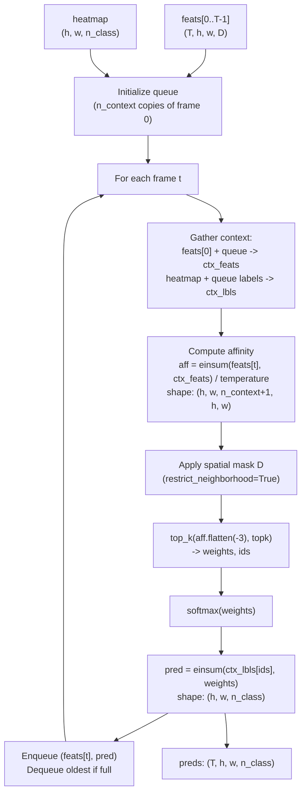
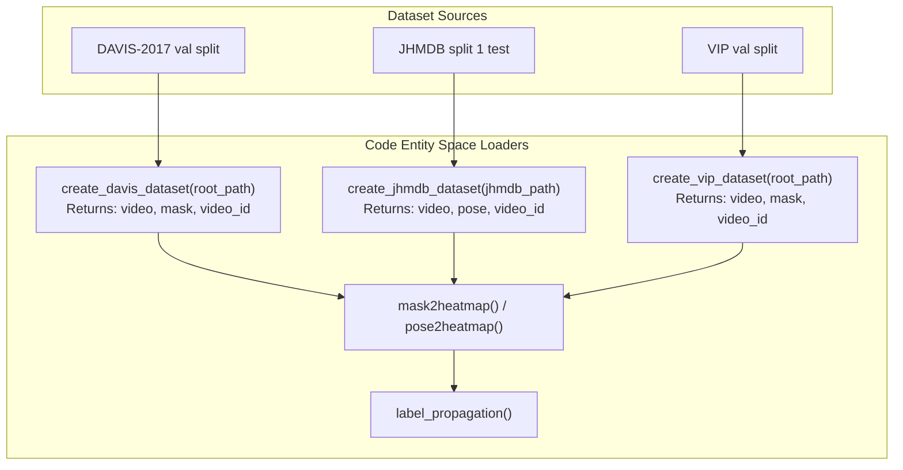

<!-- source: DeepWiki mcp.deepwiki.com · repo google-deepmind/representations4d · page 4.3 Evaluation Framework · fetched 2026-10-26 -->

# Evaluation Framework

<details>
<summary>Relevant source files</summary>

The following files were used as context for generating this wiki page:

- [colabs/rvm_evaluation_demo.ipynb](colabs/rvm_evaluation_demo.ipynb)
- [colabs/rvm_runtime_and_memory.ipynb](colabs/rvm_runtime_and_memory.ipynb)

</details>


## Purpose and Scope

This page details the evaluation harness implemented in `colabs/rvm_evaluation_demo.ipynb`, which measures the dense video prediction capabilities of Recurrent Video Masked Autoencoders (RVM) and comparable video models across three benchmarks:
- **DAVIS-2017**: Video object segmentation evaluated via the J&F (Jaccard and F-measure) metric.
- **JHMDB**: Human pose tracking evaluated via the Percentage of Correct Keypoints (PCK) metric.
- **VIP**: Video instance segmentation evaluated via mean Intersection over Union (mIoU) across semantic body parts.

The harness is model-agnostic, supporting both JAX/Flax architectures (such as RVM) and PyTorch models via a pluggable feature extraction interface.

Sources: [colabs/rvm_evaluation_demo.ipynb:1-944]()

---

## Model Plug-in Interface

The evaluation pipeline abstracts model execution behind a unified feature extraction interface. Each evaluation runner accepts a `model`, an `extract_feature_function`, and an optional JAX `params` tree.

```mermaid
graph TD
    subgraph Natural_Language_Space ["Natural Language Space"]
        ModelInput[""Model Evaluation Runner"" -->|"Extracts features"| FeatureExtraction[""Feature Extraction Step""]]
    end

    subgraph Code_Entity_Space ["Code Entity Space"]
        EvalFunc["eval_davis / eval_jhmdb / eval_vip"] --> ExtFunc["extract_feature_function"]
        ExtFunc -->|"If params is not None"| JAXModel["VideoSiamMAE model & params"]
        ExtFunc -->|"If params is None"| TorchModel["PyTorch Module (VideoMAE, DINOv2, etc.)"]
        JAXModel --> Norm["torch.nn.functional.normalize(feats, dim=-1)"]
        TorchModel --> Norm
    end

    ModelInput -.-> Code_Entity_Space
```

| Argument | Purpose |
|---|---|
| `model` | The model object (JAX `VideoSiamMAE` or any PyTorch module) |
| `extract_feature_function` | Callable that accepts `(model, video)` or `(model, params, video)` and returns spatial features |
| `params` | JAX parameter dictionary (`None` for PyTorch models) |

The evaluation wrappers branch on `params`:
- **PyTorch**: `feats = extract_feature_function(model, video)` returning a `torch.Tensor` of shape `(T, h, w, D)`.
- **JAX**: `feats = extract_feature_function(model, params, video)` returning a JAX array, converted to a CUDA tensor via `torch.tensor(feats).cuda()`.

All feature tensors are L2-normalized: `feats = torch.nn.functional.normalize(feats, dim=-1)`. Features must conform to shape `(T, h, w, D)` where `h = height // patch_size` and `w = width // patch_size`.

Sources: [colabs/rvm_evaluation_demo.ipynb:769-944]()

---

## Label Propagation

`label_propagation` is the shared mechanism used across DAVIS, JHMDB, and VIP to propagate ground-truth labels from the initial frame to all subsequent frames using cosine similarity in the feature space.



Sources: [colabs/rvm_evaluation_demo.ipynb:327-454](), [colabs/rvm_inference_demo.ipynb:835-879]()

### Parameters

| Parameter | Default | Effect |
|---|---|---|
| `n_context` | 20 | Maximum frames held in the sliding window context queue |
| `temperature` | 0.7 | Scales affinity scores prior to top-k selection |
| `topk` | 7 (DAVIS/JHMDB), 10 (VIP) | Number of nearest neighbors used per query position |
| `radius` | 20 | Pixel-distance threshold for spatial neighborhood restriction |
| `restrict_neighborhood` | `True` | Whether to apply distance penalty mask `D` |

### Context Queue

The queue (`queue.Queue(n_context)`) tracks recent frames. Frame 0 is always included as a hardcoded global context item. After processing frame `t`, `(feats[t], pred[t])` is pushed onto the queue, maintaining a sliding window of recent predictions.

Sources: [colabs/rvm_evaluation_demo.ipynb:410-453]()

---

## Dataset Loaders and Feature Processing

Dataset loaders supply video frames and ground-truth annotations as Python generators.



| Function | Dataset split | Label Type | Yield Fields |
|---|---|---|---|
| `create_davis_dataset` | DAVIS-2017 val | Segmentation masks | `video`, `mask`, `video_id` |
| `create_jhmdb_dataset` | JHMDB split 1 test | Joint positions (15 joints, xy) | `video`, `pose`, `video_id` |
| `create_vip_dataset` | VIP val | Semantic labels (20 classes) | `video`, `mask`, `video_id` |

Sources: [colabs/rvm_evaluation_demo.ipynb:275-317]()

---

## Evaluation Pipelines

The evaluation harness implements distinct pipelines for each benchmark:

### evaluate_davis
Resizes videos to `(480, 880)` (feature resolution `30 × 55` with `patch_size=16`). Computes Jaccard index (`db_eval_iou`) and boundary F-measure (`db_eval_boundary`) per object across frames `1` to `T-1`.

### evaluate_jhmdb
Resizes videos to `(320, 320)` (feature resolution `20 × 20`). Tracks 15 joint positions and evaluates using Percentage of Correct Keypoints (`computePCK`) across thresholds `0.1` to `0.5`.

### evaluate_vip
Resizes videos to `(448, 880)` (feature resolution `28 × 55`). Evaluates 20 semantic clothing classes by accumulating a global confusion matrix via `fast_hist` and calculating per-class and mean IoU.

Sources: [colabs/rvm_evaluation_demo.ipynb:769-944]()

---

## Benchmark Configuration Summary

| Benchmark | Resolution | Feature Res | `topk` | `n_context` | `temperature` | `radius` |
|---|---|---|---|---|---|---|
| DAVIS J&F | 480 × 880 | 30 × 55 | 7 | 20 | 0.7 | 20 |
| JHMDB PCK | 320 × 320 | 20 × 20 | 7 | 20 | 0.7 | 20 |
| VIP mIoU | 448 × 880 | 28 × 55 | 10 | 20 | 0.7 | 20 |

Sources: [colabs/rvm_evaluation_demo.ipynb:769-944]()

---

