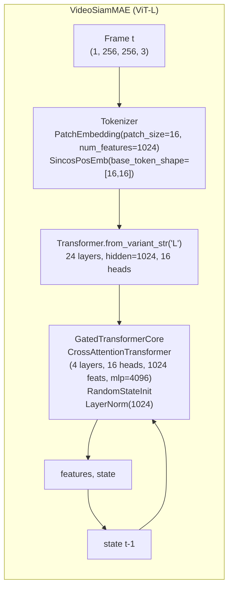
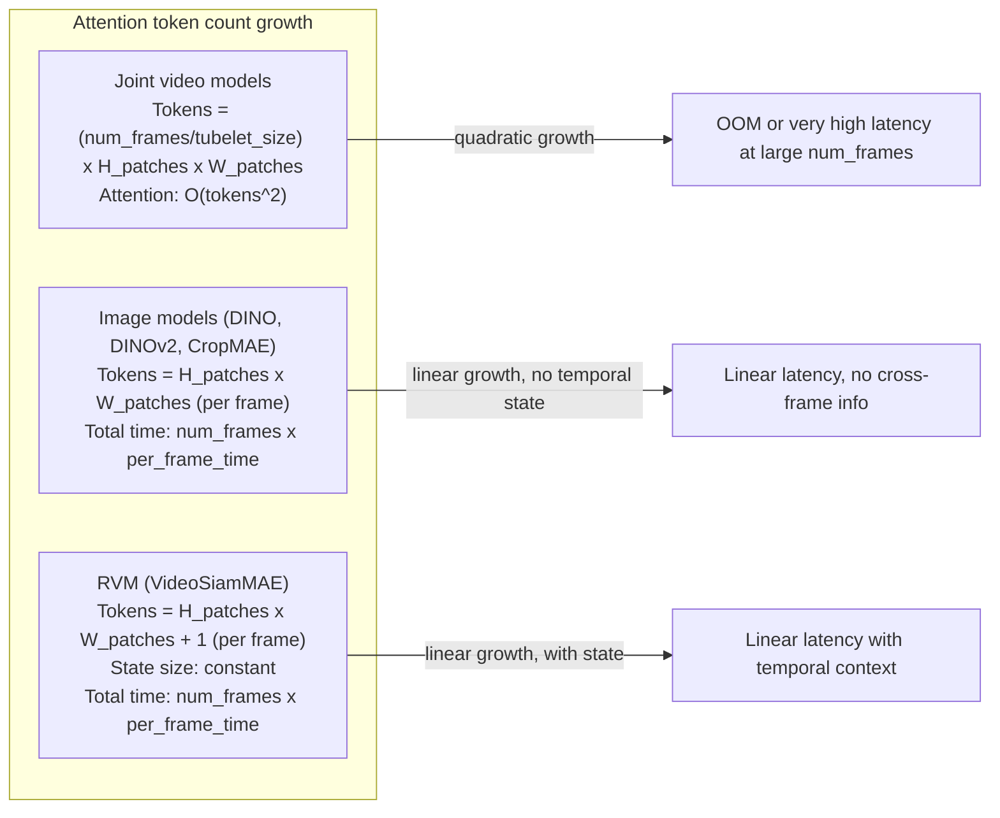

<!-- source: DeepWiki mcp.deepwiki.com · repo google-deepmind/representations4d · page 4.4 Runtime and Memory Benchmarks · fetched 2026-10-26 -->

# Runtime and Memory Benchmarks

<details>
<summary>Relevant source files</summary>

The following files were used as context for generating this wiki page:

- [colabs/rvm_evaluation_demo.ipynb](colabs/rvm_evaluation_demo.ipynb)
- [colabs/rvm_runtime_and_memory.ipynb](colabs/rvm_runtime_and_memory.ipynb)

</details>


This page documents the benchmark methodology and model comparisons found in `colabs/rvm_runtime_and_memory.ipynb`. It covers how inference latency scales with video length for RVM and competing video/image models. This page does not cover task accuracy benchmarks (DAVIS, JHMDB, VIP); for those, see the Evaluation Framework page [Evaluation Framework](#4.3). For a description of the `VideoSiamMAE` architecture itself, see [RVM Model Architecture](#4.1).

---

## Purpose

The notebook benchmarks GPU inference latency across a range of frame counts, comparing RVM against a set of contemporary video and image backbone models. The central question is: **how does wall-clock latency scale as the number of frames in a video grows?**

The key structural difference that drives the comparison is:

| Processing strategy | Models | Attention complexity vs. frames |
|---|---|---|
| Joint (all frames at once) | VideoMAE, VideoMAEv2, V-JEPA, V-JEPA 2 | Quadratic (full spatiotemporal attention) |
| Frame-independent (one frame at a time) | DINO, DINOv2, CropMAE | Linear (no cross-frame context) |
| Recurrent (one frame at a time, with state) | RVM | Linear (constant state size) |

Sources: [colabs/rvm_runtime_and_memory.ipynb:1-50]()

---

## Hardware and Environment

The notebook is configured to run on a Colab instance with an **NVIDIA A100 GPU** (`"gpuType": "A100"`, `"machine_shape": "hm"`). All models run in PyTorch with `torch.set_grad_enabled(False)` and `.eval()` mode.

Dependencies installed at the top of the notebook:

```
pip install mediapy thop
```

Sources: [colabs/rvm_runtime_and_memory.ipynb:19-49](), [colabs/rvm_runtime_and_memory.ipynb:1714-1780]()

---

## Models Benchmarked

Each model is set up independently, either by cloning a GitHub repository or loading from HuggingFace. All use a ViT-L scale backbone where applicable.

| Model | Source | Backbone | Framework | Loading method |
|---|---|---|---|---|
| VideoMAE | `MCG-NJU/VideoMAE` (GitHub) | ViT-L (custom `PretrainVisionTransformer`) | PyTorch | Manual instantiation |
| VideoMAEv2 | `OpenGVLab/VideoMAEv2-Large` (HuggingFace) | ViT-L (`VideoMAEv2` / `VisionTransformer`) | PyTorch | `from_pretrained` |
| V-JEPA | `facebookresearch/jepa` (GitHub) | ViT-L (`src.models.vision_transformer.VisionTransformer`) | PyTorch | Manual instantiation |
| V-JEPA 2 | `facebook/vjepa2-vitl-fpc64-256` (HuggingFace) | ViT-L (`VJEPA2Model` / `VJEPA2Encoder`) | PyTorch | `from_pretrained` |
| DINO | `facebookresearch/dino` (GitHub) | ViT-L (`vit_large`) | PyTorch | `vits.__dict__['vit_large']` |
| DINOv2 | `facebook/dinov2-large` (HuggingFace) | ViT-L (`Dinov2Model`) | PyTorch | `from_pretrained` |
| CropMAE | `alexandre-eymael/CropMAE` (GitHub) | ViT-L (`MaskedAutoencoderViT`) | PyTorch | Manual instantiation |
| RVM | GCS (this repo) | ViT-L (`VideoSiamMAE`) | PyTorch (ported) | `.npz` checkpoint + `recover_tree` + `flax_to_torch` |

Sources: [colabs/rvm_runtime_and_memory.ipynb:63-73](), [colabs/rvm_runtime_and_memory.ipynb:554-560](), [colabs/rvm_runtime_and_memory.ipynb:764-773](), [colabs/rvm_runtime_and_memory.ipynb:826-855](), [colabs/rvm_runtime_and_memory.ipynb:900-913](), [colabs/rvm_runtime_and_memory.ipynb:963-993](), [colabs/rvm_runtime_and_memory.ipynb:1040-1067](), [colabs/rvm_runtime_and_memory.ipynb:1186-1201]()

---

## Benchmark Methodology

All models are measured using the same protocol:

- **Frame counts tested:** `[16, 32, 64, 128, 256, 512, 1024]`
- **Resolution:** `256 × 256` pixels
- **Batch size:** 1
- **Runs per measurement:** `n_runs = 1`
- **Timing:** Wall-clock time using `time.time()`, with `torch.cuda.synchronize()` called before stopping the timer to ensure GPU completion
- **Result:** Average latency in milliseconds, printed per frame count

Sources: [colabs/rvm_runtime_and_memory.ipynb:522-549](), [colabs/rvm_runtime_and_memory.ipynb:1683-1711]()

**Timing pattern used for all models:**

```python
start = time.time()
# ... model forward pass(es) ...
torch.cuda.synchronize()
end = time.time()
avg_latency = (end - start) / n_runs
```

---

## Forward-Pass Structure by Category

The way each model's forward pass is invoked differs by category, which directly determines how its latency scales.

Diagram: Forward-pass loop structure per model category

```mermaid
flowchart TD
    subgraph "Joint video models (VideoMAE, VideoMAEv2, V-JEPA, V-JEPA 2)"
        J1["inputs = torch.randn(1, 3, num_frames, 256, 256)"]
        J2["model(inputs)"]
        J1 --> J2
    end

    subgraph "Frame-independent image models (DINO, DINOv2, CropMAE)"
        F1["inputs = torch.randn(1, num_frames, 3, 256, 256)"]
        F2["for t in range(num_frames):"]
        F3["model(inputs[:, t])"]
        F1 --> F2 --> F3 --> F2
    end

    subgraph "Recurrent model (RVM: VideoSiamMAE)"
        R1["inputs = torch.randn(1, num_frames, 256, 256, 3)"]
        R2["state = None"]
        R3["for t in range(num_frames):"]
        R4["output, state = model(inputs[:, t], state)"]
        R1 --> R2 --> R3 --> R4 --> R3
    end
```

Sources: [colabs/rvm_runtime_and_memory.ipynb:522-549](), [colabs/rvm_runtime_and_memory.ipynb:917-952](), [colabs/rvm_runtime_and_memory.ipynb:1683-1711]()

---

## RVM Model Setup in the Benchmark

The notebook defines a self-contained PyTorch port of `VideoSiamMAE` for benchmarking. The ViT-L scale is used, matching the `pretrain_rvm_large16_256` checkpoint.

Diagram: RVM benchmark model construction (`VideoSiamMAE` ViT-L)

Sources: [colabs/rvm_runtime_and_memory.ipynb:1512-1572]()

**Key classes defined inline in the notebook:**

| Class | Role |
|---|---|
| `VideoSiamMAE` | Top-level model; drives the recurrent frame loop |
| `Tokenizer` | Wraps `PatchEmbedding` + `SincosPosEmb` |
| `PatchEmbedding` | Conv2d-based patch projection (16×16) |
| `SincosPosEmb` | Sinusoidal 2D positional embedding |
| `Transformer` | Stacked `PreNormBlock` layers (ViT encoder) |
| `GatedTransformerCore` | GRU-style gating over `CrossAttentionTransformer` |
| `CrossAttentionTransformer` | Stack of `CrossAttentionBlock` layers |
| `RandomStateInit` | Initializes zero recurrent state on first frame |

Sources: [colabs/rvm_runtime_and_memory.ipynb:1215-1572]()

---

## Checkpoint Loading for RVM

The benchmark loads the RVM ViT-L checkpoint and ports it from Flax parameter format to PyTorch. Two helper functions handle this:

- `recover_tree(flat_dict)` — reconstructs the nested parameter dict from slash-delimited `.npz` keys [colabs/rvm_runtime_and_memory.ipynb:1587-1597]()
- `flatten_flax_params(params, parent_key)` — flattens the nested dict to dot-separated keys for matching against PyTorch `named_parameters()` [colabs/rvm_runtime_and_memory.ipynb:1599-1612]()
- `flax_to_torch(flat_flax, torch_model)` — copies arrays into PyTorch `nn.Parameter` objects, handling transpositions for `Linear` kernels (Flax stores `[in, out]`, PyTorch expects `[out, in]`) and `Conv2d` kernels (Flax `[H, W, in, out]` → PyTorch `[out, in, H, W]`) [colabs/rvm_runtime_and_memory.ipynb:1613-1673]()

For the canonical JAX/Flax version of `recover_tree`, see [GenCeption Pipeline](#5.1).

Sources: [colabs/rvm_runtime_and_memory.ipynb:1583-1679]()

---

## Latency Scaling Behavior

Diagram: Expected latency scaling by model category


The joint models (VideoMAE, VideoMAEv2, V-JEPA, V-JEPA 2) operate on all frames as a single token sequence. For a 256×256 input with patch size 16 and tubelet size 2, the token count at `num_frames=1024` grows to `512 × 16 × 16 = 131,072` tokens, making attention prohibitively expensive.

Frame-independent models (DINO, DINOv2, CropMAE) avoid this by operating on single frames, but carry no temporal state across frames.

RVM also operates frame-by-frame but maintains a recurrent state (`GatedTransformerCore`) of fixed size regardless of `num_frames`, giving it the same linear scaling as image models while retaining temporal context.

Sources: [colabs/rvm_runtime_and_memory.ipynb:522-549](), [colabs/rvm_runtime_and_memory.ipynb:917-952](), [colabs/rvm_runtime_and_memory.ipynb:1683-1711]()

---

## Input Tensor Formats

Each model category expects a different tensor layout:

| Model(s) | Input shape | Layout |
|---|---|---|
| VideoMAE, VideoMAEv2 | `(1, 3, num_frames, 256, 256)` | `(B, C, T, H, W)` |
| V-JEPA | `(1, 3, num_frames, 256, 256)` | `(B, C, T, H, W)` |
| V-JEPA 2 | `(1, num_frames, 3, 256, 256)` | `(B, T, C, H, W)` |
| DINO, DINOv2, CropMAE | `(1, num_frames, 3, 256, 256)` → slice `[:, t]` | Per-frame `(B, C, H, W)` |
| RVM | `(1, num_frames, 256, 256, 3)` → slice `[:, t]` | Per-frame `(B, H, W, C)` (channels-last) |

Sources: [colabs/rvm_runtime_and_memory.ipynb:527-543](), [colabs/rvm_runtime_and_memory.ipynb:727-742](), [colabs/rvm_runtime_and_memory.ipynb:793-808](), [colabs/rvm_runtime_and_memory.ipynb:863-883](), [colabs/rvm_runtime_and_memory.ipynb:929-946](), [colabs/rvm_runtime_and_memory.ipynb:1006-1024](), [colabs/rvm_runtime_and_memory.ipynb:1152-1170](), [colabs/rvm_runtime_and_memory.ipynb:1687-1706]()

---

