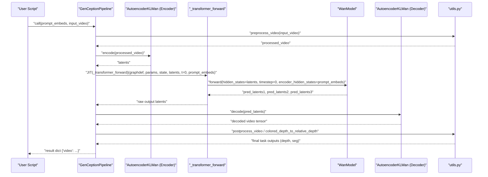

<!-- source: DeepWiki mcp.deepwiki.com · repo google-deepmind/representations4d · page 5.1 GenCeption Pipeline · fetched 2026-10-26 -->

# GenCeption Pipeline

<details>
<summary>Relevant source files</summary>

The following files were used as context for generating this wiki page:

- [representations4d/genception/pipeline.py](representations4d/genception/pipeline.py)
- [representations4d/genception/run_inference.py](representations4d/genception/run_inference.py)

</details>


## Purpose and Scope

This page provides full technical documentation for the `GenCeptionPipeline` class defined in `representations4d/genception/pipeline.py`. GenCeption adapts the WAN 2.1 video diffusion transformer backbone into a single-step feed-forward multi-task video perception model capable of predicting dense outputs such as depth, surface normals, and video object segmentation (RefVOS) directly from an input video and precomputed prompt embeddings without iterative diffusion denoising.

Sources: [`representations4d/genception/pipeline.py:16-44`](), [`representations4d/genception/run_inference.py:16-35`]()

---

## Configuration Resolution and Initialization (`from_pretrained`)

The `GenCeptionPipeline` supports default configurations for both `14b` and `1.3b` model variants via `_DEFAULT_CONFIGS` [representations4d/genception/pipeline.py:115-174](). These configurations define essential structural parameters such as attention heads, hidden dimensions, layer counts, and multi-task token head dimensions.

```python
_DEFAULT_CONFIGS = {
    '14b': { ... },
    '1.3b': {
        'num_attention_heads': 12,
        'attention_head_dim': 128,
        'in_channels': 16,
        'out_channels': 16,
        'text_dim': 4096,
        'freq_dim': 256,
        'ffn_dim': 8960,
        'num_layers': 30,
        ...
    }
}
```

During initialization, these parameters can be overridden by an optional `config.json` file located in the checkpoint directory.

Sources: [`representations4d/genception/pipeline.py:112-174`]()

---

## Pipeline Architecture & Natural Language to Code Mapping

The following diagram bridges high-level perception concepts (Natural Language Space) to their corresponding implementation classes and functions within the codebase (Code Entity Space).

### Architecture Mapping

```mermaid
graph TD
    subgraph NaturalLanguageSpace ["Natural Language Space"]
        InputVideo["Input Video Frame Sequence"]
        TextPrompts["Precomputed Text Prompt Embeddings"]
        VAEEncoder["Video VAE Encoder"]
        TransformerCore["Diffusion Transformer Backbone (t=0)"]
        TaskHeads["Multi-Task Output Prediction Heads"]
        VAEDecoder["Video VAE Decoder"]
        DepthPost["Relative Depth Postprocessing"]
    end

    subgraph CodeEntitySpace ["Code Entity Space"]
        LoadVideo["representations4d.genception.utils.load_video"]
        PromptTensor["jnp.ndarray (prompt_embeds)"]
        VAEClass["representations4d.genception.vae.AutoencoderKLWan"]
        ModelClass["representations4d.genception.model.WanModel"]
        ForwardFunc["representations4d.genception.pipeline._transformer_forward"]
        DecodeFunc["GenCeptionPipeline.decode_video"]
        UtilsDepth["representations4d.genception.utils.colored_depth_to_relative_depth"]
    end

    InputVideo --> LoadVideo
    TextPrompts --> PromptTensor
    VAEEncoder --> VAEClass
    TransformerCore --> ModelClass
    TransformerCore --> ForwardFunc
    TaskHeads --> ForwardFunc
    VAEDecoder --> DecodeFunc
    DepthPost --> UtilsDepth
```



Sources: [`representations4d/genception/pipeline.py:77-105`](), [`representations4d/genception/vae.py:1-68`](), [`representations4d/genception/model.py:1-60`](), [`representations4d/genception/utils.py:1-65`]

---

## Latent Encoding and Normalization (`encode_video`)

Input videos of shape `[T, H, W, C]` are preprocessed and converted into latent representations using the causal-conv video VAE (`AutoencoderKLWan`) [representations4d/genception/pipeline.py:65-67](). 

1. **Preprocessing**: Frames are normalized and resized to match expected resolution bounds (e.g., `480x832`) [representations4d/genception/pipeline.py:140-141]().
2. **VAE Encoding**: The encoder maps pixel space to latent space with `in_channels=16` [representations4d/genception/pipeline.py:119]().
3. **Latent Normalization**: Depending on the configuration flag `normalize_latents` [representations4d/genception/pipeline.py:142](), latents may be scaled or normalized prior to being passed into the transformer backbone.

Sources: [`representations4d/genception/pipeline.py:65-68](), [`representations4d/genception/vae.py:1-40`]

---

## Single-Step Transformer Forward Pass (`_transformer_forward`)

Unlike iterative diffusion models that require multiple denoising steps, GenCeption performs a **single-step feed-forward inference pass** at a fixed diffusion timestep ($t=0$). 

The JIT-compiled helper `_transformer_forward` merges the NNX graph definition, parameters, and state, then invokes the `WanModel` [representations4d/genception/pipeline.py:77-105]():

```python
@jax.jit
def _transformer_forward(
    graphdef: Any,
    params: Any,
    rest_of_state: Any,
    latents: jnp.ndarray,
    timestep: jnp.ndarray,
    prompt_embeds: jnp.ndarray,
) -> Tuple[jnp.ndarray, jnp.ndarray, jnp.ndarray]:
  model = nnx.merge(graphdef, params, rest_of_state)
  pred_latents1, pred_latents2, pred_latents3 = model(
      hidden_states=latents,
      timestep=timestep,
      encoder_hidden_states=prompt_embeds,
  )
  return pred_latents1, pred_latents2, pred_latents3
```

- **`latents`**: Encoded video latents of shape `[B, C, T', H', W']` [representations4d/genception/pipeline.py:92]().
- **`timestep`**: Integer diffusion timestep array set to zero (shape `[B]`) [representations4d/genception/pipeline.py:93]().
- **`prompt_embeds`**: Precomputed text embeddings (e.g., from UMT5-XXL) of shape `[B, seq_len, text_dim]` [representations4d/genception/pipeline.py:23-25, 94]().

Sources: [`representations4d/genception/pipeline.py:77-105`](), [`representations4d/genception/model.py:1-80`]

---

## Video Decoding and Depth Extraction (`decode_video` & `decode_depth`)

Once the transformer predicts the output latents (`pred_latents1`, `pred_latents2`, `pred_latents3`) [representations4d/genception/pipeline.py:100]():

1. **`decode_video`**: Passes the predicted latents through `AutoencoderKLWan` to reconstruct pixel-space video tensors.
2. **`decode_depth`**: Converts model outputs into metric or relative depth maps using color-space utilities like `colored_depth_to_relative_depth` [representations4d/genception/pipeline.py:61]().
3. **Postprocessing**: Applies scaling, resizing, and format conversion via `postprocess_video` [representations4d/genception/pipeline.py:63]() to output viewable MP4 arrays or image frames.

Sources: [`representations4d/genception/pipeline.py:61-67](), [`representations4d/genception/utils.py:1-80`]

---

## Pipeline Execution Sequence

The sequence below illustrates the runtime flow when executing `GenCeptionPipeline.__call__`.

### Execution Flow Sequence



Sources: [`representations4d/genception/pipeline.py:77-105](), [`representations4d/genception/run_inference.py:150-195`]

---

