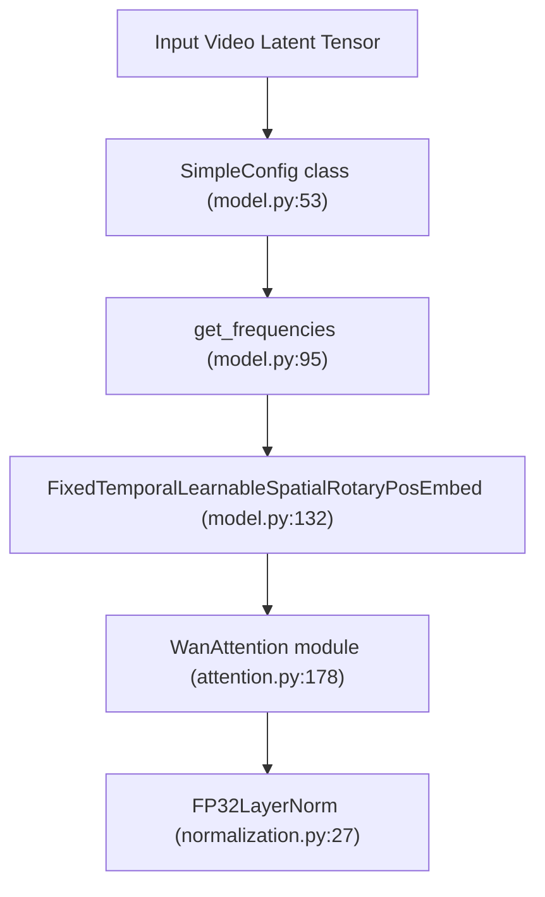
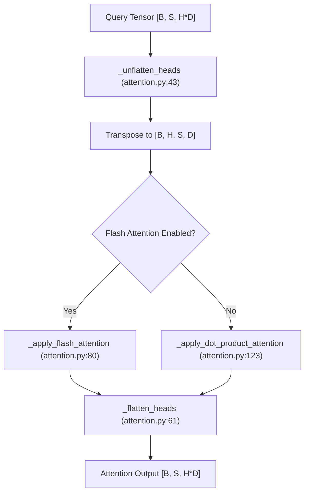
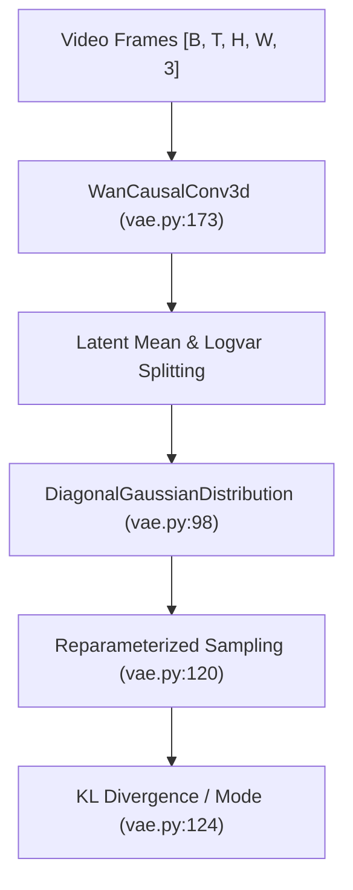

<!-- source: DeepWiki mcp.deepwiki.com · repo google-deepmind/representations4d · page 5.2 WAN Model and VAE Internals · fetched 2026-10-26 -->

# WAN Model and VAE Internals

Relevant source files

The following files were used as context for generating this wiki page:

- [representations4d/genception/attention.py](representations4d/genception/attention.py)
- [representations4d/genception/embeddings.py](representations4d/genception/embeddings.py)
- [representations4d/genception/model.py](representations4d/genception/model.py)
- [representations4d/genception/normalization.py](representations4d/genception/normalization.py)
- [representations4d/genception/vae.py](representations4d/genception/vae.py)

## Purpose and Scope
This page details the architectural internals of the WAN 2.1 transformer backbone and the 3D causal video Variational Autoencoder (VAE) used in the GenCeption perception pipeline. It covers the core transformer building blocks, multi-head attention mechanisms with flash-attention support, rotary position embeddings (RoPE), float32-stabilized layer normalization, and the `AutoencoderKLWan` video VAE incorporating temporal causal convolutions and diagonal Gaussian latent distributions.

---

## 1. WAN Transformer Backbone and Configuration
The WAN 2.1 transformer backbone processes video latents and auxiliary task tokens through stacked self-attention and cross-attention blocks. Configurations are managed dynamically via the `SimpleConfig` class, which exposes dictionary keys as attributes during model construction and forward propagation `[representations4d/genception/model.py:53-66]()`.

*Diagram 1: Natural Language Space to Code Entity Space mapping for WAN transformer configuration and initialization.*

**Sources:** `[representations4d/genception/model.py:53-66]`, `[representations4d/genception/model.py:95-130]`, `[representations4d/genception/model.py:132-181]`, `[representations4d/genception/attention.py:178-193]`, `[representations4d/genception/normalization.py:27-57]()`

---

## 2. Attention Mechanisms and Rotary Position Embeddings
Multi-head attention in GenCeption is implemented via `WanAttention` `[representations4d/genception/attention.py:178-193]()`. It supports two execution pathways for computing attention scores:
1. **Flash Attention**: Accelerated execution via `jax.nn.dot_product_attention` through `_apply_flash_attention` `[representations4d/genception/attention.py:80-121]()`.
2. **Standard Dot-Product Attention**: Explicit einsum-based scaling and softmax via `_apply_dot_product_attention` `[representations4d/genception/attention.py:123-158]()`.

Head reshaping utilities `_unflatten_heads` `[representations4d/genception/attention.py:43-58]()` and `_flatten_heads` `[representations4d/genception/attention.py:61-73]()` handle tensor layout transitions between `[B, S, H*D]` and `[B, H, S, D]`.

Rotary Position Embeddings (RoPE) are computed using `get_1d_rotary_pos_embed` `[representations4d/genception/embeddings.py:123-151]()` and split across temporal, height, and width dimensions via `get_frequencies` `[representations4d/genception/model.py:95-130]()`. For task-specific learnable tokens, `FixedTemporalLearnableSpatialRotaryPosEmbed` anchors temporal positions while keeping spatial height/width position parameters learnable `[representations4d/genception/model.py:132-181]()`.

*Diagram 2: Attention execution flow bridging tensor layouts and attention implementations.*

**Sources:** `[representations4d/genception/attention.py:43-193]`, `[representations4d/genception/embeddings.py:123-151]`, `[representations4d/genception/model.py:95-181]()`

---

## 3. Normalization and Embedding Modules
To maintain numerical stability under mixed-precision execution, `FP32LayerNorm` wraps standard layer normalization by casting inputs to `float32` prior to normalization and returning them to the original input dtype `[representations4d/genception/normalization.py:27-57]()`.

Timestep and positional embeddings are generated using sinusoidal representations via `get_sinusoidal_embeddings` `[representations4d/genception/embeddings.py:67-115]()`. Activation functions are dynamically retrieved via a shared registry dictionary `_ACTIVATIONS` (`swish`, `silu`, `relu`, `gelu`, `mish`) accessed through `get_activation` `[representations4d/genception/embeddings.py:34-59]()`.

**Sources:** `[representations4d/genception/normalization.py:27-57]`, `[representations4d/genception/embeddings.py:34-115]()`

---

## 4. AutoencoderKLWan Video VAE and Causal Conv Cache
The `AutoencoderKLWan` video VAE encodes video frames into 16-channel latents with 8x spatial and 4x temporal downsampling, and decodes latents back into video space `[representations4d/genception/vae.py:16-30]()`.

Key components include:
* **`WanCausalConv3d`**: Applies 3D causal convolutions that pad only in the past along the temporal axis (`CACHE_T = 2`), ensuring outputs at time $t$ depend strictly on inputs at times $\le t$ `[representations4d/genception/vae.py:45-46]`, `[representations4d/genception/vae.py:173-202]()`.
* **`DiagonalGaussianDistribution`**: Parameterizes latent posterior distributions via mean and log-variance splitting, providing reparameterized sampling and KL divergence calculations `[representations4d/genception/vae.py:98-146]()`.
* **Output Dataclasses**: `AutoencoderKLOutput` encapsulates latent distributions `[representations4d/genception/vae.py:87-97]()`, while `DecoderOutput` returns reconstructed video tensors `[representations4d/genception/vae.py:75-84]()`.

*Diagram 3: Video VAE encoding and latent distribution management pipeline.*

**Sources:** `[representations4d/genception/vae.py:16-46]`, `[representations4d/genception/vae.py:75-146]`, `[representations4d/genception/vae.py:173-202]()`

---

