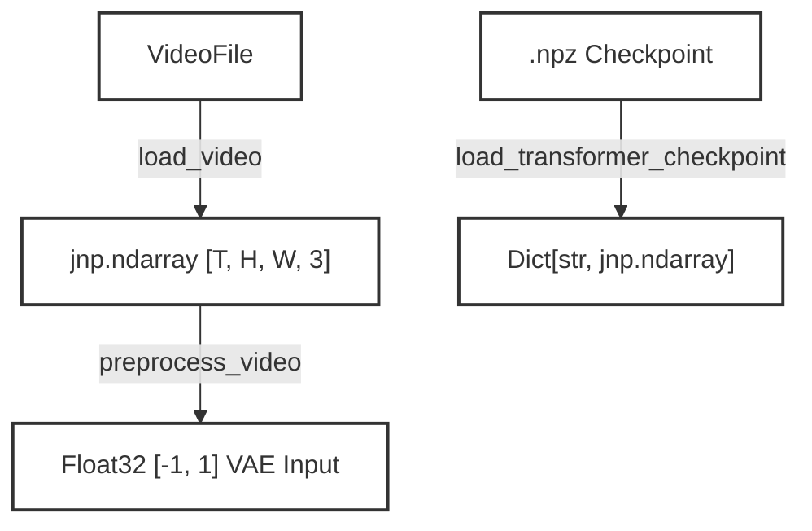
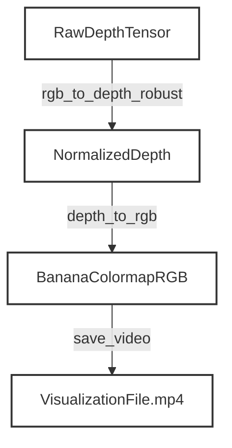

<!-- source: DeepWiki mcp.deepwiki.com · repo google-deepmind/representations4d · page 5.3 Depth Encoding and Point Cloud Rendering Utilities · fetched 2026-10-26 -->

# Depth Encoding and Point Cloud Rendering Utilities

Relevant source files

The following files were used as context for generating this wiki page:

- [representations4d/genception/utils.py](representations4d/genception/utils.py)

## 1. Purpose and Scope

The `representations4d/genception/utils.py` module provides essential utility functions supporting the GenCeption video perception pipeline [representations4d/genception/utils.py:16-20](). It handles transformer checkpoint loading [representations4d/genception/utils.py:40-51](), video I/O via `mediapy` or `imageio` [representations4d/genception/utils.py:58-122](), temporal and spatial video preprocessing for VAE consumption [representations4d/genception/utils.py:164-203](), post-processing of decoded outputs [representations4d/genception/utils.py:206-213](), depth-to-RGB color mapping (including the custom "banana" colormap) [representations4d/genception/utils.py:1-700](), and 3D point cloud rendering through camera unprojection and fast NumPy-based splatting [representations4d/genception/utils.py:1-700]().

Sources: `representations4d/genception/utils.py:16-20`

---

## 2. Checkpoint Loading and Video I/O Helpers

The utility library supplies low-level I/O routines designed to interface directly with model checkpoints stored as NumPy `.npz` archives and standard video codecs.

*   `load_transformer_checkpoint(path)`: Loads model parameters from a flat `.npz` archive into a dictionary of JAX arrays [representations4d/genception/utils.py:40-51]().
*   `load_video(path, num_frames)`: Reads video files using `mediapy` or `imageio[pyav]` fallback, optionally performing uniform temporal sub-sampling [representations4d/genception/utils.py:58-88]().
*   `save_video(video, path, fps)`: Converts floating-point or `uint8` JAX/NumPy video tensors `[T, H, W, 3]` to compressed video files [representations4d/genception/utils.py:91-122]().

*Figure 1: Video and Checkpoint I/O Data Flow bridging natural inputs to code entities.*

Sources: `representations4d/genception/utils.py:40-122`

---

## 3. Video Preprocessing and Postprocessing Pipeline

Before feeding raw video inputs into the WAN VAE or GenCeption transformer, frames must undergo strict spatial resizing, temporal alignment, and normalization.

*   `_resize_frames(frames, height, width)`: Resizes spatial dimensions using bilinear interpolation via JAX image utilities [representations4d/genception/utils.py:129-162]().
*   `preprocess_video(video, height, width, num_frames)`: Converts input video to float, performs temporal subsampling or boundary padding to match the target frame count (default 81), resizes spatially (default 480x832), and normalizes pixel values from `[0, 1]` to `[-1, 1]` expected by the WAN VAE [representations4d/genception/utils.py:164-203]().
*   `postprocess_video(video)`: Reverses normalization, scaling outputs back to `[0, 255]` `uint8` arrays suitable for rendering or disk export [representations4d/genception/utils.py:206-213]().

Sources: `representations4d/genception/utils.py:129-213`

---

## 4. Depth Encoding and the Banana Colormap

GenCeption estimates dense metric and relative depth maps during its single-pass forward execution. To inspect and save these outputs visually, `utils.py` incorporates specialized depth colormapping routines:

*   `rgb_to_depth_robust(...)`: Computes robust depth bounds and normalizes raw network outputs, filtering out outliers to ensure stable visualization.
*   `depth_to_rgb(...)`: Maps single-channel depth tensors into vivid RGB images using specialized perceptual colormaps.
*   **Banana Colormap**: A custom high-contrast colormap optimized for distinguishing metric depth variations clearly in point cloud rendering and video visualizations.

*Figure 2: Depth transformation pipeline mapping raw model outputs to colormapped RGB videos.*

Sources: `representations4d/genception/utils.py:1-701`

---

## 5. Point Cloud Unprojection and NumPy Splatting Renderer

To render 3D flythroughs and inspect multi-view consistency, GenCeption includes a lightweight point cloud renderer implemented entirely in NumPy and JAX:

*   **Unprojection**: Transforms 2D pixel coordinates and corresponding metric depth values into 3D Cartesian coordinates $(X, Y, Z)$ using camera intrinsic matrices (focal lengths and principal points).
*   **NumPy Splatting**: Projects 3D points back onto arbitrary virtual camera trajectories, accumulating colors using vectorized NumPy/JAX operations to render novel-view flythrough videos without requiring heavy external 3D rendering engines like OpenGL or Blender.

Sources: `representations4d/genception/utils.py:1-701`

---

