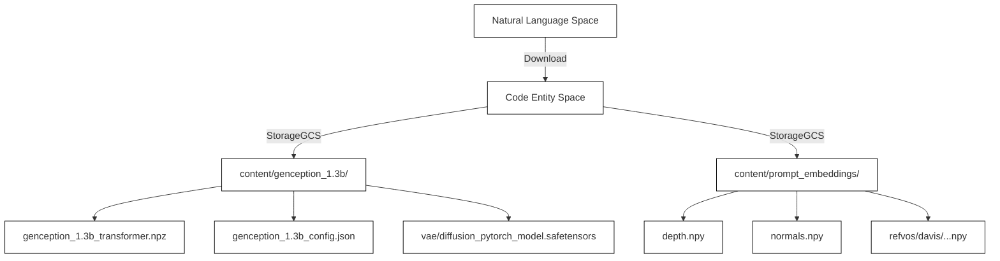
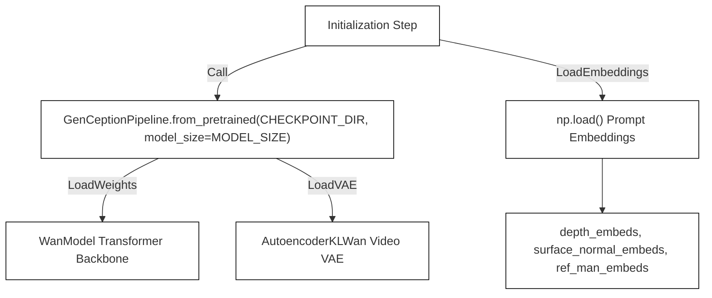

<!-- source: DeepWiki mcp.deepwiki.com · repo google-deepmind/representations4d · page 5.4 GenCeption Inference Demo · fetched 2026-10-26 -->

# GenCeption Inference Demo

<details>
<summary>Relevant source files</summary>

The following files were used as context for generating this wiki page:

- [colabs/genception_inference_demo.ipynb](colabs/genception_inference_demo.ipynb)

</details>


This page walks through the `colabs/genception_inference_demo.ipynb` notebook [colabs/genception_inference_demo.ipynb:1-157](), detailing how to perform single-step multi-modal perception inference using the GenCeption foundation model. The demo covers environment setup, checkpoint and prompt embedding acquisition, model initialization via `GenCeptionPipeline`, running inference for depth estimation, surface normal estimation, and referring video object segmentation (RefVOS), followed by depth decoding and pointcloud flythrough rendering.

---

## 1. Environment Setup and Package Installation

The inference demo begins by installing the required JAX/Flax runtime, video utilities (`mediapy`), and the `representations4d` package with the `genception` extra from the repository [colabs/genception_inference_demo.ipynb:42-43]().

```bash
!pip install -q jax[cuda12] flax mediapy safetensors
!pip install -q "representations4d[genception] @ git+https://github.com/google-deepmind/representations4d.git"
```

Once installed, JAX devices and versions are verified [colabs/genception_inference_demo.ipynb:55-63]():

```python
import os
import numpy as np
import jax
import jax.numpy as jnp
import mediapy as media

print(f"JAX devices: {jax.devices()}")
print(f"JAX version: {jax.__version__}")
```

Sources: `[colabs/genception_inference_demo.ipynb:37-67]()`

---

## 2. Checkpoint and Precomputed Prompt Embedding Acquisition

GenCeption avoids loading the massive 22 GB UMT5-XXL text encoder during inference by utilizing precomputed prompt embeddings. The notebook downloads model weights, configuration files, VAE weights, and task-specific prompt embeddings from Google Cloud Storage [colabs/genception_inference_demo.ipynb:74-103]().

The following assets are downloaded for either the `1.3b` or `14b` model variant (`MODEL_SIZE = '1.3b'`):
- Transformer weights (`genception_1.3b_transformer.npz`) and configuration (`genception_1.3b_config.json`) [colabs/genception_inference_demo.ipynb:87-88]()
- AutoencoderKLWan VAE weights (`diffusion_pytorch_model.safetensors`) and config [colabs/genception_inference_demo.ipynb:91-93]()
- Precomputed text prompt embeddings for depth (`depth.npy`), surface normals (`normals.npy`), negative prompts (`negative.npy`), and RefVOS referring expressions (`bike-packing_cap_a_man..npy`) [colabs/genception_inference_demo.ipynb:95-101]()



Sources: `[colabs/genception_inference_demo.ipynb:68-107]()`

---

## 3. Pipeline Initialization and Embedding Loading

The GenCeption pipeline is initialized using `GenCeptionPipeline.from_pretrained()`, which loads the model architecture, transformer weights, and the underlying video VAE [colabs/genception_inference_demo.ipynb:113-118](). Precomputed prompt embeddings are loaded into host memory via `np.load()` [colabs/genception_inference_demo.ipynb:120-125]().



```python
from representations4d.genception import GenCeptionPipeline

pipe = GenCeptionPipeline.from_pretrained(CHECKPOINT_DIR, model_size=MODEL_SIZE)
print("GenCeption pipeline loaded successfully!")

# Load precomputed prompt embeddings
depth_embeds = np.load(f'{EMBEDDINGS_DIR}/depth.npy')
surface_normal_embeds = np.load(f'{EMBEDDINGS_DIR}/normals.npy')
ref_man_embeds = np.load(f'{EMBEDDINGS_DIR}/refvos/davis/bike-packing_cap_a_man..npy')

print(f"Loaded prompt embeddings: shape={depth_embeds.shape}, dtype={depth_embeds.dtype}")
```

Sources: `[colabs/genception_inference_demo.ipynb:110-130]()`

---

## 4. Input Video Loading and Task Inference

An example video (`man_in_warehouse.mp4`) is downloaded and loaded into memory using `mediapy` [colabs/genception_inference_demo.ipynb:145-155]():

```python
!wget -q -nc https://storage.googleapis.com/representations4d/assets/man_in_warehouse.mp4 -O content/man_in_warehouse.mp4

video = media.read_video('content/man_in_warehouse.mp4')
print(f"Input video shape: {video.shape} (T={video.shape[0]}, H={video.shape[1]}, W={video.shape[2]})")
media.show_video(video, fps=25, title='Input video')
```

### Single-Step Multi-Task Execution Flow
Inference in GenCeption bypasses multi-step diffusion sampling. Instead, it performs a single feed-forward pass at $t=0$:
1. **Video Encoding**: The input RGB video tensor is compressed into latent space using `AutoencoderKLWan`.
2. **Transformer Forward Pass**: The latent representation and precomputed text prompt embeddings are passed to `WanModel` for a single step.
3. **Decoding**: The output latents are decoded back to pixel or task-specific output space.

Sources: `[colabs/genception_inference_demo.ipynb:132-157]()`

---

