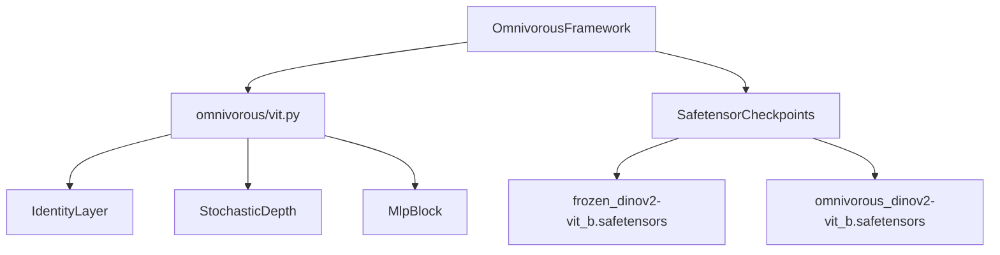
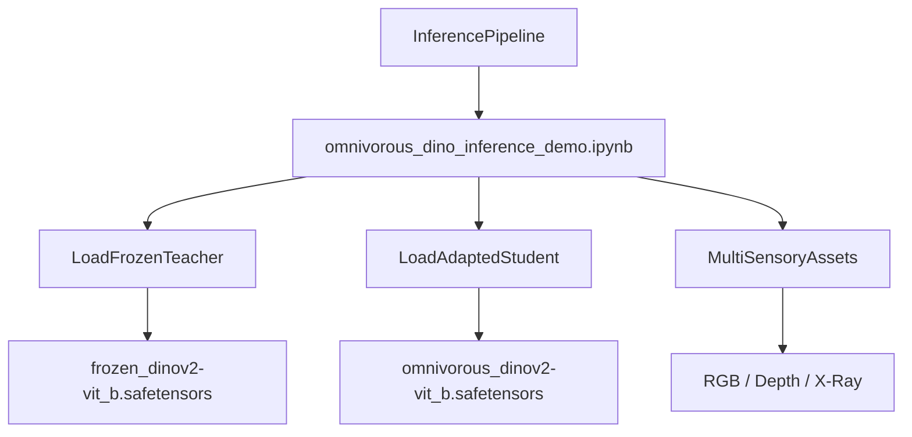

<!-- source: DeepWiki mcp.deepwiki.com · repo google-deepmind/representations4d · page 6 Omnivorous Vision Encoders · fetched 2026-10-26 -->

# Omnivorous Vision Encoders

Relevant source files

The following files were used as context for generating this wiki page:

- [README.md](README.md)
- [assets/omnivorous-method.png](assets/omnivorous-method.png)

## Purpose and Scope

The Omnivorous Vision Encoders framework introduces a lightweight post-training recipe designed to adapt visual foundation models like DINOv2 [README.md:19-21](). Its primary objective is to increase feature alignment across multi-sensory modalities—such as RGB images, depth maps, and X-rays—that describe the same underlying physical scene [README.md:19-21](). By bridging sensory gaps, omnivorous post-training improves representation alignment for cross-modal retrieval, downstream 3D scene understanding, and zero-shot transfer to novel, unseen modalities [README.md:19-21]().

This page functions as a parent guide, summarizing the overarching architecture and demonstration utilities. Technical depth is intentionally split into dedicated child pages:
- **ViT Implementation**: Covers `omnivorous/vit.py` and model parameter mapping [README.md:74-75]().
- **Cross-Modal Inference Demo**: Covers the `omnivorous_dino_inference_demo` notebook workflow [README.md:53]().

Sources: `README.md:19-21`, `README.md:74-75`

---

## 6.1 ViT Implementation

The core backbone supporting the omnivorous post-training framework is a self-contained, CLIP-compatible Vision Transformer (ViT). Implemented within `omnivorous/vit.py`, this architecture integrates specialized structural modules including `IdentityLayer`, `StochasticDepth`, `MlpBlock`, and multi-layer encoder blocks configured to process both standard visual tokens and cross-modal projections.

The framework utilizes 86.5M parameter ViT-B configurations [README.md:74-75](). Checkpoints are split into a frozen teacher model (`frozen_dinov2-vit_b.safetensors`) and an adapted student model (`omnivorous_dinov2-vit_b.safetensors`) [README.md:74-75](). For detailed class hierarchies, parameter loading logic, and block definitions, see [ViT Implementation](#6.1).

Sources: `README.md:19-21`, `README.md:74-75`

---

## 6.2 Cross-Modal Inference Demo

To validate cross-modal feature alignment empirically, the codebase provides an interactive evaluation notebook (`omnivorous_dino_inference_demo.ipynb`) [README.md:53](). This demo manages the parallel loading of both the frozen DINOv2 teacher and the omnivorous student safetensor weights, executing inference across multi-sensory assets (RGB, depth, and X-ray inputs).

Sources: `README.md:53`, `README.md:74-75`

Users can inspect cosine similarities and feature projection spaces to observe how omnivorous alignment narrows the semantic gap between disparate sensory modalities. For complete setup scripts, asset handling, and visualization code, see [Cross-Modal Inference Demo](#6.2).

Sources: `README.md:53`, `README.md:74-75`

---

