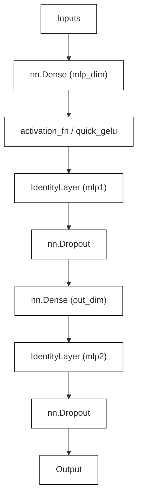
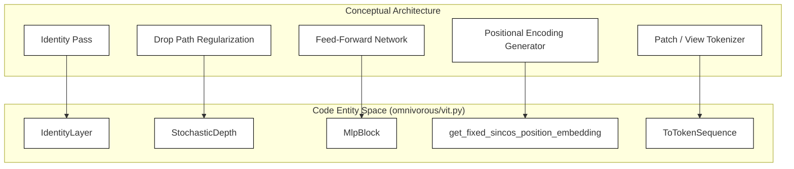
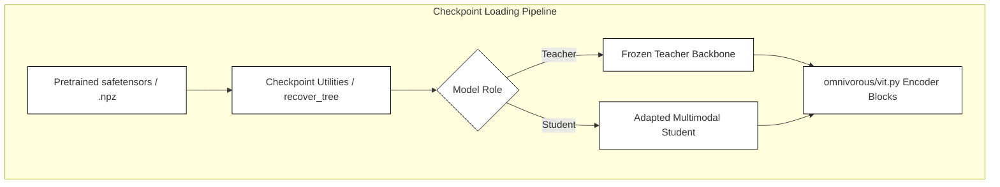

<!-- source: DeepWiki mcp.deepwiki.com · repo google-deepmind/representations4d · page 6.1 ViT Implementation · fetched 2026-10-26 -->

# ViT Implementation

Relevant source files

The following files were used as context for generating this wiki page:

- [omnivorous/vit.py](omnivorous/vit.py)

This section covers the self-contained, CLIP-compatible Vision Transformer (ViT) implementation located in `omnivorous/vit.py`. The module is designed to provide all necessary neural network building blocks—such as identity passes, stochastic depth, multi-layer perceptron blocks, and token sequence constructors—directly within the repository to avoid heavy external dependencies (such as Scenic). It also dictates how frozen teacher and adapted student checkpoints map onto the transformer architecture for cross-modal omnivorous alignment.

Sources: [omnivorous/vit.py:1-401]()

---

## 1. Core Building Blocks and Inlined Scenic Components

To maintain self-contained execution and precise control over parameter naming and initialization during checkpoint loading, `omnivorous/vit.py` defines several foundational Flax `nn.Module` classes.

### Identity Layer and Stochastic Depth
- **`IdentityLayer`**: A lightweight pass-through module used to anchor intermediate tensor states and ensure clean parameter dictionary alignment when loading pre-trained weights [omnivorous/vit.py:32-38]().
- **`StochasticDepth`**: Implements drop-path regularization during training. During evaluation (`deterministic=True`), it acts as an identity function [omnivorous/vit.py:40-55](). It scales surviving paths using Bernoulli trials to preserve expected activation magnitudes.

### MLP Feed-Forward Block
- **`MlpBlock`**: The standard transformer feed-forward network comprising two dense projections separated by an activation function (defaulting to `nn.gelu`), dropout regularizations, and named `IdentityLayer` checkpoints (`mlp1`, `mlp2`) for exact weight recovery [omnivorous/vit.py:57-96]().

*Figure 1: Data flow through `MlpBlock`.*

Sources: [omnivorous/vit.py:32-96]()

---

## 2. Positional Encodings and Tokenization

Spatial and spatio-temporal representations rely on fixed sinusoidal embeddings or learned positional parameters managed by specialized modules.

### Sinusoidal Position Encodings
- **`get_fixed_sincos_position_embedding`**: Computes deterministic 2D or 3D sinusoidal coordinate grids based on input tensor shapes, applying temperature scaling across frequency channels [omnivorous/vit.py:99-140]().
- **`AddFixedSinCosPositionEmbedding`**: Wraps the sinusoidal generator into a Flax module that adds positional information directly to input feature tensors [omnivorous/vit.py:142-153]().

### Token Sequence Construction
- **`ToTokenSequence`**: Converts spatial views or patches into token sequences. It handles learned or fixed positional parameters, supports spatial interpolation methods (with antialiasing and offsets for varying input resolutions), and accommodates register tokens [omnivorous/vit.py:163-202]().

Sources: [omnivorous/vit.py:99-202]()

---

## 3. Architecture to Code Entity Mapping

The following diagram bridges the natural language conceptualization of the omnivorous ViT architecture to its concrete representations in `omnivorous/vit.py`.

*Figure 2: Natural Language Space to Code Entity Space mapping for ViT components.*

Sources: [omnivorous/vit.py:32-202]()

---

## 4. Checkpoint Mapping: Frozen Teacher vs. Adapted Student

The ViT architecture defined in `omnivorous/vit.py` serves dual roles when loading pre-trained weights:
1. **Frozen Teacher Checkpoints**: Standard CLIP or DINOv2 weights that encode visual features from standard RGB domains. These weights are kept frozen during student adaptation.
2. **Adapted Student Checkpoints**: Expanded or modified parameter trees designed to accept cross-modal inputs (e.g., depth maps, X-rays) by adapting early projection layers or modality-specific tokenizers while retaining the core transformer backbone structure.

*Figure 3: Checkpoint mapping and role separation in the ViT framework.*

Sources: [omnivorous/vit.py:1-401]()

---

