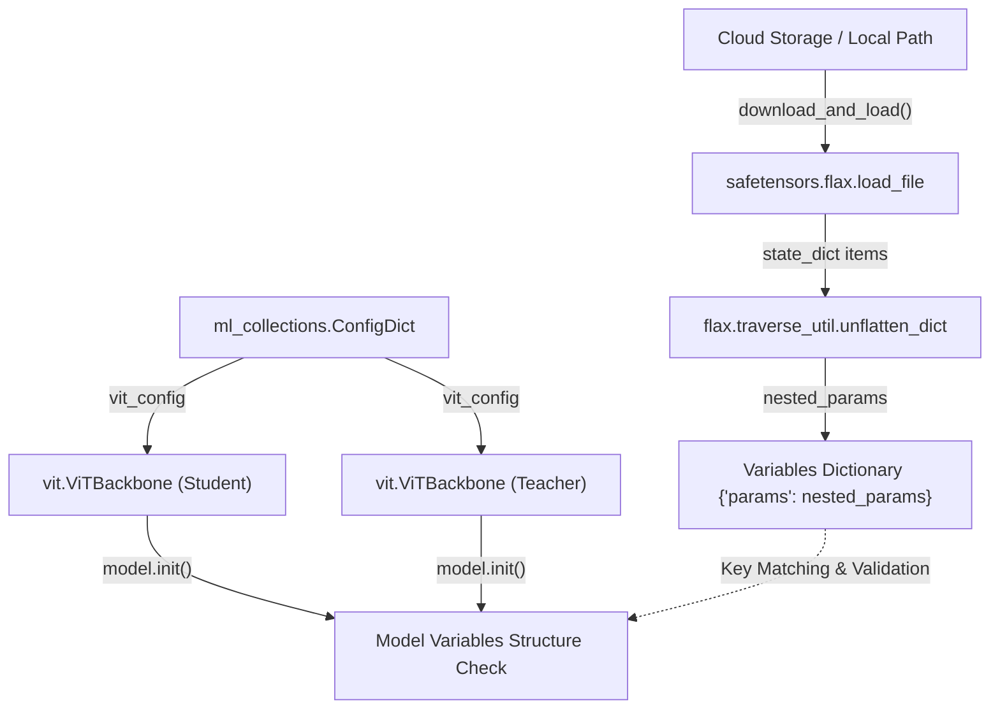
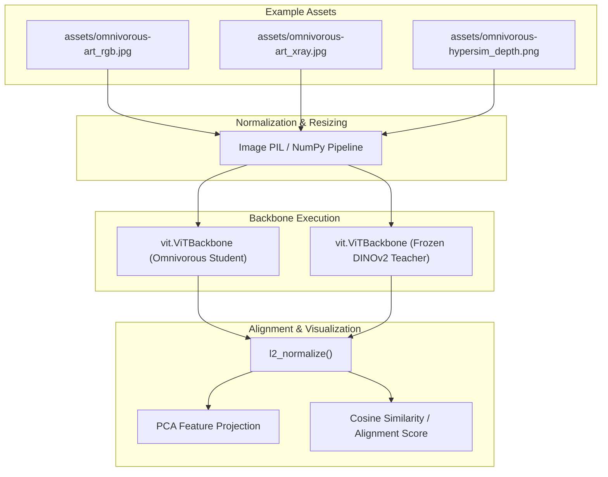

<!-- source: DeepWiki mcp.deepwiki.com · repo google-deepmind/representations4d · page 6.2 Cross-Modal Inference Demo · fetched 2026-10-26 -->

# Cross-Modal Inference Demo

<details>
<summary>Relevant source files</summary>

The following files were used as context for generating this wiki page:

- [assets/omnivorous-art_rgb.jpg](assets/omnivorous-art_rgb.jpg)
- [assets/omnivorous-art_xray.jpg](assets/omnivorous-art_xray.jpg)
- [assets/omnivorous-hypersim_depth.png](assets/omnivorous-hypersim_depth.png)
- [assets/omnivorous-hypersim_rgb.png](assets/omnivorous-hypersim_rgb.png)
- [colabs/omnivorous_dino_inference_demo.ipynb](colabs/omnivorous_dino_inference_demo.ipynb)

</details>


## Purpose and Scope

This page details the implementation and execution flow of the cross-modal inference demo for the Omnivorous DINOv2 post-training framework, hosted at `colabs/omnivorous_dino_inference_demo.ipynb`. The demo showcases how to load open-sourced `safetensors` checkpoints for both a frozen DINOv2 teacher model and an omnivorous student model using JAX/Flax. It covers preprocessing multi-modal assets (such as RGB images, depth maps, and x-rays), performing dense feature extraction, computing cross-modal feature alignment scores, and generating PCA-based visualizations to verify that representations align across heterogeneous modalities.

Sources: [`colabs/omnivorous_dino_inference_demo.ipynb:1-152`]()

---

## 1. ViT Configuration and Model Initialization

The demo configures a standard Vision Transformer (`ViT-B/14`) architecture to match the training setup using an `ml_collections.ConfigDict`. This configuration specifies tokenizer options, network depth, hidden dimensions, MLP expansion ratios, multi-head attention layouts, patch sizes, and positional embedding dimensions.

```python
vit_config = ml_collections.ConfigDict({
    'tokenize': True,
    'num_layers': 12,
    'hidden_size': 768,
    'mlp_dim': 3072,
    'num_heads': 12,
    'patches': ml_collections.ConfigDict({'size': (14, 14)}),
    'posembs': (37, 37),
    'pos_interpolation_method': 'bicubic',
    'pooling': 'tok',
})
```

The student and teacher backbones are instantiated via `vit.ViTBackbone`:
- `student_model = vit.ViTBackbone(**vit_config)` [`colabs/omnivorous_dino_inference_demo.ipynb:46-64`]()
- `teacher_model = vit.ViTBackbone(**vit_config)` [`colabs/omnivorous_dino_inference_demo.ipynb:46-64`]()

### Initialization & Checkpoint Loading Architecture


*Sources: [`colabs/omnivorous_dino_inference_demo.ipynb:46-123`]*

---

## 2. Checkpoint Recovery and Unflattening Workflow

The utility function `download_and_load(ckpt_name, model)` handles asset retrieval from Google Cloud Storage (`BUCKET_URL = "https://storage.googleapis.com/omnivorous"`) with a fallback mechanism to local temporary directories (`/tmp/omnivorous_export/`) for testing before public release [colabs/omnivorous_dino_inference_demo.ipynb:65-94]().

Once loaded via `safetensors.flax.load_file`, the flat parameter dictionary is unflattened to match Flax's nested tree hierarchy using `flax.traverse_util.unflatten_dict`:

```python
state_dict = load_file(local_path)
nested_params = unflatten_dict({tuple(k.split('.')): v for k, v in state_dict.items()})
variables = {'params': nested_params}
```
[`colabs/omnivorous_dino_inference_demo.ipynb:95-102`]()

The script verifies architecture compatibility by initializing the model with dummy inputs (`jnp.zeros((1, 224, 224, 3))`) and performing key-set subtraction against expected parameter keys to warn of any missing or extra parameters [colabs/omnivorous_dino_inference_demo.ipynb:104-123]().

Sources: [`colabs/omnivorous_dino_inference_demo.ipynb:65-123`]()

---

## 3. Multi-Modal Asset Handling and Preprocessing

The notebook processes heterogeneous example assets stored in the repository to evaluate cross-modal alignment:
- RGB art asset: `assets/omnivorous-art_rgb.jpg`
- X-Ray art asset: `assets/omnivorous-art_xray.jpg`
- Hypersim RGB asset: `assets/omnivorous-hypersim_rgb.png`
- Hypersim Depth asset: `assets/omnivorous-hypersim_depth.png`

Inputs are standardized, resized, and fed into both the frozen DINOv2 teacher (which natively processes RGB) and the omnivorous student model (which handles cross-modal variants like depth and x-rays).

### Data Flow for Cross-Modal Evaluation


*Sources: [`colabs/omnivorous_dino_inference_demo.ipynb:1-152`]*

---

## 4. Feature Extraction, Normalization, and Alignment Scoring

To compare representations across modalities, features extracted from the Vision Transformer backbones undergo L2 normalization along the channel dimension via `l2_normalize()`:

```python
def l2_normalize(x, axis=-1):
  """Helper to L2 normalize features along the channel dimension."""
  return x / jnp.maximum(jnp.linalg.norm(x, axis=axis, keepdims=True), 1e-8)
```
[`colabs/omnivorous_dino_inference_demo.ipynb:147-150`]()

The function `get_features_and_score(model, variables, rgb_input, aux_input)` computes dense representations for both the standard RGB input and an auxiliary modality (`aux_input`, such as depth or x-ray), calculating cross-modal alignment scores to quantify feature preservation and adaptation across sensory domains [colabs/omnivorous_dino_inference_demo.ipynb:152]().

Sources: [`colabs/omnivorous_dino_inference_demo.ipynb:142-152`]()

---

