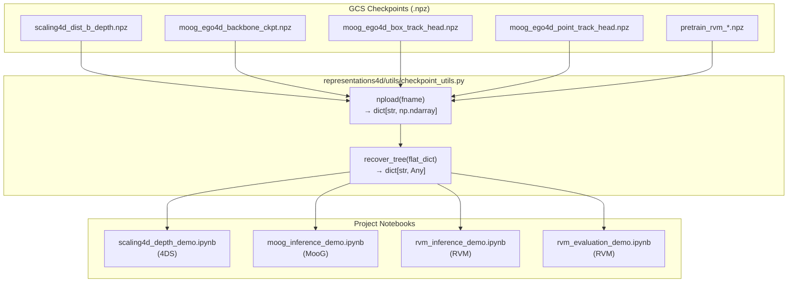

<!-- source: DeepWiki mcp.deepwiki.com · repo google-deepmind/representations4d · page 7 Utilities and Project Infrastructure · fetched 2026-10-26 -->

# Utilities and Project Infrastructure

<details>
<summary>Relevant source files</summary>

The following files were used as context for generating this wiki page:

- [pyproject.toml](pyproject.toml)
- [representations4d/utils/checkpoint_utils.py](representations4d/utils/checkpoint_utils.py)

</details>


This page provides an overview of the shared utility modules in the `representations4d` repository that are consumed across all research projects: 4DS, MooG, and RVM, alongside package dependencies and infrastructure setup. The primary shared utility is the checkpoint loading subsystem located in `representations4d/utils/`. For a detailed treatment of each function in that subsystem, see [Checkpoint Utilities](#7.1). For details on community contributions and licensing, see [Contributing and Licensing](#7.2).

---

## Module Layout and Packaging

The utilities sub-package is a thin layer with a single file at present:

```
representations4d/
└── utils/
    └── checkpoint_utils.py   ← npload, recover_tree
```

Project configuration and dependencies are managed via `pyproject.toml` [pyproject.toml:1-25](). The package defines core dependencies such as `einops`, `flax`, `jax`, `kauldron`, `numpy`, and `typeguard` [pyproject.toml:5-12](), alongside optional extras like `genception` which pulls in `ml_dtypes`, `torch`, `safetensors`, and `mediapy` [pyproject.toml:14-20]().

Sources: [pyproject.toml:1-25](), [representations4d/utils/checkpoint_utils.py:1-61]()

---

## Utilities at a Glance

The following table summarises every public symbol exported by the utilities sub-package.

| Symbol | File | Signature | Purpose |
|---|---|---|---|
| `npload` | `checkpoint_utils.py` | `npload(fname: str) -> dict[str, np.ndarray]` | Loads a `.npz` file into a flat `dict` mapping slash-delimited key strings to `ndarray` values. |
| `recover_tree` | `checkpoint_utils.py` | `recover_tree(flat_dict: dict[str, np.ndarray]) -> dict[str, Any]` | Converts the flat slash-delimited dict produced by `npload` into a nested parameter tree. |

Sources: [representations4d/utils/checkpoint_utils.py:23-61]()

---

## Relationship to the Projects

All projects use a consistent two-step checkpoint loading pattern: `npload` reads the raw `.npz` file, then `recover_tree` restructures the flat key space into a nested dict that can be passed directly to a Flax model's parameter tree.

**Diagram: Checkpoint utilities and their consumers**



Sources: [representations4d/utils/checkpoint_utils.py:23-61]()

---

## Key Design Decisions

**`allow_pickle=False` in `npload`**

`np.load` is called with `allow_pickle=False` [representations4d/utils/checkpoint_utils.py:24](). This means the `.npz` files must contain only numeric arrays — no Python objects. This is a deliberate safety constraint; all checkpoints in the repository adhere to this format.

**Flat key format in `.npz` files**

Flax parameter trees are naturally nested dicts (e.g., `params/encoder/layers/0/kernel`). When serialised to `.npz`, the nested structure is flattened by joining path segments with `/`. `recover_tree` reverses this by splitting each key on `/` and building a nested dict incrementally [representations4d/utils/checkpoint_utils.py:28-61]().

**Diagram: Flat-to-tree transformation performed by `recover_tree`**

```mermaid
flowchart LR
    subgraph "Input: flat dict from npload"
        K1["\"params/encoder/kernel\"\n→ ndarray"]
        K2["\"params/encoder/bias\"\n→ ndarray"]
        K3["\"params/head/kernel\"\n→ ndarray"]
    end

    subgraph "recover_tree logic"
        SPLIT["k.split('/')"]
        LOOP["loop parts[:-1]\nbuild nested dicts"]
        ASSIGN["node[parts[-1]] = v"]
        SPLIT --> LOOP --> ASSIGN
    end

    subgraph "Output: nested dict"
        T1["params\n└── encoder\n│   ├── kernel: ndarray\n│   └── bias: ndarray\n└── head\n    └── kernel: ndarray"]
    end

    K1 --> SPLIT
    K2 --> SPLIT
    K3 --> SPLIT
    ASSIGN --> T1
```

Sources: [representations4d/utils/checkpoint_utils.py:28-61]()

---

## Sub-Topics and Child Pages

- **[Checkpoint Utilities](#7.1)** — Detailed documentation on `npload` and `recover_tree` in `checkpoint_utils.py`, covering `.npz` loading mechanics, flat key reconstruction, and cross-project usage.
- **[Contributing and Licensing](#7.2)** — Overview of contribution workflows, Google CLA requirements, community guidelines, and the Apache-2.0 license.

---

