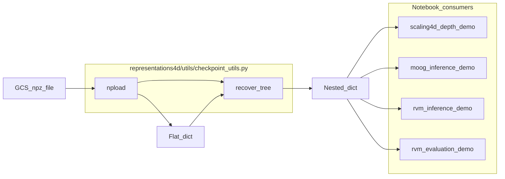
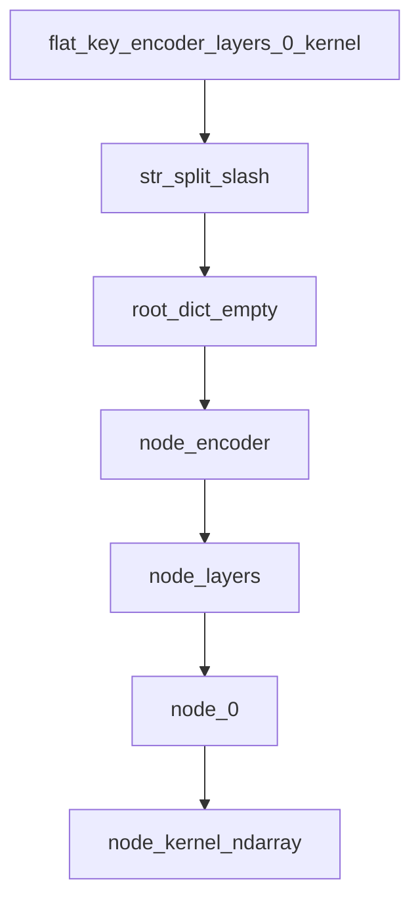

<!-- source: DeepWiki mcp.deepwiki.com · repo google-deepmind/representations4d · page 7.1 Checkpoint Utilities · fetched 2026-10-26 -->

# Checkpoint Utilities

<details>
<summary>Relevant source files</summary>

The following files were used as context for generating this wiki page:

- [representations4d/utils/checkpoint_utils.py](representations4d/utils/checkpoint_utils.py)

</details>


This page documents the two functions in `representations4d/utils/checkpoint_utils.py` that handle loading pretrained model weights from `.npz` files. These utilities are the shared mechanism by which all three projects (4DS, MooG, and RVM) load parameters from Google Cloud Storage checkpoints at inference time.

For the full list of available checkpoints, their URLs, and which tasks they support, see the Pretrained Checkpoints page ([Pretrained Checkpoints](#1.2)). For project-specific loading patterns, see the individual demo walkthroughs: 4DS ([Depth Estimation Demo](#2.2)), MooG ([Inference Demo](#3.5)), and RVM ([Inference Demo](#4.2)).

---

## Module Overview

`representations4d/utils/checkpoint_utils.py` exports two functions:

| Function | Signature | Purpose |
|---|---|---|
| `npload` | `(fname: str) → dict[str, np.ndarray]` | Reads an `.npz` file into a flat dictionary |
| `recover_tree` | `(flat_dict: dict[str, np.ndarray]) → dict[str, Any]` | Reconstructs a nested parameter tree from slash-delimited flat keys |

The two functions are designed to be used in sequence: `npload` reads the raw file, and `recover_tree` reshapes the flat key structure into the nested dictionary expected by Flax model `params` arguments.

Sources: [representations4d/utils/checkpoint_utils.py:1-61]()

---

## Function: `npload`

[representations4d/utils/checkpoint_utils.py:23-25]()

```python
def npload(fname: str) -> dict[str, np.ndarray]:
  loaded = np.load(fname, allow_pickle=False)
  return dict(loaded)
```

Loads a NumPy `.npz` archive from a local path or a GCS URI (via whichever file I/O layer is in scope) and returns its contents as a plain Python dictionary mapping string keys to `np.ndarray` values.

**Key detail:** `allow_pickle=False` is passed to `np.load` [representations4d/utils/checkpoint_utils.py:24](). This means the loader will raise an exception if the archive contains pickled Python objects, providing a safety guarantee that the checkpoint contains only raw numeric arrays.

The returned dictionary is flat — all keys are strings, and the key format encodes the parameter tree path using `/` as a separator (e.g., `"encoder/layers/0/kernel"`).

Sources: [representations4d/utils/checkpoint_utils.py:23-25]()

---

## Function: `recover_tree`

[representations4d/utils/checkpoint_utils.py:28-61]()

```python
def recover_tree(flat_dict: dict[str, np.ndarray]) -> dict[str, Any]:
  ...
```

Converts the flat key-value dictionary produced by `npload` into a nested dictionary whose structure matches the Flax parameter tree expected by each model.

**Algorithm:**

1. Start with an empty root dictionary `tree = {}` [representations4d/utils/checkpoint_utils.py:38-40]().
2. For each key-value pair in `flat_dict`, split the key on `"/"` to get a list of path parts [representations4d/utils/checkpoint_utils.py:41-49]().
3. Walk down the nested dictionary, creating intermediate dictionaries if a part does not exist [representations4d/utils/checkpoint_utils.py:50-59]().
4. Assign the `np.ndarray` value at the leaf node corresponding to the final path part [representations4d/utils/checkpoint_utils.py:60]().

**Example transformation:**

| Flat key | Nested location |
|---|---|
| `"encoder/layers/0/kernel"` | `result["encoder"]["layers"]["0"]["kernel"]` |
| `"readout/dense/bias"` | `result["readout"]["dense"]["bias"]` |
| `"params/scale"` | `result["params"]["scale"]` |

Sources: [representations4d/utils/checkpoint_utils.py:28-61]()

---

## Data Flow Diagram

**Title: Checkpoint loading pipeline — `npload` → `recover_tree` → model params**



Sources: [representations4d/utils/checkpoint_utils.py:1-61]()

---

## Key Format Convention

All `.npz` checkpoints in this repository use `/`-delimited strings as array keys, where each segment corresponds to one level of nesting in the Flax parameter tree. `recover_tree` depends on this convention [representations4d/utils/checkpoint_utils.py:28-49]().

**Title: Flat key to nested dict reconstruction — `recover_tree` logic**



Sources: [representations4d/utils/checkpoint_utils.py:41-60]()

---

## Usage Pattern Across Projects

All three projects follow the same two-step loading pattern:

1. Call `npload` with a path or URL to the `.npz` file [representations4d/utils/checkpoint_utils.py:23-25]().
2. Pass the result to `recover_tree` to obtain a nested parameter dictionary [representations4d/utils/checkpoint_utils.py:28-61]().
3. Supply the nested dictionary as the `params` argument when calling the model.

The table below maps each checkpoint to its consuming notebook and shows the logical call sequence:

| Checkpoint file | Project | Notebook |
|---|---|---|
| `scaling4d_dist_b_depth.npz` | 4DS | `scaling4d_depth_demo.ipynb` |
| `moog_ego4d_backbone_ckpt.npz` | MooG | `moog_inference_demo.ipynb` |
| `moog_ego4d_box_track_head.npz` | MooG | `moog_inference_demo.ipynb` |
| `moog_ego4d_point_track_head.npz` | MooG | `moog_inference_demo.ipynb` |
| `pretrain_rvm_*16_256.npz` | RVM | `rvm_inference_demo.ipynb`, `rvm_evaluation_demo.ipynb` |

Sources: [representations4d/utils/checkpoint_utils.py:1-61]()

---

## Security Note

`npload` passes `allow_pickle=False` to `numpy.load` [representations4d/utils/checkpoint_utils.py:24](). This is a deliberate design choice. NumPy's pickle-based array loading can execute arbitrary Python code embedded in a `.npz` file; disabling it ensures that checkpoint files are interpreted as pure numeric data only. Any `.npz` file containing pickled objects will cause `np.load` to raise a `ValueError` rather than deserialize the object.

Sources: [representations4d/utils/checkpoint_utils.py:23-25]()

---

