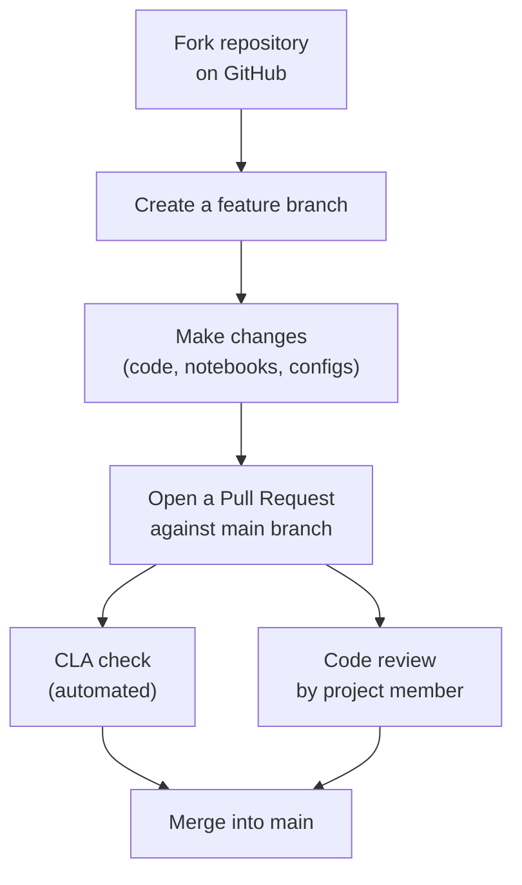
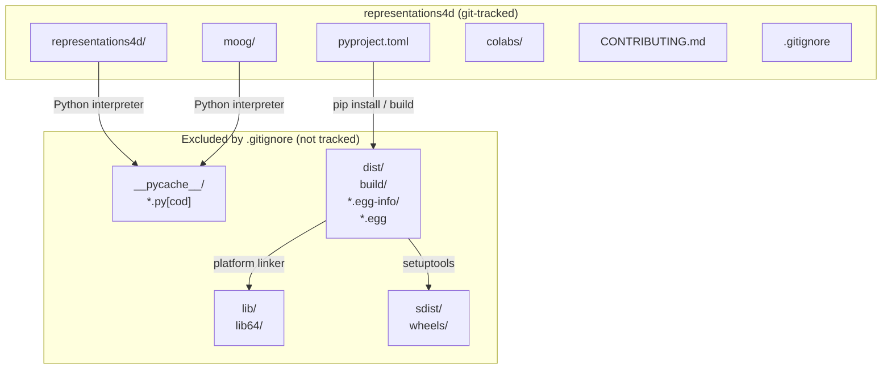
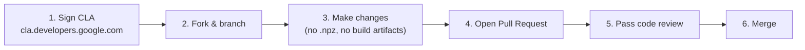

<!-- source: DeepWiki mcp.deepwiki.com · repo google-deepmind/representations4d · page 7.2 Contributing and Licensing · fetched 2026-10-26 -->

# Contributing and Licensing

Relevant source files

The following files were used as context for generating this wiki page:

- [.gitignore](.gitignore)
- [CONTRIBUTING.md](CONTRIBUTING.md)
- [LICENSE](LICENSE)

## Purpose and Scope

This page outlines the policies, workflows, and legal frameworks governing contributions to the `representations4d` repository. It details the Google Contributor License Agreement (CLA) requirement, pull request and code review processes, community conduct standards, version control exclusions governed by [.gitignore](), and the terms of the Apache-2.0 license under which the software is distributed [LICENSE:1-126]().

Sources: [CONTRIBUTING.md:1-25](), [.gitignore:1-24](), [LICENSE:1-126]()

---

## Contributor License Agreement

Before any contribution can be accepted into the repository, contributors must sign a **Google Contributor License Agreement (CLA)**. The CLA ensures that you or your employer retain copyright to your contributions while granting Google a perpetual license to use, modify, and redistribute your code as part of the project.

- Sign or review your current agreements on file at [https://cla.developers.google.com/](https://cla.developers.google.com/) [CONTRIBUTING.md:1-9]().
- The CLA needs to be submitted only once per Google Open Source project ecosystem. If you have already signed one for another project, you generally do not need to repeat the process [CONTRIBUTING.md:11-13]().

Sources: [CONTRIBUTING.md:1-13]()

---

## Pull Requests and Code Review

All modifications—including those by core project maintainers—must be submitted via GitHub pull requests and undergo code review prior to merging [CONTRIBUTING.md:15-20]().

Diagram: Contribution and Review Workflow

Sources: [CONTRIBUTING.md:15-20]()

---

## Community Guidelines

The project strictly adheres to **Google's Open Source Community Guidelines** [CONTRIBUTING.md:22-25](). All interactions across issues, pull requests, and discussions must maintain a welcoming, respectful, and inclusive environment conforming to the conduct policy available at [https://opensource.google/conduct/](https://opensource.google/conduct/).

Sources: [CONTRIBUTING.md:22-25]()

---

## Version Control Exclusions (`.gitignore`)

The [.gitignore]() file defines artifacts, caches, and build products excluded from git tracking. The table below maps these categories to their corresponding exclusion paths [.gitignore:1-24]().

| Category | Excluded Patterns |
|---|---|
| Python bytecode / cache | `__pycache__/`, `*.py[cod]`, `*$py.class` [.gitignore:1-4]() |
| Build and distribution artifacts | `build/`, `dist/`, `*.egg-info/`, `*.egg`, `MANIFEST` [.gitignore:6-24]() |
| Packaging internals | `develop-eggs/`, `downloads/`, `eggs/`, `.eggs/`, `sdist/`, `var/`, `wheels/`, `share/python-wheels/` [.gitignore:6-20]() |
| Installed config & paths | `.installed.cfg`, `.Python` [.gitignore:14-22]() |
| Compiled shared libraries | `lib/`, `lib64/` [.gitignore:14-15]() |

> **Note:** Pretrained checkpoints and large data assets (`.npz`) are excluded from repository version control and fetched dynamically at runtime.

Diagram: Build Artifacts and Git Exclusion Mapping

Sources: [.gitignore:1-24]()

---

## Licensing (Apache-2.0)

The repository is made available under the **Apache License, Version 2.0** [LICENSE:1-3](). This license grants users worldwide, non-exclusive, royalty-free copyright and patent licenses to use, reproduce, prepare derivative works of, publicly display, sublicense, and distribute the work, subject to conditions such as preserving copyright notices and including a copy of the license [LICENSE:67-126]().

Sources: [LICENSE:1-126]()

---

## Summary of Contributing Steps

Diagram: Step-by-Step Contribution Pipeline

| Step | Requirement | Reference |
|---|---|---|
| Sign CLA | Required before first contribution | [CONTRIBUTING.md:1-9]() |
| Pull Request | Required for all changes | [CONTRIBUTING.md:15-20]() |
| Code review | At least one reviewer approval needed | [CONTRIBUTING.md:15-20]() |
| Conduct | Follow Google Open Source guidelines | [CONTRIBUTING.md:22-25]() |
| Artifacts | Do not commit build outputs or `.npz` files | [.gitignore:1-24]() |
| Licensing | Adhere to Apache-2.0 terms | [LICENSE:1-126]() |

Sources: [CONTRIBUTING.md:1-25](), [.gitignore:1-24](), [LICENSE:1-126]()

---

