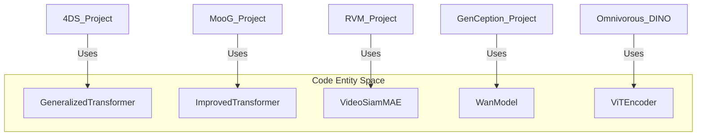
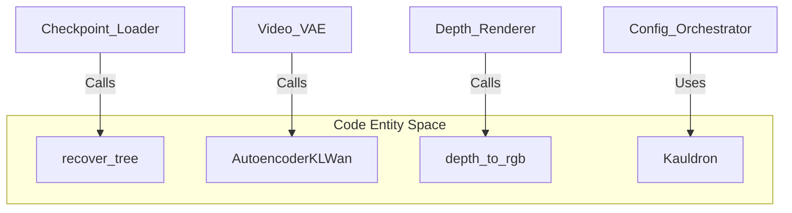

<!-- source: DeepWiki mcp.deepwiki.com · repo google-deepmind/representations4d · page 8 Glossary · fetched 2026-10-26 -->

# Glossary

Relevant source files

The following files were used as context for generating this wiki page:

- [README.md](README.md)
- [colabs/moog_inference_demo.ipynb](colabs/moog_inference_demo.ipynb)
- [moog/README.md](moog/README.md)
- [representations4d/genception/__init__.py](representations4d/genception/__init__.py)

## Purpose and Scope
This page defines codebase-specific terms, architectural concepts, evaluation metrics, and utility functions across the `representations4d` repository. Each entry includes its role in the system, architectural details, and code pointers.

---

## Term Definitions

### 4DS (Scaling 4D Representations)
* **Definition**: A self-supervised learning paradigm evaluating masked autoencoding (MAE) on non-semantic, spatial (3D) and temporal (+1D = 4D) vision tasks such as camera pose, point/object tracking, and depth estimation [README.md:1-5]().
* **Code Pointers**: `README.md:5-7`, `README.md:64-66` [README.md:5-66]().

### MooG (Moving Off-the-Grid)
* **Definition**: A self-supervised video representation model allowing latent tokens to move freely across space and time rather than staying fixed on a pixel grid [README.md:11-13]().
* **Code Pointers**: `moog/README.md:1-5`, `colabs/moog_inference_demo.ipynb:79-152` [moog/README.md:1-5]() [colabs/moog_inference_demo.ipynb:79-152]().

### RVM (Recurrent Video Masked Autoencoders)
* **Definition**: A recurrent, transformer-based approach modeling temporal structure using an asymmetric masking objective and simple pixel reconstruction loss [README.md:15-18]().
* **Code Pointers**: `README.md:15-18`, `README.md:70-73` [README.md:15-73]().

### GenCeption
* **Definition**: A feed-forward perception model leveraging a pre-trained video generative diffusion backbone (WAN 2.1) to perform multi-task video perception (depth, normals, RefVOS) steered by text instructions [README.md:23-26]().
* **Code Pointers**: `representations4d/genception/__init__.py:16-30` [representations4d/genception/__init__.py:16-29]().

### WAN 2.1
* **Definition**: The underlying video generative diffusion transformer backbone used in GenCeption, adapted for single-step feed-forward multi-task perception [README.md:23-24]().
* **Code Pointers**: `representations4d/genception/__init__.py:19` [representations4d/genception/__init__.py:19]().

### Banana Colormap
* **Definition**: A specialized color mapping utility used for depth visualization and relative depth conversion in GenCeption outputs [README.md:56](), [representations4d/genception/__init__.py:21-27]().
* **Code Pointers**: `representations4d/genception/__init__.py:21-27` [representations4d/genception/__init__.py:21-27]().

### MAE (Masked Autoencoders)
* **Definition**: A self-supervised pretraining strategy where random subsets of input tokens/patches are masked, and the model is trained to reconstruct missing content [README.md:5]().
* **Code Pointers**: `README.md:5-15` [README.md:5-15]().

### Readout Head
* **Definition**: Lightweight task-specific downstream modules (e.g., box tracking, point tracking, depth estimation) attached to frozen or fine-tuned backbone representations [README.md:11](), [README.md:66-69]().
* **Code Pointers**: `README.md:66-69` [README.md:66-69]().

### EncoderToReadout
* **Definition**: A structural wrapper class connecting backbone encoder representations to downstream readout heads for dense prediction tasks [README.md:66]().
* **Code Pointers**: `README.md:66` [README.md:66]().

### GatedTransformerCore
* **Definition**: A recurrent transformer core component incorporating GRU-style gating mechanisms to process video frames sequentially [README.md:15]().
* **Code Pointers**: `README.md:15-18` [README.md:15-18]().

### SRTEncoder/Decoder
* **Definition**: Scene Representation Transformer modules used to encode and decode off-the-grid latent tokens across views and frames [README.md:11]().
* **Code Pointers**: `README.md:11-13` [README.md:11-13]().

### Label Propagation
* **Definition**: An evaluation mechanism where ground-truth or initial labels from a reference frame are propagated across subsequent video frames using feature similarities or model trackers [README.md:47-50]().
* **Code Pointers**: `README.md:47-50` [README.md:47-50]().

### J&F (Jaccard and F-measure)
* **Definition**: Standard video object segmentation evaluation metric combining region similarity ($\mathcal{J}$) and contour accuracy ($\mathcal{F}$) [README.md:50]().
* **Code Pointers**: `README.md:50` [README.md:50]().

### PCK (Percentage of Correct Keypoints)
* **Definition**: An evaluation metric measuring keypoint tracking accuracy within a normalized threshold distance [README.md:50]().
* **Code Pointers**: `README.md:50` [README.md:50]().

### mIoU (Mean Intersection over Union)
* **Definition**: Standard semantic and region segmentation overlap metric calculated across classes or object tracks [README.md:50]().
* **Code Pointers**: `README.md:50` [README.md:50]().

### Kauldron
* **Definition**: A JAX-based configuration and training framework used for orchestrating model training runs (e.g., MooG configuration) [moog/README.md:33](), [colabs/moog_inference_demo.ipynb:49]().
* **Code Pointers**: `moog/README.md:31-34`, `colabs/moog_inference_demo.ipynb:49` [moog/README.md:31-34]() [colabs/moog_inference_demo.ipynb:49]().

### Fourier Embedding
* **Definition**: Frequency-based positional encoding mechanism used in off-the-grid models to represent continuous spatial and temporal coordinates [README.md:11]().
* **Code Pointers**: `README.md:11-13` [README.md:11-13]().

### Tubelet Patch Embedding
* **Definition**: A 3D spatiotemporal patch extraction technique operating over video volumes by grouping spatial patches across consecutive frames [README.md:5-15]().
* **Code Pointers**: `README.md:5-15` [README.md:5-15]().

### recover_tree
* **Definition**: A checkpoint utility function that reconstructs flat, slash-delimited dictionary keys (from `.npz` files) into nested JAX parameter trees [README.md:62-76]().
* **Code Pointers**: `README.md:62-76` [README.md:62-76]().

### AutoencoderKLWan
* **Definition**: The Variational Autoencoder (VAE) class with causal convolution caching used by WAN-based models to encode and decode video latents [representations4d/genception/__init__.py:29]().
* **Code Pointers**: `representations4d/genception/__init__.py:29` [representations4d/genception/__init__.py:29]().

### RefVOS (Referring Video Object Segmentation)
* **Definition**: A task where target objects are segmented across a video sequence conditioned on a textual description or referring expression [README.md:23]().
* **Code Pointers**: `README.md:23-25` [README.md:23-25]().

### Omnivorous Alignment
* **Definition**: A lightweight post-training recipe adapting vision foundation models (such as DINOv2) to increase feature alignment across multi-sensory modalities like RGB images, depth maps, and X-rays [README.md:19-21]().
* **Code Pointers**: `README.md:19-21`, `README.md:74-75` [README.md:19-75]().

---

## System to Code Mapping Diagrams

The following diagrams bridge natural language concepts across projects to their corresponding code entities in the repository.

### Diagram 1: Backbone and Perceptual Framework Mapping

*Sources: `README.md:5-25`, `colabs/moog_inference_demo.ipynb:116-152` [README.md:5-25]() [colabs/moog_inference_demo.ipynb:116-152]()`

### Diagram 2: Utilities and Pipeline Mapping

*Sources: `README.md:62-76`, `representations4d/genception/__init__.py:23-29`, `colabs/moog_inference_demo.ipynb:49` [README.md:62-76]() [representations4d/genception/__init__.py:23-29]() [colabs/moog_inference_demo.ipynb:49]()`

---
*Sources: `README.md:1-76`, `moog/README.md:1-35`, `representations4d/genception/__init__.py:1-30`, `colabs/moog_inference_demo.ipynb:1-152` [README.md:1-76]() [moog/README.md:1-34]() [representations4d/genception/__init__.py:1-29]() [colabs/moog_inference_demo.ipynb:1-152]()*