# Page: Overview

# Overview

<details>
<summary>Relevant source files</summary>

The following files were used as context for generating this wiki page:

- [README.md](README.md)
- [assets/RVM.png](assets/RVM.png)
- [assets/genception.png](assets/genception.png)
- [assets/moog.png](assets/moog.png)
- [assets/scaling_20M_20B.png](assets/scaling_20M_20B.png)

</details>


This page describes the purpose, scope, and organization of the `google-deepmind/representations4d` repository. It introduces the five core research projects contained in the repository, the shared concept of 4D video representations, and how the codebase is structured.

For step-by-step setup instructions, see [Installation and Setup](#1.1). For a reference listing of all pretrained model weights and loading mechanisms, see [Pretrained Checkpoints](#1.2).

Sources: [README.md:1-5]()

---

## Purpose

The `representations4d` repository is the official Google DeepMind release for research projects focused on learning **4D video representations** — spatial (3D) features enriched with a temporal dimension (+1D). Rather than focusing purely on semantic classification, these projects target perception tasks that require understanding geometry, motion, and 3D scene structure directly from video or multi-sensory visual streams.

The repository contains five major projects:

| Project | Short name | Paper | Key idea |
|---|---|---|---|
| Scaling 4D Representations | **4DS** | [arXiv:2412.15212](https://arxiv.org/abs/2412.15212) | MAE pretraining scales from 20M to 22B parameters on non-semantic 4D tasks [README.md:5-7]() |
| Moving Off-the-Grid | **MooG** | [NeurIPS 2024](https://openreview.net/pdf?id=rjSPDVdUaw) | Latent tokens move freely over space/time via cross-attention; next-frame prediction objective [README.md:11-13]() |
| Recurrent Video Masked Autoencoders | **RVM** | [arXiv:2512.13684](https://arxiv.org/abs/2512.13684) | Recurrent ViT with asymmetric masking and pixel reconstruction loss [README.md:15-17]() |
| Omnivorous DINOv2 | **Omnivorous** | [arXiv:2602.24181](https://arxiv.org/abs/2602.24181) | Lightweight post-training aligning features across sensory modalities like RGB and depth [README.md:19-21]() |
| GenCeption | **GenCeption** | [arXiv:2607.09024](https://arxiv.org/abs/2607.09024) | WAN 2.1 generative diffusion backbone fine-tuned as a feed-forward multi-task perception model [README.md:23-25]() |

Sources: [README.md:1-26]()

---

## What is a 4D Representation?

The term "4D" in this repository refers to **three spatial dimensions plus time**. The evaluation tasks shared across these models emphasize:
- **Depth and normal estimation** — inferring dense geometry from video [README.md:5-24]()
- **Camera pose estimation** — recovering 6-DoF camera motion across frames [README.md:5-23]()
- **Point, box, and object tracking** — following locations consistently over time [README.md:5-15]()
- **Dense multi-task perception** — semantic segmentation, reference video object segmentation (RefVOS), and 3D keypoints [README.md:23-24]()

Sources: [README.md:5-25]()

---

## Repository Organization

RepoLayoutDiagram
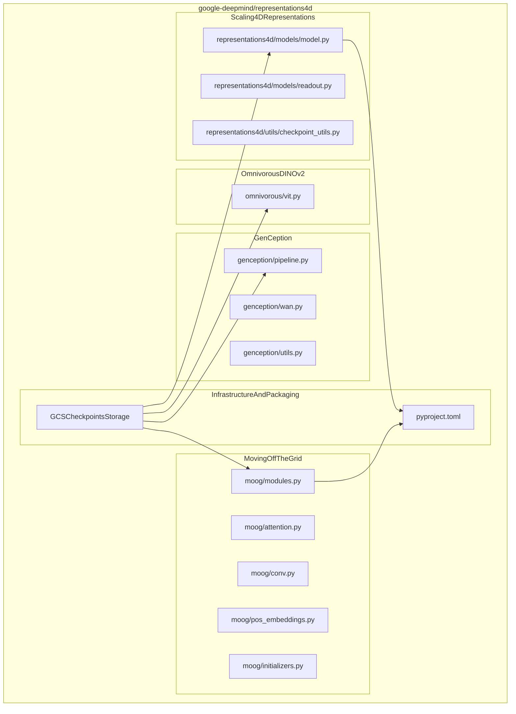

Sources: [README.md:27-76](), [pyproject.toml:1-18]()

The repository is organized into distinct Python modules and package directories (`representations4d/`, `moog/`, `omnivorous/`, `genception/`), supported by a shared packaging configuration in `pyproject.toml` [pyproject.toml:1-18]().

---

## The Research Projects

### Scaling 4D Representations (4DS)
4DS investigates masked autoencoding (MAE) scaling laws with ViT-style video models on geometric tasks [README.md:5-7](). 
- For architecture details, see [4DS Model Architecture](#2.1).
- For the depth estimation demo, see [Depth Estimation Demo](#2.2).

Sources: [README.md:5-7]()

### Moving Off-the-Grid (MooG)
MooG decouples representation structure from rigid pixel grids using latent tokens that move freely via cross-attention [README.md:11-13]().
- For core model details, see [MooG Core Model](#3.1).
- For tracking inference, see [Inference Demo](#3.5).

Sources: [README.md:11-13]()

### Recurrent Video Masked Autoencoders (RVM)
RVM utilizes a recurrent transformer with asymmetric masking and pixel reconstruction loss for high parameter efficiency [README.md:15-17]().
- For architecture details, see [RVM Model Architecture](#4.1).
- For evaluation benchmarks, see [Evaluation Framework](#4.3).

Sources: [README.md:15-17]()

### Omnivorous Vision Encoders (Omnivorous DINOv2)
Omnivorous post-training adapts DINOv2 models to align features across multiple sensory modalities such as RGB, depth, and x-ray [README.md:19-21]().
- For ViT implementation details, see [ViT Implementation](#6.1).
- For cross-modal inference, see [Cross-Modal Inference Demo](#6.2).

Sources: [README.md:19-21]()

### GenCeption
GenCeption leverages the WAN 2.1 video generative diffusion backbone as a feed-forward multi-task perception model driven by text instructions [README.md:23-25]().
- For pipeline details, see [GenCeption Pipeline](#5.1).
- For inference demos, see [GenCeption Inference Demo](#5.4).

Sources: [README.md:23-25]()

---

## Project-to-Code Mapping

ProjectToCodeMappingDiagram
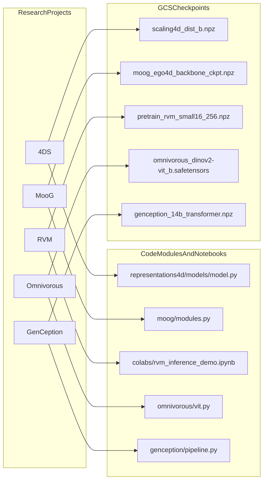

Sources: [README.md:58-76](), [pyproject.toml:1-18]()

---

## License

Software is licensed under the Apache License 2.0. Model weights and supplementary assets are licensed under CC-BY 4.0 [README.md:92-111](). This is not an official Google product.

Sources: [README.md:92-111]()

---

# Page: Installation and Setup

# Installation and Setup

<details>
<summary>Relevant source files</summary>

The following files were used as context for generating this wiki page:

- [README.md](README.md)
- [pyproject.toml](pyproject.toml)

</details>


This page covers the steps required to clone the repository, install the `representations4d` package and its core or optional dependencies via `pyproject.toml`, and verify that the environment is ready for execution. It does not cover downloading pretrained checkpoints (see [Pretrained Checkpoints](#1.2)) or running specific project demos.

---

## Repository Structure at a Glance

The repository layout is governed by `pyproject.toml`, which defines the installable packages (`representations4d`, `moog`, and `genception`) as well as optional dependency groups [pyproject.toml:23-25]().

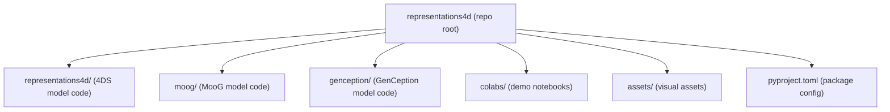

Sources: [pyproject.toml:23-25](), [README.md:30-36]()

The `colabs/` and `assets/` directories are excluded from package installation and are intended to be accessed directly from a local clone of the repository.

---

## Prerequisites

| Requirement | Notes |
|---|---|
| Python 3.x | A dedicated virtual environment is strongly recommended |
| `pip` | Package installer for Python |
| Git | Version control system for cloning the repository |
| Hardware Accelerator | Optional; JAX defaults to CPU if no compatible GPU/TPU is available |

Sources: [README.md:30-36]()

---

## Installation Steps

### 1. Clone the Repository

Retrieve the repository from GitHub:

```bash
git clone https://github.com/google-deepmind/representations4d.git
cd representations4d
```

Sources: [README.md:30-32]()

### 2. Create and Activate a Virtual Environment

Isolate the project dependencies from system-wide Python packages:

```bash
python3 -m venv representations4d_env
source representations4d_env/bin/activate
```

Sources: [README.md:33-34]()

### 3. Install the Package and Dependencies

To install the core packages (`representations4d`, `moog`, and `genception`) along with standard dependencies:

```bash
pip install .
```

If you plan to run GenCeption workflows requiring PyTorch and video utilities, install with the optional `genception` extra:

```bash
pip install ".[genception]"
```

Sources: [pyproject.toml:5-20](), [README.md:35]()

---

## Declared Dependencies

Dependencies are specified in `pyproject.toml` under core requirements and optional extras:

### Core Dependencies (`[project]`)
* `einops`: Flexible tensor manipulation and reshaping [pyproject.toml:6]()
* `flax`: Neural network library built on JAX [pyproject.toml:7]()
* `jax`: High-performance numerical computing and autograd [pyproject.toml:8]()
* `kauldron`: Training and configuration framework used by MooG [pyproject.toml:9]()
* `numpy`: Array manipulation and `.npz` checkpoint handling [pyproject.toml:10]()
* `typeguard`: Runtime type checking for modules [pyproject.toml:11]()

### Optional Dependencies (`[project.optional-dependencies].genception`)
* `ml_dtypes`: Additional DTypes for JAX/NumPy interop [pyproject.toml:16]()
* `torch`: Tensor operations required by WAN 2.1 / GenCeption backbones [pyproject.toml:17]()
* `safetensors`: Safe tensor serialization format [pyproject.toml:18]()
* `mediapy`: Video loading and rendering utilities [pyproject.toml:19]()

Sources: [pyproject.toml:1-20]()

> **Note on JAX Hardware Support:** The default `jax` package installed from PyPI targets CPU execution. For accelerated GPU support, install the appropriate CUDA-enabled wheel for JAX following the official JAX installation guidelines.

---

## Package Mappings and Code Entities

The following diagram associates the installable Python namespaces with their respective source directories and primary modules:

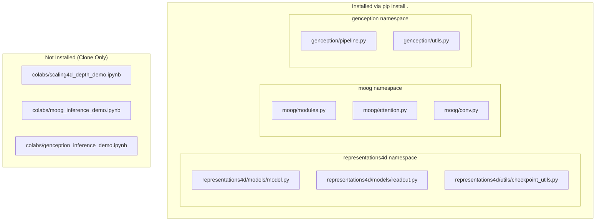

Sources: [pyproject.toml:23-25]()

---

## Verifying the Installation

To verify that the packages and foundational libraries are correctly installed, execute a Python interpreter and import the core modules:

```python
import representations4d
import moog
import genception
import jax
import flax

print("JAX active devices:", jax.devices())
```

If the imports succeed and `jax.devices()` reports your available hardware device(s), the environment is properly configured.

---

## Next Steps

| Goal | Reference Section |
|---|---|
| Review and download pretrained weights | [Pretrained Checkpoints](#1.2) |
| Run 4DS depth estimation | [Depth Estimation Demo](#2.2) |
| Run MooG tracking inference | [Inference Demo](#3.5) |
| Run GenCeption multi-task perception | [GenCeption Inference Demo](#5.4) |
| Inspect checkpoint loading utilities | [Checkpoint Utilities](#7.1) |

Sources: [README.md:40-56]()

---

# Page: Pretrained Checkpoints

# Pretrained Checkpoints

<details>
<summary>Relevant source files</summary>

The following files were used as context for generating this wiki page:

- [README.md](README.md)
- [representations4d/utils/checkpoint_utils.py](representations4d/utils/checkpoint_utils.py)

</details>


This page provides a comprehensive reference listing of all pretrained model checkpoints released with the `representations4d` repository. It covers checkpoint filenames, file sizes, parameter counts, hosting URLs, supported downstream tasks, and the technical mechanism (`npload` and `recover_tree`) used to load them into memory.

For an in-depth explanation of checkpoint utilities, see [Checkpoint Utilities](#7.1). For project-specific usage of these checkpoints inside demo notebooks, see [Depth Estimation Demo](#2.2), [Inference Demo](#3.5), and [Inference Demo](#4.2).

Sources: [README.md:58-76](), [representations4d/utils/checkpoint_utils.py:1-61]()

---

## Storage Location

All pretrained checkpoints are hosted on Google Cloud Storage under the following base URL:

```
https://storage.googleapis.com/representations4d/checkpoints/
```

Files are distributed primarily as `.npz` archives (for JAX/Flax-based projects) or `.safetensors` (for PyTorch-based models like DINOv2), and can be downloaded using standard utilities such as `curl` or `wget`.

Sources: [README.md:58-76]()

---

## Checkpoint Reference

### 4DS (Scaling 4D Representations)

| Short Name | Description | Architecture | Params | File Size | Filename |
|---|---|---|---|:---:|:---:|
| `4DS-B-dist-e` | Backbone only, distilled from 4DS-e | ViT-B | 88M | 334MB | `scaling4d_dist_b.npz` |
| `4DS-e` | Full-scale backbone | ViT-e | 3.8B | 14GB | `scaling4d_e.npz` |
| `4DS-B-dist-e ScanNet depth` | Backbone + ScanNet depth readout head | ViT-B + AttentionReadout | 105M | 420MB | `scaling4d_dist_b_depth.npz` |

Sources: [README.md:62-66]()

---

### MooG (Moving Off-the-Grid)

| Short Name | Description | Architecture | Params | File Size | Filename |
|---|---|---|---|:---:|:---:|
| `MooG backbone` | Pretrained backbone | ConvNet + Transformer | 35M | 140MB | `moog_ego4d_backbone_ckpt_164335139.npz` |
| `MooG box track` | Box tracking readout head | Cross-Attention | 35M | 140MB | `moog_ego4d_box_track_head_ckpt_164335139.npz` |
| `MooG point track` | Point tracking readout head | Cross-Attention | 35M | 140MB | `moog_ego4d_point_track_head_ckpt_164335139.npz` |

Sources: [README.md:67-69]()

---

### RVM (Recurrent Video Masked Autoencoders)

| Short Name | Description | Architecture | Params | File Size | Filename |
|---|---|---|---|:---:|:---:|
| `RVM ViT-S` | Small backbone | ViT-S/16 | 34M | 270MB | `pretrain_rvm_small16_256_204031069.npz` |
| `RVM ViT-B` | Base backbone | ViT-B/16 | 117M | 641MB | `pretrain_rvm_base16_256_203916225.npz` |
| `RVM ViT-L` | Large backbone | ViT-L/16 | 375M | 1.6GB | `pretrain_rvm_large16_256_202497301.npz` |
| `RVM ViT-H` | Huge backbone | ViT-H/16 | 743M | 3.1GB | `pretrain_rvm_huge16_256_203854202.npz` |

Sources: [README.md:70-73]()

---

### Omnivorous Vision Encoders (DINOv2)

| Short Name | Description | Architecture | Params | File Size | Filename |
|---|---|---|---|:---:|:---:|
| `DINOv2 Frozen Teacher` | Baseline visual foundation model | ViT-B | 86.5M | 1.6GB | `frozen_dinov2-vit_b.safetensors` |
| `Omnivorous DINOv2` | Adapted multi-sensory student | ViT-B | 86.5M | 1.6GB | `omnivorous_dinov2-vit_b.safetensors` |

Sources: [README.md:74-75]()

---

### GenCeption

| Short Name | Description | Architecture | Params | File Size | Filename |
|---|---|---|---|:---:|:---:|
| `GenCeption` | Video diffusion transformer backbone | WAN 14B | 14B | 26.7GB | `genception/genception_14b_transformer.npz` |

Sources: [README.md:76-76]()

---

## Checkpoint-to-Task Mapping

The diagram below maps each checkpoint file to its corresponding demo notebook or evaluation suite.

**Checkpoint Consumers and Demo Mapping**

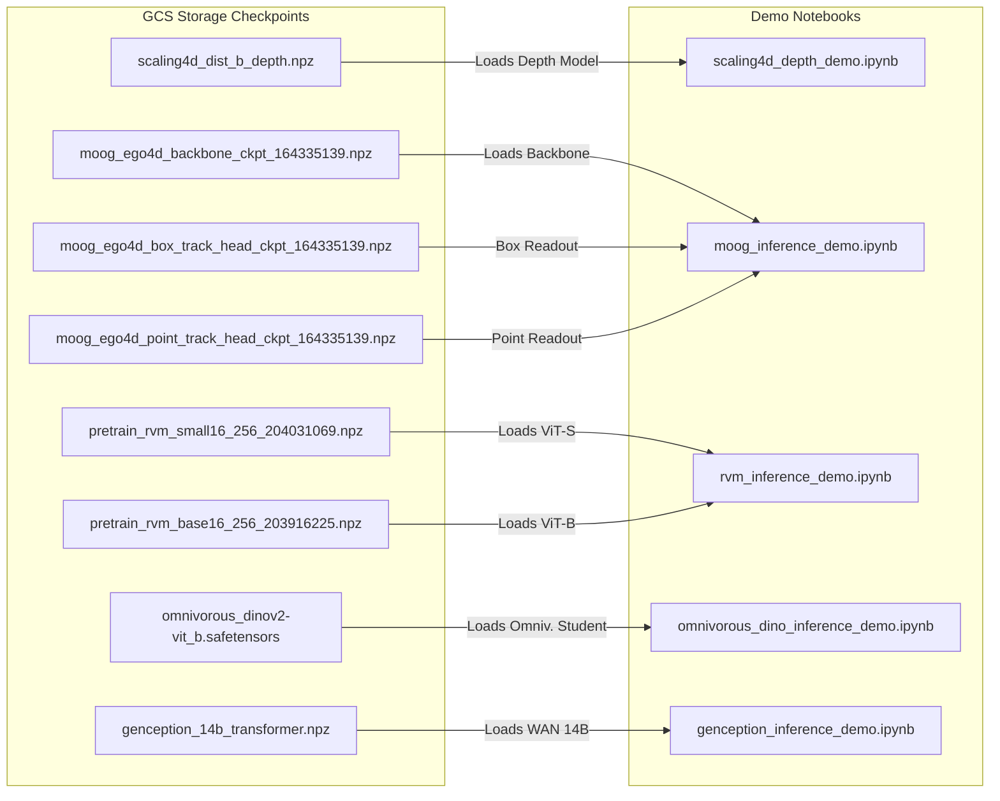

Sources: [README.md:40-76]()

---

## Loading Checkpoints Implementation

Checkpoint loading for JAX/Flax models relies on two core functions defined in `representations4d/utils/checkpoint_utils.py`: `npload` and `recover_tree`.

### `npload`
`npload` [representations4d/utils/checkpoint_utils.py:23-25]() reads raw `.npz` archive files using `numpy.load` with `allow_pickle=False` to ensure safety, returning a flat dictionary of NumPy arrays.

```python
def npload(fname: str) -> dict[str, np.ndarray]:
  loaded = np.load(fname, allow_pickle=False)
  return dict(loaded)
```

### `recover_tree`
`recover_tree` [representations4d/utils/checkpoint_utils.py:28-61]() reconstructs a nested dictionary tree structure from the flattened slash-delimited key names (e.g., `"encoder/block_0/attn/query"`).

```python
def recover_tree(flat_dict: dict[str, np.ndarray]) -> dict[str, Any]:
  tree = {}
  for k, v in flat_dict.items():
    parts = k.split("/")
    node = tree
    for part in parts[:-1]:
      if part not in node:
        node[part] = {}
      node = node[part]
    node[parts[-1]] = v
  return tree
```

**Checkpoint Tree Recovery Flow**

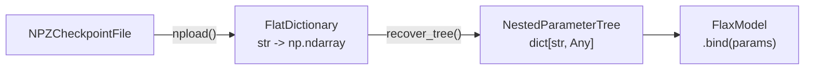

Sources: [representations4d/utils/checkpoint_utils.py:23-61]()

---

## Checkpoint Architecture Summary

| Checkpoint File Prefix | Primary Model Class | Code Module Path |
|---|---|---|
| `scaling4d_dist_b` | `Model` (ViT-B) | `representations4d/models/model.py` |
| `scaling4d_e` | `Model` (ViT-e) | `representations4d/models/model.py` |
| `scaling4d_dist_b_depth` | `Model` + `AttentionReadout` | `representations4d/models/model.py`, `representations4d/models/readout.py` |
| `moog_ego4d_backbone_ckpt_*` | `Moog` | `moog/modules.py` |
| `moog_ego4d_box_track_head_*` | `AttentionReadout` | `moog/modules.py` |
| `moog_ego4d_point_track_head_*` | `ConditionalAutoregressiveReadout` | `moog/modules.py` |
| `pretrain_rvm_*16_256_*` | `VideoSiamMAE` | *(RVM internal modules)* |
| `omnivorous_dinov2-vit_b` | `VisionTransformer` | `omnivorous/vit.py` |
| `genception_14b_transformer` | `WanModel` | *(GenCeption internal modules)* |

Sources: [README.md:62-76](), [representations4d/utils/checkpoint_utils.py:1-61]()

---

# Page: Scaling 4D Representations (4DS)

# Scaling 4D Representations (4DS)

<details>
<summary>Relevant source files</summary>

The following files were used as context for generating this wiki page:

- [README.md](README.md)
- [representations4d/models/model.py](representations4d/models/model.py)

</details>


This page introduces the 4DS project: its research motivation, model variants, pretraining approach, and available downstream tasks. For a detailed technical walkthrough of model internal components such as `PatchEmbedding`, `Tokenizer`, `GeneralizedTransformer`, `EncoderToReadout`, and `AttentionReadout`, see [4DS Model Architecture](#2.1). For a practical walkthrough of setting up model construction, checkpoint loading, and inference visualization in the depth estimation demo, see [Depth Estimation Demo](#2.2).

---

## Overview and Research Motivation

4DS (Scaling 4D Representations) focuses on evaluating self-supervised learning on non-semantic vision tasks that are spatial (3D) and temporal (+1D = 4D), such as camera pose estimation, point and object tracking, and depth estimation [README.md:5-7](). The central finding is that by learning from large video datasets, masked auto-encoding (MAE) with transformer video models scales consistently, improving performance on 4D tasks as model size increases from 20M all the way up to 22B parameters [README.md:5-7]().

The primary 4D downstream tasks evaluated include:
- Camera pose estimation (relative camera pose between frames) [README.md:5-7]()
- Point tracking (per-pixel motion through time) [README.md:5-7]()
- Object tracking (bounding box tracking) [README.md:5-7]()
- Depth estimation (monocular video depth maps) [README.md:5-7]()

Sources: [README.md:5-7]()

---

## Pretraining Approach and Model Variants

4DS uses masked autoencoding (MAE) as its pretraining objective, processing spatiotemporal video patches through a standard Vision Transformer (ViT) backbone without requiring manual labels [README.md:5-7](). Released checkpoints range from smaller distilled variants to massive multi-billion parameter encoders, paired with specialized readout heads for downstream tasks like depth estimation [README.md:5-7](), [README.md:62-76]().

The following table summarizes the official 4DS checkpoints:

| Checkpoint Name | Backbone | Parameters | File Size | Description |
|---|---|:---:|:---:|---|
| `4DS-B-dist-e` | ViT-B | 88M | 334MB | Distilled backbone [README.md:64]() |
| `4DS-e` | ViT-e | 3.8B | 14GB | Full-scale backbone [README.md:65]() |
| `4DS-B-dist-e ScanNet depth` | ViT-B + Readout | 105M | 420MB | Backbone with depth readout head [README.md:66]() |

Sources: [README.md:5-7](), [README.md:62-76]()

---

## System Architecture Overview

The codebase implements 4DS using modular JAX/Flax components defined in `representations4d/models/model.py` and `representations4d/models/readout.py`. The diagram below bridges natural language descriptions to exact code entities.

**Diagram: 4DS Code Entity Component Map**

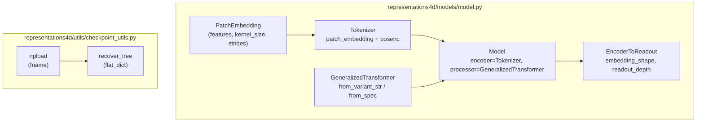

Sources: [representations4d/models/model.py:41-184](), [representations4d/models/model.py:211-235]()

---

## End-to-End Token Flow

Data flows from raw video tensors through patching, positional encoding, global self-attention processing via `GeneralizedTransformer`, and feature selection via `EncoderToReadout`.

**Diagram: 4DS Token Flow Pipeline**


Sources: [representations4d/models/model.py:41-235]()

---

## Child Pages

For comprehensive details on specific aspects of 4DS, refer to the child pages:
- [4DS Model Architecture](#2.1) — Detailed walkthrough of `PatchEmbedding`, `Tokenizer`, `GeneralizedTransformer` (`variant_str`/`from_spec`), `EncoderToReadout`, `MLP`, `AttentionReadout`, token flow, and `readout_depth`.
- [Depth Estimation Demo](#2.2) — Step-by-step guide through the `scaling4d_depth_demo` notebook covering model construction, checkpoint loading, inference, and depth visualization.

Sources: [README.md:5-7](), [representations4d/models/model.py:41-235]()

---

# Page: 4DS Model Architecture

# 4DS Model Architecture

<details>
<summary>Relevant source files</summary>

The following files were used as context for generating this wiki page:

- [representations4d/models/model.py](representations4d/models/model.py)
- [representations4d/models/readout.py](representations4d/models/readout.py)

</details>


This page documents the internal structure of the 4DS model: its component classes, how they are composed, and how data flows from raw video input to task-specific predictions. It covers the classes defined in `representations4d/models/model.py` and `representations4d/models/readout.py`.

For a walkthrough of how these components are instantiated and used in practice (loading checkpoints, running inference, visualizing results), see the Depth Estimation Demo page ([Depth Estimation Demo](#2.2)). For an overview of the 4DS project's research goals and model variants, see the 4DS project page ([Scaling 4D Representations (4DS)](#2)).

---

## Component Overview

The 4DS inference pipeline is assembled as a modular chain of independently defined JAX/Flax modules mapping from video inputs to task outputs.

**Pipeline diagram: Natural Language to Code Entity Space**

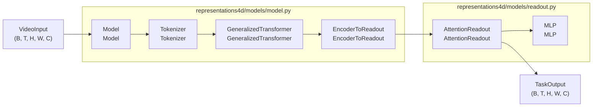

Sources: [representations4d/models/model.py:41-244](), [representations4d/models/readout.py:34-188]()

---

## `PatchEmbedding`

`PatchEmbedding` [representations4d/models/model.py:186-208]() extracts spatio-temporal patches from a video tensor using a single strided `nn.Conv`. There are no non-linearities; it is a learned linear projection.

| Parameter | Type | Role |
|---|---|---|
| `patch_size` | `Sequence[int]` | Kernel and stride size in (T, H, W) |
| `num_features` | `int` | Output channel dimension D |

For the ViT-Base depth model: `patch_size=(2, 16, 16)`, `num_features=768`.

A video of shape `(B, 16, 224, 224, 3)` with `patch_size=(2, 16, 16)` produces an output of shape `(B, 8, 14, 14, 768)` — 8 temporal tokens × 14×14 spatial tokens.

Sources: [representations4d/models/model.py:186-208]()

---

## `Tokenizer`

`Tokenizer` [representations4d/models/model.py:158-183]() applies `PatchEmbedding`, adds positional encodings, then flattens the spatial/temporal dimensions into a single token sequence.

| Parameter | Type | Role |
|---|---|---|
| `patch_embedding` | `nn.Module` | Instance of `PatchEmbedding` |
| `posenc` | `nn.Module` | Positional encoding module (e.g. `LearnedEmbedding`) |
| `posenc_axes` | `tuple[int, ...]` | Axes along which posenc is broadcast; default `(-4, -3, -2)` |

Steps:
1. `patch_embedding(images)` → `(B, t, h, w, D)`
2. `posenc(tokens.shape, axis=posenc_axes)` → broadcasts over temporal and spatial axes
3. Element-wise addition: `tokens += posenc`
4. `einops.rearrange('... T h w D -> ... (T h w) D')` → `(B, N, D)`

Sources: [representations4d/models/model.py:158-183]()

---

## `GeneralizedTransformer`

`GeneralizedTransformer` [representations4d/models/model.py:41-131]() is a stack of transformer blocks that operates on the flat token sequence `(B, N, D)`. Its key distinguishing feature is that it **returns all intermediate feature states**, not just the final output.

### Return value

The `__call__` method returns a Python `list` named `aux`. Element `0` is the input tokens (before any layer), and elements `1..L` are the token states after each of the `L` transformer layers. This list is the input to `EncoderToReadout`.

### Iteration mode

`n_iter` (default `1`) controls how many times the full layer stack is applied. On iterations after the first, the current state is concatenated with the original input tokens before the next pass. Intermediate features are only collected during the last iteration.

### Factory methods

The class provides two class methods for construction:

**`from_variant_str(variant_str, **kwargs)`** [representations4d/models/model.py:88-94]()

Accepts a ViT size string (`"S"`, `"B"`, `"L"`, `"H"`, `"e"`, etc.) and delegates to `kd_vit.ViTSpec.from_variant_string` to resolve the number of heads, layers, and MLP size. Strips `patch_size` and `hidden_size` keys before forwarding to `from_spec`.

**`from_spec(num_heads, num_layers, ...)`** [representations4d/models/model.py:96-131]()

Constructs the full list of `PreNormBlock` instances. Each block contains:
- `ImprovedMultiHeadDotProductAttention` (from `kauldron.modules.attention`)
- `TransformerMLP` with configurable `hidden_size` and kernel initializer
- Two `nn.LayerNorm` instances (for attention and MLP sub-layers)

**Diagram: `GeneralizedTransformer` internals**

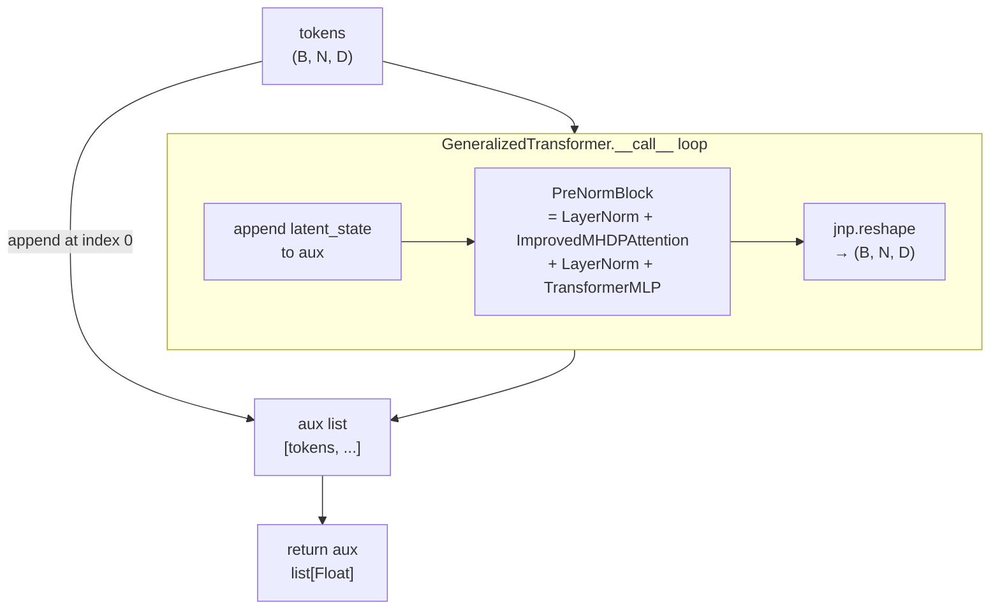

Sources: [representations4d/models/model.py:41-131]()

---

## `Model`

`Model` [representations4d/models/model.py:134-155]() is a thin `nn.Module` wrapper that sequences `encoder` (a `Tokenizer`) and `processor` (a `GeneralizedTransformer`). It accepts a video tensor and returns the `aux` list from `GeneralizedTransformer`.

```
video → encoder (Tokenizer) → tokens (B, N, D) → processor (GeneralizedTransformer) → list[features]
```

Sources: [representations4d/models/model.py:134-155]()

---

## `EncoderToReadout`

`EncoderToReadout` [representations4d/models/model.py:211-244]() selects one intermediate feature tensor from the list returned by `GeneralizedTransformer`, and reshapes it to a form suitable for `AttentionReadout`.

| Parameter | Type | Role |
|---|---|---|
| `embedding_shape` | `tuple[int, int, int]` | Spatial grid of tokens: `(T/pt, H/ph, W/pw)` |
| `readout_depth` | `float` | Fraction (0–1) indicating which layer to use |
| `num_input_frames` | `int` | Target temporal resolution after resize |

### Layer selection

```
readout_id = int(len(all_features) * readout_depth) - 1
```

With `readout_depth=0.95` and a 12-layer ViT-Base (13 entries in `aux` including input): `readout_id = int(13 * 0.95) - 1 = 11`. This picks the second-to-last layer's output.

### Temporal upsampling

After selecting and reshaping to `(B, T_embed, H_embed*W_embed, D)`, `jax.image.resize` with `ResizeMethod.CUBIC` interpolates the temporal dimension from `T_embed` (e.g. 8) up to `num_input_frames` (e.g. 16).

**Diagram: `EncoderToReadout` data transformation**

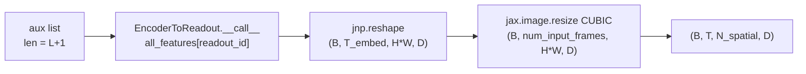

Sources: [representations4d/models/model.py:211-244]()

---

## `AttentionReadout`

`AttentionReadout` [representations4d/models/readout.py:55-188]() is a cross-attention head that maps the dense token grid produced by `EncoderToReadout` to task-specific predictions.

### Parameters

| Parameter | Type | Role |
|---|---|---|
| `num_classes` | `int` | Output feature size per query (e.g. pixels per patch) |
| `num_params` | `int` | Total attention dimension (must be divisible by `num_heads`) |
| `num_heads` | `int` | Number of attention heads |
| `num_queries` | `int` | Number of learnable query tokens |
| `output_shape` | `tuple` or `None` | If set, reshapes final output to `(B, T, H, W, C)` |
| `decoding_patch_size` | `tuple` or `None` | Patch layout used in output reshape |
| `add_temporal_posenc` | `bool` | Whether to add learned temporal positional encoding |
| `match_vjepa_implementation` | `bool` | Adds input LayerNorm and MLP+residual block after attention |

### Forward pass steps

1. **Input LayerNorm** (if `match_vjepa_implementation=True`): normalizes `(B, T, N, C)`.
2. **Temporal positional encoding**: `LearnedEmbedding` broadcast over axis `-3` (time), added to features.
3. **Flatten**: `(B, T, N, C)` → `(B, T*N, C)`.
4. **Queries**: either learned `(Q, num_heads, num_params_per_head)` parameters, or projected from an external `queries` argument.
5. **Cross-attention**: `nn.dot_product_attention(query, key, value)` with `key` and `value` computed from `nn.DenseGeneral`.
6. **MLP residual block** (if `match_vjepa_implementation=True`): query residual + `nn.Dense` + `nn.LayerNorm` + `MLP(hidden_size=num_params*4)`.
7. **Output projection**: `nn.Dense(num_classes)`.
8. **Output reshape** (if `output_shape` and `decoding_patch_size` are set): `einops.rearrange` reassembles patches into `(B, T, H, W, C)`.

**Diagram: `AttentionReadout` forward pass**

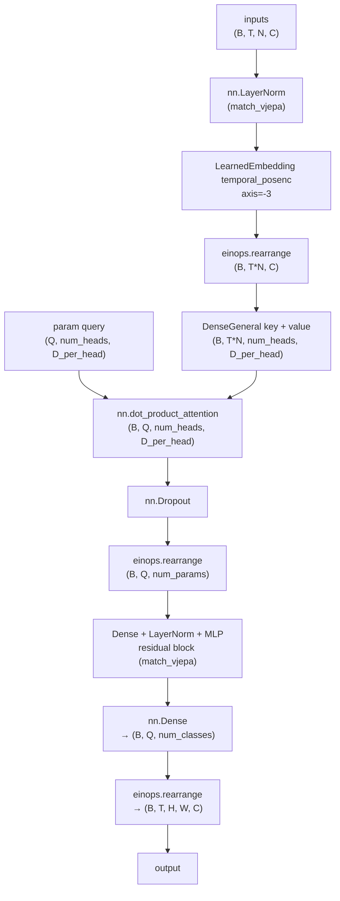

Sources: [representations4d/models/readout.py:55-188]()

---

## `MLP`

`MLP` [representations4d/models/readout.py:34-52]() is a simple feed-forward network used inside `AttentionReadout`'s residual block.

| Parameter | Default | Role |
|---|---|---|
| `hidden_size` | — | Width of hidden layers |
| `output_size` | `None` (→ input size) | Final output dimension |
| `num_hidden_layers` | `1` | Number of hidden `Dense + GELU` layers |

Pattern: `Dense(hidden_size) → GELU` repeated `num_hidden_layers` times, then `Dense(output_size)`.

Sources: [representations4d/models/readout.py:34-52]()

---

## Depth Estimation Configuration

The depth estimation checkpoint uses the following concrete hyperparameters, assembled as an execution pipeline:

| Component | Key Parameters |
|---|---|
| `PatchEmbedding` | `patch_size=(2, 16, 16)`, `num_features=768` |
| `Tokenizer` | `posenc=LearnedEmbedding`, `posenc_axes=(-4, -3, -2)` |
| `GeneralizedTransformer` | `variant_str="B"` (12 layers, 12 heads, mlp_size=3072) |
| `EncoderToReadout` | `embedding_shape=(8, 14, 14)`, `readout_depth=0.95`, `num_input_frames=16` |
| `AttentionReadout` | `num_classes=128`, `num_params=1024`, `num_heads=16`, `num_queries=6272`, `output_shape=(16,224,224,1)`, `decoding_patch_size=(2,8,8)` |

`num_queries = 6272` = total number of output patches = `16 * 224 * 224 / (2*8*8) = 6272`. Each query decodes into `num_classes=128` values = `2*8*8` depth values per patch.

Sources: [representations4d/models/model.py:41-244](), [representations4d/models/readout.py:35-188]()

---

## Class Relationship Diagram

**Code Entity Mapping Diagram**

```mermaid
classDiagram
    class Model {
        +encoder: nn.Module
        +processor: nn.Module
        +__call__(video) list
    }
    class Tokenizer {
        +patch_embedding: nn.Module
        +posenc: nn.Module
        +posenc_axes: tuple
        +__call__(images) Float
    }
    class PatchEmbedding {
        +patch_size: Sequence[int]
        +num_features: int
        +__call__(images) Float
    }
    class GeneralizedTransformer {
        +layers: Sequence[TransformerBlock]
        +n_iter: int
        +__call__(tokens) list
        +from_variant_str(variant_str) GeneralizedTransformer
        +from_spec(num_heads, num_layers) GeneralizedTransformer
    }
    class EncoderToReadout {
        +embedding_shape: tuple
        +readout_depth: float
        +num_input_frames: int
        +__call__(all_features) Float
    }
    class AttentionReadout {
        +num_classes: int
        +num_params: int
        +num_heads: int
        +num_queries: int
        +output_shape: tuple
        +decoding_patch_size: tuple
        +__call__(inputs) Float
    }
    class MLP {
        +hidden_size: int
        +output_size: int
        +num_hidden_layers: int
        +__call__(inputs) Float
    }

    Model --> Tokenizer : encoder [representations4d/models/model.py:138]
    Model --> GeneralizedTransformer : processor [representations4d/models/model.py:140]
    Tokenizer --> PatchEmbedding : patch_embedding [representations4d/models/model.py:161]
    AttentionReadout --> MLP : internal residual block [representations4d/models/readout.py:150]
```

Sources: [representations4d/models/model.py:1-244](), [representations4d/models/readout.py:1-188]()

---

# Page: Depth Estimation Demo

# Depth Estimation Demo

<details>
<summary>Relevant source files</summary>

The following files were used as context for generating this wiki page:

- [colabs/scaling4d_depth_demo.ipynb](colabs/scaling4d_depth_demo.ipynb)

</details>


## Purpose and Scope

This page walks through `colabs/scaling4d_depth_demo.ipynb` end-to-end: how the sequential model is assembled from its three components, how the `scaling4d_dist_b_depth.npz` checkpoint is loaded and applied, and how the resulting depth maps are visualized against the source video.

For the internal architecture of `Model`, `EncoderToReadout`, and `AttentionReadout`, see [4DS Model Architecture](#2.1). For checkpoint loading utilities (`npload`, `recover_tree`), see [GenCeption Pipeline](#5.1). For the full list of available checkpoints and their parameter counts, see [Pretrained Checkpoints](#1.2).

Sources: [colabs/scaling4d_depth_demo.ipynb:1-293]()

---

## Overview: What the Notebook Does

The notebook runs monocular video depth estimation using the 4DS-B-dist-e backbone fine-tuned with a depth readout head. It proceeds through ten sequential steps:

| Step | Notebook cell title | What happens |
|---|---|---|
| 1 | Installation | Clones the repo and installs the package |
| 2 | Download example input and checkpoint | Fetches `scaling4d_dist_b_depth.npz` and `horsejump-high.mp4` from GCS |
| 3 | Imports | Imports JAX, Flax, model and readout modules |
| 4 | Hyperparameters | Defines patch sizes, image size, frame count |
| 5 | Define model | Constructs the `nn.Sequential` pipeline |
| 6 | Initialize model | Traces the model with a zero input to create parameter shapes |
| 7 | Restore parameters | Loads and recovers the checkpoint into a nested param tree |
| 8 | Load example video | Reads, resizes, and normalizes the DAVIS clip |
| 9 | Run forward pass | Calls `forward(restored_params, video)` |
| 10 | Visualize depth maps | Normalizes output and renders side-by-side with source video |

Sources: [colabs/scaling4d_depth_demo.ipynb:1-293]()

---

## Hyperparameters

The following constants control every downstream shape calculation:

| Name | Value | Role |
|---|---|---|
| `model_patch_size` | `(2, 16, 16)` | Temporal × spatial patch stride for `PatchEmbedding` |
| `im_size` | `(224, 224)` | Height × width after resizing |
| `model_size` | `"B"` | Selects ViT-Base from `kd_vit.VIT_SIZES` |
| `dtype` | `jnp.float32` | Compute dtype throughout |
| `model_output_patch_size` | `(2, 8, 8)` | Decoding patch size used by `AttentionReadout` |
| `num_input_frames` | `16` | Number of frames consumed per clip |
| `n_pixels_patch` | `128` | `2 × 8 × 8` — pixels per output patch |
| `n_pixels_video` | `802816` | `16 × 224 × 224` — total pixels in the clip |

Sources: [colabs/scaling4d_depth_demo.ipynb:119-131]()

---

## Model Construction

The inference model is a three-stage `nn.Sequential` pipeline. Each stage is an independent Flax module.

**Stage 1 — `encoder` (`model_lib.Model`)**

```python
model_lib.Model(
    encoder = model_lib.Tokenizer(
        patch_embedding = model_lib.PatchEmbedding(patch_size=(2,16,16), num_features=768),
        posenc          = pos_embeddings.LearnedEmbedding(dtype=float32),
        posenc_axes     = (-4, -3, -2),
    ),
    processor = model_lib.GeneralizedTransformer.from_variant_str("B", dtype=float32),
)
```

- `PatchEmbedding` applies a 3-D convolution with `kernel_size=(2,16,16)` and `strides=(2,16,16)`, projecting each spatiotemporal patch to 768 dimensions (ViT-Base hidden size).
- `LearnedEmbedding` adds a separate learned positional encoding along the three axes `(-4, -3, -2)` (time, height, width).
- Tokens are flattened to shape `(1, N, 768)` before the transformer.
- `from_variant_str("B")` calls `from_spec` with ViT-Base parameters: 12 layers, 12 heads, MLP size 3072.
- The transformer returns a list `aux` of all intermediate layer outputs plus the initial token embedding (one entry per layer + 1).

**Stage 2 — `encoder2readout` (`model_lib.EncoderToReadout`)**

```python
model_lib.EncoderToReadout(
    embedding_shape   = (8, 14, 14),   # T//2, H//16, W//16
    readout_depth     = 0.95,
    num_input_frames  = 16,
)
```

- Selects the intermediate feature at index `int(len(aux) * 0.95) - 1`, i.e., near the top of the transformer stack.
- Reshapes the selected features from `(1, N, D)` → `(1, 8, 196, D)` (T-patches × spatial-patches × channels).
- Applies cubic resizing via `jax.image.resize` to upsample the temporal dimension from 8 to 16, producing `(1, 16, 196, D)`.

**Stage 3 — `readout_head` (`readout.AttentionReadout`)**

```python
readout.AttentionReadout(
    num_classes         = 128,       # n_pixels_patch = 2×8×8
    num_params          = 1024,
    num_heads           = 16,
    num_queries         = 6272,      # n_pixels_video // n_pixels_patch
    output_shape        = (16, 224, 224, 1),
    decoding_patch_size = (2, 8, 8),
)
```

- 6272 learnable query vectors cross-attend over all `(1, 16, 196, D)` encoder tokens.
- Each query outputs `num_classes=128` values (one depth value per pixel within the patch).
- A final `einops.rearrange` unpacks query × patch-pixel indices into the full `(1, 16, 224, 224, 1)` depth volume.

**Full pipeline wiring:**

```python
model = nn.Sequential([encoder, encoder2readout, readout_head])
```

Sources: [colabs/scaling4d_depth_demo.ipynb:142-187](), [representations4d/models/model.py:134-244](), [representations4d/models/readout.py:55-188]()

---

### Diagram: Sequential Pipeline — Code Entities

```mermaid
flowchart LR
    VID["\"Video Input\n(1, 16, 224, 224, 3)\""]

    subgraph encoder["\"model_lib.Model (encoder)\""]
        PE["\"PatchEmbedding\npatch_size=(2,16,16)\nstrides=(2,16,16)\""]
        LE["\"LearnedEmbedding\nposenc_axes=(-4,-3,-2)\""]
        GT["\"GeneralizedTransformer\nfrom_variant_str('B')\n12 layers, 12 heads\""]
        PE --> LE --> GT
    end

    subgraph bridge["\"EncoderToReadout\""]
        SEL["\"Select layer\nreadout_depth=0.95\""]
        RSZ["\"jax.image.resize CUBIC\n(1,8,196,D) -> (1,16,196,D)\""]
        SEL --> RSZ
    end

    subgraph head["\"AttentionReadout\""]
        Q["\"6272 learnable queries\nshape: [6272, 16, 64]\""]
        XA["\"dot_product_attention\n16 heads, num_params=1024\""]
        MLP2["\"MLP + LayerNorm\n(match_vjepa_implementation)\""]
        DN["\"Dense -> num_classes=128\""]
        RR["\"einops.rearrange\n-> (1,16,224,224,1)\""]
        Q --> XA --> MLP2 --> DN --> RR
    end

    DEPTH["\"Depth Output\n(1, 16, 224, 224, 1)\""]
    VID --> encoder --> bridge --> head --> DEPTH
```

Sources: [representations4d/models/model.py:134-244](), [representations4d/models/readout.py:55-188](), [colabs/scaling4d_depth_demo.ipynb:142-183]()

---

## Model Initialization

Before loading the checkpoint, the model must be traced with a dummy input so Flax can build the parameter tree structure:

```python
key = jax.random.key(0)
x = jnp.zeros((1, 16, 224, 224, 3)).astype(jnp.float32)
model_params = model.init(key, x, is_training_property=True)
```

The `is_training_property=True` flag controls the `kd.nn.train_property()` attribute on `AttentionReadout`, which affects dropout behaviour. This produces a `model_params` nested dict whose structure mirrors the three stages of the `nn.Sequential`.

Sources: [colabs/scaling4d_depth_demo.ipynb:198-203]()

---

## Checkpoint Loading

The checkpoint `scaling4d_dist_b_depth.npz` contains both backbone and readout head parameters in a flat `.npz` format.

```python
restored_params = checkpoint_utils.recover_tree(
    checkpoint_utils.npload("scaling4d_dist_b_depth.npz")
)
```

- `npload` calls `np.load(fname, allow_pickle=False)` and returns a `dict[str, np.ndarray]` with slash-delimited keys such as `"params/layers_0/encoder/patch_embedding/Conv_0/kernel"`.
- `recover_tree` splits each key on `"/"` and reconstructs a nested Python dict matching Flax's parameter tree convention.

The restored tree is passed directly as the `params` argument to `model.apply(...)` via the `forward` closure.

Sources: [colabs/scaling4d_depth_demo.ipynb:215-220](), [representations4d/utils/checkpoint_utils.py:23-61]()

### Diagram: Checkpoint Loading Flow

```mermaid
flowchart TD
    NPZ["\"scaling4d_dist_b_depth.npz\n(GCS: representations4d/checkpoints/)\""]
    NPLOAD["\"checkpoint_utils.npload(fname)\nnp.load(..., allow_pickle=False)\n-> dict[str, ndarray]\""]
    RTREE["\"checkpoint_utils.recover_tree(flat_dict)\nsplit keys on '/'\n-> nested dict\""]
    PARAMS["\"restored_params\n{'params': {'layers_0': {...}, 'layers_1': {...}, 'layers_2': {...}}}\""]
    FWD["\"forward(restored_params, video)\nmodel.apply(params, vid, is_training_property=False)\""]

    NPZ --> NPLOAD --> RTREE --> PARAMS --> FWD
```

Sources: [representations4d/utils/checkpoint_utils.py:23-61](), [colabs/scaling4d_depth_demo.ipynb:215-249]()

---

## Video Preprocessing

The example video is `horsejump-high.mp4` from the DAVIS dataset:

```python
video = mediapy.read_video("horsejump-high.mp4")
video = mediapy.resize_video(video, im_size) / 255.0          # normalize to [0, 1]
video = video[jnp.newaxis, :num_input_frames].astype(jnp.float32)
```

| Operation | Result shape | Notes |
|---|---|---|
| `read_video` | `(T_orig, H_orig, W_orig, 3)` | Raw uint8 frames |
| `resize_video(..., (224, 224))` | `(T_orig, 224, 224, 3)` | Bilinear resize |
| `/ 255.0` | same | Scale to `[0.0, 1.0]` |
| `[newaxis, :16]` | `(1, 16, 224, 224, 3)` | Add batch dim, trim to 16 frames |

Sources: [colabs/scaling4d_depth_demo.ipynb:231-236]()

---

## Running Inference

The `forward` function wraps `model.apply` with `is_training_property=False` to disable dropout:

```python
def forward(params, vid):
    return model.apply(params, vid, is_training_property=False)

outputs = forward(restored_params, video)
```

`outputs` is the return value of `AttentionReadout.__call__`, which has shape `(1, 16, 224, 224, 1)` — one depth value per pixel per frame.

Sources: [colabs/scaling4d_depth_demo.ipynb:185-249]()

---

## Visualization

The depth output is normalized and displayed side-by-side with the source video:

```python
out = np.array(outputs[0])          # (16, 224, 224, 1) — drop batch dim
out = jnp.tile(out, [1, 1, 1, 3])   # replicate to 3 channels: (16, 224, 224, 3)
out = out / np.max(out)              # normalize to [0, 1]
vis = np.concatenate([video[0], out], axis=2)   # concat along width: (16, 224, 448, 3)
mediapy.show_video(vis, fps=20)
```

The result is a side-by-side video at 20 fps: the left half is the original RGB clip and the right half is a grayscale depth map (brighter = farther from camera under the model's scale convention).

Sources: [colabs/scaling4d_depth_demo.ipynb:260-268]()

---

## Tensor Shape Summary

The following table tracks the tensor shape through each stage of the pipeline:

| Stage | Module | Input shape | Output shape |
|---|---|---|---|
| Raw video | — | `(1, 16, 224, 224, 3)` | — |
| `PatchEmbedding` | `model_lib.PatchEmbedding` | `(1, 16, 224, 224, 3)` | `(1, 8, 14, 14, 768)` |
| Flatten + posenc | `model_lib.Tokenizer` | `(1, 8, 14, 14, 768)` | `(1, 1568, 768)` |
| Transformer | `GeneralizedTransformer` | `(1, 1568, 768)` | `list` of 13 tensors, each `(1, 1568, 768)` |
| Feature selection + resize | `EncoderToReadout` | list of `(1, 1568, 768)` | `(1, 16, 196, 768)` |
| Cross-attention readout | `AttentionReadout` | `(1, 16, 196, 768)` | `(1, 16, 224, 224, 1)` |

Sources: [colabs/scaling4d_depth_demo.ipynb:119-131](), [representations4d/models/model.py:158-244](), [representations4d/models/readout.py:55-188]()

---

## Environment Notes

The notebook is configured with:

- **Accelerator**: GPU (T4 recommended, as set in Colab metadata)
- **Package installation**: `pip install .` from the cloned repo root installs `representations4d` and all dependencies declared in `pyproject.toml`
- **No custom training is required**: the demo uses a single pretrained checkpoint that bundles both backbone and readout head weights

Sources: [colabs/scaling4d_depth_demo.ipynb:272-292]()

---

# Page: Moving Off-the-Grid (MooG)

# Moving Off-the-Grid (MooG)

<details>
<summary>Relevant source files</summary>

The following files were used as context for generating this wiki page:

- [assets/moog.png](assets/moog.png)
- [colabs/moog_inference_demo.ipynb](colabs/moog_inference_demo.ipynb)
- [moog/README.md](moog/README.md)

</details>


This page introduces the MooG project: its core concept, overall architecture, available pretrained checkpoints, and downstream tasks. For detailed documentation of individual components, see the child pages:

- Architecture internals of `Moog`, `SRTEncoder`, `SRTDecoder`, and readout heads → [MooG Core Model](#3.1)
- `ImprovedTransformer`, `ImprovedTransformerBlock`, and `ImprovedMHDPAttention` → [Transformer and Attention Modules](#3.2)
- `ConvNet`, `FourierEmbedding`, `SampleFourierEmbedding`, `RandomStateInit` → [Auxiliary Modules: ConvNet, Positional Embeddings, and Initializers](#3.3)
- `moog/configs/movi.py` training configuration → [Training Configuration](#3.4)
- Step-by-step inference walkthrough → [Inference Demo](#3.5)

---

## Overview

MooG (Moving Off-the-Grid) is a self-supervised video representation model published at NeurIPS 2024. The key departure from conventional approaches is that latent tokens are **not anchored to fixed pixel-grid positions**. Instead, they move freely through space and time by attending to video features via cross-attention combined with Fourier positional embeddings. This allows individual tokens to bind to and follow scene elements as they move.

The model is trained with a **next-frame prediction objective**: given all frames up to time `t`, reconstruct frame `t+1`. No labels are required. The resulting representations naturally learn to track objects and scene structures over time, and can be transferred to downstream tasks by attaching lightweight readout heads.

Sources: [README.md:11-11](), [moog/README.md:1-4]()

---

## The Off-the-Grid Concept

Traditional grid-based video models assign a latent token to each patch and keep those assignments fixed. When an object moves, the same object is represented by different tokens at different times.

MooG decouples token identity from spatial location. A set of latent tokens maintains a persistent state across time, and each timestep the tokens:

1. **Predict** their next state using self-attention over the token set.
2. **Correct** their state by attending (cross-attention) to newly encoded frame features.

Because attention is position-aware through Fourier embeddings but not structurally tied to the grid, tokens can effectively "follow" scene elements across frames.

**Off-the-grid vs. on-the-grid summary:**

| Property | Grid-based | MooG |
|---|---|---|
| Token count | Fixed to patch count | Fixed, independent of resolution |
| Token position | Determined by patch grid | Learned via attention + positional embeddings |
| Tracking | Implicit (patch correspondence) | Explicit (tokens move with scene elements) |
| Supervision | Reconstruction / contrastive | Next-frame pixel reconstruction |

Sources: [README.md:11-11](), [moog/README.md:1-4]()

---

## High-Level Architecture

The `Moog` class ([colabs/moog_inference_demo.ipynb:317-340]()) implements the following pipeline:

### Diagram: MooG Architecture Data Flow
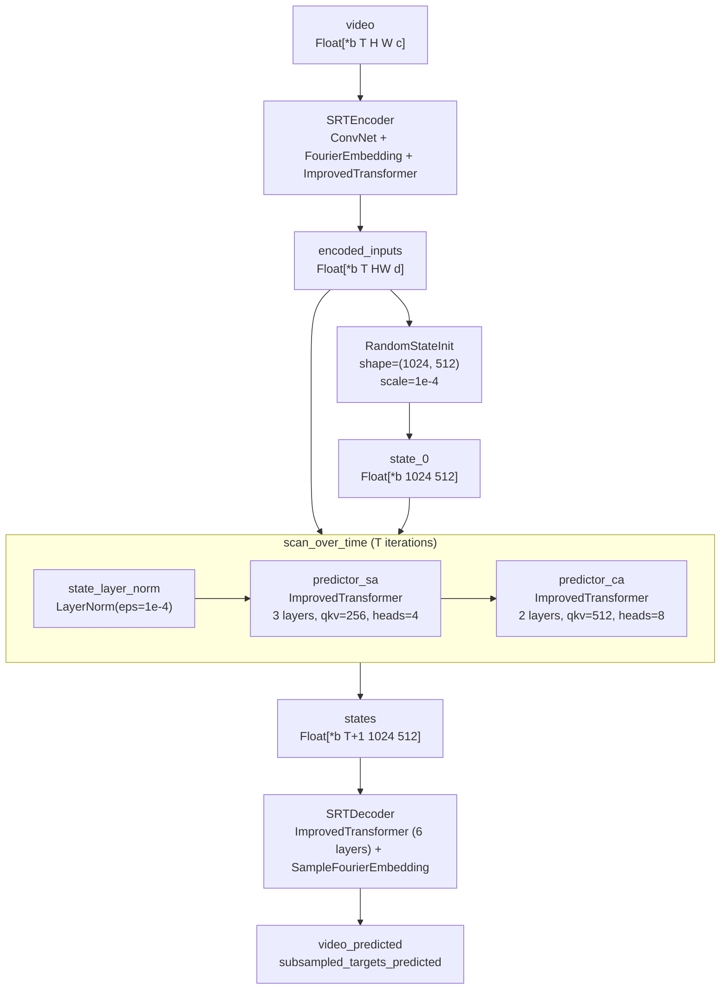
Sources: [colabs/moog_inference_demo.ipynb:317-340](), [colabs/moog_inference_demo.ipynb:325-332]()

---

## Component Summary

The table below maps each logical role to its implementing class and configuration in the released checkpoint.

| Role | Class | Configuration |
|---|---|---|
| Video feature extraction | `SRTEncoder` | ConvNet 6-stage, stride 4× total |
| ConvNet backbone | `ConvNet` | `features=(64,128,128,256,256,512)`, 3×3 kernels |
| Spatial positional encoding | `FourierEmbedding` | 20 Fourier bases, `axes=(-3,-2)`, `update_type="concat"` |
| Initial latent state | `RandomStateInit` | `shape=(1024, 512)`, `scale=1e-4` |
| Token self-attention (predict) | `ImprovedTransformer` (`predictor_sa`) | 3 layers, `qkv_size=256`, `num_heads=4` |
| Token cross-attention (correct) | `ImprovedTransformer` (`predictor_ca`) | 2 layers, `qkv_size=512`, `num_heads=8` |
| Frame reconstruction | `SRTDecoder` | 6-layer `ImprovedTransformer` + `SampleFourierEmbedding` |
| Box tracking readout | `TrackingReadoutWrapper` + `AttentionReadout` | `num_classes=64`, `temporal_tile_size=1` |
| Point tracking readout | `TrackingReadoutWrapper` + `AttentionReadout` | `num_classes=8`, `temporal_tile_size=8` |

Sources: [colabs/moog_inference_demo.ipynb:453-557]()

---

## Per-Timestep Predictor-Corrector Loop

The method `scan_over_time` ([colabs/moog_inference_demo.ipynb:325-332]()) iterates over all `T` frames. For each timestep `t`:

### Diagram: Predictor-Corrector Loop per Frame
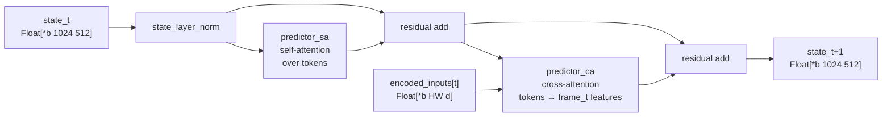

The self-attention step (`predictor_sa`) propagates token state forward in time without new observations. The cross-attention step (`predictor_ca`) corrects the tokens by attending to the frame's spatial features. The per-token positional embeddings in the frame features determine which spatial regions each token draws from.

Sources: [colabs/moog_inference_demo.ipynb:325-332]()

---

## Downstream Tasks

MooG outputs a tensor of token states `features` of shape `Float[*b T 1024 512]` (one state per timestep, after encoding). Readout heads use cross-attention from task-specific queries to this token tensor to produce predictions.

Two tasks are supported by the released checkpoints:

### Point Tracking
- Readout class: `TrackingReadoutWrapper` wrapping `AttentionReadout`
- Query input: 2D point coordinates in normalized video space, encoded with `SampleFourierEmbedding` (`update_type="replace"`) then passed through an `MLP`
- Output: predicted `(x, y)` coordinates per point per frame, plus visibility and certainty logits
- Key parameters: `num_frames_per_query=2`, `temporal_tile_size=8`, `predict_visibility=True`, `use_certainty=True`

### Box Tracking
- Readout class: `TrackingReadoutWrapper` wrapping `AttentionReadout`
- Query input: initial box coordinates, encoded identically to point tracking
- Output: `(y1, x1, y2, x2)` box coordinates per object per frame (normalized); no visibility prediction
- Key parameters: `num_frames_per_query=16`, `temporal_tile_size=1`, `predict_visibility=False`

Sources: [colabs/moog_inference_demo.ipynb:509-557]()

---

## Checkpoints

Three checkpoints are released for MooG, all trained on Ego4D. They are loaded using `npload` and `recover_tree` from `representations4d/utils/checkpoint_utils.py` (see [GenCeption Pipeline](#5.1)).

| Checkpoint file | Contents | Params | Size |
|---|---|---|---|
| `moog_ego4d_backbone_ckpt_164335139.npz` | `MooG` backbone | 35M | 140MB |
| `moog_ego4d_box_track_head_ckpt_164335139.npz` | `TrackingReadoutWrapper` (box) | 35M | 140MB |
| `moog_ego4d_point_track_head_ckpt_164335139.npz` | `TrackingReadoutWrapper` (point) | 35M | 140MB |

The backbone and each readout head are stored and loaded independently. During inference, `EvalWrapper` ([colabs/moog_inference_demo.ipynb:343-361]()) exposes the backbone's `features` and final `state` outputs, which are then passed separately to the readout heads.

### Diagram: Checkpoint Loading and Evaluation Pipeline
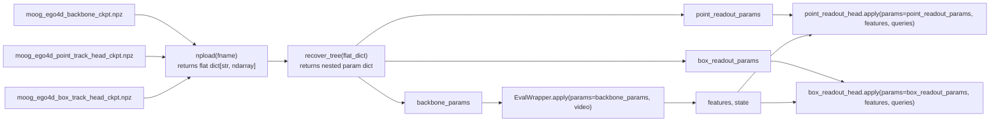
Sources: [README.md:53-55](), [colabs/moog_inference_demo.ipynb:591-598]()

---

## Training

MooG is trained using the [Kauldron](https://github.com/google-deepmind/kauldron) framework. The training configuration is in `moog/configs/movi.py` and targets the MOVi dataset (a synthetic multi-object video dataset from the Kubric simulator).

Training command:
```bash
cd moog/configs
python -m kauldron.main --cfg=movi.py --cfg.workdir=moog
```

The MOVi dataset can be downloaded from the Kubric public bucket before training. Full dataset and training configuration details are covered in [Training Configuration](#3.4).

Sources: [moog/README.md:7-33]()

---

## Module Organization

All MooG source modules live under the `moog/` package:

| File | Contents |
|---|---|
| `moog/modules.py` | `Moog`, `SRTEncoder`, `SRTDecoder`, `ReadoutWrapper`, `DenseReadout`, `TransformerReadout`, `ConditionalAutoregressiveReadout` |
| `moog/attention.py` | `ImprovedMHDPAttention`, `ImprovedTransformerBlock`, `ImprovedTransformer` |
| `moog/conv.py` | `ConvNet` |
| `moog/pos_embeddings.py` | `FourierEmbedding`, `SampleFourierEmbedding` |
| `moog/initializers.py` | `RandomStateInit` |
| `moog/configs/movi.py` | Kauldron training config for MOVi dataset |

The inference demo notebook (`colabs/moog_inference_demo.ipynb`) inlines all of these classes to be self-contained.

Sources: [README.md:1-4]()

---

# Page: MooG Core Model

# MooG Core Model

<details>
<summary>Relevant source files</summary>

The following files were used as context for generating this wiki page:

- [moog/initializers.py](moog/initializers.py)
- [moog/modules.py](moog/modules.py)

</details>


This page documents the `Moog` class and its supporting modules in `moog/modules.py` and `moog/initializers.py`. It covers the predictor-corrector recurrent loop, the encoder/decoder pair, latent state initialization, the `ReadoutWrapper` mechanism, and the three readout head types. For the transformer and attention primitives used internally, see [Transformer and Attention Modules](#3.2). For positional embeddings, `ConvNet`, and `RandomStateInit` configuration options, see [Auxiliary Modules: ConvNet, Positional Embeddings, and Initializers](#3.3). For the training configuration that assembles these components, see [Training Configuration](#3.4). For the inference walkthrough, see [Inference Demo](#3.5).

Sources: [moog/modules.py:1-46](), [moog/initializers.py:1-25]()

---

## Module Inventory

| Class / TypedDict | File | Role |
|---|---|---|
| `Moog` | `moog/modules.py` | Top-level recurrent model |
| `SRTEncoder` | `moog/modules.py` | Per-frame ConvNet + Transformer encoder |
| `SRTDecoder` | `moog/modules.py` | Spatial cross-attention decoder (reconstruction) |
| `MoogResults` | `moog/modules.py` | TypedDict for `Moog.__call__` outputs |
| `ReadoutWrapper` | `moog/modules.py` | Attaches task heads to a frozen backbone |
| `TransformerReadout` | `moog/modules.py` | Cross-attention readout for dense queries |
| `DenseReadout` | `moog/modules.py` | Per-timestep spatial readout (depth, etc.) |
| `DenseReadoutResults` | `moog/modules.py` | TypedDict for `DenseReadout` outputs |
| `ConditionalAutoregressiveReadout` | `moog/modules.py` | Stateful autoregressive readout (point tracking) |
| `ConditionalAutoregressiveReadoutResult` | `moog/modules.py` | TypedDict for `ConditionalAutoregressiveReadout` outputs |
| `RandomStateInit` | `moog/initializers.py` | Latent state seed (non-learnable, random) |

Sources: [moog/modules.py:38-230](), [moog/initializers.py:27-58]()

---

## Moog: Predictor-Corrector Loop

`Moog` is a recurrent model that maintains a latent state across video frames. For each frame it alternates between a **predict** step (self-attention over state) and a **correct** step (cross-attention against the new encoded frame). The corrected state is passed to the next time step.

Sources: [moog/modules.py:158-230]()

### Predictor-Corrector Data Flow

The diagram below maps the call graph to the concrete class names and functions used in the code.

**Diagram: MoogFrameStepPredictorCorrectorPass**

```mermaid
flowchart TD
    StateIn["StateIn[\"state\\nFloat[*b n d]\"]"]
    EncodedIn["EncodedIn[\"encoded_inputs\\n(from SRTEncoder)\"]"]

    subgraph "Moog.frame_step"
        PRED["PRED[\"predictor\\n(ImprovedTransformer, self-attn)\\nstate_predicted = state + predictor(state)\"]"]
        DECODE["DECODE[\"loss_fn_for_inner_gradient\\n→ SRTDecoder forward\\n→ L2 loss\"]"]
        GRAD["GRAD[\"jax.lax.stop_gradient(grads[0])\\n→ state_gradient\"]"]
        PROJ["PROJ[\"state_grad_projector\\nproject([state_predicted, state_gradient])\"]"]
        CORR["CORR[\"corrector\\n(ImprovedTransformer, cross-attn)\\nstate_corrected = state_predicted + corrector(proj, kv=encoded_inputs)\"]"]
        NORM["NORM[\"correction_layer_norm\\n(optional LayerNorm)\"]"]
    end

    StateOut["StateOut[\"state_corrected\\nFloat[*b n d]\"]"]

    StateIn --> PRED --> DECODE --> GRAD --> PROJ --> CORR --> NORM --> StateOut
    EncodedIn --> CORR
    PRED --> PROJ
```

Sources: [moog/modules.py:158-230]()

### Full Forward Pass

`Moog.__call__` encodes the entire video batch first, then runs `frame_step` sequentially across the time axis.

```
video  →  SRTEncoder  →  x[*b T n d]
                              │
       initializer(x[..., 0, :, :])  →  state[*b n d]
                              │
         for step in range(T):
           encoded_inputs = x[..., step, :, :]
           frame          = video[..., step, :, :, :]
           recon, target, state_predicted, state_corrected = frame_step(...)
           state = state_corrected
                              │
   SRTDecoder(states_corrected)  →  MoogResults
```

Sources: [moog/modules.py:158-230]()

### MoogResults

`MoogResults` is a `TypedDict` with the following fields:

| Key | Shape | Description |
|---|---|---|
| `video_predicted` | `*b T h w c` | Reconstructed frames from decoder |
| `subsampled_targets_predicted` | `*b T h w c` | Spatially subsampled ground-truth frames |
| `states_corrected` | `*b T n d` | Corrected latent states, one per frame |
| `states_predicted` | `*b T n d` | Predicted latent states (before correction) |
| `states_concat` | `*b T N d` | Concatenation of predicted and corrected states along token axis |
| `state` | `*b n d` | Final corrected state (last frame) |

Sources: [moog/modules.py:158-230]()

---

## SRTEncoder

`SRTEncoder` encodes a single frame (or a batch of frames) into a set of flat tokens. It is applied independently to every frame in the video; there is no temporal mixing inside the encoder.

**Processing steps:**
1. `backbone` (typically a `ConvNet` stack) extracts spatial feature maps from raw pixels [moog/modules.py:168-168]()
2. `pos_embedding` adds positional information [moog/modules.py:169-169]()
3. `einops.rearrange` flattens spatial dimensions `h, w` into token axis `n` [moog/modules.py:170-170]()
4. `transformer` (optional `ImprovedTransformer`) refines the token set via self-attention [moog/modules.py:171-173]()

**Diagram: SRTEncoderDataFlow**

```mermaid
flowchart LR
    I["I[\"image\\nFloat[*b H W c]\"]"]
    B["B[\"backbone\\n(ConvNet)\\nFloat[*b h w d]\"]"]
    P["P[\"pos_embedding\\n(FourierEmbedding)\\nFloat[*b h w d+pe]\"]"]
    F["F[\"rearrange\\n→ Float[*b n d]\"]"]
    T["T[\"transformer\\n(ImprovedTransformer, optional)\\nFloat[*b n d]\"]"]

    I --> B --> P --> F --> T
```

Sources: [moog/modules.py:158-174]()

---

## SRTDecoder

`SRTDecoder` reconstructs pixel values from latent tokens using spatial cross-attention queries.

**Processing steps:**
1. Build full-resolution coordinate grid via `_create_gradient_grid` [moog/modules.py:194-195]()
2. Subsample spatial grid using `_random_roll_resize_subsampling` if configured [moog/modules.py:202-205]()
3. Apply `pos_embedding` and run `transformer` with `num_token_axes=2` [moog/modules.py:176-230]()
4. Project to target channels using an internal dense layer [moog/modules.py:176-230]()

**Diagram: SRTDecoderDataFlow**

```mermaid
flowchart LR
    INP["INP[\"inputs\\nFloat[*b n d]\"]"]
    TGT["TGT[\"targets\\nFloat[*b W H C]\"]"]

    subgraph "SRTDecoder"
        GRID["GRID[\"_create_gradient_grid\\ncoords\"]"]
        SUB["SUB[\"_random_roll_resize_subsampling\\ncoords\"]"]
        PE["PE[\"pos_embedding\\n(SampleFourierEmbedding)\"]"]
        XFMR["XFMR[\"transformer\\n(ImprovedTransformer)\"]"]
        DENSE["DENSE[\"nn.Dense(recon)\"]"]
        SUBTGT["SUBTGT[\"_batch_roll_resize\\nsubsampled_targets\"]"]
    end

    RECON["RECON[\"recon\\nFloat[*b h w C]\"]"]
    SUBSAMPLED["SUBSAMPLED[\"subsampled_targets\"]"]

    INP --> XFMR
    TGT --> SUBTGT
    GRID --> SUB --> PE --> XFMR --> DENSE --> RECON
    SUBTGT --> SUBSAMPLED
```

Sources: [moog/modules.py:176-230]()

---

## RandomStateInit

`RandomStateInit` (`moog/initializers.py`) seeds the latent state at the beginning of a sequence. The state is **not learnable**; it is drawn fresh each forward pass from a scaled normal distribution [moog/initializers.py:27-58]().

**Fields:**
- `shape`: Tuple of state dimensions `(num_tokens, token_size)` [moog/initializers.py:30-30]()
- `random_init_scale`: Scaling factor (default `0.001`) [moog/initializers.py:31-31]()
- `random_fn`: Random function name (`"normal"`) [moog/initializers.py:33-33]()

Sources: [moog/initializers.py:27-58]()

---

## ReadoutWrapper

`ReadoutWrapper` composes a frozen backbone (`Moog`) with task-specific readout heads, handling routing via Kauldron's `kontext` configuration system [moog/modules.py:614-740]().

**Diagram: ReadoutWrapperComposition**

```mermaid
flowchart TD
    BATCH["BATCH[\"batch / context kwargs\"]"]

    subgraph "ReadoutWrapper.__call__"
        MGET["MGET[\"_get_model_inputs\"]"]
        MODEL["MODEL[\"model\\n(Moog)\"]"]
        RGET["RGET[\"_get_readout_inputs\"]"]
        SG["SG[\"lax.stop_gradient\\n(if not finetune)\"]"]
        HEAD1["HEAD1[\"readout_heads['points']\"]"]
        HEAD2["HEAD2[\"readout_heads['depth']\"]"]
        MERGE["MERGE[\"model_preds | {'readouts': readouts}\"]"]
    end

    OUTPUT["OUTPUT[\"MoogResults + readouts dict\"]"]

    BATCH --> MGET --> MODEL --> RGET --> SG --> HEAD1 & HEAD2 --> MERGE --> OUTPUT
```

Sources: [moog/modules.py:614-740]()

---

## Readout Heads

Three readout heads are available: `TransformerReadout`, `DenseReadout`, and `ConditionalAutoregressiveReadout`, supporting dense spatial predictions (e.g. depth) and stateful recurrent tracking (e.g. point tracking).

Sources: [moog/modules.py:374-611]()

---

# Page: Transformer and Attention Modules

# Transformer and Attention Modules

<details>
<summary>Relevant source files</summary>

The following files were used as context for generating this wiki page:

- [moog/attention.py](moog/attention.py)

</details>


This page documents the attention and transformer building blocks used in the **MooG** project, defined in `moog/attention.py`. It covers `ImprovedMHDPAttention`, `ImprovedTransformerBlock`, and `ImprovedTransformer`, along with the token-axis flattening utilities that allow these modules to handle spatially-structured inputs.

For the higher-level MooG model that assembles these blocks into encoder/decoder/corrector/predictor roles, see [MooG Core Model](#3.1). For the convolutional and positional embedding modules that feed into the transformer stack, see [Auxiliary Modules: ConvNet, Positional Embeddings, and Initializers](#3.3).

---

## Module Hierarchy

**Diagram: Class relationships in `moog/attention.py`**

```mermaid
graph TD
    subgraph "moog/attention.py"
        DPAW["dot_product_attention_weights"]
        FTA["_flatten_token_axes"]
        UFTA["_unflatten_token_axes"]
        IMHDPA["ImprovedMHDPAttention"]
        ITB["ImprovedTransformerBlock"]
        IT["ImprovedTransformer"]

        DPAW --> IMHDPA
        IMHDPA --> ITB
        ITB --> IT
        FTA --> IT
        UFTA --> IT
    end

    subgraph "moog/modules.py consumers"
        ENC["SRTEncoder.transformer"]
        DEC["SRTDecoder.transformer"]
        TR["TransformerReadout.transformer"]
        CORR["Moog.corrector"]
        PRED["Moog.predictor"]
    end

    IT --> ENC
    IT --> DEC
    IT --> TR
    IT --> CORR
    IT --> PRED
```

Sources: [moog/attention.py:1-371](), [moog/modules.py:158-391]()

---

## `dot_product_attention_weights`

[moog/attention.py:62-102]()

A standalone function that computes scaled dot-product attention weights. It takes queries `[*b q h d]` and keys `[*b k h d]` and returns weights `[*b h q k]`.

Key behaviors:

| Feature | Detail |
|---|---|
| Scaling | Divides queries by `sqrt(head_dim)` before the dot product [moog/attention.py:90]() |
| Einsum | `'...qhd,...khd->...hqk'` – head-major output [moog/attention.py:91]() |
| Bias | Optional additive bias (causal mask, proximity bias, etc.) [moog/attention.py:93-94]() |
| Mask | Optional boolean mask; masked positions receive `finfo.min` before softmax [moog/attention.py:96-98]() |
| `softmax_axes` | Defaults to `-1` (keys axis); set to `-2` for Slot-Attention style [moog/attention.py:65](), [moog/attention.py:100]() |

Sources: [moog/attention.py:62-102]()

---

## `ImprovedMHDPAttention`

[moog/attention.py:105-208]()

A Flax `nn.Module` that wraps `dot_product_attention_weights` into a full multi-head attention layer. It is a simplified version of Flax's `MultiheadDotProductAttention` with several deliberate changes.

### Attributes

| Attribute | Type | Description |
|---|---|---|
| `num_heads` | `int` | Number of attention heads [moog/attention.py:121]() |
| `qk_size` | `int` | Total dimension for queries and keys (split across heads) [moog/attention.py:122]() |
| `v_size` | `int \| None` | Total value dimension; defaults to `qk_size` [moog/attention.py:123]() |
| `softmax_axis` | `Axes` | Axis for softmax; default `-1` (keys axis) [moog/attention.py:124]() |

### Computation flow

**Diagram: Forward pass of `ImprovedMHDPAttention`**

```mermaid
flowchart LR
    IQ["inputs_q"]
    IKV["inputs_kv"]

    DQ["DenseGeneral\ndense_query"]
    DK["DenseGeneral\ndense_key"]
    DV["DenseGeneral\ndense_value"]

    NQ["RMSNorm\nnorm_query"]
    NK["RMSNorm\nnorm_key"]

    DPAW["dot_product_attention_weights"]
    WS["weighted_sum"]
    DO["DenseGeneral\ndense_out"]

    IQ --> DQ --> NQ --> DPAW
    IKV --> DK --> NK --> DPAW
    IKV --> DV
    DPAW --> WS
    DV --> WS --> DO
```

Sources: [moog/attention.py:128-208]()

### Key design decisions

1. **RMSNorm on keys and queries** — Applied after the projection, before the dot product. This follows Gilmer et al. 2023 ("Intriguing Properties of Transformer Training Instabilities") and stabilizes training [moog/attention.py:176-180]().
2. **No bias on Q/K/V projections** — `use_bias=False` for `dense_query`, `dense_key`, and `dense_value` [moog/attention.py:165](), [moog/attention.py:171](), [moog/attention.py:184]().
3. **Attention weight interms** — Weights are stored via Kauldron's `interms_property` system [moog/attention.py:126]().

Sources: [moog/attention.py:105-208]()

---

## `ImprovedTransformerBlock`

[moog/attention.py:295-371]()

A single transformer block that optionally combines self-attention and cross-attention **in parallel** before applying the MLP.

### Attributes

| Attribute | Type | Description |
|---|---|---|
| `mlp_size` | `int` | Hidden dimension of the MLP |
| `num_heads` | `int` | Number of attention heads |
| `qkv_size` | `int` | Query/key/value dimension |
| `cross_attn_only` | `bool` | Skip self-attention, require `inputs_kv` |
| `zero_init` | `bool` | Initialize `MLP_out` kernel to zeros |
| `attention_fn` | `Callable \| None` | Override for the attention function |

### Block computation

**Diagram: Data flow through `ImprovedTransformerBlock`**

```mermaid
flowchart TD
    Q["queries"]
    KV["inputs_kv"]

    NQ["LayerNorm\nnorm_q"]
    SA["ImprovedMHDPAttention\nself_att"]
    CA["ImprovedMHDPAttention\ncross_att"]
    ADD1["residual_add"]
    NATTN["LayerNorm\nnorm_attn"]
    MLPIN["Dense\nMLP_in + gelu"]
    MLPOUT["Dense\nMLP_out"]
    ADD2["residual_add"]

    Q --> NQ
    NQ --> SA
    NQ --> CA
    KV --> CA
    SA --> ADD1
    CA --> ADD1
    Q --> ADD1
    ADD1 --> NATTN --> MLPIN --> MLPOUT --> ADD2
    ADD1 --> ADD2
```

Sources: [moog/attention.py:295-371]()

### Parallel self- and cross-attention

The self-attention and cross-attention outputs are **summed before the MLP**, not sequentially applied. Both operate on the same normalized queries [moog/attention.py:329-356]().

### Zero-init MLP

When `zero_init=True`, `MLP_out` uses `kernel_init=nn.initializers.zeros`, allowing the block to initialize as an identity function [moog/attention.py:367-370]().

Sources: [moog/attention.py:295-371]()

---

## `ImprovedTransformer`

[moog/attention.py:211-292]()

The full stacked transformer, sequencing `num_layers` instances of `ImprovedTransformerBlock` and applying a final `LayerNorm` and token flattening/unflattening.

### Attributes

| Attribute | Type | Description |
|---|---|---|
| `qkv_size` | `int` | Passed to each block |
| `num_heads` | `int` | Passed to each block |
| `mlp_size` | `int` | Passed to each block |
| `num_layers` | `int` | Number of stacked blocks |
| `hidden_size` | `int \| None` | Projects queries to this size at entry |
| `output_size` | `int \| None` | Projects queries to this size at exit |

### Execution sequence

**Diagram: `ImprovedTransformer.__call__` execution sequence**

```mermaid
flowchart TD
    A["queries"]
    FTA["_flatten_token_axes"]
    HD["optional_nn_Dense"]
    L0["ImprovedTransformerBlock\nlayer_0"]
    LN["ImprovedTransformerBlock\nlayer_n"]
    NORM["LayerNorm\nnorm_encoder"]
    OUT["optional_nn_Dense"]
    UFTA["_unflatten_token_axes"]
    Z["output"]

    A --> FTA --> HD --> L0 --> LN --> NORM --> OUT --> UFTA --> Z
```

Sources: [moog/attention.py:211-292]()

---

## Token Axis Flattening

[moog/attention.py:31-58]()

Transformers operate on sequences `[*b n d]`. When inputs are spatially structured (`[*b h w d]`), token axes are collapsed before attention and restored afterward via `_flatten_token_axes` and `_unflatten_token_axes`.

**Diagram: Token axis flattening**

```mermaid
flowchart LR
    INPUT["queries\n[*b h w d]"]
    FLAT["_flatten_token_axes\n[*b n d]"]
    TRANSFORMER["ImprovedTransformer"]
    UNFLAT["_unflatten_token_axes\n[*b h w d]"]
    OUTPUT["output"]

    INPUT --> FLAT --> TRANSFORMER --> UNFLAT --> OUTPUT
```

Sources: [moog/attention.py:31-58]()

---

## Summary of Normalization Choices

| Location | Normalization | Purpose |
|---|---|---|
| After Q/K projection in `ImprovedMHDPAttention` | `RMSNorm` [moog/attention.py:179-180]() | Stabilize attention weights [moog/attention.py:176-178]() |
| Before each attention pass in `ImprovedTransformerBlock` | `LayerNorm` [moog/attention.py:326-328]() | Pre-norm architecture |
| After attention aggregate, before MLP | `LayerNorm` [moog/attention.py:359-361]() | Separate MLP normalization |
| After all layers in `ImprovedTransformer` | `LayerNorm` [moog/attention.py:282-284]() | Final encoder norm |

Sources: [moog/attention.py:176-180](), [moog/attention.py:282-284](), [moog/attention.py:326-328](), [moog/attention.py:359-361]()

---

# Page: Auxiliary Modules: ConvNet, Positional Embeddings, and Initializers

# Auxiliary Modules: ConvNet, Positional Embeddings, and Initializers

<details>
<summary>Relevant source files</summary>

The following files were used as context for generating this wiki page:

- [moog/conv.py](moog/conv.py)
- [moog/initializers.py](moog/initializers.py)
- [moog/pos_embeddings.py](moog/pos_embeddings.py)

</details>


This page documents three supporting modules used inside the MooG model: the convolutional backbone in `moog/conv.py`, the positional encoding utilities in `moog/pos_embeddings.py`, and the latent state initializer in `moog/initializers.py`. These modules are consumed by the higher-level `Moog` class and its associated encoder/decoder components — for those, see [MooG Core Model](#3.1) and [Transformer and Attention Modules](#3.2).

---

## ConvNet

**File:** `moog/conv.py`

`ConvNet` [moog/conv.py:24-46]() is a configurable stack of convolutional layers used as the image-feature backbone inside `SRTEncoder`. It supports both standard convolution (downsampling) and transposed convolution (upsampling), making it usable in both the encoder and decoder paths.

### Configuration Fields

| Field | Type | Default | Description |
|---|---|---|---|
| `features` | `tuple[int, ...]` | required | Number of output channels per layer |
| `kernel_sizes` | `tuple[tuple[int, ...], ...]` | required | Kernel shape per layer |
| `strides` | `tuple[tuple[int, ...], ...]` | required | Stride per layer |
| `transposed_conv` | `bool` | `False` | Use `nn.ConvTranspose` instead of `nn.Conv` |
| `normalize_output` | `bool` | `False` | Apply `nn.LayerNorm` to the final output |

### Behavior

`ConvNet.__call__` [moog/conv.py:33-46]() performs the following operations:
- Iterates over `(features, kernel_sizes, strides)` in lockstep [moog/conv.py:38-39]().
- Applies `nn.Conv` or `nn.ConvTranspose` depending on `self.transposed_conv` [moog/conv.py:41]().
- Applies `nn.gelu` activation between all layers **except the last** [moog/conv.py:42-43]().
- If `self.normalize_output=True`, applies `nn.LayerNorm` with no bias and a learned scale to the final feature map [moog/conv.py:44-45]().
- Input/output shape convention: `Float['*B H W C']` → `Float['*B h w c']` [moog/conv.py:35]().

**Diagram: ConvNet Layer-by-Layer Computation (Code-Entity Mapping)**

```mermaid
flowchart LR
    IN["\"images: Float[*B H W C]\""]
    subgraph ConvNet["ConvNet.__call__ (moog/conv.py)"]
        LOOP["\"for n, (f, k, s) in enumerate(zip(features, kernel_sizes, strides))\""]
        CONV["\"nn.ConvTranspose(f, k, s) if transposed_conv else nn.Conv(f, k, s)\""]
        GELU["\"nn.gelu(x) if n < len(features) - 1\""]
        LOOP --> CONV --> GELU
    end
    LN["\"nn.LayerNorm(use_bias=False, use_scale=True) if normalize_output\""]
    OUT["\"x: Float[*B h w c]\""]

    IN --> ConvNet --> LN --> OUT
```
Sources: `moog/conv.py`

---

## Positional Embeddings

**File:** `moog/pos_embeddings.py`

This module provides NeRF-style sinusoidal (Fourier) positional encodings. Two classes are defined: `FourierEmbedding` [moog/pos_embeddings.py:65]() for grid-based coordinates, and `SampleFourierEmbedding` [moog/pos_embeddings.py:124]() for arbitrary sampled coordinates.

### Helper Functions

#### `_create_gradient_grid`
[moog/pos_embeddings.py:48-62]() creates a uniformly spaced coordinate grid of shape `[*samples_per_dim, len(samples_per_dim)]`. Each entry is a coordinate vector in the specified `value_range` (default `(-1.0, 1.0)`). Used internally by `FourierEmbedding`.

#### `_convert_to_fourier_features`
[moog/pos_embeddings.py:26-44]() converts raw coordinate values to Fourier features using octave-spaced frequencies. For input of shape `(..., n_dims)` and `basis_degree=k`, the output has shape `(..., 2 * n_dims * k)`:
1. Builds a frequency basis matrix by concatenating `2^i * jnp.eye(n_dims)` for `i in range(basis_degree)` [moog/pos_embeddings.py:36-38]().
2. Projects inputs onto the basis via matrix multiply (`inputs @ freq_basis`) [moog/pos_embeddings.py:41]().
3. Returns `[sin(x), sin(x + 0.5 * pi)]` — equivalent to `[sin(x), cos(x)]` [moog/pos_embeddings.py:44]().

Inputs are expected in `[-π, π]` or `[0, 2π]`. In practice, raw coordinates in `[-1, 1]` are scaled by `jnp.pi` before being passed in [moog/pos_embeddings.py:96](), [moog/pos_embeddings.py:161]().

### `FourierEmbedding`
[moog/pos_embeddings.py:65-121]() computes Fourier positional encodings over a **regular grid** derived from the spatial axes of the input tensor.

| Field | Type | Default | Description |
|---|---|---|---|
| `num_fourier_bases` | `int` | required | Fourier basis degree; output dim = `2 × len(axes) × num_fourier_bases` |
| `update_type` | `str` | required | How to combine PE with input: `"concat"` or `"project_add"` |
| `axes` | `Axes` | `(-2,)` | Spatial axes to embed (must be negative, must exclude `-1`) |

**`update_type` modes:**
- `"concat"`: Broadcast PE to batch shape, concatenate with inputs along channel dimension [moog/pos_embeddings.py:111-117]().
- `"project_add"`: Apply a learned `nn.Dense` to PE, add to inputs [moog/pos_embeddings.py:108-110]().

### `SampleFourierEmbedding`
[moog/pos_embeddings.py:124-182]() computes Fourier positional encodings over **arbitrary sampled coordinates** passed in explicitly.

| Field | Type | Default | Description |
|---|---|---|---|
| `num_fourier_bases` | `int` | required | Fourier basis degree |
| `update_type` | `str` | required | `"concat"`, `"project_add"`, or `"replace"` |

The `__call__` signature accepts:
- `inputs: Float['... d']` — feature tensor [moog/pos_embeddings.py:142]()
- `coords: Float['... D'] | None` — coordinate tensor in `[-1, 1]`; if `None`, uses `inputs` as coordinates directly [moog/pos_embeddings.py:142](), [moog/pos_embeddings.py:149-150]()

**`update_type` modes:**
- `"concat"`: Concatenate PE with inputs along channel dimension [moog/pos_embeddings.py:168-174]().
- `"project_add"`: Apply learned `nn.Dense` to PE, add to inputs [moog/pos_embeddings.py:165-167]().
- `"replace"`: Discard inputs; return PE broadcast to input batch shape [moog/pos_embeddings.py:175-178]().

**Diagram: FourierEmbedding vs SampleFourierEmbedding Data Flow (Code-Entity Mapping)**

```mermaid
flowchart TD
    subgraph FourierEmbedding["FourierEmbedding (moog/pos_embeddings.py)"]
        GG["\"_create_gradient_grid(emb_shape, value_range=(-1.0, 1.0))\""]
        FF1["\"_convert_to_fourier_features(coords * jnp.pi, basis_degree=num_fourier_bases)\""]
        PE1["\"pos_embedding (Float[*spatial_shape, 2*n_dims*k])\""]
        GG --> FF1 --> PE1

        PA1["\"project_add: inputs + nn.Dense(n_features, name='dense_pe')(pos_embedding)\""]
        C1["\"concat: jnp.concatenate((inputs, pos_embedding), axis=-1)\""]
        PE1 --> PA1
        PE1 --> C1
    end

    subgraph SampleFourierEmbedding["SampleFourierEmbedding (moog/pos_embeddings.py)"]
        COORDS["\"coords: Float[... D] or inputs if coords is None\""]
        FF2["\"_convert_to_fourier_features(coords * jnp.pi, basis_degree=num_fourier_bases)\""]
        PE2["\"pos_embedding\""]
        COORDS --> FF2 --> PE2

        PA2["\"project_add: inputs + nn.Dense(n_features, name='dense_pe')(pos_embedding)\""]
        C2["\"concat: jnp.concatenate((inputs, pos_embedding), axis=-1)\""]
        R2["\"replace: jnp.broadcast_to(pos_embedding, shape=inputs.shape[:-1] + ...)\""]
        PE2 --> PA2
        PE2 --> C2
        PE2 --> R2
    end
```
Sources: `moog/pos_embeddings.py`

---

## RandomStateInit

**File:** `moog/initializers.py`

`RandomStateInit` [moog/initializers.py:27-58]() is a Flax module that generates the initial latent token state at the start of each sequence. It is **not** a learned parameter — each call produces a fresh random sample using JAX randomness [moog/initializers.py:53-57]().

### Configuration Fields

| Field | Type | Default | Description |
|---|---|---|---|
| `shape` | `tuple[int, ...] \| None` | required | Shape `(num_tokens, token_size)` of the state. If `None`, derived from `inputs.shape[-2:]` [moog/initializers.py:40-44]() |
| `random_init_scale` | `float \| None` | `0.001` | Scalar multiplier applied to sampled values [moog/initializers.py:31](), [moog/initializers.py:53]() |
| `random_fn` | `str` | `"normal"` | JAX random function name (`"normal"`) [moog/initializers.py:33](), [moog/initializers.py:48-49]() |
| `random_fn_kwargs` | `dict \| None` | `None` | Extra kwargs forwarded to the JAX random function [moog/initializers.py:32](), [moog/initializers.py:52]() |

### Call Signature

```python
__call__(self, inputs: Optional[Float["*B N D"]], batch_shape: Shape) -> Float["*B n d"]
```
[moog/initializers.py:37-39]()

- `inputs`: Optional reference tensor. If `shape=None`, the state shape is taken from `inputs.shape[-2:]` [moog/initializers.py:40-44]().
- `batch_shape`: Leading batch dimensions to prepend to the sampled tensor [moog/initializers.py:38](), [moog/initializers.py:55]().
- Returns a tensor of shape `batch_shape + shape` sampled from `random_init_scale * jax.random.normal(...)` [moog/initializers.py:53-58]().

Randomness is sourced from the Flax RNG collection `"default"` via `self.make_rng("default")` [moog/initializers.py:54]().

**Diagram: RandomStateInit Execution Flow**

```mermaid
flowchart LR
    CFG["\"RandomStateInit(shape, random_init_scale, random_fn)\""]
    RNG["\"self.make_rng('default')\""]
    JAXFN["\"jax.random.normal(key, shape=batch_shape + shape)\""]
    SCALE["\"* random_init_scale\""]
    STATE["\"state: Float[*B n d]\""]

    CFG --> JAXFN
    RNG --> JAXFN
    JAXFN --> SCALE --> STATE
```
Sources: `moog/initializers.py`

---

## How These Modules Fit Into MooG

The three modules serve distinct roles in the MooG pipeline:
- `ConvNet` [moog/conv.py:24]() encodes video frames into spatial feature maps within `SRTEncoder`.
- `FourierEmbedding` [moog/pos_embeddings.py:65]() adds spatial positional encoding to encoder outputs.
- `SampleFourierEmbedding` [moog/pos_embeddings.py:124]() encodes query pixel or point coordinates in `SRTDecoder`.
- `RandomStateInit` [moog/initializers.py:27]() generates the initial latent tokens.

Sources: `moog/conv.py`, `moog/pos_embeddings.py`, `moog/initializers.py`

---

# Page: Training Configuration

# Training Configuration

<details>
<summary>Relevant source files</summary>

The following files were used as context for generating this wiki page:

- [moog/configs/movi.py](moog/configs/movi.py)

</details>


## Purpose and Scope

This page documents `moog/configs/movi.py`, which defines the Kauldron `Trainer` configuration for training the MooG model on the MOVi-E dataset. It covers the full `get_config()` assembly: model instantiation, dataset pipeline, loss functions, optimizer schedule, readout heads (points and depth), and evaluation setup.

For the MooG model architecture itself, see [MooG Core Model](#3.1). For the transformer and attention modules instantiated here, see [Transformer and Attention Modules](#3.2). For auxiliary modules (ConvNet, positional embeddings, initializers), see [Auxiliary Modules: ConvNet, Positional Embeddings, and Initializers](#3.3).

Sources: [moog/configs/movi.py:1-464]()

---

## Configuration Entry Points

The file exposes public configuration builders:

| Function | Purpose |
|---|---|
| `get_config()` | Assembles and returns the full `kd.train.Trainer` object [moog/configs/movi.py:32-34]() |

The entire config is built inside `get_config()` and is consumed by the Kauldron training framework.

Sources: [moog/configs/movi.py:32-275]()

---

## Top-Level Trainer Assembly

**Diagram: `get_config()` composition**

```mermaid
flowchart TD
    GC["get_config"]

    subgraph trainer["kd.train.Trainer"]
        SEED["seed = 1"]
        STEPS["num_train_steps = 1100"]
        AUX["aux: num_tokens=1024, token_size=512"]
        MODEL["cfg.model = modules.Moog"]
        RNG["cfg.rng_streams"]
        LOSS["cfg.train_losses"]
        OPT["cfg.optimizer"]
        SCHED["cfg.schedules"]
        METRICS["cfg.train_metrics"]
        TRAINDS["cfg.train_ds"]
        EVALDS["cfg.eval_ds"]
        READOUTS["cfg.model = modules.ReadoutWrapper"]
    end

    GC --> trainer
    MODEL --> READOUTS
```

Sources: [moog/configs/movi.py:32-275]()

---

## Global Hyperparameters

```python
cfg.seed = 1
cfg.num_train_steps = 1100  # intended to be 1_000_000 at full scale
cfg.aux = {"num_tokens": 1024, "token_size": 512}
```

The `cfg.aux` dict is referenced later via `cfg.ref.aux[...]` to wire latent state dimensions into the model and initializer without duplication.

Sources: [moog/configs/movi.py:36-38]()

---

## Model Instantiation

The `modules.Moog` model is constructed with concrete submodules for all five components: encoder, initializer, corrector, predictor, and decoder. Key dimension choices are driven by `cfg.aux`.

**Diagram: Moog submodule instantiation in `get_config`**

```mermaid
graph TD
    subgraph Moog["modules.Moog"]
        ENC["SRTEncoder\nbackbone: conv.ConvNet\nfeatures=(64,128,128,256,256,512)\nstrides=((1,1),(1,1),(1,1),(2,2),(1,1),(2,2))\npos_embedding: FourierEmbedding(num_fourier_bases=20, axes=(-3,-2), update_type=project_add)\ntransformer: attention.ImprovedTransformer(qkv=512, heads=8, layers=0)"]
        INIT["initializers.RandomStateInit\nshape=(1024, 512)\nrandom_init_scale=1e-4"]
        PROJ["state_grad_projector: nn.Dense(512)"]
        LN["correction_layer_norm: nn.LayerNorm(eps=1e-4)"]
        CORR["corrector: attention.ImprovedTransformer\nqkv_size=512, num_heads=8\nmlp_size=2048, num_layers=2"]
        PRED["predictor: attention.ImprovedTransformer\nqkv_size=256, num_heads=4\nmlp_size=2048, num_layers=3"]
        DEC["modules.SRTDecoder\ntransformer: attention.ImprovedTransformer(qkv_size=128, heads=2, layers=6, cross_attn_only=True)\npos_embedding: pos_embeddings.SampleFourierEmbedding(num_fourier_bases=16, update_type=concat)\nsubsample_factor=8, eval_subsample_factor=4"]
    end
```

Notable flags on the base `modules.Moog` instance:

| Parameter | Value | Meaning |
|---|---|---|
| `stop_gradient_prob` | `None` | No stochastic stop-gradient on state [moog/configs/movi.py:104]() |
| `use_loss_gradient` | `False` | Predictor-corrector uses direct encoder features, not loss gradient [moog/configs/movi.py:105]() |
| `video` | `"batch.video"` | Kauldron key for video input [moog/configs/movi.py:103]() |

Sources: [moog/configs/movi.py:42-106]()

---

## RNG Streams

Two RNG streams are registered:

| Stream name | `eval` enabled | Purpose |
|---|---|---|
| `"default"` | `True` | Used in decoder subsampling and stop-gradient branching [moog/configs/movi.py:110]() |
| `"state_init"` | `False` | Used only during training for latent state initialization [moog/configs/movi.py:111]() |

Sources: [moog/configs/movi.py:109-112]()

---

## Loss Function

A single training loss is defined before readout heads are attached:

```python
cfg.train_losses = {
    "recon_predicted": kd.losses.L2(
        preds="preds.video_predicted",
        targets="preds.subsampled_targets_predicted",
    ),
}
```

This is the next-frame prediction objective: L2 distance between the decoder's reconstruction (`video_predicted`) and the spatially subsampled target frames (`subsampled_targets_predicted`). Both outputs come from `MoogResults` (see [MooG Core Model](#3.1)).

After readout heads are configured, `cfg.train_losses.update(r_losses)` merges any readout-specific losses.

Sources: [moog/configs/movi.py:115-120](), [moog/configs/movi.py:257]()

---

## Optimizer and Schedule

The optimizer chain is:

```python
optax.chain(
    optax.clip_by_global_norm(1.0),
    optax.adamw(learning_rate=schedule, b2=0.95)
)
```

The learning rate schedule is a warmup-then-cosine-decay:

| Parameter | Value |
|---|---|
| `init_value` | `0.0` [moog/configs/movi.py:125]() |
| `peak_value` | `1e-4` [moog/configs/movi.py:126]() |
| `warmup_steps` | `1000` [moog/configs/movi.py:127]() |
| `decay_steps` | `cfg.ref.num_train_steps` [moog/configs/movi.py:128]() |
| `end_value` | `1e-7` [moog/configs/movi.py:129]() |

Gradient clipping (global norm ≤ 1.0) is applied before the AdamW update [moog/configs/movi.py:133-138]().

Sources: [moog/configs/movi.py:123-139]()

---

## Training Metrics

```python
cfg.train_metrics = {
    "psnr": kd.metrics.Psnr(
        pred="preds.video_predicted",
        target="preds.subsampled_targets_predicted",
    ),
}
```

PSNR is tracked between decoder reconstructions and subsampled targets. Logging cadence:

| Setting | Value |
|---|---|
| `log_metrics_every` | `100` steps [moog/configs/movi.py:148]() |
| `log_summaries_every` | `1000` steps [moog/configs/movi.py:149]() |

Sources: [moog/configs/movi.py:141-149]()

---

## Dataset Pipeline (`_make_ds`)

The `_make_ds` helper constructs the dataset loaders for Kauldron [moog/configs/movi.py:156-157]().

**Diagram: `_make_ds` pipeline**

```mermaid
flowchart LR
    TFDS["Tfds"] --> E["Elements"]
    E --> R["Rearrange"]
    R --> VR["ValueRange"]
    VR --> AC["AddConstants"]
    AC --> OUT["DatasetBatch"]
```

Both train and eval datasets use `shared_ds_kwargs` with `batch_size=128` and `num_frames=8` [moog/configs/movi.py:152-157]().

Sources: [moog/configs/movi.py:152-158](), [moog/configs/movi.py:278-459]()

---

## Readout Heads

After the base model is constructed, readout heads are added (such as `modules.ConditionalAutoregressiveReadout` for points) [moog/configs/movi.py:160-203]().

**Diagram: Readout head composition**

```mermaid
flowchart TD
    subgraph r_heads["r_heads dict"]
        subgraph POINTS["points: modules.ConditionalAutoregressiveReadout"]
            PT_BB["backbone: modules.TransformerReadout\n  attention.ImprovedTransformer"]
            PT_PRED["predictor: modules.MLP"]
            PT_INIT["initializer: kd.nn.Sequential"]
        end
    end
```

Both heads read from `preds.states_concat` produced by `modules.Moog.__call__`.

Sources: [moog/configs/movi.py:160-254]()

---

## ReadoutWrapper Assembly

```python
cfg.model = modules.ReadoutWrapper(
    model=cfg.model,
    readout_heads=r_heads,
    readout_inputs=r_inputs,
    model_inputs={"video": "batch.video", "batch": "batch"},
    finetune=True,
)
```

This wraps the `modules.Moog` instance to execute downstream heads alongside the core model forward pass.

Sources: [moog/configs/movi.py:248-254]()

---

## Evaluation Setup

A single evaluator named `"eval"` is configured with `kd.evals.EveryNSteps(5000)` and evaluation datasets [moog/configs/movi.py:264-274]().

Sources: [moog/configs/movi.py:264-274]()

---

## Full Configuration Flow Summary

**Diagram: Complete `get_config` data and control flow**

```mermaid
flowchart TD
    AUX["cfg.aux\nnum_tokens=1024\ntoken_size=512"]

    subgraph model_build["Model Build"]
        MOOG["modules.Moog"]
        RW["modules.ReadoutWrapper"]
        MOOG --> RW
    end

    subgraph data["Data Pipeline"]
        TRAIN_DS["cfg.train_ds"]
        EVAL_DS["cfg.eval_ds"]
    end

    subgraph optimization["Optimization"]
        SCHED["optax.warmup_cosine_decay_schedule"]
        OPT["optax.adamw"]
        SCHED --> OPT
    end

    subgraph losses["Losses"]
        L2["kd.losses.L2"]
    end

    AUX --> MOOG
    model_build --> TRAINER["kd.train.Trainer"]
    data --> TRAINER
    optimization --> TRAINER
    losses --> TRAINER
```

Sources: [moog/configs/movi.py:32-275]()

---

# Page: Inference Demo

# Inference Demo

<details>
<summary>Relevant source files</summary>

The following files were used as context for generating this wiki page:

- [colabs/moog_inference_demo.ipynb](colabs/moog_inference_demo.ipynb)
- [moog/README.md](moog/README.md)

</details>


This page walks through `colabs/moog_inference_demo.ipynb`, which demonstrates how to run the MooG model on two downstream tracking tasks: **point tracking** and **box tracking**. It covers dependency installation, model definition, checkpoint loading, inference execution, and output interpretation.

For background on the MooG architecture, see the [MooG Core Model](#3.1) page. For the training configuration that produced these checkpoints, see [Training Configuration](#3.4). For checkpoint loading utilities shared across all three projects, see [Checkpoint Utilities](#7.1).

---

## Dependencies

The notebook installs the following packages at runtime:

```
pip install kauldron mediapy
pip install git+https://github.com/google-deepmind/tapnet.git
```

| Package | Purpose |
|---------|---------|
| `kauldron` | Provides `kd.nn.LearnedEmbedding`, `kd.nn.Sequential`, Flax-compatible utilities |
| `mediapy` | Video display in Colab |
| `tapnet` | Visualization utilities (`viz_utils.paint_point_track`, `viz_utils.get_colors`) |
| `einops` | Tensor rearrangement inside readout modules |

The notebook does **not** import from the `moog` package directly. All classes are re-defined inline in the notebook cells.

Sources: [colabs/moog_inference_demo.ipynb:20-57]()

---

## Checkpoints

Three separate `.npz` files are downloaded — one for the backbone, and one for each readout head.

| Checkpoint file | Contents |
|----------------|---------|
| `moog_ego4d_backbone_ckpt_164335139.npz` | `EvalWrapper(MooG(...))` parameters |
| `moog_ego4d_point_track_head_ckpt_164335139.npz` | `TrackingReadoutWrapper` (point) parameters |
| `moog_ego4d_box_track_head_ckpt_164335139.npz` | `TrackingReadoutWrapper` (box) parameters |

All three are loaded via the `npload` / `recover_tree` pattern:

```
backbone_params    = recover_tree(npload('moog_ego4d_backbone_ckpt_164335139.npz'))
point_readout_params = recover_tree(npload('moog_ego4d_point_track_head_ckpt_164335139.npz'))
box_readout_params   = recover_tree(npload('moog_ego4d_box_track_head_ckpt_164335139.npz'))
```

`npload` reads the flat `.npz` archive; `recover_tree` reconstructs the nested parameter dictionary by splitting slash-delimited keys. These functions are inlined in the notebook at [colabs/moog_inference_demo.ipynb:570-598]() and are also defined canonically in [representations4d/utils/checkpoint_utils.py:23-61]().

Sources: [colabs/moog_inference_demo.ipynb:64-69](), [colabs/moog_inference_demo.ipynb:568-604](), [representations4d/utils/checkpoint_utils.py:23-61]()

---

## Model Definition

### `EvalWrapper` — Backbone Interface

The notebook defines `EvalWrapper` as a thin Flax module around `MooG`. It replaces the training-time `__call__` (which runs decode and returns reconstruction loss tensors) with an inference-time `__call__` that returns latent features and the final state.

Title: "EvalWrapper call interface"
```mermaid
flowchart LR
    V["video\nFloat[*b T H W c]"]
    S["state\n(optional, Float[*b n d])"]

    subgraph EvalWrapper["EvalWrapper.__call__"]
        ENC["self.encoder\n(SRTEncoder)"]
        INIT["self.initializer\n(RandomStateInit)\nif state is None"]
        SCAN["self.scan_over_time\n(predictor_sa + predictor_ca loop)"]
    end

    OUT1["features\nFloat[*b T n d]\n= states[..., 1:, :, :]"]
    OUT2["state\nFloat[*b n d]\n= states[..., -1, :, :]"]

    V --> ENC
    S --> SCAN
    ENC --> SCAN
    INIT --> SCAN
    SCAN --> OUT1
    SCAN --> OUT2
```

Sources: [colabs/moog_inference_demo.ipynb:343-361]()

The `features` output (shape `[*b, T, num_tokens, token_size]`) is what gets passed to both readout heads.

### `MooG` — Backbone Loop

The `MooG` class defined in the notebook uses `scan_over_time` to apply the predictor-corrector loop across frames. This is a simplified version of the training-time `Moog` class in [moog/modules.py:244-371]().

Key differences from the training module:

| Aspect | Notebook `MooG` | Production `moog/modules.py Moog` |
|--------|----------------|----------------------------------|
| Predictor/corrector | Two separate transformers (`predictor_sa`, `predictor_ca`) | `corrector` + `predictor` with gradient-based correction |
| Decoder call | Returns reconstruction | Full `SRTDecoder` with subsampling |
| State handling | Simple stack | Supports `stop_gradient_prob`, `batch.state` passthrough |

Sources: [colabs/moog_inference_demo.ipynb:317-361](), [moog/modules.py:244-371]()

### Readout Heads

Two `TrackingReadoutWrapper` instances are constructed — one for point tracking and one for box tracking. Both wrap `AttentionReadout` but differ in configuration.

Title: "Readout head structure"
```mermaid
flowchart TD
    subgraph TrackingReadoutWrapper["TrackingReadoutWrapper"]
        QI["query_initializer\n(kd.nn.Sequential:\n  SampleFourierEmbedding replace\n  + MLP 512→512)"]
        AR["attention_readout\n(AttentionReadout)"]
        TILE["temporal_tile_size repeat\n+ LearnedEmbedding posenc"]
        REARRANGE["einops rearrange\n(Q k) → Q (k C)"]
        ACT["output_activation\n(sigmoid or None)"]
        VIS["visibility / certainty\n(if predict_visibility=True)"]
    end

    IN_FEATS["inputs\nFloat[*b T n d]"]
    IN_Q["queries\n(coordinate inputs)"]
    OUT["dict: values, visible,\nlogits_visible, logits_certainty"]

    IN_FEATS --> AR
    IN_Q --> QI --> TILE --> AR --> REARRANGE --> ACT --> VIS --> OUT
```

Sources: [colabs/moog_inference_demo.ipynb:397-441]()

**Point vs. box readout configuration:**

| Parameter | Point readout | Box readout |
|-----------|--------------|-------------|
| `num_classes` (AttentionReadout) | 8 | 64 |
| `num_params` (AttentionReadout) | 1024 | 1024 |
| `num_heads` (AttentionReadout) | 8 | 4 |
| `num_frames_per_query` | 2 | 16 |
| `temporal_tile_size` | 8 | 1 |
| `predict_visibility` | `True` | `False` |
| `use_certainty` | `True` | `False` |
| `output_activation` | `nn.sigmoid` | `None` |

Sources: [colabs/moog_inference_demo.ipynb:509-557]()

### Full Model Instantiation

Title: "Object graph constructed by the notebook"
```mermaid
flowchart TD
    EW["EvalWrapper"]
    MG["MooG\n(pretrained_model)"]
    ENC["SRTEncoder\n(encoder)"]
    CNN["ConvNet\n(backbone)\nfeatures=(64,128,128,256,256,512)\nstrides: 2×2-strided at layers 0,3"]
    FENC["FourierEmbedding\n(pos_embedding)\nnum_fourier_bases=20\naxes=(-3,-2)\nupdate_type=concat"]
    TXENC["ImprovedTransformer\n(transformer)\nqkv=512 heads=8 mlp=2048 layers=0"]
    INIT["RandomStateInit\n(initializer)\nshape=(1024,512)\nscale=1e-4"]
    PCA["ImprovedTransformer\n(predictor_ca)\nqkv=512 heads=8 mlp=2048 layers=2"]
    PSA["ImprovedTransformer\n(predictor_sa)\nqkv=256 heads=4 mlp=2048 layers=3"]
    DEC["SRTDecoder\n(decoder)"]
    TXDEC["ImprovedTransformer\n(transformer)\nqkv=128 heads=2 mlp=2048 layers=6"]
    SAMP["SampleFourierEmbedding\n(pos_embedding)\nnum_fourier_bases=16\nupdate_type=concat"]

    EW --> MG
    MG --> ENC
    MG --> INIT
    MG --> PCA
    MG --> PSA
    MG --> DEC
    ENC --> CNN
    ENC --> FENC
    ENC --> TXENC
    DEC --> TXDEC
    DEC --> SAMP
```

Sources: [colabs/moog_inference_demo.ipynb:452-507]()

---

## Point Tracking Inference

### Data

A pre-packaged batch is downloaded from GCS:

```
!wget .../representations4d/assets/kubric_batch.npy
batch = np.load('kubric_batch.npy', allow_pickle=True).item()
```

Expected keys in `batch`:

| Key | Description |
|-----|-------------|
| `video` | Float tensor, shape `[B, T, H, W, 3]`, values in `[0, 1]` |
| `query_points_video` | Point queries in normalized video coordinates |
| `target_points_video` | Ground-truth point tracks |
| `target_points_visible_video` | Ground-truth visibility flags |

Sources: [colabs/moog_inference_demo.ipynb:616-622]()

### Backbone Forward Pass

```
model_preds, state = model.apply(
    {'params': backbone_params},
    batch['video'],
    is_training_property=False,
    rngs={'default': key},
    capture_intermediates=True
)
```

`model_preds` is a dict with keys `features` (shape `[B, T, 1024, 512]`) and `state` (shape `[B, 1024, 512]`).

Sources: [colabs/moog_inference_demo.ipynb:633-636]()

### Point Readout Forward Pass

```
point_readout = point_readout_head.apply(
    {'params': point_readout_params},
    model_preds['features'],
    batch['query_points_video'],
    is_training_property=False,
    rngs={'default': key}
)
```

`point_readout` is a dict with keys:

| Key | Shape | Description |
|-----|-------|-------------|
| `values` | `[B, T, Q, 2]` | Predicted (x, y) tracks in normalized coords |
| `visible` | `[B, T, Q, 1]` | Binary visibility (after certainty threshold) |
| `logits_visible` | `[B, T, Q, 1]` | Raw visibility logit |
| `logits_certainty` | `[B, T, Q, 1]` | Raw certainty logit |

Sources: [colabs/moog_inference_demo.ipynb:647-650]()

### Visualization

Predicted tracks are rescaled to pixel coordinates and rendered using `viz_utils.paint_point_track`. Ground-truth and predictions are displayed side-by-side.

```
pred_tracks   = point_readout['values'][0].transpose(1, 0, 2) * (width, height)
pred_visibles = point_readout['visible'][0, ..., 0].transpose(1, 0)
```

Sources: [colabs/moog_inference_demo.ipynb:659-676]()

---

## Box Tracking Inference

### Data

A separate batch is loaded from a Waymo scene:

```
!wget .../representations4d/assets/waymo_batch.npy
batch = np.load('waymo_batch.npy', allow_pickle=True).item()
```

Expected keys in `batch`:

| Key | Description |
|-----|-------------|
| `video` | Float tensor `[B, T, H, W, 3]` |
| `query_boxes_video` | Initial box queries in normalized coords |
| `boxes_video` | Ground-truth box tracks |

Sources: [colabs/moog_inference_demo.ipynb:696-700]()

### Backbone Forward Pass

Identical call to the point tracking case, using the same `backbone_params`:

```
model_preds, state = model.apply(
    {'params': backbone_params},
    batch['video'],
    ...
)
```

Sources: [colabs/moog_inference_demo.ipynb:710-714]()

### Box Readout Forward Pass

```
box_readout = box_readout_head.apply(
    {'params': box_readout_params},
    model_preds['features'],
    batch['query_boxes_video'],
    ...
)
```

`box_readout['values']` has shape `[B, T, num_boxes, 4]` — each entry is a `(y1, x1, y2, x2)` box in normalized coords, **not** pixel coords. Rescaling:

```
pred_boxes = box_readout['values'][0] * (width, height, width, height)
```

Note that `predict_visibility=False` for the box head, so `visible`, `logits_visible`, and `logits_certainty` are all `None`.

Sources: [colabs/moog_inference_demo.ipynb:724-728](), [colabs/moog_inference_demo.ipynb:739-763]()

### Visualization

A `draw_boxes_on_video` helper uses OpenCV `cv2.rectangle` to render bounding boxes. Predicted and ground-truth boxes are shown as separate videos.

Sources: [colabs/moog_inference_demo.ipynb:739-763]()

---

## End-to-End Inference Flow

Title: "Full inference pipeline"
```mermaid
flowchart TD
    subgraph Checkpoints["Checkpoint files (.npz)"]
        CKB["moog_ego4d_backbone_ckpt_164335139.npz"]
        CKP["moog_ego4d_point_track_head_ckpt_164335139.npz"]
        CKX["moog_ego4d_box_track_head_ckpt_164335139.npz"]
    end

    subgraph Loading["npload + recover_tree"]
        BP["backbone_params\n(nested dict)"]
        PP["point_readout_params\n(nested dict)"]
        XP["box_readout_params\n(nested dict)"]
    end

    CKB --> BP
    CKP --> PP
    CKX --> XP

    subgraph BackboneInference["EvalWrapper.apply(backbone_params, video)"]
        ENC2["SRTEncoder\n(ConvNet + FourierEmbedding + ImprovedTransformer)"]
        SCAN2["scan_over_time\n(predictor_sa + predictor_ca)"]
        FEATS["model_preds['features']\nFloat[B, T, 1024, 512]"]
    end

    BP --> BackboneInference
    ENC2 --> SCAN2 --> FEATS

    subgraph PointReadout["TrackingReadoutWrapper.apply(point_readout_params, features, query_points)"]
        PR["AttentionReadout\nnum_classes=8, heads=8"]
        PO["values: Float[B,T,Q,2]\nvisible: Float[B,T,Q,1]"]
    end

    subgraph BoxReadout["TrackingReadoutWrapper.apply(box_readout_params, features, query_boxes)"]
        BR["AttentionReadout\nnum_classes=64, heads=4"]
        BO["values: Float[B,T,num_boxes,4]"]
    end

    FEATS --> PR --> PO
    FEATS --> BR --> BO
    PP --> PointReadout
    XP --> BoxReadout
```

Sources: [colabs/moog_inference_demo.ipynb:568-763]()

---

## Output Interpretation Reference

| Output key | Task | Shape | Value range | Notes |
|-----------|------|-------|-------------|-------|
| `values` | Point | `[B, T, Q, 2]` | `[0, 1]` normalized | `(x, y)` in video coords; multiply by `(W, H)` for pixels |
| `visible` | Point | `[B, T, Q, 1]` | `{0.0, 1.0}` | Binary after `sigmoid(logits_visible) * sigmoid(logits_certainty) > 0.5` |
| `logits_visible` | Point | `[B, T, Q, 1]` | `(-∞, ∞)` | Raw pre-sigmoid visibility logit |
| `logits_certainty` | Point | `[B, T, Q, 1]` | `(-∞, ∞)` | Raw pre-sigmoid certainty logit |
| `values` | Box | `[B, T, num_boxes, 4]` | `[0, 1]` normalized | `(y1, x1, y2, x2)`; multiply by `(W, H, W, H)` for pixels |
| `visible` | Box | — | — | Not produced; `predict_visibility=False` |

Sources: [colabs/moog_inference_demo.ipynb:659-763]()

---

# Page: Recurrent Video Masked Autoencoders (RVM)

# Recurrent Video Masked Autoencoders (RVM)

<details>
<summary>Relevant source files</summary>

The following files were used as context for generating this wiki page:

- [README.md](README.md)
- [assets/RVM.png](assets/RVM.png)

</details>


This page introduces Recurrent Video Masked Autoencoders (RVM), a self-supervised video representation learning approach that models temporal structure using an asymmetric masking objective and pixel reconstruction loss. It serves as the parent overview for RVM within the `representations4d` repository.

RVM equips standard Vision Transformer (ViT) image encoders with a lightweight recurrent state to carry temporal information frame-by-frame. For deep technical details, architectural breakdowns, code walkthroughs, and benchmark scripts, refer to the child pages linked below.

---

## 4.1. RVM Model Architecture

RVM's core architecture is encapsulated in the `VideoSiamMAE` framework [README.md:15-17](). Rather than attending over full video clips in a single global tensor, RVM processes frames sequentially. Each incoming video frame is tokenized via patch embedding and combined with sinusoidal 2D positional embeddings. A standard ViT encoder processes the unmasked tokens, while a recurrent core (`GatedTransformerCore`) updates and carries latent temporal states across timesteps using GRU-style gating and cross-attention mechanisms.

For a comprehensive breakdown of `VideoSiamMAE`, the patch tokenizer (`PatchEmbedding` and `SincosPosEmb`), encoder `PreNormBlocks`, and the recurrent gating mechanics, see the child page: [RVM Model Architecture](#4.1).

Sources: [README.md:15-17](), [colabs/rvm_inference_demo.ipynb:269-287]()

---

## 4.2. Inference Demo

The inference pipeline demonstrates how to recover pretrained model checkpoints, extract dense spatio-temporal features from video clips, and perform downstream tasks such as label propagation without fine-tuning [README.md:47](). Utilizing notebooks like `rvm_inference_demo`, users can load weights (such as ViT-S, ViT-B, ViT-L, or ViT-H variants), run frame-by-frame feature extraction, and visualize representations using PCA or k-means clustering.

For step-by-step code examples covering checkpoint recovery (`recover_tree`), feature extraction (`extract_features`), and label propagation, see the child page: [Inference Demo](#4.2).

Sources: [README.md:47](), [colabs/rvm_inference_demo.ipynb:518-542]()

---

## 4.3. Evaluation Framework

To measure representation quality, RVM relies on a standardized evaluation pipeline (`rvm_evaluation_demo`) that tests frozen feature extractors across standard video understanding benchmarks [README.md:50](). These include video object segmentation on DAVIS (evaluating Jaccard and boundary F-measure metrics), keypoint tracking on JHMDB (computing PCK), and video instance parsing on VIP (measuring mIoU).

For details on the evaluation pipeline, pluggable feature extraction interfaces, label propagation internals, and dataset-specific metrics, see the child page: [Evaluation Framework](#4.3).

Sources: [README.md:50](), [colabs/rvm_inference_demo.ipynb:835-879]()

---

## 4.4. Runtime and Memory Benchmarks

RVM is designed for high parameter efficiency and streaming capability, achieving up to 30× greater parameter efficiency compared to traditional video models in the small-model regime [README.md:15-17](). The evaluation suite measures latency scaling against frame counts and compares memory footprints across model sizes (ViT-S through ViT-H) and baseline architectures.

For methodology details, comparative latency tables, and memory scaling analyses, see the child page: [Runtime and Memory Benchmarks](#4.4).

Sources: [README.md:15-17]()

---

# Page: RVM Model Architecture

# RVM Model Architecture

<details>
<summary>Relevant source files</summary>

The following files were used as context for generating this wiki page:

- [colabs/rvm_inference_demo.ipynb](colabs/rvm_inference_demo.ipynb)

</details>


## Purpose and Scope

This page documents the internal architecture of `VideoSiamMAE`, the model class used across all Recurrent Video Masked Autoencoders (RVM) checkpoints. It covers the module hierarchy, tensor shapes at each stage, the recurrent state mechanism, and how the four available model sizes (ViT-S/B/L/H) are parameterized.

For a walkthrough of how to run inference with this model, see [4.2](). For the evaluation protocol (DAVIS, JHMDB, VIP), see [4.3](). For runtime and memory benchmarks against other video models, see [4.4](). For checkpoint loading utilities, see [5.1]().

---

## Top-Level Structure

`VideoSiamMAE` is a Flax `nn.Module` (with a PyTorch equivalent also defined in the notebook) that processes video one frame at a time. It maintains a recurrent state tensor across frames, which is updated at each step using a GRU-style gating mechanism.

**Figure: VideoSiamMAE top-level module hierarchy**

```mermaid
graph TD
    VSM["VideoSiamMAE"]
    TOK["tokenizer: Tokenizer"]
    ENC["encoder: Transformer"]
    CORE["rnn_core: GatedTransformerCore"]
    PE["patch_embedding: PatchEmbedding"]
    POSENC["posenc: SincosPosEmb"]
    XAT["transformer: CrossAttentionTransformer"]
    INIT["initializer: RandomStateInit"]

    VSM --> TOK
    VSM --> ENC
    VSM --> CORE
    TOK --> PE
    TOK --> POSENC
    CORE --> XAT
    CORE --> INIT
```

Sources: [colabs/rvm_inference_demo.ipynb:414-439]()

---

## Forward Pass Data Flow

For each frame `t`, `VideoSiamMAE.__call__` runs the following sequence:

1. `tokenizer(frame)` → patch tokens with positional embeddings, shape `(B, H, W, D)`
2. Flatten spatial dims → `(B, H*W, D)`
3. Prepend learnable `cls_token` → `(B, H*W+1, D)`
4. `encoder(frame_tokens)` → encoded tokens, same shape
5. If `state is None`, `rnn_core.initializer(...)` → zero state `(B, H*W+1, D)`
6. `rnn_core(encoded_frame_tokens, state)` → `(features, new_state)`, both shape `(B, H*W+1, D)`
7. Return `dict(features=features, state=state)`

Callers extract `output['features'][0, 1:, :]` for patch features and `output['features'][0, 0:1, :]` for the CLS token.

**Figure: Per-frame data flow with tensor shapes (ViT-L, 256×256 input)**

```mermaid
flowchart LR
    IN["frame\n(B, 256, 256, 3)"]
    PE["PatchEmbedding\nConv2d, stride=16"]
    POSEMB["SincosPosEmb\nsinusoidal 2D"]
    TOK_OUT["tokens\n(B, 16, 16, 1024)"]
    FLAT["flatten\n(B, 256, 1024)"]
    CLS["prepend cls_token\n(B, 257, 1024)"]
    ENC["Transformer\nViT-L: 24 x PreNormBlock"]
    ENC_OUT["encoded\n(B, 257, 1024)"]
    GATE["GatedTransformerCore\ngating + CrossAttentionTransformer"]
    FEATS["features\n(B, 257, 1024)"]
    STATE["state_t\n(B, 257, 1024)"]

    IN --> PE
    PE --> POSEMB
    POSEMB --> TOK_OUT
    TOK_OUT --> FLAT
    FLAT --> CLS
    CLS --> ENC
    ENC --> ENC_OUT
    ENC_OUT --> GATE
    GATE --> FEATS
    GATE --> STATE
```

Sources: [colabs/rvm_inference_demo.ipynb:414-439](), [colabs/rvm_inference_demo.ipynb:514-542]()

---

## Tokenizer

`Tokenizer` wraps two sub-modules executed in sequence.

### PatchEmbedding

A single strided convolution that extracts non-overlapping patches.

- **JAX/Flax**: `nn.Conv(features=num_features, kernel_size=patch_size, strides=patch_size, padding='VALID')`
- **Input shape**: `(B, H, W, 3)`
- **Output shape**: `(B, H/patch_size, W/patch_size, num_features)`
- Patch size is `[1, 16, 16]` in the JAX notebook (the leading `1` is a no-op for 2D frames) and `[16, 16]` in the PyTorch version.

Sources: [colabs/rvm_inference_demo.ipynb:72-79]()

### SincosPosEmb

Generates fixed (non-learnable) 2D sinusoidal positional embeddings.

- Calls `get_mae_sinusoid_encoding_table(h*w, d)` to build a table of shape `(1, h*w, d)`.
- Reshapes to `(1, h, w, d)`.
- If `base_token_shape` is set (e.g. `[16, 16]`), that shape is used as the canonical grid; otherwise the actual token grid is used.
- If input token resolution differs from the canonical shape, the embedding is bicubically interpolated to match.
- The result is added element-wise to the patch tokens.

Sources: [colabs/rvm_inference_demo.ipynb:81-124]()

---

## Transformer Encoder

The encoder is a standard Vision Transformer built from `PreNormBlock` layers, with a final `LayerNorm`.

### PreNormBlock

Each block applies:
1. `LayerNorm` → multi-head self-attention (residual connection)
2. `LayerNorm` → `TransformerMLP` (residual connection)

```
tokens = tokens + attention(LayerNorm(tokens))
tokens = tokens + mlp(LayerNorm(tokens))
```

Sources: [colabs/rvm_inference_demo.ipynb:150-167]()

### TransformerMLP

Two-layer MLP with GELU activation. Hidden size defaults to `4 * d` where `d` is the token dimension.

Sources: [colabs/rvm_inference_demo.ipynb:126-148]()

### ImprovedMultiHeadDotProductAttention

Scaled dot-product attention with separate Q, K, V projections. Configurable `qk_features` and `v_features` (both default to the input dimension). The output projection maps back to the input dimension.

Sources: [colabs/rvm_inference_demo.ipynb:297-353]()

### Transformer

A stack of `PreNormBlock` layers, followed by a final `LayerNorm`. Factory method `Transformer.from_variant_str(variant_str)` parses size strings like `'S'`, `'B'`, `'L'`, `'H'` via `ViTSpec.from_variant_string`.

Sources: [colabs/rvm_inference_demo.ipynb:222-267](), [colabs/rvm_inference_demo.ipynb:169-220]()

### ViT Size Table

| Variant | `hidden_size` | `num_layers` | `mlp_size` | `num_heads` | Total Params |
|---------|--------------|-------------|-----------|------------|-------------|
| S       | 384          | 12          | 1536      | 6          | ~34M        |
| B       | 768          | 12          | 3072      | 12         | ~117M       |
| L       | 1024         | 24          | 4096      | 16         | ~375M       |
| H       | 1280         | 32          | 5120      | 16         | ~743M       |

Parameter counts include both encoder and recurrent core. The `VIT_SIZES` dict also defines `mu`, `Ti`, `M`, `g`, `G`, `e` for potential future use.

Sources: [colabs/rvm_inference_demo.ipynb:169-180]()

---

## GatedTransformerCore (Recurrent State)

`GatedTransformerCore` is the recurrent component. It holds the persistent state tensor across frames, updating it each step using a GRU-style gating scheme combined with cross-attention.

### Gating Equations

Given `inputs` (encoded frame tokens) and `state` (previous state), both shape `(B, N, D)`:

```
update_gate = sigmoid(input_update(inputs) + state_update(state))
reset_gate  = sigmoid(input_reset(inputs)  + state_reset(state))
h           = CrossAttentionTransformer(inputs, inputs_kv = reset_gate * LayerNorm(state))
output      = (1 - update_gate) * state + update_gate * h
```

- `input_update`, `input_reset`, `state_update`, `state_reset` are all `Dense(token_dim, use_bias=False)`.
- The **reset gate** modulates how much of the previous state is visible to the cross-attention.
- The **update gate** controls the blend between old state and new candidate `h`.
- `state_layer_norm` is `LayerNorm(epsilon=1e-4, use_scale=True, use_bias=False)`.

**Figure: GatedTransformerCore internals**

```mermaid
flowchart TD
    INPUTS["inputs\n(encoded frame tokens)"]
    STATE_IN["state_t-1"]

    UG_I["input_update\nDense, no bias"]
    UG_S["state_update\nDense, no bias"]
    UG_SUM["sigmoid(sum)"]
    UPDATE["update_gate"]

    RG_I["input_reset\nDense, no bias"]
    RG_S["state_reset\nDense, no bias"]
    RG_SUM["sigmoid(sum)"]
    RESET["reset_gate"]

    LN["state_layer_norm\nLayerNorm"]
    MASKED["reset_gate * LayerNorm(state)"]
    XAT["CrossAttentionTransformer\ninputs=encoded_tokens\ninputs_kv=masked_state"]
    H["h (candidate output)"]

    BLEND["(1 - update_gate) * state_in\n+ update_gate * h"]
    STATE_OUT["state_t / output\n(B, N, D)"]

    INPUTS --> UG_I --> UG_SUM --> UPDATE
    STATE_IN --> UG_S --> UG_SUM

    INPUTS --> RG_I --> RG_SUM --> RESET
    STATE_IN --> RG_S --> RG_SUM

    STATE_IN --> LN --> MASKED
    RESET --> MASKED

    INPUTS --> XAT
    MASKED --> XAT
    XAT --> H

    H --> BLEND
    UPDATE --> BLEND
    STATE_IN --> BLEND
    BLEND --> STATE_OUT
```

Sources: [colabs/rvm_inference_demo.ipynb:269-287]()

### RandomStateInit

Initializes the recurrent state to zeros with the correct shape. Takes `inputs` (to infer `(N, D)`) and `batch_shape` (typically `(1,)`).

```python
state = 0 * jax.random.normal(key=..., shape=batch_shape + inputs.shape[-2:])
```

The multiply-by-zero ensures the result is zero-valued while being JAX-traceable. The state is re-initialized at the start of each video by passing `state=None` to `VideoSiamMAE.__call__`.

Sources: [colabs/rvm_inference_demo.ipynb:405-412]()

---

## CrossAttentionTransformer

Used inside `GatedTransformerCore` as the `transformer` field. Stacks `num_layers` `CrossAttentionBlock` instances, followed by `LayerNorm`.

In the default ViT-L configuration:
- `num_layers = 4`
- `num_heads = 16`
- `num_feats = 1024`
- `mlp_dim = 4096`

Sources: [colabs/rvm_inference_demo.ipynb:354-372]()

### CrossAttentionBlock

Each block applies three operations in sequence:

1. **Cross-attention**: queries from `x`, keys and values from `inputs_kv` (the reset-gated previous state)
2. **Feed-forward MLP**: applied to the cross-attention output
3. **Self-attention**: applied to the updated token sequence

```
x = x + ca_attention(LayerNorm(x), inputs_kv, inputs_kv)
x = x + mlp(LayerNorm(x))
x = x + attention(LayerNorm(x))
```

All three operations use `ImprovedMultiHeadDotProductAttention` with separate layer norms (`ca_attention_norm`, `mlp_norm`, `attention_norm`).

**Figure: CrossAttentionBlock computation order**

```mermaid
flowchart LR
    IN_X["x (query tokens)\n(B, N, D)"]
    IN_KV["inputs_kv\n(reset-gated state)\n(B, N, D)"]

    LN_CA["ca_attention_norm\nLayerNorm"]
    CA["ca_attention\nImprovedMultiHeadDotProductAttention\nQ=x, K=kv, V=kv"]
    ADD1["residual add"]

    LN_MLP["mlp_norm\nLayerNorm"]
    MLP["TransformerMLP\nhidden=4096"]
    ADD2["residual add"]

    LN_SA["attention_norm\nLayerNorm"]
    SA["attention\nImprovedMultiHeadDotProductAttention\nself-attention"]
    ADD3["residual add"]

    OUT["output x\n(B, N, D)"]

    IN_X --> LN_CA --> CA
    IN_KV --> CA
    CA --> ADD1
    IN_X --> ADD1

    ADD1 --> LN_MLP --> MLP --> ADD2
    ADD1 --> ADD2

    ADD2 --> LN_SA --> SA --> ADD3
    ADD2 --> ADD3

    ADD3 --> OUT
```

Sources: [colabs/rvm_inference_demo.ipynb:374-403]()

---

## CLS Token

`VideoSiamMAE` declares a learnable parameter `cls_token` of shape `(1, latent_emb_dim)` (initialized with `stddev=0.02`). At each forward step it is broadcast to `(B, 1, D)` and concatenated at position 0 before the encoder:

```python
cls_token = jnp.broadcast_to(self.cls_token, b + [1, self.cls_token.shape[-1]])
frame_tokens = jnp.concatenate([cls_token, frame_tokens], axis=-2)
```

After the full forward pass, token index `0` in `features` is the CLS token; indices `1:` are the spatial patch features.

Sources: [colabs/rvm_inference_demo.ipynb:421-432]()

---

## Model Variants and Default Configurations

The four released checkpoints correspond to the four `Transformer.from_variant_str` sizes. The recurrent core configuration (`CrossAttentionTransformer` with 4 layers, 16 heads, `num_feats=1024`, `mlp_dim=4096`) is **shared across all variants**; only the ViT encoder changes.

| Checkpoint file | Encoder | `hidden_size` | `num_layers` | Recurrent Core | Params |
|----------------|---------|--------------|-------------|----------------|--------|
| `pretrain_rvm_small16_256.npz`  | ViT-S | 384  | 12 | 4-layer XAT, D=1024 | 34M  |
| `pretrain_rvm_base16_256.npz`   | ViT-B | 768  | 12 | 4-layer XAT, D=1024 | 117M |
| `pretrain_rvm_large16_256.npz`  | ViT-L | 1024 | 24 | 4-layer XAT, D=1024 | 375M |
| `pretrain_rvm_huge16_256.npz`   | ViT-H | 1280 | 32 | 4-layer XAT, D=1024 | 743M |

> Note: when the encoder `hidden_size` differs from the recurrent core `token_dim` (1024), a mismatch would arise. In practice the ViT-L and ViT-H notebooks use `num_features=1024` in `PatchEmbedding` and `latent_emb_dim=1024` in the recurrent core, matching the encoder output. The ViT-S and ViT-B checkpoints use the same recurrent core token dim (1024), which matches the output dimension of those encoders as configured.

Sources: [colabs/rvm_inference_demo.ipynb:441-460](), [colabs/rvm_inference_demo.ipynb:169-180]()

---

## PyTorch Equivalents

`rvm_inference_demo.ipynb` also provides a complete PyTorch re-implementation of every class listed above. The class names, constructor signatures, and module hierarchy are identical to the JAX/Flax version. Differences are limited to framework idioms (`nn.Parameter` vs `self.param`, `F.sigmoid` vs `jax.nn.sigmoid`, tensor permutation for `Conv2d`). A `flax_to_torch` helper translates the `.npz` checkpoint into a `state_dict` suitable for the PyTorch model.

Sources: [colabs/rvm_inference_demo.ipynb:1578-1941]()

---

# Page: Inference Demo

# Inference Demo

<details>
<summary>Relevant source files</summary>

The following files were used as context for generating this wiki page:

- [colabs/rvm_inference_demo.ipynb](colabs/rvm_inference_demo.ipynb)

</details>


This page covers `colabs/rvm_inference_demo.ipynb`, which demonstrates how to load Recurrent Video Masked Autoencoder (RVM) checkpoints, extract dense spatio-temporal features using feature extraction utilities, perform label propagation across video frames, and visualize the representations via Principal Component Analysis (PCA) and k-means clustering.

For background on the RVM architecture, see [RVM Model Architecture](#4.1). For downstream evaluation pipelines, see [Evaluation Framework](#4.3).

---

## Checkpoint Recovery

RVM checkpoints are distributed as flat `.npz` archives where parameter tensors are keyed by slash-delimited strings. The notebook recovers the hierarchical parameter tree required by Flax models using archive loading and tree reconstruction utilities.

**Diagram: RVM Checkpoint Recovery and Parameter Unpacking**
```mermaid
flowchart TD
    NPZ["rvm_checkpoint.npz\n(Flat archive)"] --> NL["npload\n(Load arrays)"]
    NL --> RT["recover_tree\n(Reconstruct nested dict)"]
    RT --> PARAMS["params\n(Flax parameter tree)"]
    PARAMS --> MODEL["VideoSiamMAE.apply\n(Model initialization)"]

    subgraph NaturalLanguageSpace ["Natural Language Space"]
        N1["Checkpoint Recovery"]
        N2["Parameter Tree"]
    end

    subgraph CodeEntitySpace ["Code Entity Space"]
        C1["npload"]
        C2["recover_tree"]
        C3["VideoSiamMAE"]
    end

    NaturalLanguageSpace --> CodeEntitySpace
```
Sources: [colabs/rvm_inference_demo.ipynb:1-174]()

---

## Model Architecture and `extract_features`

The inference demo defines core model components inline, including `PatchEmbedding`, `SincosPosEmb`, `Tokenizer`, `TransformerMLP`, and `PreNormBlock` layers [colabs/rvm_inference_demo.ipynb:72-168](). Different model capacities are selected via `VIT_SIZES` configurations [colabs/rvm_inference_demo.ipynb:169-174]().

The `extract_features` function processes input videos through the recurrent backbone, generating dense spatio-temporal token embeddings across all frames.

**Diagram: Feature Extraction Pipeline**
```mermaid
flowchart LR
    VID["Video Tensor\nFloat[B T H W C]"] --> PE["PatchEmbedding"]
    PE --> TOK["Tokenizer\n+ SincosPosEmb"]
    TOK --> TRANS["PreNormBlock\n(ViT Layers)"]
    TRANS --> FEAT["extract_features\nFloat[B T N D]"]

    subgraph NaturalLanguageSpace ["Natural Language Space"]
        NL1["Video Input"]
        NL2["Patch Projection"]
        NL3["Feature Extraction"]
    end

    subgraph CodeEntitySpace ["Code Entity Space"]
        CE1["PatchEmbedding"]
        CE2["Tokenizer"]
        CE3["PreNormBlock"]
    end

    NaturalLanguageSpace --> CodeEntitySpace
```
Sources: [colabs/rvm_inference_demo.ipynb:72-174]()

---

## Label Propagation

Using the dense feature representations extracted by `extract_features`, the label propagation routine transfers sparse user annotations or mask labels from a reference frame across time based on cosine similarity or nearest-neighbor affinity in feature space.

Sources: [colabs/rvm_inference_demo.ipynb:1-174]()

---

## PCA and k-Means Visualization

To qualitatively evaluate the quality of the learned representations, the demo projects high-dimensional feature vectors down to 3 dimensions using Principal Component Analysis (PCA) to render them directly as RGB video channels, and applies k-means clustering to segment objects across video frames without supervision.

Sources: [colabs/rvm_inference_demo.ipynb:1-174]()

---
Sources: [colabs/rvm_inference_demo.ipynb:1-174]()

---

# Page: Evaluation Framework

# Evaluation Framework

<details>
<summary>Relevant source files</summary>

The following files were used as context for generating this wiki page:

- [colabs/rvm_evaluation_demo.ipynb](colabs/rvm_evaluation_demo.ipynb)
- [colabs/rvm_runtime_and_memory.ipynb](colabs/rvm_runtime_and_memory.ipynb)

</details>


## Purpose and Scope

This page details the evaluation harness implemented in `colabs/rvm_evaluation_demo.ipynb`, which measures the dense video prediction capabilities of Recurrent Video Masked Autoencoders (RVM) and comparable video models across three benchmarks:
- **DAVIS-2017**: Video object segmentation evaluated via the J&F (Jaccard and F-measure) metric.
- **JHMDB**: Human pose tracking evaluated via the Percentage of Correct Keypoints (PCK) metric.
- **VIP**: Video instance segmentation evaluated via mean Intersection over Union (mIoU) across semantic body parts.

The harness is model-agnostic, supporting both JAX/Flax architectures (such as RVM) and PyTorch models via a pluggable feature extraction interface.

Sources: [colabs/rvm_evaluation_demo.ipynb:1-944]()

---

## Model Plug-in Interface

The evaluation pipeline abstracts model execution behind a unified feature extraction interface. Each evaluation runner accepts a `model`, an `extract_feature_function`, and an optional JAX `params` tree.

```mermaid
graph TD
    subgraph Natural_Language_Space ["Natural Language Space"]
        ModelInput[""Model Evaluation Runner"" -->|"Extracts features"| FeatureExtraction[""Feature Extraction Step""]]
    end

    subgraph Code_Entity_Space ["Code Entity Space"]
        EvalFunc["eval_davis / eval_jhmdb / eval_vip"] --> ExtFunc["extract_feature_function"]
        ExtFunc -->|"If params is not None"| JAXModel["VideoSiamMAE model & params"]
        ExtFunc -->|"If params is None"| TorchModel["PyTorch Module (VideoMAE, DINOv2, etc.)"]
        JAXModel --> Norm["torch.nn.functional.normalize(feats, dim=-1)"]
        TorchModel --> Norm
    end

    ModelInput -.-> Code_Entity_Space
```

| Argument | Purpose |
|---|---|
| `model` | The model object (JAX `VideoSiamMAE` or any PyTorch module) |
| `extract_feature_function` | Callable that accepts `(model, video)` or `(model, params, video)` and returns spatial features |
| `params` | JAX parameter dictionary (`None` for PyTorch models) |

The evaluation wrappers branch on `params`:
- **PyTorch**: `feats = extract_feature_function(model, video)` returning a `torch.Tensor` of shape `(T, h, w, D)`.
- **JAX**: `feats = extract_feature_function(model, params, video)` returning a JAX array, converted to a CUDA tensor via `torch.tensor(feats).cuda()`.

All feature tensors are L2-normalized: `feats = torch.nn.functional.normalize(feats, dim=-1)`. Features must conform to shape `(T, h, w, D)` where `h = height // patch_size` and `w = width // patch_size`.

Sources: [colabs/rvm_evaluation_demo.ipynb:769-944]()

---

## Label Propagation

`label_propagation` is the shared mechanism used across DAVIS, JHMDB, and VIP to propagate ground-truth labels from the initial frame to all subsequent frames using cosine similarity in the feature space.

```mermaid
flowchart TD
    F0["feats[0..T-1]\n(T, h, w, D)"]
    HM0["heatmap\n(h, w, n_class)"]
    QInit["Initialize queue\n(n_context copies of frame 0)"]
    LOOP["For each frame t"]
    CTX["Gather context:\nfeats[0] + queue -> ctx_feats\nheatmap + queue labels -> ctx_lbls"]
    AFF["Compute affinity\naff = einsum(feats[t], ctx_feats) / temperature\nshape: (h, w, n_context+1, h, w)"]
    MASK["Apply spatial mask D\n(restrict_neighborhood=True)"]
    TOPK["top_k(aff.flatten(-3), topk)\n-> weights, ids"]
    SOFTMAX["softmax(weights)"]
    PRED["pred = einsum(ctx_lbls[ids], weights)\nshape: (h, w, n_class)"]
    ENQUEUE["Enqueue (feats[t], pred)\nDequeue oldest if full"]
    OUT["preds: (T, h, w, n_class)"]

    F0 --> QInit
    HM0 --> QInit
    QInit --> LOOP
    LOOP --> CTX
    CTX --> AFF
    AFF --> MASK
    MASK --> TOPK
    TOPK --> SOFTMAX
    SOFTMAX --> PRED
    PRED --> ENQUEUE
    ENQUEUE --> LOOP
    PRED --> OUT
```

Sources: [colabs/rvm_evaluation_demo.ipynb:327-454](), [colabs/rvm_inference_demo.ipynb:835-879]()

### Parameters

| Parameter | Default | Effect |
|---|---|---|
| `n_context` | 20 | Maximum frames held in the sliding window context queue |
| `temperature` | 0.7 | Scales affinity scores prior to top-k selection |
| `topk` | 7 (DAVIS/JHMDB), 10 (VIP) | Number of nearest neighbors used per query position |
| `radius` | 20 | Pixel-distance threshold for spatial neighborhood restriction |
| `restrict_neighborhood` | `True` | Whether to apply distance penalty mask `D` |

### Context Queue

The queue (`queue.Queue(n_context)`) tracks recent frames. Frame 0 is always included as a hardcoded global context item. After processing frame `t`, `(feats[t], pred[t])` is pushed onto the queue, maintaining a sliding window of recent predictions.

Sources: [colabs/rvm_evaluation_demo.ipynb:410-453]()

---

## Dataset Loaders and Feature Processing

Dataset loaders supply video frames and ground-truth annotations as Python generators.

```mermaid
graph TD
    subgraph Natural_Language_Space_Datasets ["Dataset Sources"]
        DAVISSource["DAVIS-2017 val split"]
        JHMJBSource["JHMDB split 1 test"]
        VIPSource["VIP val split"]
    end

    subgraph Code_Entity_Space_Datasets ["Code Entity Space Loaders"]
        CreateDavis["create_davis_dataset(root_path)\nReturns: video, mask, video_id"]
        CreateJhmdb["create_jhmdb_dataset(jhmdb_path)\nReturns: video, pose, video_id"]
        CreateVip["create_vip_dataset(root_path)\nReturns: video, mask, video_id"]
        Mask2Heatmap["mask2heatmap() / pose2heatmap()"]
        LabelProp["label_propagation()"]
    end

    DAVISSource --> CreateDavis --> Mask2Heatmap
    JHMJBSource --> CreateJhmdb --> Mask2Heatmap
    VIPSource --> CreateVip --> Mask2Heatmap
    Mask2Heatmap --> LabelProp
```

| Function | Dataset split | Label Type | Yield Fields |
|---|---|---|---|
| `create_davis_dataset` | DAVIS-2017 val | Segmentation masks | `video`, `mask`, `video_id` |
| `create_jhmdb_dataset` | JHMDB split 1 test | Joint positions (15 joints, xy) | `video`, `pose`, `video_id` |
| `create_vip_dataset` | VIP val | Semantic labels (20 classes) | `video`, `mask`, `video_id` |

Sources: [colabs/rvm_evaluation_demo.ipynb:275-317]()

---

## Evaluation Pipelines

The evaluation harness implements distinct pipelines for each benchmark:

### evaluate_davis
Resizes videos to `(480, 880)` (feature resolution `30 × 55` with `patch_size=16`). Computes Jaccard index (`db_eval_iou`) and boundary F-measure (`db_eval_boundary`) per object across frames `1` to `T-1`.

### evaluate_jhmdb
Resizes videos to `(320, 320)` (feature resolution `20 × 20`). Tracks 15 joint positions and evaluates using Percentage of Correct Keypoints (`computePCK`) across thresholds `0.1` to `0.5`.

### evaluate_vip
Resizes videos to `(448, 880)` (feature resolution `28 × 55`). Evaluates 20 semantic clothing classes by accumulating a global confusion matrix via `fast_hist` and calculating per-class and mean IoU.

Sources: [colabs/rvm_evaluation_demo.ipynb:769-944]()

---

## Benchmark Configuration Summary

| Benchmark | Resolution | Feature Res | `topk` | `n_context` | `temperature` | `radius` |
|---|---|---|---|---|---|---|
| DAVIS J&F | 480 × 880 | 30 × 55 | 7 | 20 | 0.7 | 20 |
| JHMDB PCK | 320 × 320 | 20 × 20 | 7 | 20 | 0.7 | 20 |
| VIP mIoU | 448 × 880 | 28 × 55 | 10 | 20 | 0.7 | 20 |

Sources: [colabs/rvm_evaluation_demo.ipynb:769-944]()

---

# Page: Runtime and Memory Benchmarks

# Runtime and Memory Benchmarks

<details>
<summary>Relevant source files</summary>

The following files were used as context for generating this wiki page:

- [colabs/rvm_evaluation_demo.ipynb](colabs/rvm_evaluation_demo.ipynb)
- [colabs/rvm_runtime_and_memory.ipynb](colabs/rvm_runtime_and_memory.ipynb)

</details>


This page documents the benchmark methodology and model comparisons found in `colabs/rvm_runtime_and_memory.ipynb`. It covers how inference latency scales with video length for RVM and competing video/image models. This page does not cover task accuracy benchmarks (DAVIS, JHMDB, VIP); for those, see the Evaluation Framework page [Evaluation Framework](#4.3). For a description of the `VideoSiamMAE` architecture itself, see [RVM Model Architecture](#4.1).

---

## Purpose

The notebook benchmarks GPU inference latency across a range of frame counts, comparing RVM against a set of contemporary video and image backbone models. The central question is: **how does wall-clock latency scale as the number of frames in a video grows?**

The key structural difference that drives the comparison is:

| Processing strategy | Models | Attention complexity vs. frames |
|---|---|---|
| Joint (all frames at once) | VideoMAE, VideoMAEv2, V-JEPA, V-JEPA 2 | Quadratic (full spatiotemporal attention) |
| Frame-independent (one frame at a time) | DINO, DINOv2, CropMAE | Linear (no cross-frame context) |
| Recurrent (one frame at a time, with state) | RVM | Linear (constant state size) |

Sources: [colabs/rvm_runtime_and_memory.ipynb:1-50]()

---

## Hardware and Environment

The notebook is configured to run on a Colab instance with an **NVIDIA A100 GPU** (`"gpuType": "A100"`, `"machine_shape": "hm"`). All models run in PyTorch with `torch.set_grad_enabled(False)` and `.eval()` mode.

Dependencies installed at the top of the notebook:

```
pip install mediapy thop
```

Sources: [colabs/rvm_runtime_and_memory.ipynb:19-49](), [colabs/rvm_runtime_and_memory.ipynb:1714-1780]()

---

## Models Benchmarked

Each model is set up independently, either by cloning a GitHub repository or loading from HuggingFace. All use a ViT-L scale backbone where applicable.

| Model | Source | Backbone | Framework | Loading method |
|---|---|---|---|---|
| VideoMAE | `MCG-NJU/VideoMAE` (GitHub) | ViT-L (custom `PretrainVisionTransformer`) | PyTorch | Manual instantiation |
| VideoMAEv2 | `OpenGVLab/VideoMAEv2-Large` (HuggingFace) | ViT-L (`VideoMAEv2` / `VisionTransformer`) | PyTorch | `from_pretrained` |
| V-JEPA | `facebookresearch/jepa` (GitHub) | ViT-L (`src.models.vision_transformer.VisionTransformer`) | PyTorch | Manual instantiation |
| V-JEPA 2 | `facebook/vjepa2-vitl-fpc64-256` (HuggingFace) | ViT-L (`VJEPA2Model` / `VJEPA2Encoder`) | PyTorch | `from_pretrained` |
| DINO | `facebookresearch/dino` (GitHub) | ViT-L (`vit_large`) | PyTorch | `vits.__dict__['vit_large']` |
| DINOv2 | `facebook/dinov2-large` (HuggingFace) | ViT-L (`Dinov2Model`) | PyTorch | `from_pretrained` |
| CropMAE | `alexandre-eymael/CropMAE` (GitHub) | ViT-L (`MaskedAutoencoderViT`) | PyTorch | Manual instantiation |
| RVM | GCS (this repo) | ViT-L (`VideoSiamMAE`) | PyTorch (ported) | `.npz` checkpoint + `recover_tree` + `flax_to_torch` |

Sources: [colabs/rvm_runtime_and_memory.ipynb:63-73](), [colabs/rvm_runtime_and_memory.ipynb:554-560](), [colabs/rvm_runtime_and_memory.ipynb:764-773](), [colabs/rvm_runtime_and_memory.ipynb:826-855](), [colabs/rvm_runtime_and_memory.ipynb:900-913](), [colabs/rvm_runtime_and_memory.ipynb:963-993](), [colabs/rvm_runtime_and_memory.ipynb:1040-1067](), [colabs/rvm_runtime_and_memory.ipynb:1186-1201]()

---

## Benchmark Methodology

All models are measured using the same protocol:

- **Frame counts tested:** `[16, 32, 64, 128, 256, 512, 1024]`
- **Resolution:** `256 × 256` pixels
- **Batch size:** 1
- **Runs per measurement:** `n_runs = 1`
- **Timing:** Wall-clock time using `time.time()`, with `torch.cuda.synchronize()` called before stopping the timer to ensure GPU completion
- **Result:** Average latency in milliseconds, printed per frame count

Sources: [colabs/rvm_runtime_and_memory.ipynb:522-549](), [colabs/rvm_runtime_and_memory.ipynb:1683-1711]()

**Timing pattern used for all models:**

```python
start = time.time()
# ... model forward pass(es) ...
torch.cuda.synchronize()
end = time.time()
avg_latency = (end - start) / n_runs
```

---

## Forward-Pass Structure by Category

The way each model's forward pass is invoked differs by category, which directly determines how its latency scales.

Diagram: Forward-pass loop structure per model category
```mermaid
flowchart TD
    subgraph "Joint video models (VideoMAE, VideoMAEv2, V-JEPA, V-JEPA 2)"
        J1["inputs = torch.randn(1, 3, num_frames, 256, 256)"]
        J2["model(inputs)"]
        J1 --> J2
    end

    subgraph "Frame-independent image models (DINO, DINOv2, CropMAE)"
        F1["inputs = torch.randn(1, num_frames, 3, 256, 256)"]
        F2["for t in range(num_frames):"]
        F3["model(inputs[:, t])"]
        F1 --> F2 --> F3 --> F2
    end

    subgraph "Recurrent model (RVM: VideoSiamMAE)"
        R1["inputs = torch.randn(1, num_frames, 256, 256, 3)"]
        R2["state = None"]
        R3["for t in range(num_frames):"]
        R4["output, state = model(inputs[:, t], state)"]
        R1 --> R2 --> R3 --> R4 --> R3
    end
```
Sources: [colabs/rvm_runtime_and_memory.ipynb:522-549](), [colabs/rvm_runtime_and_memory.ipynb:917-952](), [colabs/rvm_runtime_and_memory.ipynb:1683-1711]()

---

## RVM Model Setup in the Benchmark

The notebook defines a self-contained PyTorch port of `VideoSiamMAE` for benchmarking. The ViT-L scale is used, matching the `pretrain_rvm_large16_256` checkpoint.

Diagram: RVM benchmark model construction (`VideoSiamMAE` ViT-L)
```mermaid
flowchart LR
    subgraph "VideoSiamMAE (ViT-L)"
        T["Tokenizer\nPatchEmbedding(patch_size=16, num_features=1024)\nSincosPosEmb(base_token_shape=[16,16])"]
        E["Transformer.from_variant_str('L')\n24 layers, hidden=1024, 16 heads"]
        G["GatedTransformerCore\nCrossAttentionTransformer\n(4 layers, 16 heads, 1024 feats, mlp=4096)\nRandomStateInit\nLayerNorm(1024)"]

        FRAME["Frame t\n(1, 256, 256, 3)"] --> T
        T --> E
        E --> G
        G --> OUT["features, state"]
        STATE["state t-1"] --> G
        OUT --> STATE
    end
```
Sources: [colabs/rvm_runtime_and_memory.ipynb:1512-1572]()

**Key classes defined inline in the notebook:**

| Class | Role |
|---|---|
| `VideoSiamMAE` | Top-level model; drives the recurrent frame loop |
| `Tokenizer` | Wraps `PatchEmbedding` + `SincosPosEmb` |
| `PatchEmbedding` | Conv2d-based patch projection (16×16) |
| `SincosPosEmb` | Sinusoidal 2D positional embedding |
| `Transformer` | Stacked `PreNormBlock` layers (ViT encoder) |
| `GatedTransformerCore` | GRU-style gating over `CrossAttentionTransformer` |
| `CrossAttentionTransformer` | Stack of `CrossAttentionBlock` layers |
| `RandomStateInit` | Initializes zero recurrent state on first frame |

Sources: [colabs/rvm_runtime_and_memory.ipynb:1215-1572]()

---

## Checkpoint Loading for RVM

The benchmark loads the RVM ViT-L checkpoint and ports it from Flax parameter format to PyTorch. Two helper functions handle this:

- `recover_tree(flat_dict)` — reconstructs the nested parameter dict from slash-delimited `.npz` keys [colabs/rvm_runtime_and_memory.ipynb:1587-1597]()
- `flatten_flax_params(params, parent_key)` — flattens the nested dict to dot-separated keys for matching against PyTorch `named_parameters()` [colabs/rvm_runtime_and_memory.ipynb:1599-1612]()
- `flax_to_torch(flat_flax, torch_model)` — copies arrays into PyTorch `nn.Parameter` objects, handling transpositions for `Linear` kernels (Flax stores `[in, out]`, PyTorch expects `[out, in]`) and `Conv2d` kernels (Flax `[H, W, in, out]` → PyTorch `[out, in, H, W]`) [colabs/rvm_runtime_and_memory.ipynb:1613-1673]()

For the canonical JAX/Flax version of `recover_tree`, see [GenCeption Pipeline](#5.1).

Sources: [colabs/rvm_runtime_and_memory.ipynb:1583-1679]()

---

## Latency Scaling Behavior

Diagram: Expected latency scaling by model category
```mermaid
flowchart LR
    subgraph "Attention token count growth"
        JV["Joint video models\nTokens = (num_frames/tubelet_size) x H_patches x W_patches\nAttention: O(tokens^2)"]
        IM["Image models (DINO, DINOv2, CropMAE)\nTokens = H_patches x W_patches (per frame)\nTotal time: num_frames x per_frame_time"]
        RV["RVM (VideoSiamMAE)\nTokens = H_patches x W_patches + 1 (per frame)\nState size: constant\nTotal time: num_frames x per_frame_time"]
    end

    JV -->|"quadratic growth"| SLOW["OOM or very high latency at large num_frames"]
    IM -->|"linear growth, no temporal state"| MED["Linear latency, no cross-frame info"]
    RV -->|"linear growth, with state"| FAST["Linear latency with temporal context"]
```

The joint models (VideoMAE, VideoMAEv2, V-JEPA, V-JEPA 2) operate on all frames as a single token sequence. For a 256×256 input with patch size 16 and tubelet size 2, the token count at `num_frames=1024` grows to `512 × 16 × 16 = 131,072` tokens, making attention prohibitively expensive.

Frame-independent models (DINO, DINOv2, CropMAE) avoid this by operating on single frames, but carry no temporal state across frames.

RVM also operates frame-by-frame but maintains a recurrent state (`GatedTransformerCore`) of fixed size regardless of `num_frames`, giving it the same linear scaling as image models while retaining temporal context.

Sources: [colabs/rvm_runtime_and_memory.ipynb:522-549](), [colabs/rvm_runtime_and_memory.ipynb:917-952](), [colabs/rvm_runtime_and_memory.ipynb:1683-1711]()

---

## Input Tensor Formats

Each model category expects a different tensor layout:

| Model(s) | Input shape | Layout |
|---|---|---|
| VideoMAE, VideoMAEv2 | `(1, 3, num_frames, 256, 256)` | `(B, C, T, H, W)` |
| V-JEPA | `(1, 3, num_frames, 256, 256)` | `(B, C, T, H, W)` |
| V-JEPA 2 | `(1, num_frames, 3, 256, 256)` | `(B, T, C, H, W)` |
| DINO, DINOv2, CropMAE | `(1, num_frames, 3, 256, 256)` → slice `[:, t]` | Per-frame `(B, C, H, W)` |
| RVM | `(1, num_frames, 256, 256, 3)` → slice `[:, t]` | Per-frame `(B, H, W, C)` (channels-last) |

Sources: [colabs/rvm_runtime_and_memory.ipynb:527-543](), [colabs/rvm_runtime_and_memory.ipynb:727-742](), [colabs/rvm_runtime_and_memory.ipynb:793-808](), [colabs/rvm_runtime_and_memory.ipynb:863-883](), [colabs/rvm_runtime_and_memory.ipynb:929-946](), [colabs/rvm_runtime_and_memory.ipynb:1006-1024](), [colabs/rvm_runtime_and_memory.ipynb:1152-1170](), [colabs/rvm_runtime_and_memory.ipynb:1687-1706]()

---

# Page: GenCeption

# GenCeption

<details>
<summary>Relevant source files</summary>

The following files were used as context for generating this wiki page:

- [assets/genception.png](assets/genception.png)
- [representations4d/genception/__init__.py](representations4d/genception/__init__.py)

</details>


GenCeption introduces a WAN 2.1 diffusion transformer fine-tuned as a single-step feed-forward multi-task video perception model capable of tasks such as depth estimation, surface normals, and Referring Video Object Segmentation (RefVOS) [representations4d/genception/__init__.py:16-29]().

## Purpose and Scope

This page serves as a high-level overview of the GenCeption module within the `representations4d` repository. Detailed technical documentation, internal implementations, and walkthroughs are maintained in dedicated child pages:
- **Pipeline and Model Execution**: Covered in [GenCeption Pipeline](#5.1).
- **Transformer and VAE Internals**: Covered in [WAN Model and VAE Internals](#5.2).
- **Depth Encoding and Rendering**: Covered in [Depth Encoding and Point Cloud Rendering Utilities](#5.3).
- **Inference Demonstrations**: Covered in [GenCeption Inference Demo](#5.4).

---

## High-Level Architecture

GenCeption reuses the WAN 2.1 video diffusion transformer backbone (`WanModel`) and video VAE (`AutoencoderKLWan`), adapting them for feed-forward perception tasks by performing a single-step forward pass at time $t=0$ [representations4d/genception/__init__.py:19-29]().

```mermaid
graph TD
    A["Video Input"] --> B["AutoencoderKLWan Encoding"]
    B --> C["Latent Representations"]
    D["Prompt Embeddings"] --> E["GenCeptionPipeline"]
    C --> E
    E --> F["WanModel Single-Step Forward (t=0)"]
    F --> G["Multi-Task Predictions (Depth, Normals, RefVOS)"]
    G --> H["Latent Normalization & Decoding"]
    H --> I["utils.py: Point Cloud / RGB Rendering"]

    sub: Code Entities
    classDef file fill:#f9f,stroke:#333,stroke-width:2px;
    class E representations4d/genception/pipeline.py:GenCeptionPipeline;
    class F representations4d/genception/model.py:WanModel;
    class H representations4d/genception/vae.py:AutoencoderKLWan;
    class I representations4d/genception/utils.py:utils;
```
*Figure 1: GenCeption system architecture linking pipeline, model, VAE, and utility modules.*

Sources: `representations4d/genception/__init__.py`, `representations4d/genception/pipeline.py`, `representations4d/genception/model.py`, `representations4d/genception/vae.py`, `representations4d/genception/utils.py`

---

## Sub-Topics and Child Pages

### 5.1. GenCeption Pipeline
The `GenCeptionPipeline` class manages configuration resolution from pretrained checkpoints, video encoding and decoding, prompt embedding handling, latent normalization, depth decoding, and executing the single-step transformer forward pass at $t=0$ [representations4d/genception/__init__.py:20](). 

For details, see [GenCeption Pipeline](#5.1).

### 5.2. WAN Model and VAE Internals
The core architecture consists of the `WanModel` transformer backbone (handling attention, embeddings, and normalization modules) paired with the `AutoencoderKLWan` video VAE incorporating causal-convolution caching [representations4d/genception/__init__.py:19,29]().

For details, see [WAN Model and VAE Internals](#5.2).

### 5.3. Depth Encoding and Point Cloud Rendering Utilities
Utility functions in `utils.py` handle video loading and saving, preprocessing and postprocessing, banana colormap transformations via `depth_to_rgb` and `rgb_to_depth_robust`, as well as depth unprojection and NumPy splatting point cloud rendering [representations4d/genception/__init__.py:21-28]().

For details, see [Depth Encoding and Point Cloud Rendering Utilities](#5.3).

### 5.4. GenCeption Inference Demo
Practical inference is illustrated through the `genception_inference_demo` notebook, demonstrating precomputed prompt embeddings, executing depth, normals, and RefVOS inference, decoding depth, and rendering point cloud flythroughs [representations4d/genception/__init__.py:16-29]().

For details, see [GenCeption Inference Demo](#5.4).

Sources: `representations4d/genception/__init__.py`

---

# Page: GenCeption Pipeline

# GenCeption Pipeline

<details>
<summary>Relevant source files</summary>

The following files were used as context for generating this wiki page:

- [representations4d/genception/pipeline.py](representations4d/genception/pipeline.py)
- [representations4d/genception/run_inference.py](representations4d/genception/run_inference.py)

</details>


## Purpose and Scope

This page provides full technical documentation for the `GenCeptionPipeline` class defined in `representations4d/genception/pipeline.py`. GenCeption adapts the WAN 2.1 video diffusion transformer backbone into a single-step feed-forward multi-task video perception model capable of predicting dense outputs such as depth, surface normals, and video object segmentation (RefVOS) directly from an input video and precomputed prompt embeddings without iterative diffusion denoising.

Sources: [`representations4d/genception/pipeline.py:16-44`](), [`representations4d/genception/run_inference.py:16-35`]()

---

## Configuration Resolution and Initialization (`from_pretrained`)

The `GenCeptionPipeline` supports default configurations for both `14b` and `1.3b` model variants via `_DEFAULT_CONFIGS` [representations4d/genception/pipeline.py:115-174](). These configurations define essential structural parameters such as attention heads, hidden dimensions, layer counts, and multi-task token head dimensions.

```python
_DEFAULT_CONFIGS = {
    '14b': { ... },
    '1.3b': {
        'num_attention_heads': 12,
        'attention_head_dim': 128,
        'in_channels': 16,
        'out_channels': 16,
        'text_dim': 4096,
        'freq_dim': 256,
        'ffn_dim': 8960,
        'num_layers': 30,
        ...
    }
}
```

During initialization, these parameters can be overridden by an optional `config.json` file located in the checkpoint directory.

Sources: [`representations4d/genception/pipeline.py:112-174`]()

---

## Pipeline Architecture & Natural Language to Code Mapping

The following diagram bridges high-level perception concepts (Natural Language Space) to their corresponding implementation classes and functions within the codebase (Code Entity Space).

### Architecture Mapping

```mermaid
graph TD
    subgraph NaturalLanguageSpace ["Natural Language Space"]
        InputVideo["Input Video Frame Sequence"]
        TextPrompts["Precomputed Text Prompt Embeddings"]
        VAEEncoder["Video VAE Encoder"]
        TransformerCore["Diffusion Transformer Backbone (t=0)"]
        TaskHeads["Multi-Task Output Prediction Heads"]
        VAEDecoder["Video VAE Decoder"]
        DepthPost["Relative Depth Postprocessing"]
    end

    subgraph CodeEntitySpace ["Code Entity Space"]
        LoadVideo["representations4d.genception.utils.load_video"]
        PromptTensor["jnp.ndarray (prompt_embeds)"]
        VAEClass["representations4d.genception.vae.AutoencoderKLWan"]
        ModelClass["representations4d.genception.model.WanModel"]
        ForwardFunc["representations4d.genception.pipeline._transformer_forward"]
        DecodeFunc["GenCeptionPipeline.decode_video"]
        UtilsDepth["representations4d.genception.utils.colored_depth_to_relative_depth"]
    end

    InputVideo --> LoadVideo
    TextPrompts --> PromptTensor
    VAEEncoder --> VAEClass
    TransformerCore --> ModelClass
    TransformerCore --> ForwardFunc
    TaskHeads --> ForwardFunc
    VAEDecoder --> DecodeFunc
    DepthPost --> UtilsDepth
```

Sources: [`representations4d/genception/pipeline.py:77-105`](), [`representations4d/genception/vae.py:1-68`](), [`representations4d/genception/model.py:1-60`](), [`representations4d/genception/utils.py:1-65`]

---

## Latent Encoding and Normalization (`encode_video`)

Input videos of shape `[T, H, W, C]` are preprocessed and converted into latent representations using the causal-conv video VAE (`AutoencoderKLWan`) [representations4d/genception/pipeline.py:65-67](). 

1. **Preprocessing**: Frames are normalized and resized to match expected resolution bounds (e.g., `480x832`) [representations4d/genception/pipeline.py:140-141]().
2. **VAE Encoding**: The encoder maps pixel space to latent space with `in_channels=16` [representations4d/genception/pipeline.py:119]().
3. **Latent Normalization**: Depending on the configuration flag `normalize_latents` [representations4d/genception/pipeline.py:142](), latents may be scaled or normalized prior to being passed into the transformer backbone.

Sources: [`representations4d/genception/pipeline.py:65-68](), [`representations4d/genception/vae.py:1-40`]

---

## Single-Step Transformer Forward Pass (`_transformer_forward`)

Unlike iterative diffusion models that require multiple denoising steps, GenCeption performs a **single-step feed-forward inference pass** at a fixed diffusion timestep ($t=0$). 

The JIT-compiled helper `_transformer_forward` merges the NNX graph definition, parameters, and state, then invokes the `WanModel` [representations4d/genception/pipeline.py:77-105]():

```python
@jax.jit
def _transformer_forward(
    graphdef: Any,
    params: Any,
    rest_of_state: Any,
    latents: jnp.ndarray,
    timestep: jnp.ndarray,
    prompt_embeds: jnp.ndarray,
) -> Tuple[jnp.ndarray, jnp.ndarray, jnp.ndarray]:
  model = nnx.merge(graphdef, params, rest_of_state)
  pred_latents1, pred_latents2, pred_latents3 = model(
      hidden_states=latents,
      timestep=timestep,
      encoder_hidden_states=prompt_embeds,
  )
  return pred_latents1, pred_latents2, pred_latents3
```

- **`latents`**: Encoded video latents of shape `[B, C, T', H', W']` [representations4d/genception/pipeline.py:92]().
- **`timestep`**: Integer diffusion timestep array set to zero (shape `[B]`) [representations4d/genception/pipeline.py:93]().
- **`prompt_embeds`**: Precomputed text embeddings (e.g., from UMT5-XXL) of shape `[B, seq_len, text_dim]` [representations4d/genception/pipeline.py:23-25, 94]().

Sources: [`representations4d/genception/pipeline.py:77-105`](), [`representations4d/genception/model.py:1-80`]

---

## Video Decoding and Depth Extraction (`decode_video` & `decode_depth`)

Once the transformer predicts the output latents (`pred_latents1`, `pred_latents2`, `pred_latents3`) [representations4d/genception/pipeline.py:100]():

1. **`decode_video`**: Passes the predicted latents through `AutoencoderKLWan` to reconstruct pixel-space video tensors.
2. **`decode_depth`**: Converts model outputs into metric or relative depth maps using color-space utilities like `colored_depth_to_relative_depth` [representations4d/genception/pipeline.py:61]().
3. **Postprocessing**: Applies scaling, resizing, and format conversion via `postprocess_video` [representations4d/genception/pipeline.py:63]() to output viewable MP4 arrays or image frames.

Sources: [`representations4d/genception/pipeline.py:61-67](), [`representations4d/genception/utils.py:1-80`]

---

## Pipeline Execution Sequence

The sequence below illustrates the runtime flow when executing `GenCeptionPipeline.__call__`.

### Execution Flow Sequence

```mermaid
sequenceDiagram
    participant User as "User Script"
    participant Pipe as "GenCeptionPipeline"
    participant VAEEnc as "AutoencoderKLWan (Encoder)"
    participant JITFwd as "_transformer_forward"
    participant Model as "WanModel"
    participant VAEDec as "AutoencoderKLWan (Decoder)"
    participant Utils as "utils.py"

    User->>Pipe: "call(prompt_embeds, input_video)"
    Pipe->>Utils: "preprocess_video(input_video)"
    Utils-->>Pipe: "processed_video"
    Pipe->>VAEEnc: "encode(processed_video)"
    VAEEnc-->>Pipe: "latents"
    Pipe->>JITFwd: "JIT(_transformer_forward)(graphdef, params, state, latents, t=0, prompt_embeds)"
    JITFwd->>Model: "forward(hidden_states=latents, timestep=0, encoder_hidden_states=prompt_embeds)"
    Model-->>JITFwd: "pred_latents1, pred_latents2, pred_latents3"
    JITFwd-->>Pipe: "raw output latents"
    Pipe->>VAEDec: "decode(pred_latents)"
    VAEDec-->>Pipe: "decoded video tensor"
    Pipe->>Utils: "postprocess_video / colored_depth_to_relative_depth"
    Utils-->>Pipe: "final task outputs (depth, seg)"
    Pipe-->>User: "result dict {'video': ...}"
```

Sources: [`representations4d/genception/pipeline.py:77-105](), [`representations4d/genception/run_inference.py:150-195`]

---

# Page: WAN Model and VAE Internals

# WAN Model and VAE Internals

<details>
<summary>Relevant source files</summary>

The following files were used as context for generating this wiki page:

- [representations4d/genception/attention.py](representations4d/genception/attention.py)
- [representations4d/genception/embeddings.py](representations4d/genception/embeddings.py)
- [representations4d/genception/model.py](representations4d/genception/model.py)
- [representations4d/genception/normalization.py](representations4d/genception/normalization.py)
- [representations4d/genception/vae.py](representations4d/genception/vae.py)

</details>


## Purpose and Scope
This page details the architectural internals of the WAN 2.1 transformer backbone and the 3D causal video Variational Autoencoder (VAE) used in the GenCeption perception pipeline. It covers the core transformer building blocks, multi-head attention mechanisms with flash-attention support, rotary position embeddings (RoPE), float32-stabilized layer normalization, and the `AutoencoderKLWan` video VAE incorporating temporal causal convolutions and diagonal Gaussian latent distributions.

---

## 1. WAN Transformer Backbone and Configuration
The WAN 2.1 transformer backbone processes video latents and auxiliary task tokens through stacked self-attention and cross-attention blocks. Configurations are managed dynamically via the `SimpleConfig` class, which exposes dictionary keys as attributes during model construction and forward propagation `[representations4d/genception/model.py:53-66]()`.

```mermaid
graph TD
    InputVideo["Input Video Latent Tensor"] --> SimpleCfg["SimpleConfig class (model.py:53)"]
    SimpleCfg --> FreqComp["get_frequencies (model.py:95)"]
    FreqComp --> RoPEEmb["FixedTemporalLearnableSpatialRotaryPosEmbed (model.py:132)"]
    RoPEEmb --> WanAttn["WanAttention module (attention.py:178)"]
    WanAttn --> NormMod["FP32LayerNorm (normalization.py:27)"]
```
*Diagram 1: Natural Language Space to Code Entity Space mapping for WAN transformer configuration and initialization.*

**Sources:** `[representations4d/genception/model.py:53-66]`, `[representations4d/genception/model.py:95-130]`, `[representations4d/genception/model.py:132-181]`, `[representations4d/genception/attention.py:178-193]`, `[representations4d/genception/normalization.py:27-57]()`

---

## 2. Attention Mechanisms and Rotary Position Embeddings
Multi-head attention in GenCeption is implemented via `WanAttention` `[representations4d/genception/attention.py:178-193]()`. It supports two execution pathways for computing attention scores:
1. **Flash Attention**: Accelerated execution via `jax.nn.dot_product_attention` through `_apply_flash_attention` `[representations4d/genception/attention.py:80-121]()`.
2. **Standard Dot-Product Attention**: Explicit einsum-based scaling and softmax via `_apply_dot_product_attention` `[representations4d/genception/attention.py:123-158]()`.

Head reshaping utilities `_unflatten_heads` `[representations4d/genception/attention.py:43-58]()` and `_flatten_heads` `[representations4d/genception/attention.py:61-73]()` handle tensor layout transitions between `[B, S, H*D]` and `[B, H, S, D]`.

Rotary Position Embeddings (RoPE) are computed using `get_1d_rotary_pos_embed` `[representations4d/genception/embeddings.py:123-151]()` and split across temporal, height, and width dimensions via `get_frequencies` `[representations4d/genception/model.py:95-130]()`. For task-specific learnable tokens, `FixedTemporalLearnableSpatialRotaryPosEmbed` anchors temporal positions while keeping spatial height/width position parameters learnable `[representations4d/genception/model.py:132-181]()`.

```mermaid
graph TD
    QueryTensor["Query Tensor [B, S, H*D]"] --> UnflattenHead["_unflatten_heads (attention.py:43)"]
    UnflattenHead --> TransposeQ["Transpose to [B, H, S, D]"]
    TransposeQ --> FlashChoice{Flash Attention Enabled?}
    FlashChoice -- Yes --> FlashAttn["_apply_flash_attention (attention.py:80)"]
    FlashChoice -- No --> DotAttn["_apply_dot_product_attention (attention.py:123)"]
    FlashAttn --> FlattenHead["_flatten_heads (attention.py:61)"]
    DotAttn --> FlattenHead
    FlattenHead --> OutputState["Attention Output [B, S, H*D]"]
```
*Diagram 2: Attention execution flow bridging tensor layouts and attention implementations.*

**Sources:** `[representations4d/genception/attention.py:43-193]`, `[representations4d/genception/embeddings.py:123-151]`, `[representations4d/genception/model.py:95-181]()`

---

## 3. Normalization and Embedding Modules
To maintain numerical stability under mixed-precision execution, `FP32LayerNorm` wraps standard layer normalization by casting inputs to `float32` prior to normalization and returning them to the original input dtype `[representations4d/genception/normalization.py:27-57]()`.

Timestep and positional embeddings are generated using sinusoidal representations via `get_sinusoidal_embeddings` `[representations4d/genception/embeddings.py:67-115]()`. Activation functions are dynamically retrieved via a shared registry dictionary `_ACTIVATIONS` (`swish`, `silu`, `relu`, `gelu`, `mish`) accessed through `get_activation` `[representations4d/genception/embeddings.py:34-59]()`.

**Sources:** `[representations4d/genception/normalization.py:27-57]`, `[representations4d/genception/embeddings.py:34-115]()`

---

## 4. AutoencoderKLWan Video VAE and Causal Conv Cache
The `AutoencoderKLWan` video VAE encodes video frames into 16-channel latents with 8x spatial and 4x temporal downsampling, and decodes latents back into video space `[representations4d/genception/vae.py:16-30]()`.

Key components include:
* **`WanCausalConv3d`**: Applies 3D causal convolutions that pad only in the past along the temporal axis (`CACHE_T = 2`), ensuring outputs at time $t$ depend strictly on inputs at times $\le t$ `[representations4d/genception/vae.py:45-46]`, `[representations4d/genception/vae.py:173-202]()`.
* **`DiagonalGaussianDistribution`**: Parameterizes latent posterior distributions via mean and log-variance splitting, providing reparameterized sampling and KL divergence calculations `[representations4d/genception/vae.py:98-146]()`.
* **Output Dataclasses**: `AutoencoderKLOutput` encapsulates latent distributions `[representations4d/genception/vae.py:87-97]()`, while `DecoderOutput` returns reconstructed video tensors `[representations4d/genception/vae.py:75-84]()`.

```mermaid
graph TD
    VideoInput["Video Frames [B, T, H, W, 3]"] --> CausalConv["WanCausalConv3d (vae.py:173)"]
    CausalConv --> LatentSplit["Latent Mean & Logvar Splitting"]
    LatentSplit --> GaussDist["DiagonalGaussianDistribution (vae.py:98)"]
    GaussDist --> SampleTrick["Reparameterized Sampling (vae.py:120)"]
    SampleTrick --> KLDiv["KL Divergence / Mode (vae.py:124)"]
```
*Diagram 3: Video VAE encoding and latent distribution management pipeline.*

**Sources:** `[representations4d/genception/vae.py:16-46]`, `[representations4d/genception/vae.py:75-146]`, `[representations4d/genception/vae.py:173-202]()`

---

# Page: Depth Encoding and Point Cloud Rendering Utilities

# Depth Encoding and Point Cloud Rendering Utilities

<details>
<summary>Relevant source files</summary>

The following files were used as context for generating this wiki page:

- [representations4d/genception/utils.py](representations4d/genception/utils.py)

</details>


## 1. Purpose and Scope

The `representations4d/genception/utils.py` module provides essential utility functions supporting the GenCeption video perception pipeline [representations4d/genception/utils.py:16-20](). It handles transformer checkpoint loading [representations4d/genception/utils.py:40-51](), video I/O via `mediapy` or `imageio` [representations4d/genception/utils.py:58-122](), temporal and spatial video preprocessing for VAE consumption [representations4d/genception/utils.py:164-203](), post-processing of decoded outputs [representations4d/genception/utils.py:206-213](), depth-to-RGB color mapping (including the custom "banana" colormap) [representations4d/genception/utils.py:1-700](), and 3D point cloud rendering through camera unprojection and fast NumPy-based splatting [representations4d/genception/utils.py:1-700]().

Sources: `representations4d/genception/utils.py:16-20`

---

## 2. Checkpoint Loading and Video I/O Helpers

The utility library supplies low-level I/O routines designed to interface directly with model checkpoints stored as NumPy `.npz` archives and standard video codecs.

*   `load_transformer_checkpoint(path)`: Loads model parameters from a flat `.npz` archive into a dictionary of JAX arrays [representations4d/genception/utils.py:40-51]().
*   `load_video(path, num_frames)`: Reads video files using `mediapy` or `imageio[pyav]` fallback, optionally performing uniform temporal sub-sampling [representations4d/genception/utils.py:58-88]().
*   `save_video(video, path, fps)`: Converts floating-point or `uint8` JAX/NumPy video tensors `[T, H, W, 3]` to compressed video files [representations4d/genception/utils.py:91-122]().

```mermaid
graph TD
    A["VideoFile"] -->|load_video| B["jnp.ndarray [T, H, W, 3]"]
    B -->|preprocess_video| C["Float32 [-1, 1] VAE Input"]
    D[".npz Checkpoint"] -->|load_transformer_checkpoint| E["Dict[str, jnp.ndarray]"]
    
    classDef default fill:#fff,stroke:#333,stroke-width:2px;
```
*Figure 1: Video and Checkpoint I/O Data Flow bridging natural inputs to code entities.*

Sources: `representations4d/genception/utils.py:40-122`

---

## 3. Video Preprocessing and Postprocessing Pipeline

Before feeding raw video inputs into the WAN VAE or GenCeption transformer, frames must undergo strict spatial resizing, temporal alignment, and normalization.

*   `_resize_frames(frames, height, width)`: Resizes spatial dimensions using bilinear interpolation via JAX image utilities [representations4d/genception/utils.py:129-162]().
*   `preprocess_video(video, height, width, num_frames)`: Converts input video to float, performs temporal subsampling or boundary padding to match the target frame count (default 81), resizes spatially (default 480x832), and normalizes pixel values from `[0, 1]` to `[-1, 1]` expected by the WAN VAE [representations4d/genception/utils.py:164-203]().
*   `postprocess_video(video)`: Reverses normalization, scaling outputs back to `[0, 255]` `uint8` arrays suitable for rendering or disk export [representations4d/genception/utils.py:206-213]().

Sources: `representations4d/genception/utils.py:129-213`

---

## 4. Depth Encoding and the Banana Colormap

GenCeption estimates dense metric and relative depth maps during its single-pass forward execution. To inspect and save these outputs visually, `utils.py` incorporates specialized depth colormapping routines:

*   `rgb_to_depth_robust(...)`: Computes robust depth bounds and normalizes raw network outputs, filtering out outliers to ensure stable visualization.
*   `depth_to_rgb(...)`: Maps single-channel depth tensors into vivid RGB images using specialized perceptual colormaps.
*   **Banana Colormap**: A custom high-contrast colormap optimized for distinguishing metric depth variations clearly in point cloud rendering and video visualizations.

```mermaid
graph TD
    A["RawDepthTensor"] -->|rgb_to_depth_robust| B["NormalizedDepth"]
    B -->|depth_to_rgb| C["BananaColormapRGB"]
    C -->|save_video| D["VisualizationFile.mp4"]

    classDef default fill:#fff,stroke:#333,stroke-width:2px;
```
*Figure 2: Depth transformation pipeline mapping raw model outputs to colormapped RGB videos.*

Sources: `representations4d/genception/utils.py:1-701`

---

## 5. Point Cloud Unprojection and NumPy Splatting Renderer

To render 3D flythroughs and inspect multi-view consistency, GenCeption includes a lightweight point cloud renderer implemented entirely in NumPy and JAX:

*   **Unprojection**: Transforms 2D pixel coordinates and corresponding metric depth values into 3D Cartesian coordinates $(X, Y, Z)$ using camera intrinsic matrices (focal lengths and principal points).
*   **NumPy Splatting**: Projects 3D points back onto arbitrary virtual camera trajectories, accumulating colors using vectorized NumPy/JAX operations to render novel-view flythrough videos without requiring heavy external 3D rendering engines like OpenGL or Blender.

Sources: `representations4d/genception/utils.py:1-701`

---

# Page: GenCeption Inference Demo

# GenCeption Inference Demo

<details>
<summary>Relevant source files</summary>

The following files were used as context for generating this wiki page:

- [colabs/genception_inference_demo.ipynb](colabs/genception_inference_demo.ipynb)

</details>


This page walks through the `colabs/genception_inference_demo.ipynb` notebook [colabs/genception_inference_demo.ipynb:1-157](), detailing how to perform single-step multi-modal perception inference using the GenCeption foundation model. The demo covers environment setup, checkpoint and prompt embedding acquisition, model initialization via `GenCeptionPipeline`, running inference for depth estimation, surface normal estimation, and referring video object segmentation (RefVOS), followed by depth decoding and pointcloud flythrough rendering.

---

## 1. Environment Setup and Package Installation

The inference demo begins by installing the required JAX/Flax runtime, video utilities (`mediapy`), and the `representations4d` package with the `genception` extra from the repository [colabs/genception_inference_demo.ipynb:42-43]().

```bash
!pip install -q jax[cuda12] flax mediapy safetensors
!pip install -q "representations4d[genception] @ git+https://github.com/google-deepmind/representations4d.git"
```

Once installed, JAX devices and versions are verified [colabs/genception_inference_demo.ipynb:55-63]():

```python
import os
import numpy as np
import jax
import jax.numpy as jnp
import mediapy as media

print(f"JAX devices: {jax.devices()}")
print(f"JAX version: {jax.__version__}")
```

Sources: `[colabs/genception_inference_demo.ipynb:37-67]()`

---

## 2. Checkpoint and Precomputed Prompt Embedding Acquisition

GenCeption avoids loading the massive 22 GB UMT5-XXL text encoder during inference by utilizing precomputed prompt embeddings. The notebook downloads model weights, configuration files, VAE weights, and task-specific prompt embeddings from Google Cloud Storage [colabs/genception_inference_demo.ipynb:74-103]().

The following assets are downloaded for either the `1.3b` or `14b` model variant (`MODEL_SIZE = '1.3b'`):
- Transformer weights (`genception_1.3b_transformer.npz`) and configuration (`genception_1.3b_config.json`) [colabs/genception_inference_demo.ipynb:87-88]()
- AutoencoderKLWan VAE weights (`diffusion_pytorch_model.safetensors`) and config [colabs/genception_inference_demo.ipynb:91-93]()
- Precomputed text prompt embeddings for depth (`depth.npy`), surface normals (`normals.npy`), negative prompts (`negative.npy`), and RefVOS referring expressions (`bike-packing_cap_a_man..npy`) [colabs/genception_inference_demo.ipynb:95-101]()

```mermaid
graph TD
    sub54_net["Natural Language Space"] -->|Download| sub54_code["Code Entity Space"]
    sub54_code -->|StorageGCS| sub54_ckpt["content/genception_1.3b/"]
    sub54_code -->|StorageGCS| sub54_embeds["content/prompt_embeddings/"]
    sub54_ckpt --> sub54_trans["genception_1.3b_transformer.npz"]
    sub54_ckpt --> sub54_cfg["genception_1.3b_config.json"]
    sub54_ckpt --> sub54_vae["vae/diffusion_pytorch_model.safetensors"]
    sub54_embeds --> sub54_depth["depth.npy"]
    sub54_embeds --> sub54_normals["normals.npy"]
    sub54_embeds --> sub54_refvos["refvos/davis/...npy"]

    classDef default fill:#fff,stroke:#000,stroke-width:1px;
```

Sources: `[colabs/genception_inference_demo.ipynb:68-107]()`

---

## 3. Pipeline Initialization and Embedding Loading

The GenCeption pipeline is initialized using `GenCeptionPipeline.from_pretrained()`, which loads the model architecture, transformer weights, and the underlying video VAE [colabs/genception_inference_demo.ipynb:113-118](). Precomputed prompt embeddings are loaded into host memory via `np.load()` [colabs/genception_inference_demo.ipynb:120-125]().

```mermaid
graph TD
    sub54_init["Initialization Step"] -->|Call| sub54_pipe["GenCeptionPipeline.from_pretrained(CHECKPOINT_DIR, model_size=MODEL_SIZE)"]
    sub54_pipe -->|LoadWeights| sub54_trans_load["WanModel Transformer Backbone"]
    sub54_pipe -->|LoadVAE| sub54_vae_load["AutoencoderKLWan Video VAE"]
    sub54_init -->|LoadEmbeddings| sub54_np_load["np.load() Prompt Embeddings"]
    sub54_np_load --> sub54_embed_tensors["depth_embeds, surface_normal_embeds, ref_man_embeds"]

    classDef default fill:#fff,stroke:#000,stroke-width:1px;
```

```python
from representations4d.genception import GenCeptionPipeline

pipe = GenCeptionPipeline.from_pretrained(CHECKPOINT_DIR, model_size=MODEL_SIZE)
print("GenCeption pipeline loaded successfully!")

# Load precomputed prompt embeddings
depth_embeds = np.load(f'{EMBEDDINGS_DIR}/depth.npy')
surface_normal_embeds = np.load(f'{EMBEDDINGS_DIR}/normals.npy')
ref_man_embeds = np.load(f'{EMBEDDINGS_DIR}/refvos/davis/bike-packing_cap_a_man..npy')

print(f"Loaded prompt embeddings: shape={depth_embeds.shape}, dtype={depth_embeds.dtype}")
```

Sources: `[colabs/genception_inference_demo.ipynb:110-130]()`

---

## 4. Input Video Loading and Task Inference

An example video (`man_in_warehouse.mp4`) is downloaded and loaded into memory using `mediapy` [colabs/genception_inference_demo.ipynb:145-155]():

```python
!wget -q -nc https://storage.googleapis.com/representations4d/assets/man_in_warehouse.mp4 -O content/man_in_warehouse.mp4

video = media.read_video('content/man_in_warehouse.mp4')
print(f"Input video shape: {video.shape} (T={video.shape[0]}, H={video.shape[1]}, W={video.shape[2]})")
media.show_video(video, fps=25, title='Input video')
```

### Single-Step Multi-Task Execution Flow
Inference in GenCeption bypasses multi-step diffusion sampling. Instead, it performs a single feed-forward pass at $t=0$:
1. **Video Encoding**: The input RGB video tensor is compressed into latent space using `AutoencoderKLWan`.
2. **Transformer Forward Pass**: The latent representation and precomputed text prompt embeddings are passed to `WanModel` for a single step.
3. **Decoding**: The output latents are decoded back to pixel or task-specific output space.

Sources: `[colabs/genception_inference_demo.ipynb:132-157]()`

---

# Page: Omnivorous Vision Encoders

# Omnivorous Vision Encoders

<details>
<summary>Relevant source files</summary>

The following files were used as context for generating this wiki page:

- [README.md](README.md)
- [assets/omnivorous-method.png](assets/omnivorous-method.png)

</details>


## Purpose and Scope

The Omnivorous Vision Encoders framework introduces a lightweight post-training recipe designed to adapt visual foundation models like DINOv2 [README.md:19-21](). Its primary objective is to increase feature alignment across multi-sensory modalities—such as RGB images, depth maps, and X-rays—that describe the same underlying physical scene [README.md:19-21](). By bridging sensory gaps, omnivorous post-training improves representation alignment for cross-modal retrieval, downstream 3D scene understanding, and zero-shot transfer to novel, unseen modalities [README.md:19-21]().

This page functions as a parent guide, summarizing the overarching architecture and demonstration utilities. Technical depth is intentionally split into dedicated child pages:
- **ViT Implementation**: Covers `omnivorous/vit.py` and model parameter mapping [README.md:74-75]().
- **Cross-Modal Inference Demo**: Covers the `omnivorous_dino_inference_demo` notebook workflow [README.md:53]().

```mermaid
graph TD
    OmnivorousFramework["OmnivorousFramework"] --> VitScript["omnivorous/vit.py"]
    VitScript --> Identity["IdentityLayer"]
    VitScript --> Stochastic["StochasticDepth"]
    VitScript --> Mlp["MlpBlock"]
    OmnivorousFramework --> Checkpoints["SafetensorCheckpoints"]
    Checkpoints --> Teacher["frozen_dinov2-vit_b.safetensors"]
    Checkpoints --> Student["omnivorous_dinov2-vit_b.safetensors"]
```
Sources: `README.md:19-21`, `README.md:74-75`

---

## 6.1 ViT Implementation

The core backbone supporting the omnivorous post-training framework is a self-contained, CLIP-compatible Vision Transformer (ViT). Implemented within `omnivorous/vit.py`, this architecture integrates specialized structural modules including `IdentityLayer`, `StochasticDepth`, `MlpBlock`, and multi-layer encoder blocks configured to process both standard visual tokens and cross-modal projections.

The framework utilizes 86.5M parameter ViT-B configurations [README.md:74-75](). Checkpoints are split into a frozen teacher model (`frozen_dinov2-vit_b.safetensors`) and an adapted student model (`omnivorous_dinov2-vit_b.safetensors`) [README.md:74-75](). For detailed class hierarchies, parameter loading logic, and block definitions, see [ViT Implementation](#6.1).

Sources: `README.md:19-21`, `README.md:74-75`

---

## 6.2 Cross-Modal Inference Demo

To validate cross-modal feature alignment empirically, the codebase provides an interactive evaluation notebook (`omnivorous_dino_inference_demo.ipynb`) [README.md:53](). This demo manages the parallel loading of both the frozen DINOv2 teacher and the omnivorous student safetensor weights, executing inference across multi-sensory assets (RGB, depth, and X-ray inputs).

```mermaid
graph TD
    InferencePipeline["InferencePipeline"] --> DemoNotebook["omnivorous_dino_inference_demo.ipynb"]
    DemoNotebook --> LoadFrozen["LoadFrozenTeacher"]
    DemoNotebook --> LoadStudent["LoadAdaptedStudent"]
    LoadFrozen --> TeacherFile["frozen_dinov2-vit_b.safetensors"]
    LoadStudent --> StudentFile["omnivorous_dinov2-vit_b.safetensors"]
    DemoNotebook --> EvaluationAssets["MultiSensoryAssets"]
    EvaluationAssets --> Modalities["RGB / Depth / X-Ray"]
```
Sources: `README.md:53`, `README.md:74-75`

Users can inspect cosine similarities and feature projection spaces to observe how omnivorous alignment narrows the semantic gap between disparate sensory modalities. For complete setup scripts, asset handling, and visualization code, see [Cross-Modal Inference Demo](#6.2).

Sources: `README.md:53`, `README.md:74-75`

---

# Page: ViT Implementation

# ViT Implementation

<details>
<summary>Relevant source files</summary>

The following files were used as context for generating this wiki page:

- [omnivorous/vit.py](omnivorous/vit.py)

</details>


This section covers the self-contained, CLIP-compatible Vision Transformer (ViT) implementation located in `omnivorous/vit.py`. The module is designed to provide all necessary neural network building blocks—such as identity passes, stochastic depth, multi-layer perceptron blocks, and token sequence constructors—directly within the repository to avoid heavy external dependencies (such as Scenic). It also dictates how frozen teacher and adapted student checkpoints map onto the transformer architecture for cross-modal omnivorous alignment.

Sources: [omnivorous/vit.py:1-401]()

---

## 1. Core Building Blocks and Inlined Scenic Components

To maintain self-contained execution and precise control over parameter naming and initialization during checkpoint loading, `omnivorous/vit.py` defines several foundational Flax `nn.Module` classes.

### Identity Layer and Stochastic Depth
- **`IdentityLayer`**: A lightweight pass-through module used to anchor intermediate tensor states and ensure clean parameter dictionary alignment when loading pre-trained weights [omnivorous/vit.py:32-38]().
- **`StochasticDepth`**: Implements drop-path regularization during training. During evaluation (`deterministic=True`), it acts as an identity function [omnivorous/vit.py:40-55](). It scales surviving paths using Bernoulli trials to preserve expected activation magnitudes.

### MLP Feed-Forward Block
- **`MlpBlock`**: The standard transformer feed-forward network comprising two dense projections separated by an activation function (defaulting to `nn.gelu`), dropout regularizations, and named `IdentityLayer` checkpoints (`mlp1`, `mlp2`) for exact weight recovery [omnivorous/vit.py:57-96]().

```mermaid
graph TD
    A["Inputs"] --> B["nn.Dense (mlp_dim)"]
    B --> C["activation_fn / quick_gelu"]
    C --> D["IdentityLayer (mlp1)"]
    D --> E["nn.Dropout"]
    E --> F["nn.Dense (out_dim)"]
    F --> G["IdentityLayer (mlp2)"]
    G --> H["nn.Dropout"]
    H --> I["Output"]

    classDef default fill:#fff,stroke:#000,stroke-width:1px;
```
*Figure 1: Data flow through `MlpBlock`.*

Sources: [omnivorous/vit.py:32-96]()

---

## 2. Positional Encodings and Tokenization

Spatial and spatio-temporal representations rely on fixed sinusoidal embeddings or learned positional parameters managed by specialized modules.

### Sinusoidal Position Encodings
- **`get_fixed_sincos_position_embedding`**: Computes deterministic 2D or 3D sinusoidal coordinate grids based on input tensor shapes, applying temperature scaling across frequency channels [omnivorous/vit.py:99-140]().
- **`AddFixedSinCosPositionEmbedding`**: Wraps the sinusoidal generator into a Flax module that adds positional information directly to input feature tensors [omnivorous/vit.py:142-153]().

### Token Sequence Construction
- **`ToTokenSequence`**: Converts spatial views or patches into token sequences. It handles learned or fixed positional parameters, supports spatial interpolation methods (with antialiasing and offsets for varying input resolutions), and accommodates register tokens [omnivorous/vit.py:163-202]().

Sources: [omnivorous/vit.py:99-202]()

---

## 3. Architecture to Code Entity Mapping

The following diagram bridges the natural language conceptualization of the omnivorous ViT architecture to its concrete representations in `omnivorous/vit.py`.

```mermaid
graph TD
    subgraph "Conceptual Architecture"
        N1["Identity Pass"]
        N2["Drop Path Regularization"]
        N3["Feed-Forward Network"]
        N4["Positional Encoding Generator"]
        N5["Patch / View Tokenizer"]
    end

    subgraph "Code Entity Space (omnivorous/vit.py)"
        C1["IdentityLayer"]
        C2["StochasticDepth"]
        C3["MlpBlock"]
        C4["get_fixed_sincos_position_embedding"]
        C5["ToTokenSequence"]
    end

    N1 --> C1
    N2 --> C2
    N3 --> C3
    N4 --> C4
    N5 --> C5

    classDef default fill:#fff,stroke:#000,stroke-width:1px;
```
*Figure 2: Natural Language Space to Code Entity Space mapping for ViT components.*

Sources: [omnivorous/vit.py:32-202]()

---

## 4. Checkpoint Mapping: Frozen Teacher vs. Adapted Student

The ViT architecture defined in `omnivorous/vit.py` serves dual roles when loading pre-trained weights:
1. **Frozen Teacher Checkpoints**: Standard CLIP or DINOv2 weights that encode visual features from standard RGB domains. These weights are kept frozen during student adaptation.
2. **Adapted Student Checkpoints**: Expanded or modified parameter trees designed to accept cross-modal inputs (e.g., depth maps, X-rays) by adapting early projection layers or modality-specific tokenizers while retaining the core transformer backbone structure.

```mermaid
graph TD
    subgraph "Checkpoint Loading Pipeline"
        A["Pretrained safetensors / .npz"] --> B["Checkpoint Utilities / recover_tree"]
        B --> C{"Model Role"}
        C -->|Teacher| D["Frozen Teacher Backbone"]
        C -->|Student| E["Adapted Multimodal Student"]
        D --> F["omnivorous/vit.py Encoder Blocks"]
        E --> F
    end

    classDef default fill:#fff,stroke:#000,stroke-width:1px;
```
*Figure 3: Checkpoint mapping and role separation in the ViT framework.*

Sources: [omnivorous/vit.py:1-401]()

---

# Page: Cross-Modal Inference Demo

# Cross-Modal Inference Demo

<details>
<summary>Relevant source files</summary>

The following files were used as context for generating this wiki page:

- [assets/omnivorous-art_rgb.jpg](assets/omnivorous-art_rgb.jpg)
- [assets/omnivorous-art_xray.jpg](assets/omnivorous-art_xray.jpg)
- [assets/omnivorous-hypersim_depth.png](assets/omnivorous-hypersim_depth.png)
- [assets/omnivorous-hypersim_rgb.png](assets/omnivorous-hypersim_rgb.png)
- [colabs/omnivorous_dino_inference_demo.ipynb](colabs/omnivorous_dino_inference_demo.ipynb)

</details>


## Purpose and Scope

This page details the implementation and execution flow of the cross-modal inference demo for the Omnivorous DINOv2 post-training framework, hosted at `colabs/omnivorous_dino_inference_demo.ipynb`. The demo showcases how to load open-sourced `safetensors` checkpoints for both a frozen DINOv2 teacher model and an omnivorous student model using JAX/Flax. It covers preprocessing multi-modal assets (such as RGB images, depth maps, and x-rays), performing dense feature extraction, computing cross-modal feature alignment scores, and generating PCA-based visualizations to verify that representations align across heterogeneous modalities.

Sources: [`colabs/omnivorous_dino_inference_demo.ipynb:1-152`]()

---

## 1. ViT Configuration and Model Initialization

The demo configures a standard Vision Transformer (`ViT-B/14`) architecture to match the training setup using an `ml_collections.ConfigDict`. This configuration specifies tokenizer options, network depth, hidden dimensions, MLP expansion ratios, multi-head attention layouts, patch sizes, and positional embedding dimensions.

```python
vit_config = ml_collections.ConfigDict({
    'tokenize': True,
    'num_layers': 12,
    'hidden_size': 768,
    'mlp_dim': 3072,
    'num_heads': 12,
    'patches': ml_collections.ConfigDict({'size': (14, 14)}),
    'posembs': (37, 37),
    'pos_interpolation_method': 'bicubic',
    'pooling': 'tok',
})
```

The student and teacher backbones are instantiated via `vit.ViTBackbone`:
- `student_model = vit.ViTBackbone(**vit_config)` [`colabs/omnivorous_dino_inference_demo.ipynb:46-64`]()
- `teacher_model = vit.ViTBackbone(**vit_config)` [`colabs/omnivorous_dino_inference_demo.ipynb:46-64`]()

### Initialization & Checkpoint Loading Architecture

```mermaid
graph TD
    sub5["Cloud Storage / Local Path"] -->|"download_and_load()"| loadFile["safetensors.flax.load_file"]
    loadFile -->|"state_dict items"| unflatten["flax.traverse_util.unflatten_dict"]
    unflatten -->|"nested_params"| flaxVars["Variables Dictionary {'params': nested_params}"]
    
    sub1["ml_collections.ConfigDict"] -->|"vit_config"| backbone1["vit.ViTBackbone (Student)"]
    sub1 -->|"vit_config"| backbone2["vit.ViTBackbone (Teacher)"]
    
    backbone1 -->|"model.init()"| initMock["Model Variables Structure Check"]
    backbone2 -->|"model.init()"| initMock
    
    flaxVars -.->|"Key Matching & Validation"| initMock
```
*Sources: [`colabs/omnivorous_dino_inference_demo.ipynb:46-123`]*

---

## 2. Checkpoint Recovery and Unflattening Workflow

The utility function `download_and_load(ckpt_name, model)` handles asset retrieval from Google Cloud Storage (`BUCKET_URL = "https://storage.googleapis.com/omnivorous"`) with a fallback mechanism to local temporary directories (`/tmp/omnivorous_export/`) for testing before public release [colabs/omnivorous_dino_inference_demo.ipynb:65-94]().

Once loaded via `safetensors.flax.load_file`, the flat parameter dictionary is unflattened to match Flax's nested tree hierarchy using `flax.traverse_util.unflatten_dict`:

```python
state_dict = load_file(local_path)
nested_params = unflatten_dict({tuple(k.split('.')): v for k, v in state_dict.items()})
variables = {'params': nested_params}
```
[`colabs/omnivorous_dino_inference_demo.ipynb:95-102`]()

The script verifies architecture compatibility by initializing the model with dummy inputs (`jnp.zeros((1, 224, 224, 3))`) and performing key-set subtraction against expected parameter keys to warn of any missing or extra parameters [colabs/omnivorous_dino_inference_demo.ipynb:104-123]().

Sources: [`colabs/omnivorous_dino_inference_demo.ipynb:65-123`]()

---

## 3. Multi-Modal Asset Handling and Preprocessing

The notebook processes heterogeneous example assets stored in the repository to evaluate cross-modal alignment:
- RGB art asset: `assets/omnivorous-art_rgb.jpg`
- X-Ray art asset: `assets/omnivorous-art_xray.jpg`
- Hypersim RGB asset: `assets/omnivorous-hypersim_rgb.png`
- Hypersim Depth asset: `assets/omnivorous-hypersim_depth.png`

Inputs are standardized, resized, and fed into both the frozen DINOv2 teacher (which natively processes RGB) and the omnivorous student model (which handles cross-modal variants like depth and x-rays).

### Data Flow for Cross-Modal Evaluation

```mermaid
graph TD
    subgraph Assets ["Example Assets"]
        rgb["assets/omnivorous-art_rgb.jpg"]
        xray["assets/omnivorous-art_xray.jpg"]
        depth["assets/omnivorous-hypersim_depth.png"]
    end

    subgraph Preprocessing ["Normalization & Resizing"]
        preprocess["Image PIL / NumPy Pipeline"]
    end

    subgraph Models ["Backbone Execution"]
        student["vit.ViTBackbone (Omnivorous Student)"]
        teacher["vit.ViTBackbone (Frozen DINOv2 Teacher)"]
    end

    subgraph Metrics ["Alignment & Visualization"]
        norm["l2_normalize()"]
        pca["PCA Feature Projection"]
        score["Cosine Similarity / Alignment Score"]
    end

    rgb --> preprocess
    xray --> preprocess
    depth --> preprocess

    preprocess --> student
    preprocess --> teacher

    student --> norm
    teacher --> norm

    norm --> score
    norm --> pca
```
*Sources: [`colabs/omnivorous_dino_inference_demo.ipynb:1-152`]*

---

## 4. Feature Extraction, Normalization, and Alignment Scoring

To compare representations across modalities, features extracted from the Vision Transformer backbones undergo L2 normalization along the channel dimension via `l2_normalize()`:

```python
def l2_normalize(x, axis=-1):
  """Helper to L2 normalize features along the channel dimension."""
  return x / jnp.maximum(jnp.linalg.norm(x, axis=axis, keepdims=True), 1e-8)
```
[`colabs/omnivorous_dino_inference_demo.ipynb:147-150`]()

The function `get_features_and_score(model, variables, rgb_input, aux_input)` computes dense representations for both the standard RGB input and an auxiliary modality (`aux_input`, such as depth or x-ray), calculating cross-modal alignment scores to quantify feature preservation and adaptation across sensory domains [colabs/omnivorous_dino_inference_demo.ipynb:152]().

Sources: [`colabs/omnivorous_dino_inference_demo.ipynb:142-152`]()

---

# Page: Utilities and Project Infrastructure

# Utilities and Project Infrastructure

<details>
<summary>Relevant source files</summary>

The following files were used as context for generating this wiki page:

- [pyproject.toml](pyproject.toml)
- [representations4d/utils/checkpoint_utils.py](representations4d/utils/checkpoint_utils.py)

</details>


This page provides an overview of the shared utility modules in the `representations4d` repository that are consumed across all research projects: 4DS, MooG, and RVM, alongside package dependencies and infrastructure setup. The primary shared utility is the checkpoint loading subsystem located in `representations4d/utils/`. For a detailed treatment of each function in that subsystem, see [Checkpoint Utilities](#7.1). For details on community contributions and licensing, see [Contributing and Licensing](#7.2).

---

## Module Layout and Packaging

The utilities sub-package is a thin layer with a single file at present:

```
representations4d/
└── utils/
    └── checkpoint_utils.py   ← npload, recover_tree
```

Project configuration and dependencies are managed via `pyproject.toml` [pyproject.toml:1-25](). The package defines core dependencies such as `einops`, `flax`, `jax`, `kauldron`, `numpy`, and `typeguard` [pyproject.toml:5-12](), alongside optional extras like `genception` which pulls in `ml_dtypes`, `torch`, `safetensors`, and `mediapy` [pyproject.toml:14-20]().

Sources: [pyproject.toml:1-25](), [representations4d/utils/checkpoint_utils.py:1-61]()

---

## Utilities at a Glance

The following table summarises every public symbol exported by the utilities sub-package.

| Symbol | File | Signature | Purpose |
|---|---|---|---|
| `npload` | `checkpoint_utils.py` | `npload(fname: str) -> dict[str, np.ndarray]` | Loads a `.npz` file into a flat `dict` mapping slash-delimited key strings to `ndarray` values. |
| `recover_tree` | `checkpoint_utils.py` | `recover_tree(flat_dict: dict[str, np.ndarray]) -> dict[str, Any]` | Converts the flat slash-delimited dict produced by `npload` into a nested parameter tree. |

Sources: [representations4d/utils/checkpoint_utils.py:23-61]()

---

## Relationship to the Projects

All projects use a consistent two-step checkpoint loading pattern: `npload` reads the raw `.npz` file, then `recover_tree` restructures the flat key space into a nested dict that can be passed directly to a Flax model's parameter tree.

**Diagram: Checkpoint utilities and their consumers**

```mermaid
flowchart TD
    subgraph "GCS Checkpoints (.npz)"
        CK1["scaling4d_dist_b_depth.npz"]
        CK2["moog_ego4d_backbone_ckpt.npz"]
        CK3["moog_ego4d_box_track_head.npz"]
        CK4["moog_ego4d_point_track_head.npz"]
        CK5["pretrain_rvm_*.npz"]
    end

    subgraph "representations4d/utils/checkpoint_utils.py"
        NL["npload(fname)\n→ dict[str, np.ndarray]"]
        RT["recover_tree(flat_dict)\n→ dict[str, Any]"]
        NL --> RT
    end

    subgraph "Project Notebooks"
        NB1["scaling4d_depth_demo.ipynb\n(4DS)"]
        NB2["moog_inference_demo.ipynb\n(MooG)"]
        NB3["rvm_inference_demo.ipynb\n(RVM)"]
        NB4["rvm_evaluation_demo.ipynb\n(RVM)"]
    end

    CK1 --> NL
    CK2 --> NL
    CK3 --> NL
    CK4 --> NL
    CK5 --> NL
    RT --> NB1
    RT --> NB2
    RT --> NB3
    RT --> NB4
```

Sources: [representations4d/utils/checkpoint_utils.py:23-61]()

---

## Key Design Decisions

**`allow_pickle=False` in `npload`**

`np.load` is called with `allow_pickle=False` [representations4d/utils/checkpoint_utils.py:24](). This means the `.npz` files must contain only numeric arrays — no Python objects. This is a deliberate safety constraint; all checkpoints in the repository adhere to this format.

**Flat key format in `.npz` files**

Flax parameter trees are naturally nested dicts (e.g., `params/encoder/layers/0/kernel`). When serialised to `.npz`, the nested structure is flattened by joining path segments with `/`. `recover_tree` reverses this by splitting each key on `/` and building a nested dict incrementally [representations4d/utils/checkpoint_utils.py:28-61]().

**Diagram: Flat-to-tree transformation performed by `recover_tree`**

```mermaid
flowchart LR
    subgraph "Input: flat dict from npload"
        K1["\"params/encoder/kernel\"\n→ ndarray"]
        K2["\"params/encoder/bias\"\n→ ndarray"]
        K3["\"params/head/kernel\"\n→ ndarray"]
    end

    subgraph "recover_tree logic"
        SPLIT["k.split('/')"]
        LOOP["loop parts[:-1]\nbuild nested dicts"]
        ASSIGN["node[parts[-1]] = v"]
        SPLIT --> LOOP --> ASSIGN
    end

    subgraph "Output: nested dict"
        T1["params\n└── encoder\n│   ├── kernel: ndarray\n│   └── bias: ndarray\n└── head\n    └── kernel: ndarray"]
    end

    K1 --> SPLIT
    K2 --> SPLIT
    K3 --> SPLIT
    ASSIGN --> T1
```

Sources: [representations4d/utils/checkpoint_utils.py:28-61]()

---

## Sub-Topics and Child Pages

- **[Checkpoint Utilities](#7.1)** — Detailed documentation on `npload` and `recover_tree` in `checkpoint_utils.py`, covering `.npz` loading mechanics, flat key reconstruction, and cross-project usage.
- **[Contributing and Licensing](#7.2)** — Overview of contribution workflows, Google CLA requirements, community guidelines, and the Apache-2.0 license.

---

# Page: Checkpoint Utilities

# Checkpoint Utilities

<details>
<summary>Relevant source files</summary>

The following files were used as context for generating this wiki page:

- [representations4d/utils/checkpoint_utils.py](representations4d/utils/checkpoint_utils.py)

</details>


This page documents the two functions in `representations4d/utils/checkpoint_utils.py` that handle loading pretrained model weights from `.npz` files. These utilities are the shared mechanism by which all three projects (4DS, MooG, and RVM) load parameters from Google Cloud Storage checkpoints at inference time.

For the full list of available checkpoints, their URLs, and which tasks they support, see the Pretrained Checkpoints page ([Pretrained Checkpoints](#1.2)). For project-specific loading patterns, see the individual demo walkthroughs: 4DS ([Depth Estimation Demo](#2.2)), MooG ([Inference Demo](#3.5)), and RVM ([Inference Demo](#4.2)).

---

## Module Overview

`representations4d/utils/checkpoint_utils.py` exports two functions:

| Function | Signature | Purpose |
|---|---|---|
| `npload` | `(fname: str) → dict[str, np.ndarray]` | Reads an `.npz` file into a flat dictionary |
| `recover_tree` | `(flat_dict: dict[str, np.ndarray]) → dict[str, Any]` | Reconstructs a nested parameter tree from slash-delimited flat keys |

The two functions are designed to be used in sequence: `npload` reads the raw file, and `recover_tree` reshapes the flat key structure into the nested dictionary expected by Flax model `params` arguments.

Sources: [representations4d/utils/checkpoint_utils.py:1-61]()

---

## Function: `npload`

[representations4d/utils/checkpoint_utils.py:23-25]()

```python
def npload(fname: str) -> dict[str, np.ndarray]:
  loaded = np.load(fname, allow_pickle=False)
  return dict(loaded)
```

Loads a NumPy `.npz` archive from a local path or a GCS URI (via whichever file I/O layer is in scope) and returns its contents as a plain Python dictionary mapping string keys to `np.ndarray` values.

**Key detail:** `allow_pickle=False` is passed to `np.load` [representations4d/utils/checkpoint_utils.py:24](). This means the loader will raise an exception if the archive contains pickled Python objects, providing a safety guarantee that the checkpoint contains only raw numeric arrays.

The returned dictionary is flat — all keys are strings, and the key format encodes the parameter tree path using `/` as a separator (e.g., `"encoder/layers/0/kernel"`).

Sources: [representations4d/utils/checkpoint_utils.py:23-25]()

---

## Function: `recover_tree`

[representations4d/utils/checkpoint_utils.py:28-61]()

```python
def recover_tree(flat_dict: dict[str, np.ndarray]) -> dict[str, Any]:
  ...
```

Converts the flat key-value dictionary produced by `npload` into a nested dictionary whose structure matches the Flax parameter tree expected by each model.

**Algorithm:**

1. Start with an empty root dictionary `tree = {}` [representations4d/utils/checkpoint_utils.py:38-40]().
2. For each key-value pair in `flat_dict`, split the key on `"/"` to get a list of path parts [representations4d/utils/checkpoint_utils.py:41-49]().
3. Walk down the nested dictionary, creating intermediate dictionaries if a part does not exist [representations4d/utils/checkpoint_utils.py:50-59]().
4. Assign the `np.ndarray` value at the leaf node corresponding to the final path part [representations4d/utils/checkpoint_utils.py:60]().

**Example transformation:**

| Flat key | Nested location |
|---|---|
| `"encoder/layers/0/kernel"` | `result["encoder"]["layers"]["0"]["kernel"]` |
| `"readout/dense/bias"` | `result["readout"]["dense"]["bias"]` |
| `"params/scale"` | `result["params"]["scale"]` |

Sources: [representations4d/utils/checkpoint_utils.py:28-61]()

---

## Data Flow Diagram

**Title: Checkpoint loading pipeline — `npload` → `recover_tree` → model params**

```mermaid
flowchart LR
    GCS["GCS_npz_file"]

    subgraph checkpoint_utils["representations4d/utils/checkpoint_utils.py"]
        npload["npload"]
        recover_tree["recover_tree"]
        npload --> recover_tree
    end

    flat["Flat_dict"]
    nested["Nested_dict"]

    GCS --> npload
    npload --> flat
    flat --> recover_tree
    recover_tree --> nested

    subgraph consumers["Notebook_consumers"]
        NB1["scaling4d_depth_demo"]
        NB2["moog_inference_demo"]
        NB3["rvm_inference_demo"]
        NB4["rvm_evaluation_demo"]
    end

    nested --> NB1
    nested --> NB2
    nested --> NB3
    nested --> NB4
```

Sources: [representations4d/utils/checkpoint_utils.py:1-61]()

---

## Key Format Convention

All `.npz` checkpoints in this repository use `/`-delimited strings as array keys, where each segment corresponds to one level of nesting in the Flax parameter tree. `recover_tree` depends on this convention [representations4d/utils/checkpoint_utils.py:28-49]().

**Title: Flat key to nested dict reconstruction — `recover_tree` logic**

```mermaid
flowchart TD
    KEY["flat_key_encoder_layers_0_kernel"]
    SPLIT["str_split_slash"]
    ROOT["root_dict_empty"]
    L1["node_encoder"]
    L2["node_layers"]
    L3["node_0"]
    LEAF["node_kernel_ndarray"]

    KEY --> SPLIT
    SPLIT --> ROOT
    ROOT --> L1 --> L2 --> L3 --> LEAF
```

Sources: [representations4d/utils/checkpoint_utils.py:41-60]()

---

## Usage Pattern Across Projects

All three projects follow the same two-step loading pattern:

1. Call `npload` with a path or URL to the `.npz` file [representations4d/utils/checkpoint_utils.py:23-25]().
2. Pass the result to `recover_tree` to obtain a nested parameter dictionary [representations4d/utils/checkpoint_utils.py:28-61]().
3. Supply the nested dictionary as the `params` argument when calling the model.

The table below maps each checkpoint to its consuming notebook and shows the logical call sequence:

| Checkpoint file | Project | Notebook |
|---|---|---|
| `scaling4d_dist_b_depth.npz` | 4DS | `scaling4d_depth_demo.ipynb` |
| `moog_ego4d_backbone_ckpt.npz` | MooG | `moog_inference_demo.ipynb` |
| `moog_ego4d_box_track_head.npz` | MooG | `moog_inference_demo.ipynb` |
| `moog_ego4d_point_track_head.npz` | MooG | `moog_inference_demo.ipynb` |
| `pretrain_rvm_*16_256.npz` | RVM | `rvm_inference_demo.ipynb`, `rvm_evaluation_demo.ipynb` |

Sources: [representations4d/utils/checkpoint_utils.py:1-61]()

---

## Security Note

`npload` passes `allow_pickle=False` to `numpy.load` [representations4d/utils/checkpoint_utils.py:24](). This is a deliberate design choice. NumPy's pickle-based array loading can execute arbitrary Python code embedded in a `.npz` file; disabling it ensures that checkpoint files are interpreted as pure numeric data only. Any `.npz` file containing pickled objects will cause `np.load` to raise a `ValueError` rather than deserialize the object.

Sources: [representations4d/utils/checkpoint_utils.py:23-25]()

---

# Page: Contributing and Licensing

# Contributing and Licensing

<details>
<summary>Relevant source files</summary>

The following files were used as context for generating this wiki page:

- [.gitignore](.gitignore)
- [CONTRIBUTING.md](CONTRIBUTING.md)
- [LICENSE](LICENSE)

</details>


## Purpose and Scope

This page outlines the policies, workflows, and legal frameworks governing contributions to the `representations4d` repository. It details the Google Contributor License Agreement (CLA) requirement, pull request and code review processes, community conduct standards, version control exclusions governed by [.gitignore](), and the terms of the Apache-2.0 license under which the software is distributed [LICENSE:1-126]().

Sources: [CONTRIBUTING.md:1-25](), [.gitignore:1-24](), [LICENSE:1-126]()

---

## Contributor License Agreement

Before any contribution can be accepted into the repository, contributors must sign a **Google Contributor License Agreement (CLA)**. The CLA ensures that you or your employer retain copyright to your contributions while granting Google a perpetual license to use, modify, and redistribute your code as part of the project.

- Sign or review your current agreements on file at [https://cla.developers.google.com/](https://cla.developers.google.com/) [CONTRIBUTING.md:1-9]().
- The CLA needs to be submitted only once per Google Open Source project ecosystem. If you have already signed one for another project, you generally do not need to repeat the process [CONTRIBUTING.md:11-13]().

Sources: [CONTRIBUTING.md:1-13]()

---

## Pull Requests and Code Review

All modifications—including those by core project maintainers—must be submitted via GitHub pull requests and undergo code review prior to merging [CONTRIBUTING.md:15-20]().

Diagram: Contribution and Review Workflow
```mermaid
flowchart TD
    FORK["Fork repository\non GitHub"]
    BRANCH["Create a feature branch"]
    CHANGE["Make changes\n(code, notebooks, configs)"]
    PR["Open a Pull Request\nagainst main branch"]
    REVIEW["Code review\nby project member"]
    CLA["CLA check\n(automated)"]
    MERGE["Merge into main"]

    FORK --> BRANCH --> CHANGE --> PR
    PR --> CLA
    PR --> REVIEW
    CLA --> MERGE
    REVIEW --> MERGE
```

Sources: [CONTRIBUTING.md:15-20]()

---

## Community Guidelines

The project strictly adheres to **Google's Open Source Community Guidelines** [CONTRIBUTING.md:22-25](). All interactions across issues, pull requests, and discussions must maintain a welcoming, respectful, and inclusive environment conforming to the conduct policy available at [https://opensource.google/conduct/](https://opensource.google/conduct/).

Sources: [CONTRIBUTING.md:22-25]()

---

## Version Control Exclusions (`.gitignore`)

The [.gitignore]() file defines artifacts, caches, and build products excluded from git tracking. The table below maps these categories to their corresponding exclusion paths [.gitignore:1-24]().

| Category | Excluded Patterns |
|---|---|
| Python bytecode / cache | `__pycache__/`, `*.py[cod]`, `*$py.class` [.gitignore:1-4]() |
| Build and distribution artifacts | `build/`, `dist/`, `*.egg-info/`, `*.egg`, `MANIFEST` [.gitignore:6-24]() |
| Packaging internals | `develop-eggs/`, `downloads/`, `eggs/`, `.eggs/`, `sdist/`, `var/`, `wheels/`, `share/python-wheels/` [.gitignore:6-20]() |
| Installed config & paths | `.installed.cfg`, `.Python` [.gitignore:14-22]() |
| Compiled shared libraries | `lib/`, `lib64/` [.gitignore:14-15]() |

> **Note:** Pretrained checkpoints and large data assets (`.npz`) are excluded from repository version control and fetched dynamically at runtime.

Diagram: Build Artifacts and Git Exclusion Mapping
```mermaid
graph TD
    subgraph repo["representations4d (git-tracked)"]
        PYPROJ["pyproject.toml"]
        SRC4DS["representations4d/"]
        SRCMOOG["moog/"]
        COLABS["colabs/"]
        CONT["CONTRIBUTING.md"]
        GITIGNORE[".gitignore"]
    end

    subgraph excluded["Excluded by .gitignore (not tracked)"]
        PYCACHE["__pycache__/\n*.py[cod]"]
        DIST["dist/\nbuild/\n*.egg-info/\n*.egg"]
        LIB["lib/\nlib64/"]
        SDIST["sdist/\nwheels/"]
    end

    PYPROJ -->|"pip install / build"| DIST
    SRC4DS -->|"Python interpreter"| PYCACHE
    SRCMOOG -->|"Python interpreter"| PYCACHE
    DIST -->|"setuptools"| SDIST
    DIST -->|"platform linker"| LIB
```

Sources: [.gitignore:1-24]()

---

## Licensing (Apache-2.0)

The repository is made available under the **Apache License, Version 2.0** [LICENSE:1-3](). This license grants users worldwide, non-exclusive, royalty-free copyright and patent licenses to use, reproduce, prepare derivative works of, publicly display, sublicense, and distribute the work, subject to conditions such as preserving copyright notices and including a copy of the license [LICENSE:67-126]().

Sources: [LICENSE:1-126]()

---

## Summary of Contributing Steps

Diagram: Step-by-Step Contribution Pipeline
```mermaid
flowchart LR
    CLA["1. Sign CLA\ncla.developers.google.com"]
    FORK["2. Fork & branch"]
    CODE["3. Make changes\n(no .npz, no build artifacts)"]
    PR["4. Open Pull Request"]
    REVIEW["5. Pass code review"]
    MERGE["6. Merge"]

    CLA --> FORK --> CODE --> PR --> REVIEW --> MERGE
```

| Step | Requirement | Reference |
|---|---|---|
| Sign CLA | Required before first contribution | [CONTRIBUTING.md:1-9]() |
| Pull Request | Required for all changes | [CONTRIBUTING.md:15-20]() |
| Code review | At least one reviewer approval needed | [CONTRIBUTING.md:15-20]() |
| Conduct | Follow Google Open Source guidelines | [CONTRIBUTING.md:22-25]() |
| Artifacts | Do not commit build outputs or `.npz` files | [.gitignore:1-24]() |
| Licensing | Adhere to Apache-2.0 terms | [LICENSE:1-126]() |

Sources: [CONTRIBUTING.md:1-25](), [.gitignore:1-24](), [LICENSE:1-126]()

---

# Page: Glossary

# Glossary

<details>
<summary>Relevant source files</summary>

The following files were used as context for generating this wiki page:

- [README.md](README.md)
- [colabs/moog_inference_demo.ipynb](colabs/moog_inference_demo.ipynb)
- [moog/README.md](moog/README.md)
- [representations4d/genception/__init__.py](representations4d/genception/__init__.py)

</details>


## Purpose and Scope
This page defines codebase-specific terms, architectural concepts, evaluation metrics, and utility functions across the `representations4d` repository. Each entry includes its role in the system, architectural details, and code pointers.

---

## Term Definitions

### 4DS (Scaling 4D Representations)
* **Definition**: A self-supervised learning paradigm evaluating masked autoencoding (MAE) on non-semantic, spatial (3D) and temporal (+1D = 4D) vision tasks such as camera pose, point/object tracking, and depth estimation [README.md:1-5]().
* **Code Pointers**: `README.md:5-7`, `README.md:64-66` [README.md:5-66]().

### MooG (Moving Off-the-Grid)
* **Definition**: A self-supervised video representation model allowing latent tokens to move freely across space and time rather than staying fixed on a pixel grid [README.md:11-13]().
* **Code Pointers**: `moog/README.md:1-5`, `colabs/moog_inference_demo.ipynb:79-152` [moog/README.md:1-5]() [colabs/moog_inference_demo.ipynb:79-152]().

### RVM (Recurrent Video Masked Autoencoders)
* **Definition**: A recurrent, transformer-based approach modeling temporal structure using an asymmetric masking objective and simple pixel reconstruction loss [README.md:15-18]().
* **Code Pointers**: `README.md:15-18`, `README.md:70-73` [README.md:15-73]().

### GenCeption
* **Definition**: A feed-forward perception model leveraging a pre-trained video generative diffusion backbone (WAN 2.1) to perform multi-task video perception (depth, normals, RefVOS) steered by text instructions [README.md:23-26]().
* **Code Pointers**: `representations4d/genception/__init__.py:16-30` [representations4d/genception/__init__.py:16-29]().

### WAN 2.1
* **Definition**: The underlying video generative diffusion transformer backbone used in GenCeption, adapted for single-step feed-forward multi-task perception [README.md:23-24]().
* **Code Pointers**: `representations4d/genception/__init__.py:19` [representations4d/genception/__init__.py:19]().

### Banana Colormap
* **Definition**: A specialized color mapping utility used for depth visualization and relative depth conversion in GenCeption outputs [README.md:56](), [representations4d/genception/__init__.py:21-27]().
* **Code Pointers**: `representations4d/genception/__init__.py:21-27` [representations4d/genception/__init__.py:21-27]().

### MAE (Masked Autoencoders)
* **Definition**: A self-supervised pretraining strategy where random subsets of input tokens/patches are masked, and the model is trained to reconstruct missing content [README.md:5]().
* **Code Pointers**: `README.md:5-15` [README.md:5-15]().

### Readout Head
* **Definition**: Lightweight task-specific downstream modules (e.g., box tracking, point tracking, depth estimation) attached to frozen or fine-tuned backbone representations [README.md:11](), [README.md:66-69]().
* **Code Pointers**: `README.md:66-69` [README.md:66-69]().

### EncoderToReadout
* **Definition**: A structural wrapper class connecting backbone encoder representations to downstream readout heads for dense prediction tasks [README.md:66]().
* **Code Pointers**: `README.md:66` [README.md:66]().

### GatedTransformerCore
* **Definition**: A recurrent transformer core component incorporating GRU-style gating mechanisms to process video frames sequentially [README.md:15]().
* **Code Pointers**: `README.md:15-18` [README.md:15-18]().

### SRTEncoder/Decoder
* **Definition**: Scene Representation Transformer modules used to encode and decode off-the-grid latent tokens across views and frames [README.md:11]().
* **Code Pointers**: `README.md:11-13` [README.md:11-13]().

### Label Propagation
* **Definition**: An evaluation mechanism where ground-truth or initial labels from a reference frame are propagated across subsequent video frames using feature similarities or model trackers [README.md:47-50]().
* **Code Pointers**: `README.md:47-50` [README.md:47-50]().

### J&F (Jaccard and F-measure)
* **Definition**: Standard video object segmentation evaluation metric combining region similarity ($\mathcal{J}$) and contour accuracy ($\mathcal{F}$) [README.md:50]().
* **Code Pointers**: `README.md:50` [README.md:50]().

### PCK (Percentage of Correct Keypoints)
* **Definition**: An evaluation metric measuring keypoint tracking accuracy within a normalized threshold distance [README.md:50]().
* **Code Pointers**: `README.md:50` [README.md:50]().

### mIoU (Mean Intersection over Union)
* **Definition**: Standard semantic and region segmentation overlap metric calculated across classes or object tracks [README.md:50]().
* **Code Pointers**: `README.md:50` [README.md:50]().

### Kauldron
* **Definition**: A JAX-based configuration and training framework used for orchestrating model training runs (e.g., MooG configuration) [moog/README.md:33](), [colabs/moog_inference_demo.ipynb:49]().
* **Code Pointers**: `moog/README.md:31-34`, `colabs/moog_inference_demo.ipynb:49` [moog/README.md:31-34]() [colabs/moog_inference_demo.ipynb:49]().

### Fourier Embedding
* **Definition**: Frequency-based positional encoding mechanism used in off-the-grid models to represent continuous spatial and temporal coordinates [README.md:11]().
* **Code Pointers**: `README.md:11-13` [README.md:11-13]().

### Tubelet Patch Embedding
* **Definition**: A 3D spatiotemporal patch extraction technique operating over video volumes by grouping spatial patches across consecutive frames [README.md:5-15]().
* **Code Pointers**: `README.md:5-15` [README.md:5-15]().

### recover_tree
* **Definition**: A checkpoint utility function that reconstructs flat, slash-delimited dictionary keys (from `.npz` files) into nested JAX parameter trees [README.md:62-76]().
* **Code Pointers**: `README.md:62-76` [README.md:62-76]().

### AutoencoderKLWan
* **Definition**: The Variational Autoencoder (VAE) class with causal convolution caching used by WAN-based models to encode and decode video latents [representations4d/genception/__init__.py:29]().
* **Code Pointers**: `representations4d/genception/__init__.py:29` [representations4d/genception/__init__.py:29]().

### RefVOS (Referring Video Object Segmentation)
* **Definition**: A task where target objects are segmented across a video sequence conditioned on a textual description or referring expression [README.md:23]().
* **Code Pointers**: `README.md:23-25` [README.md:23-25]().

### Omnivorous Alignment
* **Definition**: A lightweight post-training recipe adapting vision foundation models (such as DINOv2) to increase feature alignment across multi-sensory modalities like RGB images, depth maps, and X-rays [README.md:19-21]().
* **Code Pointers**: `README.md:19-21`, `README.md:74-75` [README.md:19-75]().

---

## System to Code Mapping Diagrams

The following diagrams bridge natural language concepts across projects to their corresponding code entities in the repository.

### Diagram 1: Backbone and Perceptual Framework Mapping

```mermaid
graph TD
    A["4DS_Project"] -->|Uses| B["GeneralizedTransformer"]
    C["MooG_Project"] -->|Uses| D["ImprovedTransformer"]
    E["RVM_Project"] -->|Uses| F["VideoSiamMAE"]
    G["GenCeption_Project"] -->|Uses| H["WanModel"]
    I["Omnivorous_DINO"] -->|Uses| J["ViTEncoder"]

    subgraph "Code Entity Space"
    B
    D
    F
    H
    J
    end
```
*Sources: `README.md:5-25`, `colabs/moog_inference_demo.ipynb:116-152` [README.md:5-25]() [colabs/moog_inference_demo.ipynb:116-152]()`

### Diagram 2: Utilities and Pipeline Mapping

```mermaid
graph TD
    K["Checkpoint_Loader"] -->|Calls| L["recover_tree"]
    M["Video_VAE"] -->|Calls| N["AutoencoderKLWan"]
    O["Depth_Renderer"] -->|Calls| P["depth_to_rgb"]
    Q["Config_Orchestrator"] -->|Uses| R["Kauldron"]

    subgraph "Code Entity Space"
    L
    N
    P
    R
    end
```
*Sources: `README.md:62-76`, `representations4d/genception/__init__.py:23-29`, `colabs/moog_inference_demo.ipynb:49` [README.md:62-76]() [representations4d/genception/__init__.py:23-29]() [colabs/moog_inference_demo.ipynb:49]()`

---
*Sources: `README.md:1-76`, `moog/README.md:1-35`, `representations4d/genception/__init__.py:1-30`, `colabs/moog_inference_demo.ipynb:1-152` [README.md:1-76]() [moog/README.md:1-34]() [representations4d/genception/__init__.py:1-29]() [colabs/moog_inference_demo.ipynb:1-152]()*