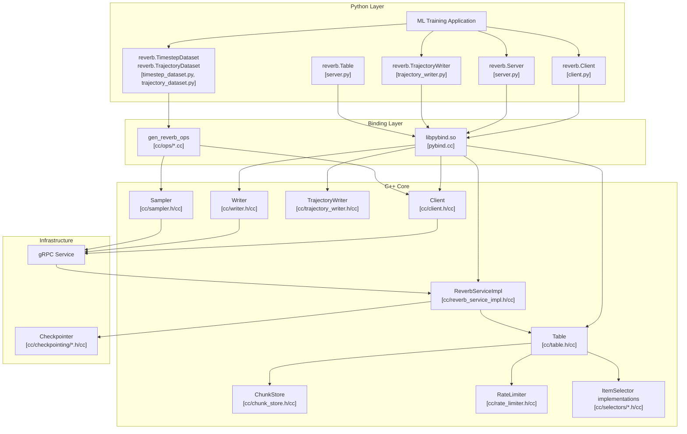
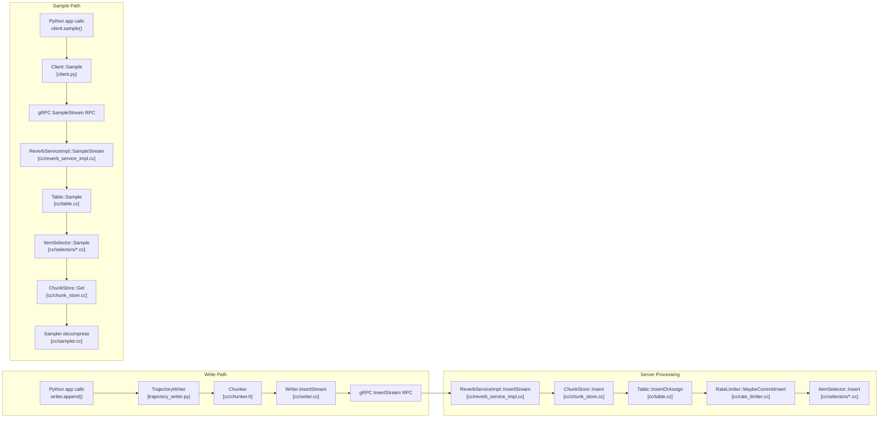

<!-- source: DeepWiki mcp.deepwiki.com · repo google-deepmind/reverb · page 1 Overview · fetched 2026-10-26 -->

# Overview

<details>
<summary>Relevant source files</summary>

The following files were used as context for generating this wiki page:

- [README.md](README.md)
- [docs/images/multiple_tables_example.png](docs/images/multiple_tables_example.png)
- [reverb/BUILD](reverb/BUILD)
- [reverb/__init__.py](reverb/__init__.py)
- [reverb/cc/ops/BUILD](reverb/cc/ops/BUILD)
- [reverb/pip_package/reverb_version.py](reverb/pip_package/reverb_version.py)
- [reverb/pip_package/setup.py](reverb/pip_package/setup.py)

</details>


## Purpose and Scope

This document provides a comprehensive overview of Reverb, an efficient and easy-to-use data storage and transport system designed for machine learning research. Reverb serves primarily as an experience replay system for distributed reinforcement learning algorithms, but its flexibility allows it to function as a general-purpose data structure system supporting FIFO, LIFO, priority queues, and custom sampling strategies.

This overview covers:
- The fundamental architecture and design philosophy
- Core components and their relationships
- Data flow from ingestion to sampling
- Technology stack and language bindings
- Basic usage patterns and installation

For detailed information about specific subsystems, see:
- System Architecture - [#2]()
- Core Components - [#3]()
- Python Client API - [#4]()
- TensorFlow Integration - [#5]()
- Build System - [#6]()
- Advanced Topics - [#7]()

**Sources:** [README.md:1-172](), [reverb/__init__.py:1-56]()

## What is Reverb?

Reverb is a C++-based, high-performance replay buffer system with Python bindings and native TensorFlow integration. It implements a client-server architecture where:

- **Servers** host one or more `Table` instances that store and manage data items
- **Clients** insert data and sample from tables via gRPC or in-process connections
- **Items** reference one or more data chunks, allowing efficient memory sharing
- **Selectors** control how items are sampled and removed (uniform, prioritized, FIFO, LIFO, etc.)
- **Rate Limiters** enforce flow control between data producers and consumers

The system is optimized for scenarios where data is produced by one set of processes (e.g., environment actors) and consumed by another (e.g., training loops), with support for distributed deployments across multiple machines.

**Key Features:**
- Efficient chunked storage with compression and delta encoding
- Multiple item selection strategies (uniform, prioritized, FIFO, LIFO, heap-based)
- Rate limiting for balanced producer-consumer dynamics
- Checkpointing for fault tolerance
- TensorFlow dataset integration for seamless training pipelines
- gRPC-based remote access with in-process optimization

**Sources:** [README.md:5-21](), [README.md:152-172]()

## Core Concepts

### Tables

A `Table` is the fundamental storage unit in Reverb. Each table maintains:
- A collection of items (each with a priority and metadata)
- A `sampler` selector that determines which items to return on sample requests
- A `remover` selector that determines which items to delete when capacity is reached
- A `RateLimiter` that controls insert and sample operations
- Optional `TableExtension` hooks for custom behavior

**Code Mapping:**
- Python: `reverb.Table` class in [reverb/server.py]()
- C++: `Table` class in [reverb/cc/table.h]() and [reverb/cc/table.cc]()
- pybind11 binding: [reverb/pybind.cc]()

### Items and Chunks

Items and chunks implement a separation of concerns:
- **Chunks**: Raw data elements (tensors) stored in a `ChunkStore`
- **Items**: References to one or more chunks, with priority and metadata

Multiple items can reference the same chunks, enabling memory-efficient storage of overlapping trajectories. Chunks are automatically garbage-collected when no items reference them.

**Code Mapping:**
- C++ ChunkStore: [reverb/cc/chunk_store.h]() and [reverb/cc/chunk_store.cc]()
- C++ Item representation: Internal to `Table` implementation

### Writers

Writers stream data to Reverb servers:
- `Writer`: Low-level interface for inserting pre-formed items
- `TrajectoryWriter`: High-level interface for building trajectories incrementally
- `StructuredWriter`: Pattern-based writer for complex data structures

**Code Mapping:**
- Python: `reverb.TrajectoryWriter` in [reverb/trajectory_writer.py]()
- Python: `reverb.Client.Writer` context manager in [reverb/client.py]()
- C++: `TrajectoryWriter` in [reverb/cc/trajectory_writer.h]()
- C++: `Writer` in [reverb/cc/writer.h]()

### Samplers

Samplers retrieve items from tables with multi-threaded workers for high throughput:
- Requests batches of items from one or more tables
- Decompresses and decodes chunks
- Returns structured `ReplaySample` objects with data and metadata

**Code Mapping:**
- Python: `reverb.Client.sample()` method in [reverb/client.py]()
- C++: `Sampler` class in [reverb/cc/sampler.h]()
- TensorFlow ops: Custom ops in [reverb/cc/ops/]()

**Sources:** [README.md:173-203](), [reverb/__init__.py:24-56]()

## System Architecture

The following diagram shows the layered architecture of Reverb, mapping high-level concepts to concrete code entities:

**Reverb Architecture: Natural Language to Code Mapping**



**Sources:** [reverb/BUILD:1-348](), [reverb/__init__.py:15-56](), [reverb/pybind.cc]()

### Architecture Characteristics

**Four-Tier Design:**

1. **Python Application Layer** - User-facing API with Pythonic interfaces
2. **Binding Layer** - pybind11 for imperative code, TensorFlow ops for graph execution
3. **C++ Core Layer** - Performance-critical implementations in C++
4. **Infrastructure Layer** - gRPC, checkpointing, and TensorFlow integration

**Client-Server Model:**

Reverb uses a client-server architecture with three connection modes:

| Mode | Description | Use Case |
|------|-------------|----------|
| **Remote** | Client connects to server via gRPC over network | Distributed training across machines |
| **Local** | Client and server in same process via gRPC loopback | Single-machine training with isolation |
| **In-Process** | Direct C++ function calls, bypassing gRPC | Single-machine training with zero-copy optimization |

**Sources:** [README.md:86-172](), Diagram 1 from provided context

## Data Flow Architecture

The following diagram maps the complete data lifecycle to specific code entities:

**Data Flow: Write → Store → Sample (Code-Level View)**



**Write Path Details:**
1. Application calls `TrajectoryWriter.append(data)` with step data
2. `Chunker` groups tensors into chunks, optionally applying delta encoding
3. `Writer` streams chunks to server via bidirectional gRPC `InsertStream`
4. Server's `ReverbServiceImpl` stores chunks in `ChunkStore`
5. `Table.InsertOrAssign` creates item referencing chunks
6. `RateLimiter` validates insert (may block if rate exceeded)
7. `ItemSelector` adds item to sampling data structure

**Sample Path Details:**
1. Application calls `Client.sample(table_name, num_samples)`
2. Python `Client` initiates gRPC `SampleStream` request
3. Server's `ReverbServiceImpl` forwards to `Table.Sample`
4. `Table` checks `RateLimiter` and calls `ItemSelector.Sample`
5. Selected items' chunks retrieved from `ChunkStore`
6. `Sampler` decompresses chunks and constructs `ReplaySample` objects
7. Samples returned to client

**Sources:** [reverb/client.py](), [reverb/trajectory_writer.py](), [reverb/cc/writer.cc](), [reverb/cc/sampler.cc](), [reverb/cc/table.cc](), Diagram 2 from provided context

## Key Components and Code Structure

### Component Table

| Component | Python Module | C++ Implementation | Primary Role |
|-----------|--------------|-------------------|--------------|
| **Server** | `reverb.Server` | `ReverbServiceImpl` | Hosts tables, handles gRPC requests |
| **Client** | `reverb.Client` | `Client` | Connects to server, inserts/samples data |
| **Table** | `reverb.Table` | `Table` | Stores items, manages sampling/removal |
| **TrajectoryWriter** | `reverb.TrajectoryWriter` | `TrajectoryWriter` | Builds trajectories incrementally |
| **Sampler** | (internal to Client) | `Sampler` | Multi-threaded sampling with decompression |
| **ItemSelector** | `reverb.selectors.*` | `ItemSelector` subclasses | Sampling/removal strategies |
| **RateLimiter** | `reverb.rate_limiters.*` | `RateLimiter` subclasses | Flow control |
| **ChunkStore** | (internal) | `ChunkStore` | Stores compressed data chunks |
| **TFClient** | `reverb.TFClient` | TensorFlow custom ops | TensorFlow-native operations |

### Python Package Structure

The `dm-reverb` package exports the following from `reverb/__init__.py`:

```python
# Main classes
reverb.Server          # Server hosting tables
reverb.Client          # Client for remote/local access
reverb.Table           # Table configuration

# Writers
reverb.TrajectoryWriter  # Incremental trajectory building
reverb.Writer            # Low-level writer (via Client context)

# Datasets (TensorFlow integration)
reverb.TimestepDataset     # tf.data.Dataset for timesteps
reverb.TrajectoryDataset   # tf.data.Dataset for trajectories
reverb.PatternDataset      # Pattern-based dataset

# TensorFlow client
reverb.TFClient           # TensorFlow-native operations

# Item selectors (in reverb.selectors)
reverb.selectors.Uniform()
reverb.selectors.Prioritized(priority_exponent)
reverb.selectors.Fifo()
reverb.selectors.Lifo()
reverb.selectors.MinHeap()
reverb.selectors.MaxHeap()

# Rate limiters (in reverb.rate_limiters)
reverb.rate_limiters.MinSize(min_size)
reverb.rate_limiters.SampleToInsertRatio(...)
reverb.rate_limiters.Queue(size)
reverb.rate_limiters.Stack(size)

# Data structures
reverb.ReplaySample      # Sample with data and metadata
reverb.SampleInfo        # Sample metadata

# Checkpointing
reverb.checkpointers.*   # Checkpointer implementations

# Errors
reverb.ReverbError
reverb.DeadlineExceededError
```

**Sources:** [reverb/__init__.py:27-56](), [reverb/BUILD:22-41]()

### C++ Core Structure

The C++ implementation is organized under `reverb/cc/`:

```
reverb/cc/
├── table.h/cc              # Core Table implementation
├── client.h/cc             # Client implementation
├── writer.h/cc             # Low-level writer
├── trajectory_writer.h/cc  # Trajectory building
├── sampler.h/cc            # Multi-threaded sampler
├── chunk_store.h/cc        # Chunk storage
├── reverb_service_impl.h/cc # gRPC service
├── rate_limiter.h/cc       # Rate limiting base
├── chunker.h/cc            # Data chunking
├── selectors/              # Item selection strategies
│   ├── fifo.h/cc
│   ├── lifo.h/cc
│   ├── uniform.h/cc
│   ├── prioritized.h/cc
│   └── heap.h/cc
├── ops/                    # TensorFlow custom ops
│   ├── client.cc
│   ├── timestep_dataset.cc
│   └── trajectory_dataset.cc
└── checkpointing/          # Persistence
    └── interface.h
```

**Sources:** [reverb/BUILD:92-121](), [reverb/cc/ops/BUILD:1-88]()

## Technology Stack

### Core Dependencies

| Technology | Version | Purpose |
|-----------|---------|---------|
| **TensorFlow** | ~2.14.0 | Tensor operations, custom ops, dataset integration |
| **gRPC** | Latest | Remote procedure calls for client-server communication |
| **Protocol Buffers** | Latest | Serialization format for RPC messages |
| **pybind11** | Latest | C++ to Python bindings |
| **Abseil** | Latest | C++ utilities and data structures |
| **Snappy** | Latest | Fast compression for chunks |

### Python Support

- Python 3.9, 3.10, 3.11
- No Python 3.8 support from version 0.13.0+
- No Python 3.7 support from version 0.10.0+

### Build System

- **Bazel**: Primary build system for C++ and Python
- **Docker**: Hermetic build environments
- **setup.py**: Python package distribution

**Sources:** [reverb/pip_package/setup.py:30-105](), [README.md:62-85]()

## Installation

### Via pip (Recommended)

```bash
# Install with TensorFlow dependency
pip install dm-reverb[tensorflow]

# Install without TensorFlow (must install compatible version separately)
pip install dm-reverb

# Nightly builds
pip install dm-reverb-nightly[tensorflow]
```

### Version Compatibility

Reverb releases are paired with specific TensorFlow versions:

| Reverb Version | TensorFlow Version | Python Support |
|----------------|-------------------|----------------|
| 0.14.0 | 2.14.0 | 3.9, 3.10, 3.11 |
| 0.13.0 | 2.14.0 | 3.9, 3.10, 3.11 |
| 0.12.0 | 2.13.0 | 3.8, 3.9, 3.10, 3.11 |
| 0.11.0 | 2.12.0 | 3.8, 3.9, 3.10, 3.11 |
| 0.10.0 | 2.11.0 | 3.7, 3.8, 3.9, 3.10 |

**Operating System Support:**
- ⚠️ Linux only (Ubuntu, Debian, etc.)
- No Windows or macOS support

**Sources:** [README.md:23-85](), [reverb/pip_package/reverb_version.py:18-38]()

## Basic Usage

### Starting a Server

```python
import reverb

# Create server with a table
server = reverb.Server(
    tables=[
        reverb.Table(
            name='my_table',
            sampler=reverb.selectors.Uniform(),  # Sample uniformly
            remover=reverb.selectors.Fifo(),     # Remove oldest first
            max_size=1000,                       # Max 1000 items
            rate_limiter=reverb.rate_limiters.MinSize(100)  # Block until 100 items
        )
    ],
    port=8000  # Optional, defaults to random port
)

print(f"Server running on port {server.port}")
```

### Creating a Client

```python
# Connect to server
client = reverb.Client(f'localhost:{server.port}')

# View server info
print(client.server_info())
```

### Inserting Simple Data

```python
# Insert single item
client.insert([1, 2, 3], priorities={'my_table': 1.0})
```

### Inserting Trajectories

```python
# Build trajectory incrementally
with client.trajectory_writer(num_keep_alive_refs=5) as writer:
    for i in range(10):
        writer.append({'obs': i, 'action': i * 2})
    
    # Create item referencing last 5 steps
    writer.create_item(
        table='my_table',
        priority=1.0,
        trajectory={
            'obs': writer.history['obs'][-5:],
            'action': writer.history['action'][-5:],
        }
    )
    
    writer.flush()  # Wait for confirmation
```

### Sampling Data

```python
# Sample items
for sample in client.sample('my_table', num_samples=10):
    print(sample.data)      # The trajectory data
    print(sample.info.key)  # Unique item key
    print(sample.info.probability)  # Sample probability
```

### Using with TensorFlow

```python
import tensorflow as tf

# Create dataset
dataset = reverb.TrajectoryDataset(
    server_address=f'localhost:{server.port}',
    table='my_table',
    dtypes={'obs': tf.int32, 'action': tf.int32},
    shapes={'obs': tf.TensorShape([None]), 'action': tf.TensorShape([None])}
)

# Use in training loop
for sample in dataset:
    # sample is a reverb.ReplaySample with .data and .info
    obs = sample.data['obs']
    action = sample.data['action']
    # Train model...
```

**Sources:** [README.md:86-150](), [reverb/client.py](), [reverb/trajectory_writer.py](), [reverb/trajectory_dataset.py]()

## Common Use Cases

### Uniform Experience Replay (e.g., SAC, DDPG)

Maintains N most recent items with uniform sampling:

```python
reverb.Table(
    name='uniform_replay',
    sampler=reverb.selectors.Uniform(),    # Equal probability for all items
    remover=reverb.selectors.Fifo(),       # Remove oldest when full
    max_size=1000000,
    rate_limiter=reverb.rate_limiters.MinSize(10000)  # Require 10k items before sampling
)
```

### Prioritized Experience Replay (e.g., DQN, D4PG)

Samples items proportionally to priority:

```python
reverb.Table(
    name='prioritized_replay',
    sampler=reverb.selectors.Prioritized(priority_exponent=0.8),  # Priority-based sampling
    remover=reverb.selectors.Fifo(),
    max_size=1000000,
    rate_limiter=reverb.rate_limiters.MinSize(10000)
)

# Update priorities based on TD-error
client.mutate_priorities(
    table='prioritized_replay',
    updates={item_key: new_priority}
)
```

### FIFO Queue (e.g., IMPALA, PPO)

Items sampled exactly once in order:

```python
reverb.Table(
    name='fifo_queue',
    sampler=reverb.selectors.Fifo(),       # Sample oldest first
    remover=reverb.selectors.Fifo(),       # Remove oldest first
    max_size=1000,
    max_times_sampled=1,                   # Remove after one sample
    rate_limiter=reverb.rate_limiters.Queue(size=1000)  # Block on full/empty
)

# Or use helper method
reverb.Table.queue(name='fifo_queue', max_size=1000)
```

### Multiple Tables for Different Data Types

```python
server = reverb.Server(tables=[
    # Transitions for DQN
    reverb.Table(
        name='transitions',
        sampler=reverb.selectors.Prioritized(0.8),
        remover=reverb.selectors.Fifo(),
        max_size=100000
    ),
    # Trajectories for model training
    reverb.Table(
        name='trajectories',
        sampler=reverb.selectors.Uniform(),
        remover=reverb.selectors.Fifo(),
        max_size=10000
    )
])
```

**Sources:** [README.md:204-280](), [README.md:281-309]()

## Distributed Deployment

Reverb supports horizontal scaling through multiple deployment patterns:

### With Load Balancer

```python
# Start multiple servers on different machines
# Server 1: machine1:8000
# Server 2: machine2:8000
# Server 3: machine3:8000

# Configure gRPC load balancer pointing to: load_balancer:8000

# Clients automatically distribute across servers
client = reverb.Client('load_balancer:8000')
```

### Manual Sharding

```python
# Create separate clients for each server
clients = [
    reverb.Client('machine1:8000'),
    reverb.Client('machine2:8000'),
    reverb.Client('machine3:8000')
]

# Manually distribute operations
import random
client = random.choice(clients)
client.insert(data, priorities={'table': 1.0})
```

**Note:** Reverb servers are independent—data is NOT replicated. This makes the system tolerant to some data loss but unsuitable as a traditional database.

**Sources:** [README.md:310-327]()

## Checkpointing

Save and restore server state:

```python
# Save checkpoint
checkpoint_path = client.checkpoint()
print(f"Checkpoint saved to: {checkpoint_path}")

# Restore from checkpoint
from reverb.platform.default import checkpointers

checkpointer = checkpointers.DefaultCheckpointer(
    path=checkpoint_path.rsplit('/', 1)[0]  # Root directory
)

# Create new server with same table configuration
server = reverb.Server(
    tables=[...],  # Must match original configuration
    checkpointer=checkpointer
)
```

**Checkpoint Behavior:**
- Blocks all insert, sample, update, delete requests during save
- Serializes all data and metadata
- Can be restored to a new server instance
- Useful for warm-starting training or fault recovery

**Sources:** [README.md:328-360]()

## Project Status and Caveats

**Production Readiness:**
- ⚠️ Not hardened for production use
- Potential for crashes or segfaults
- Best suited for research and experimentation

**Platform Support:**
- ✅ Linux (Ubuntu, Debian, etc.)
- ❌ Windows
- ❌ macOS

**Open Source:**
- GitHub: https://github.com/google-deepmind/reverb
- Apache 2.0 License
- Active development and community support

**Citation:**
```bibtex
@misc{cassirer2021reverb,
    title={Reverb: A Framework For Experience Replay},
    author={Albin Cassirer and Gabriel Barth-Maron and Eugene Brevdo and 
            Sabela Ramos and Toby Boyd and Thibault Sottiaux and Manuel Kroiss},
    year={2021},
    eprint={2102.04736},
    archivePrefix={arXiv},
    primaryClass={cs.LG}
}
```

**Sources:** [README.md:25-28](), [README.md:391-405]()

## Next Steps

To dive deeper into Reverb:

- **System Architecture** [#2]() - Detailed architecture including client-server communication and data flow
- **Core Components** [#3]() - In-depth coverage of Table, selectors, rate limiters, writers, samplers
- **Python Client API** [#4]() - Complete Python API reference with examples
- **TensorFlow Integration** [#5]() - Custom ops and dataset integration
- **Build System** [#6]() - Building from source and development workflows
- **Advanced Topics** [#7]() - Concurrency, memory management, performance optimization

**Sources:** [README.md:1-415](), [reverb/__init__.py:1-56]()

---

