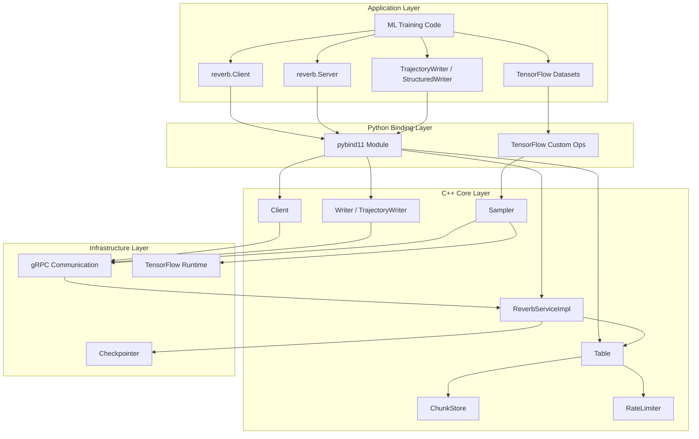
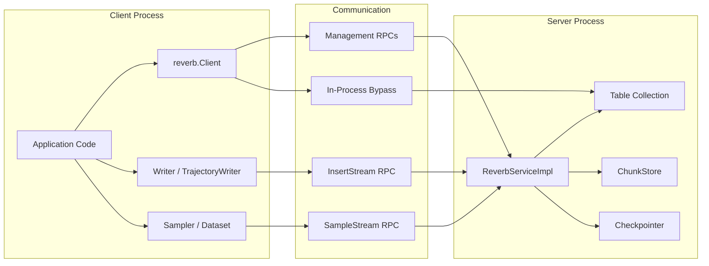
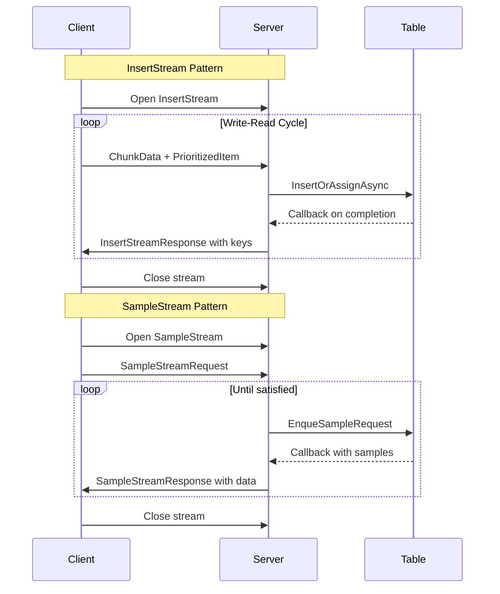
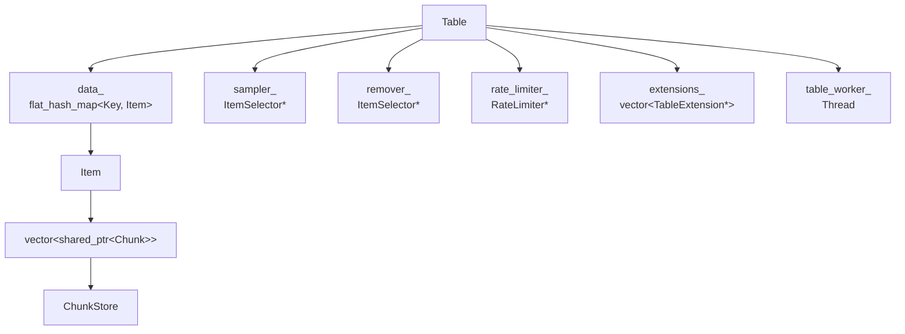
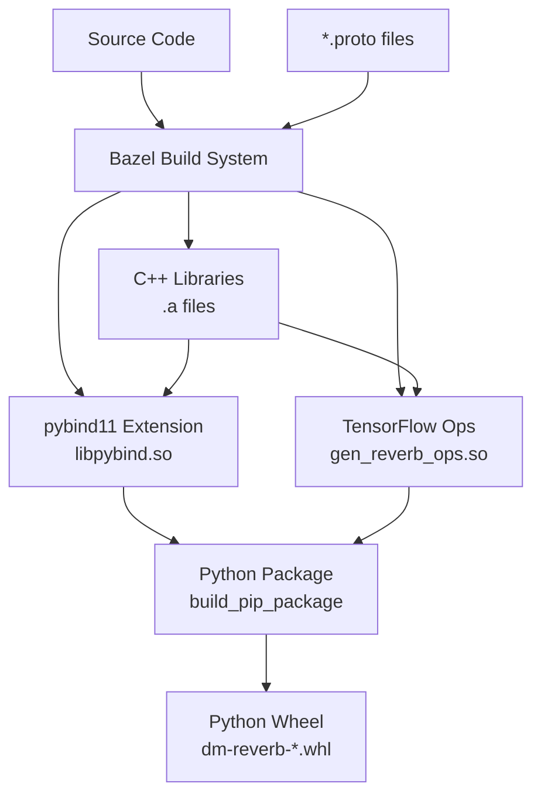

<!-- source: DeepWiki mcp.deepwiki.com · repo google-deepmind/reverb · page 2 System Architecture · fetched 2026-10-26 -->

# System Architecture

Relevant source files

The following files were used as context for generating this wiki page:

- [README.md](README.md)
- [docs/images/multiple_tables_example.png](docs/images/multiple_tables_example.png)
- [reverb/cc/BUILD](reverb/cc/BUILD)
- [reverb/cc/reverb_service.proto](reverb/cc/reverb_service.proto)
- [reverb/cc/reverb_service_impl.cc](reverb/cc/reverb_service_impl.cc)
- [reverb/cc/reverb_service_impl.h](reverb/cc/reverb_service_impl.h)
- [reverb/cc/reverb_service_impl_test.cc](reverb/cc/reverb_service_impl_test.cc)
- [reverb/pip_package/reverb_version.py](reverb/pip_package/reverb_version.py)
- [reverb/pip_package/setup.py](reverb/pip_package/setup.py)

## Purpose and Scope

This page describes the overall architecture of Reverb, including its layered design, client-server model, and how major components interact. For details on specific aspects:
- For gRPC communication protocols and streaming patterns, see [Client-Server Communication](#2.1)
- For the complete data lifecycle from ingestion to sampling, see [Data Flow Pipeline](#2.2)
- For deep dives into individual components like Table, Writers, and Samplers, see [Core Components](#3)

## Architectural Overview

Reverb implements a **client-server architecture** with four distinct layers: a Python application layer for user interaction, a Python binding layer for language interoperability, a C++ core layer for performance-critical operations, and an infrastructure layer for communication and persistence. The system is designed for high-performance distributed machine learning, with all data management operations implemented in C++ while maintaining ease of use through comprehensive Python APIs.

Sources: [README.md:1-174](), [reverb/cc/BUILD:1-546]()

## Layered Architecture

### Application Layer
The top layer provides the user-facing Python API. Users interact with `reverb.Client` to connect to servers, `reverb.Server` to start server instances, and `TrajectoryWriter` or `StructuredWriter` to insert data. TensorFlow users can leverage specialized datasets like `TimestepDataset` and `TrajectoryDataset` for efficient integration with `tf.data` pipelines.

### Python Binding Layer
This layer bridges Python and C++ through two mechanisms:
- **pybind11**: Provides general-purpose Python bindings for all C++ classes and functions
- **TensorFlow Custom Ops**: Implements TensorFlow-native operations (`ReverbClientInsert`, `ReverbClientSample`) that enable zero-copy integration with TensorFlow graphs

### C++ Core Layer
The performance-critical implementation layer written in C++:
- **ReverbServiceImpl**: gRPC service implementation handling all RPC endpoints [reverb/cc/reverb_service_impl.h:37]()
- **Table**: Central data structure managing items, sampling/removal strategies, and rate limiting [reverb/cc/table.h]()
- **ChunkStore**: Reference-counted storage for data chunks [reverb/cc/chunk_store.h]()
- **Writer/TrajectoryWriter**: Client-side components for data ingestion with chunking and compression [reverb/cc/writer.h](), [reverb/cc/trajectory_writer.h]()
- **Sampler**: Multi-threaded sampling component [reverb/cc/sampler.h]()
- **RateLimiter**: Flow control between inserts and samples [reverb/cc/rate_limiter.h]()

### Infrastructure Layer
Foundational technologies:
- **gRPC**: Provides efficient bidirectional streaming communication between clients and servers
- **Checkpointer**: Handles persistence of server state to disk
- **TensorFlow Runtime**: Required for tensor operations and compression

Sources: [reverb/cc/BUILD:133-546](), [reverb/cc/reverb_service_impl.h:15-149](), [README.md:152-172]()

## Client-Server Model

Reverb operates as a **client-server system** where multiple clients can connect to one or more servers. The server hosts one or more `Table` instances, each with its own sampling and removal strategies. Clients communicate with servers through gRPC, using bidirectional streaming for high-throughput insert and sample operations.

### Server Components

| Component | File | Purpose |
|-----------|------|---------|
| `ReverbServiceImpl` | [reverb/cc/reverb_service_impl.cc]() | Implements all gRPC endpoints defined in the service proto |
| `Table` | [reverb/cc/table.cc]() | Core data structure storing items and managing their lifecycle |
| `ChunkStore` | [reverb/cc/chunk_store.cc]() | Shared storage for data chunks with reference counting |
| `Checkpointer` | [reverb/cc/checkpointing/interface.h]() | Interface for persistence and recovery |

### Client Components

| Component | File | Purpose |
|-----------|------|---------|
| `Client` | [reverb/cc/client.cc]() | Main client interface for all operations |
| `Writer` | [reverb/cc/writer.cc]() | Low-level writer with chunking and compression |
| `TrajectoryWriter` | [reverb/cc/trajectory_writer.cc]() | High-level trajectory-oriented writer |
| `Sampler` | [reverb/cc/sampler.cc]() | Multi-threaded sampling component |

Sources: [reverb/cc/reverb_service_impl.h:35-149](), [reverb/cc/BUILD:133-273](), [reverb/cc/reverb_service.proto:1-178]()

## Communication Patterns

Reverb uses **gRPC** for client-server communication with three primary patterns:

### Bidirectional Streaming RPCs

- **InsertStream** [reverb/cc/reverb_service.proto:29-30](): Bidirectional streaming for efficient data ingestion with asynchronous confirmations
- **SampleStream** [reverb/cc/reverb_service.proto:48-49](): Bidirectional streaming for batch sampling with adaptive batching

### Unary RPCs

Used for management operations:
- **Checkpoint** [reverb/cc/reverb_service.proto:14](): Trigger server state persistence
- **MutatePriorities** [reverb/cc/reverb_service.proto:34-35](): Update or delete items
- **Reset** [reverb/cc/reverb_service.proto:38](): Clear table contents
- **ServerInfo** [reverb/cc/reverb_service.proto:52](): Query table statistics

### In-Process Optimization

When client and server run in the same process, `InitializeConnection` [reverb/cc/reverb_service.proto:56-57]() enables direct memory access to `Table` objects, bypassing gRPC serialization for zero-copy operations. The process ID is verified to ensure safety [reverb/cc/reverb_service_impl.cc:354-360]().

Sources: [reverb/cc/reverb_service.proto:1-178](), [reverb/cc/reverb_service_impl.cc:167-676]()

## Major Components

### Table: The Central Data Store

The `Table` class [reverb/cc/table.h]() is the most critical component in Reverb (importance score 141.63 from cluster analysis). It manages:

- **Item Storage**: Hash map of keys to items, where each item references chunks in the `ChunkStore`
- **Sampling Strategy**: Pluggable `ItemSelector` determining which items to sample (FIFO, LIFO, Uniform, Prioritized, Heap)
- **Removal Strategy**: Separate `ItemSelector` for removal decisions
- **Rate Limiting**: `RateLimiter` enforcing insert/sample ratios
- **Extensions**: Hooks for custom behavior via `TableExtension` interface
- **Concurrency**: Worker threads for asynchronous operations

Sources: [reverb/cc/table.h](), [reverb/cc/BUILD:160-187]()

### ChunkStore: Shared Data Repository

The `ChunkStore` [reverb/cc/chunk_store.h]() maintains weak pointers to all data chunks. Chunks are kept alive by items that reference them. When the last reference is removed, the chunk is automatically deallocated. This design allows multiple items (even across different tables) to reference the same underlying data without duplication.

Sources: [reverb/cc/chunk_store.cc](), [reverb/cc/BUILD:150-158]()

### Writers: Data Ingestion

**Writer** [reverb/cc/writer.h]() provides low-level data insertion with:
- Automatic chunking based on size thresholds
- Optional delta encoding for temporal sequences
- Snappy compression
- Streaming over gRPC

**TrajectoryWriter** [reverb/cc/trajectory_writer.h]() builds on Writer for trajectory data:
- Column-based organization
- Configurable chunking strategies per column
- Automatic batch creation from sequential data

Sources: [reverb/cc/writer.cc](), [reverb/cc/trajectory_writer.cc](), [reverb/cc/BUILD:229-273]()

### Sampler: Multi-threaded Sampling

The `Sampler` [reverb/cc/sampler.h]() implements efficient batch sampling:
- Thread pool for parallel chunk decompression
- Adaptive batch sizing based on table response time
- Rate limiter timeout support
- Both remote (gRPC) and local (direct Table access) modes

Sources: [reverb/cc/sampler.cc](), [reverb/cc/BUILD:204-227]()

### ReverbServiceImpl: gRPC Service

`ReverbServiceImpl` [reverb/cc/reverb_service_impl.h:37]() implements the gRPC service interface:
- **InsertStream**: Handles bidirectional insert streams with chunk caching and async callbacks [reverb/cc/reverb_service_impl.cc:167-330]()
- **SampleStream**: Manages bidirectional sample streams with adaptive batching [reverb/cc/reverb_service_impl.cc:458-676]()
- **Table Lookup**: Maintains hash map of table names to Table instances [reverb/cc/reverb_service_impl.cc:678-683]()
- **Initialization**: Supports checkpoint restoration on startup [reverb/cc/reverb_service_impl.cc:98-141]()

Sources: [reverb/cc/reverb_service_impl.h:15-149](), [reverb/cc/reverb_service_impl.cc:1-724](), [reverb/cc/BUILD:430-452]()

## Technology Stack

### Core Technologies

| Technology | Purpose | Key Files |
|------------|---------|-----------|
| **C++17** | Performance-critical implementation | All files in `reverb/cc/` |
| **Python 3.9-3.11** | User-facing API | All files in `reverb/` Python modules |
| **TensorFlow 2.14.0** | Tensor operations, compression, custom ops | [reverb/pip_package/setup.py:31]() |
| **gRPC** | Client-server communication | [reverb/cc/reverb_service.proto]() |
| **Protocol Buffers** | Data serialization | `*.proto` files |
| **pybind11** | Python-C++ bindings | Binding code in `reverb/pybind/` |
| **Bazel** | Build system | [reverb/cc/BUILD](), `WORKSPACE` |
| **Abseil** | C++ utility libraries | Used throughout C++ code |
| **Snappy** | Fast compression | Used in tensor compression |

### Build System Architecture

The build system uses **Bazel** to manage complex dependencies and build both C++ libraries and Python extensions. Custom Bazel rules [reverb/cc/BUILD:3-14]() handle compilation of protocol buffers, gRPC services, and pybind11 modules. The final output is a platform-specific Python wheel that includes all compiled extensions.

Sources: [reverb/cc/BUILD:1-546](), [reverb/pip_package/setup.py:1-186]()

## Design Principles

### Performance Through C++
All performance-critical operations (sampling, insertion, rate limiting, data compression) are implemented in C++ for maximum efficiency. The Python layer provides convenience and flexibility without sacrificing speed.

### Zero-Copy Where Possible
When clients and servers share a process, the `InitializeConnection` RPC enables direct memory access to Table objects, eliminating serialization overhead [reverb/cc/reverb_service_impl.cc:334-423]().

### Asynchronous by Default
Most operations use asynchronous patterns:
- `Table::InsertOrAssignAsync` with callbacks [reverb/cc/reverb_service_impl.cc:241-245]()
- `Table::EnqueSampleRequest` with callbacks [reverb/cc/reverb_service_impl.cc:604-605]()
- Bidirectional streaming for insert and sample operations

### Reference Counting for Memory Management
Data chunks use reference counting (via `shared_ptr`) so that multiple items can reference the same data. The `ChunkStore` maintains only weak references, allowing automatic cleanup when no items reference a chunk.

### Pluggable Strategies
Key behaviors are implemented through interfaces:
- `ItemSelector` for sampling and removal strategies [reverb/cc/selectors/interface.h]()
- `RateLimiter` for flow control policies [reverb/cc/rate_limiter.h]()
- `TableExtension` for custom hooks [reverb/cc/table_extensions/interface.h]()

Sources: [reverb/cc/reverb_service_impl.cc:1-724](), [README.md:152-203]()

---

